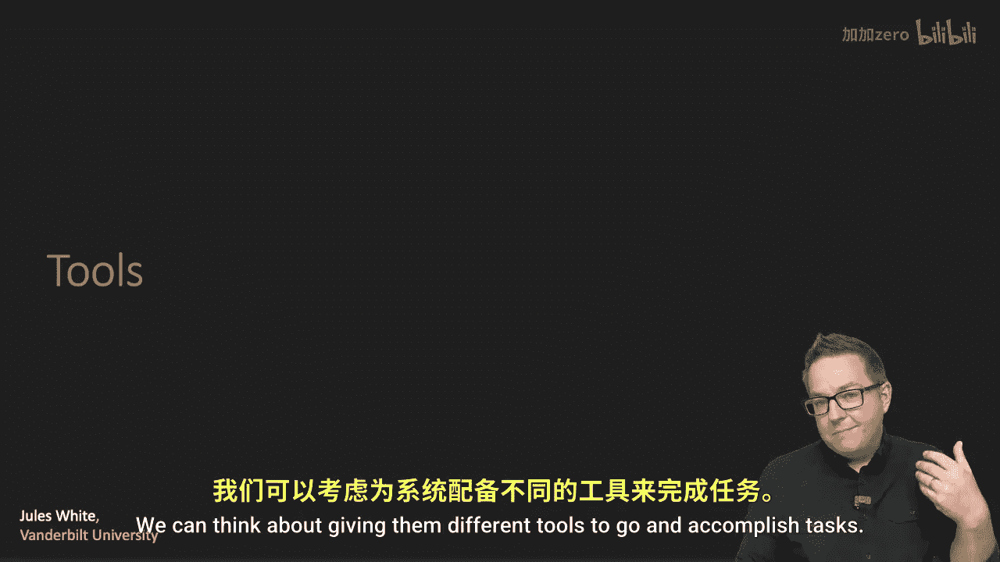
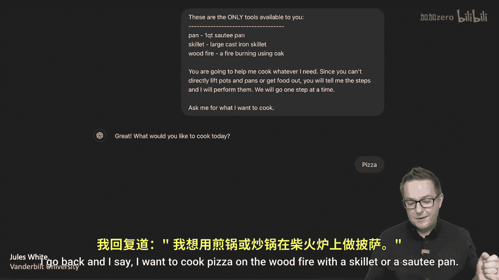
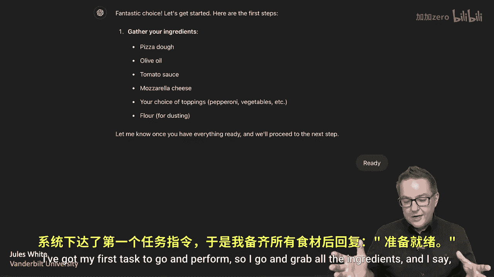
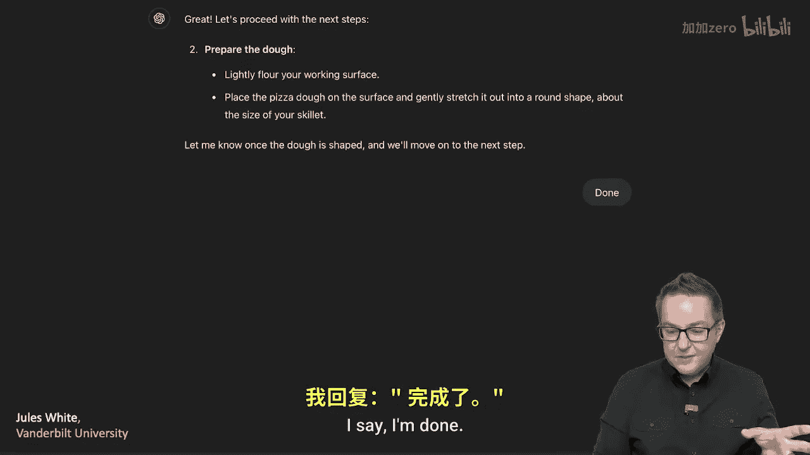
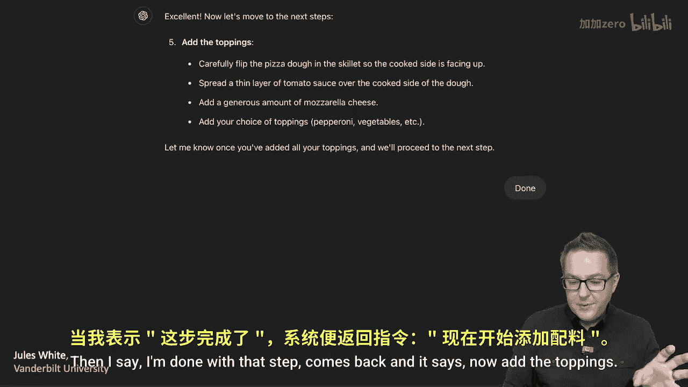
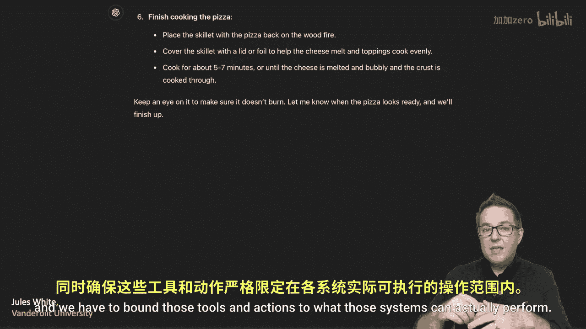
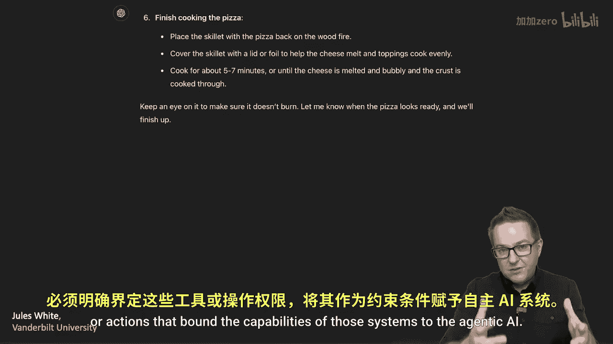
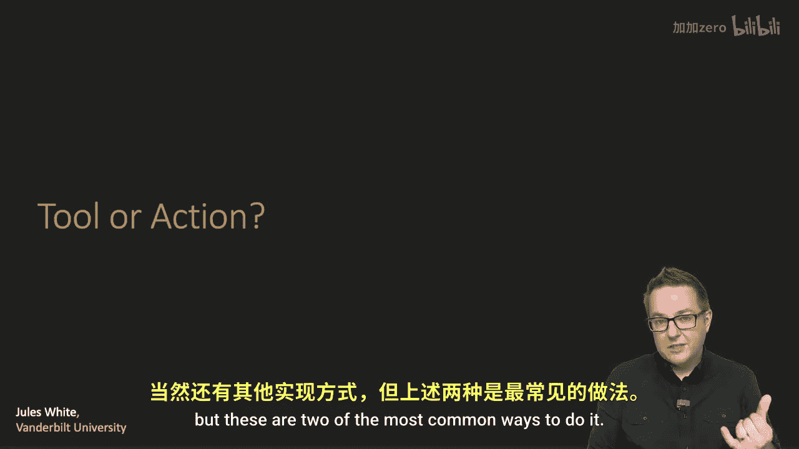

# 生成式AI战略领导者：07：为智能体配备工具 🛠️

在本节课中，我们将学习如何让智能体系统与现实世界进行交互。核心在于为智能体配备“工具”或“动作”，以约束其行为，使其在有限的资源和能力范围内完成任务。

## 智能体如何与世界交互？🤔

上一节我们探讨了智能体的基本概念，本节中我们来看看它们如何与外界互动。智能体通常通过“工具”或“动作”与世界交互。我们需要为智能体定义它可以使用的工具，以完成特定任务。这是因为我们通常不希望智能体天马行空地想象完成任务的方式。

例如，如果智能体建议通过飞行来规划一次旅行，而我们并不想乘坐飞机，这个建议就毫无意义。因此，我们需要告诉智能体允许使用的交通方式。又或者，当我们在排查电脑的网络连接问题时，如果我们允许智能体使用截图作为收集信息的方法，它就可以这样做。如果我们不希望截图，我们可能会说它唯一的工具就是“询问我”，唯一的动作就是“让我报告情况”。

我们可以通过赋予智能体不同的工具来帮助它完成任务。

## 烹饪示例：定义可用工具 👨‍🍳

现在，让我们回到烹饪的例子，并为我们的智能体配备一些工具。

以下是我们可以给出的提示内容：
> 以下是您唯一可用的工具：一个一夸脱的平底煎锅、一个长柄煎锅、一个大的铸铁煎锅、一个使用橡木燃烧的柴火。您将帮助我烹饪任何我需要的东西。由于您不能直接拿起锅具或取出食物，您将告诉我步骤，由我来执行。我们将一次进行一个步骤。请先询问我想烹饪什么。

在这里，我明确给出了智能体可以支配的烹饪工具。它的选择范围并非无限的厨具和设备。它不能要求使用**Insta Pot**或微波炉。它只有柴火、煎锅和平底锅。因此，它必须思考如何利用现有的工具来解决问题。

在提示中定义工具是一种常见做法。虽然存在更复杂、更程序化的方式（例如使用计算机更易理解的语言来描述工具），但上述方式是一个基本的近似。我们将看到，智能体能够理解这些提示并据此行动。

我们告诉智能体“这些是您可以使用的工具”。我们也可以说“这些是您可以执行的动作”，例如“把锅放在火上”。这是两种不同的思路，但本节我们将重点探讨“工具”这一思路。

## 交互过程演示 🔄

智能体询问：“您今天想烹饪什么？”
我回答：“我想用柴火和煎锅或平底锅做披萨。”

智能体回应：“很棒的选择。请准备您的食材。” 这是我需要执行的第一个任务。
我准备好食材后回复：“我准备好了。”
智能体说：“好的，准备面团。” 它告诉我如何准备面团，并再次询问我何时完成。
我完成后回复：“我完成了。”

智能体接着指示：“好的，准备柴火。” 它告诉我如何生火。请注意，它正在使用我告知它可以使用的工具。
然后它告诉我如何将铸铁煎锅放在火上，并让我在煎锅预热后告知它。
我回复：“预热好了。”
智能体说：“好的，现在开始烹饪面团。请小心地在预热的煎锅上刷一层薄薄的橄榄油。”

同样，它正在利用我提供的工具来解决问题。我将它的选择范围、动作和可执行事项限制在了完成此任务所需的这套工具内。现实世界中常见的情况是，我们无法随心所欲，我们拥有有限的资源和工具来解决问题。AI也必须能够做到同样的事情。它不能说：“您想用电脑做X，因此我将动用世界上最快的超级计算机。” 不，您没有访问权限，不能这样做。

因此，我们必须能够对其解决问题的工具施加约束。我们正是在提示中通过这种方式来实现的。

我回复：“这个步骤完成了。”
智能体说：“好的，现在添加配料。” 我们仍然大致使用已有的工具。
它继续指示：“将煎锅放在柴火上。” 并给出一些不同的信息。
整个过程大致被约束在我告知它使用的工具范围内，并且它正在解决问题。

## 工具与动作：概念辨析 ⚙️

这就是我们如何开始思考让智能体解决问题，但不是任意地解决，而是以受约束的方式解决。当我们考虑计算机系统时，它们能执行的动作是有限的、受约束的、僵化的。我们必须开始为智能体AI设定界限，限制它如何与这些系统交互。

通过赋予它“工具”或“可与这些系统执行的动作”这一概念，并且我们必须将这些工具和动作限制在这些系统实际能够执行的范围内。智能体可以设想出各种解决问题的方法，它可以告诉人类各种疯狂的解决方案，而人类即使没有被明确告知要受某种限制，也可能执行其中许多方法。

但是，一旦我们开始让这些智能体AI系统与诸如我们的客户关系管理系统、电子邮件系统或其他任何系统接触，这些系统能做的事情、能采取的行动将非常有限。因此，我们必须向智能体AI表达这些工具或动作，从而将这些系统的能力边界告知智能体。

那么，我们称之为“工具”还是“动作”呢？对此没有硬性规定。我认为很多时候，“动作”是更好的思考方式，即“我将明确列出您可以执行的动作”。特别是当我们开始讨论与计算机系统接口时，以“动作”来思考通常更有意义，因为您可以要求系统做的事情数量是有限的，因此将其列为一连串动作更容易说明。

如果您讨论的是与像人类这样开放的系统接口，以“工具”来表达通常更有意义，因为人类可以用一个工具执行许多不同的动作，并且能够灵活适应。如果智能体AI说“用这个工具执行这个动作”，人类会知道如何做；或者说“用这个工具做这个”，人类可以去填补空白。

但是，当我们与僵化的计算机系统接口时，它们做不到这一点。因此，我们通常必须描述每一个单独的动作、操作或指令。可以类比CPU，它们能执行的指令数量有限。我们必须开始思考以更明确的“动作”来定义。

您使用哪种方式取决于上下文和您试图实现的目标。您可以考虑以两种方式来表达，当然也存在其他方式，但“工具”和“动作”是最常见的两种。

## 总结 📝

本节课中，我们一起学习了如何通过为智能体配备“工具”或定义其可执行的“动作”来使其与现实世界交互。关键在于约束智能体的行为边界，使其在有限的资源和系统能力范围内解决问题。我们通过烹饪示例演示了如何定义工具并引导智能体逐步完成任务，并探讨了“工具”与“动作”这两个核心概念在不同交互场景下的适用性。理解如何有效地为智能体设定边界，是将其成功集成到各类实际系统中的基础。