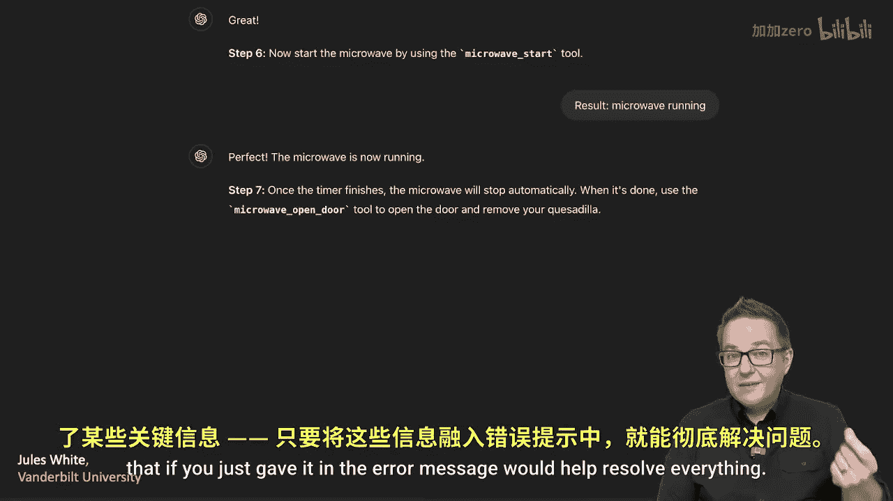

# 058：工具结果与智能体反馈 🧠

在本节课中，我们将学习如何为AI智能体提供工具执行后的反馈。这是构建能够自主执行多步骤任务的智能系统的关键环节。我们将探讨如何通过反馈信息来告知AI其行动的结果，使其能够理解环境状态并做出后续决策。

上一节我们介绍了如何让AI理解并使用工具来解决问题。本节中我们来看看，当AI执行一个工具后，我们如何有效地告知它执行结果。

## 核心概念：反馈循环 🔄

AI智能体无法直接观察其行动的结果。因此，我们必须将工具执行的结果作为后续的提示信息反馈给它。这个过程构成了一个**反馈循环**。

**反馈循环流程**：
```
1. AI接收目标 -> 2. AI决定行动（工具） -> 3. 系统执行工具 -> 4. 结果反馈给AI -> 5. AI基于结果决定下一步 -> 重复2-5
```


我们之前在许多案例中隐含地使用了这种方法，但现在需要将其明确化。其核心是：AI指定一个行动，计算机系统执行该行动，然后将行动的结果作为下一个提示输入给AI。AI根据这个结果决定下一个行动，如此循环。

## 模拟案例：微波炉加热 🌯

为了更直观地理解，我们用一个模拟微波炉加热食物的例子来说明。我们将微波炉的功能定义为一系列“工具”（或更准确地说，“行动”）。

以下是微波炉可用的工具列表：
*   `microwave_get_current_time`
*   `microwave_reset_time`
*   `microwave_increase_time`
*   `microwave_stop`
*   `microwave_start`
*   `microwave_open_door`
*   `microwave_close_door`
*   `insert_food_in_microwave`


这些工具名称类似于计算机系统中的函数名，使得AI的思考方式更接近实际编程接口。


我们给AI的初始指令是：“帮我用微波炉加热奶酪馅饼。你只能使用提供的工具，并且必须一次只完成一步，等待我描述结果。告诉我第一步。”


## 交互过程详解 🛠️


AI与系统的交互遵循严格的“行动-反馈”模式。

以下是完整的交互步骤序列：
1.  **AI指令**：`insert_food_in_microwave`
    **系统反馈**：`结果：食物已放入微波炉。`
    *（反馈告知AI行动已成功执行，世界状态已改变。）*
2.  **AI指令**：`microwave_increase_time`
    **系统反馈**：`结果：时间增加了5秒。`
    *（这是关键反馈。工具本身没有指定增加多少秒，但反馈结果让AI知道了具体的增量。AI现在知道需要累积增加至目标时间。）*
3.  **AI指令**：`microwave_increase_time` （重复多次，直到达到目标）
    **系统反馈**：`结果：时间已增至60秒。`
4.  **AI指令**：`microwave_start`
    **系统反馈**：`错误：门未关闭。`
    *（这里我们引入了一个“曲线球”。反馈不仅是失败，还包含了失败的原因。这为AI提供了修正错误所需的关键信息。）*
5.  **AI指令**：`microwave_close_door`
    **系统反馈**：`结果：门已关闭。`
6.  **AI指令**：`microwave_start`
    **系统反馈**：`结果：微波炉正在运行。`
7.  **AI指令**：等待完成后，执行 `microwave_open_door` 并取出食物。

通过这个流程，AI能够根据每一步的具体结果，动态地调整其后续计划。

## 高质量反馈的重要性 ⚠️

反馈信息的质量直接决定了智能体系统的成败。

关于错误反馈，需要特别注意以下几点：
*   **清晰明确**：错误信息必须清晰说明发生了什么以及原因。例如，“错误：门未关闭”就比一个晦涩的错误代码更有用。
*   **信息丰富**：好的错误消息应包含解决问题所需的信息。如果只是“错误32”，AI将无法理解并采取行动。
*   **可操作**：反馈应能引导AI做出正确的后续决策。指出“门未关闭”自然引导至“关门”动作。

在构建实际系统时，如果发现AI不断犯错并陷入循环，很可能是反馈信息不够清晰或缺乏关键信息。优化错误提示通常是解决问题的有效方法。



本节课中我们一起学习了为AI智能体提供工具结果反馈的核心机制。我们明白了必须将行动的结果作为后续输入，以形成有效的决策循环。同时，我们认识到反馈信息，尤其是错误信息的清晰度和丰富度，对于智能体能否成功完成任务至关重要。这为我们将AI与真实计算机系统连接，构建自动化智能体奠定了坚实基础。