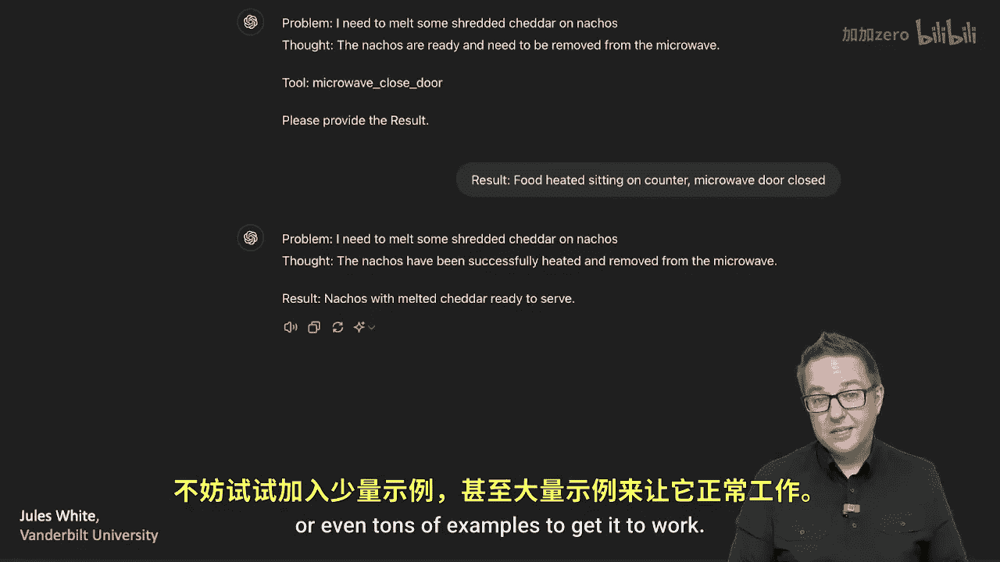

# 059：情境学习与智能体 🧠

在本节课中，我们将探讨一种强大的技术——情境学习。我们将了解如何通过提供示例来教导AI智能体，而不是仅仅依赖明确的指令，从而使智能体能够更好地理解和执行复杂任务。

---

## 概述

上一节我们讨论了如何通过明确的指令来指导AI智能体。本节中，我们来看看另一种教学方式：情境学习。这种方法模仿了人类的教学过程，通过展示解决问题的示例来让AI学习。

---

## 情境学习的概念


情境学习是指通过提供具体示例，让生成式AI在给定的“上下文”中学习如何执行任务。这类似于我们教导实习生：不是仅仅告诉他们规则，而是展示一个已解决的问题范例，包括思考过程和最终结果。

**核心公式**：`问题 -> 思考 -> 工具 -> 结果`

这种方法对于许多AI智能体系统至关重要。如果没有示例，仅靠指令往往难以让智能体达到理想的性能。


---

## 一个具体示例：外星飞船逃生

让我们回到之前的外星飞船逃生示例。假设我们有一些工具，但它们的名称和描述都被更改或移除了，AI不知道它们的功能。

**工具列表**：
*   X155
*   Q63
*   L199

此时，我没有明确告诉AI每个工具的功能，而是采用了情境学习。我提供了几个“少量示例”，即展示如何使用这些工具解决问题的范例。

以下是提供的示例：


**示例1**：
*   **问题**：感到饥饿。
*   **思考**：我需要准备食物。
*   **工具**：Q63
*   **结果**：外星披萨已备好。

**示例2**：
*   **问题**：需要前往另一个世界。
*   **思考**：我需要一个虫洞。
*   **工具**：X155
*   **结果**：通往范德堡大学的虫洞已打开。

**示例3**：
*   **问题**：需要到达反重力室。
*   **思考**：我需要一种在飞船内移动的交通工具。
*   **工具**：L199
*   **结果**：我正骑着滑板车前往该房间。

通过这种方式，我教会了AI如何思考问题、选择工具，并展示了工具应用后的结果，但没有直接说明每个工具的具体功能。

---


## 模式识别与完成


情境学习之所以有效，是因为它建立了一种模式，而大型语言模型倾向于遵循并完成这种模式。这些模型本质上是在学习预测序列中的下一个元素。

当我给出一个不完整的模式时，例如：
`问题：我需要离开飞船回到地球！思考：`

模型会尝试按照之前示例建立的模式来补全它。它推断出当前的“问题”，然后生成“思考”和“工具”部分。

**模型输出**：
*   **问题**：我需要离开飞船回到地球！
*   **思考**：我需要一种方法来定位最近的逃生舱。
*   **工具**：X155
*   **结果**：通往范德堡大学的虫洞已打开，现在我可以逃离飞船了。

AI通过观察之前的示例，学会了X155工具可以用来打开虫洞以实现移动。

---

## 处理新工具与模式泛化

更有趣的是，当引入新工具时，AI也能基于已学习的模式进行推理。

例如，在结果后添加“新工具已添加：内部虫洞”。当提出新问题“我需要从范德堡大学回到地球”时，AI能够：
1.  识别新问题。
2.  根据模式进行思考（“我需要使用虫洞工具返回地球”）。
3.  选择新引入的“内部虫洞”工具。

这表明AI不仅学会了工具的功能，更重要的是学会了**解决问题的模式**：陈述问题、解释思考过程、选择工具。

---

## 与现实计算机系统对接

在许多实际应用中，与计算机系统交互时，解决问题的步骤必须遵循明确定义的模式。计算机系统无法处理任意格式的语言或指令。


使用情境学习可以帮助我们：
1.  **教导工具用途**：通过示例展示工具如何被使用。
2.  **教导推理模式**：展示“逐步思考”、“基于思考选择工具”等推理步骤。
3.  **教导交互格式**：确保AI输出的指令序列符合后端系统能理解的严格格式。

如果你发现AI智能体的行为难以约束、不可预测，或者无法与目标系统正常交互，尝试使用情境学习，提供你希望它如何行事的示例，通常能有效地约束和引导其行为。

用教导实习生来类比：与其用一长串复杂的规则解释如何像托尔斯泰那样写作，不如直接给他看几页托尔斯泰的作品。对于许多问题，用示例描述比用可能无法覆盖所有边界情况的规则来描述要容易得多。

---

## 另一个示例：微波炉加热


让我们看另一个例子，目标是让AI学习“时间”概念，并推断出每次调用“增加时间”工具会增加5秒。

**提供的工具**：打开微波炉门、关闭微波炉门、增加微波炉时间。

**提供的示例**：

**示例1：加热剩披萨**
*   **问题**：重新加热剩披萨。
*   **思考**：我需要将披萨加热20秒。
*   **工具序列**：`打开门` -> `关门` -> `增加时间` -> `增加时间` -> `增加时间` -> `增加时间`
*   **结果**：披萨已加热。

**示例2：软化冰淇淋**
*   **问题**：软化冰淇淋。
*   **思考**：我需要将其加热10秒。
*   **工具序列**：`打开门` -> `关门` -> `增加时间` -> `增加时间`
*   **结果**：冰淇淋已软化。


然后，我提出一个新任务：“我需要融化一些切达干酪在玉米片上”。AI根据学到的模式输出：
1.  `打开门`
2.  `关门`
3.  然后，它将“30秒”的需求，正确转换成了6次`增加时间`的工具调用。

通过示例，AI学会了完成任务所需的固定步骤序列（开门、放入食物、关门、调整时间）以及如何将时间需求转化为具体的工具调用次数。

---

## 关键要点与总结

本节课中我们一起学习了情境学习的强大之处。

**总结如下**：
*   **核心价值**：情境学习通过提供示例（少量示例或大量示例），是教导AI智能体理解工具、遵循特定问题解决模式的关键技术。
*   **适用场景**：当需要AI与格式严格、脆弱的计算机系统（如数据库、邮件服务器、API）交互时，情境学习尤为重要。
*   **实施方法**：通过构建 `问题 -> 思考 -> 工具 -> 结果` 的示例链，引导AI模仿并生成符合要求的输出。
*   **行动建议**：如果你的AI智能体在交互中持续失败或行为不可预测，首要的调试策略之一就是尝试添加情境学习的示例。

**代码/模式示意**：
```python
# 期望AI学会的模式
learning_examples = [
    {
        "problem": "具体问题描述",
        "thought": "针对问题的推理步骤",
        "tool_sequence": ["工具1", "工具2", ...],
        "result": "执行工具后的结果"
    },
    # ... 更多示例
]
# AI在遇到新问题时，会参考这些示例生成符合模式的响应。
```



通过掌握情境学习，你可以更有效地引导AI智能体，使其行为更加可靠、可控，并能够与复杂的现实世界系统进行无缝对接。