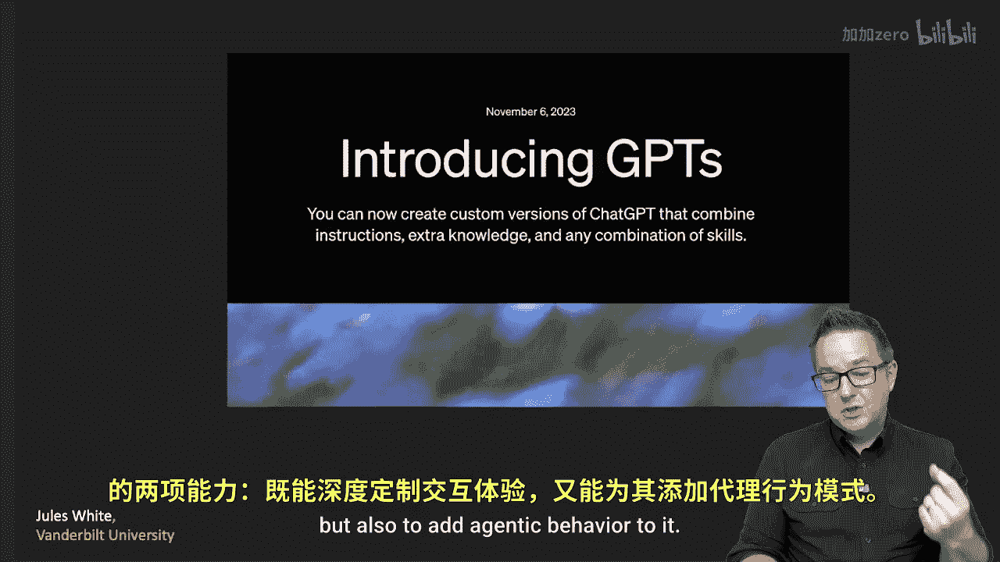
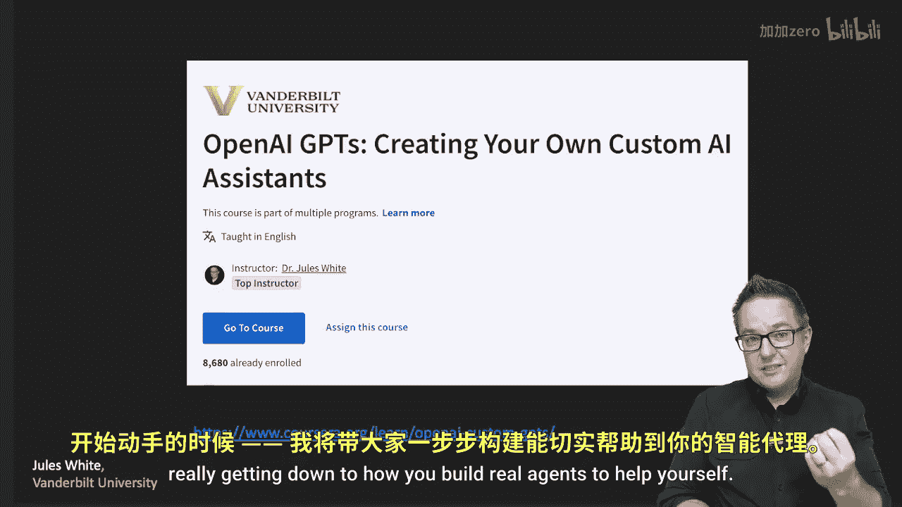

# 060：面向所有人的智能AI代理平台

在本节课中，我们将要学习什么是OpenAI的GPTs，以及它如何作为一个无需编程即可构建强大AI代理的平台。我们将探讨其核心概念，并理解它如何将生成式AI的能力提升到新的水平。

## 什么是自定义GPT？

上一节我们介绍了生成式AI的变革性力量。本节中我们来看看如何利用OpenAI的GPTs来创建属于你自己的智能代理。

自定义GPT本质上是一个定制化的ChatGPT版本。你可以将其视为一个具备代理能力的AI助手。我们无需编写传统代码，而是通过自然语言来“编程”它，告诉它应该做什么、描述它可以使用的工具，并将这些工具连接到真实的系统中。通过这种方式，任何人都能为自己的工作、生活或业务构建出色的自动化流程。

## 核心概念：从理论到实践

我本可以直接带大家动手构建，但我认为理解背后的概念至关重要。因为有时这些系统可能无法按预期工作，而掌握了基本原理，你将拥有更强大的解决问题的能力。

在GPTs的语境下，我们将探索AI代理的前沿概念。GPTs是OpenAI提供的功能，允许用户定制ChatGPT的体验，并为其添加特定的行为模式。

## 为何GPTs是游戏规则改变者？

作为一名程序员，我对此感触颇深。编程曾是我的专属领域，非程序员难以涉足。如今，这个局面被彻底改变了。

虽然之前也有各种“无代码/低代码”工具试图降低门槛，但没有任何工具能与GPTs相提并论。GPTs结合了AI的知识，以及我们即将看到的Zapier等工具的连接能力，使其能够执行真实的自动化任务。这一切仅通过直观的自然语言即可实现，这对大多数人而言是一个根本性的变革。

## 课程路线图

接下来，我将带领大家学习如何构建GPTs。我们将讨论AI代理在GPTs中是如何体现的，我们所学的原理如何应用，并一起动手构建一些令人惊叹的东西。

我知道我们已经学习了很多理论，但从这里开始，我们将真正深入探讨如何构建能够切实帮助你的真实AI代理。

## 总结

本节课中我们一起学习了OpenAI GPTs平台。我们了解到，GPTs是一个允许任何人通过自然语言定制AI代理的强大工具，它无需传统编程技能即可连接现实系统并实现自动化。这标志着AI技术民主化的重要一步，让非技术人员也能利用高级AI能力解决实际问题。在接下来的课程中，我们将把理论付诸实践。