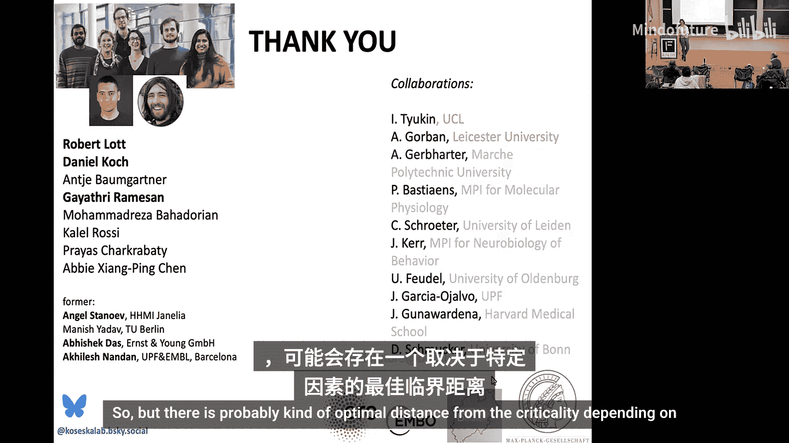

# 001：细胞计算与学习 🧬

在本节课中，我们将要学习细胞如何像微型计算机一样，在复杂多变的环境中处理信息、形成记忆甚至进行学习。我们将探讨细胞内的生化网络如何实现这些看似需要大脑才能完成的功能。

## 细胞感知的复杂性

上一节我们介绍了细胞在复杂环境中面临的信息挑战，本节中我们来看看细胞感知信号的具体机制。

细菌会留下一种化学信号，中性粒细胞会追踪这种信号。但同时，它也会面临环境中其他细胞释放出的所有相互冲突的信号。

因此，如果世界对中性粒细胞来说也是复杂的，并且充满了许多不同且相互冲突的信号，那么对于单个细胞来说，如果遵循这个逻辑，即使是细胞也需要拥有某种形式的记忆，或者能够预测或预见环境中将要发生的事件，并能够做出相应的反应。

## 不同尺度的计算网络

上一节我们讨论了细胞感知的复杂性，本节中我们来看看不同生物组织层次上的计算网络有何异同。

我们有两个不同层次的组织：一方面，老鼠使用神经网络进行高度复杂的计算；另一方面，细胞只有基因和蛋白质网络。那么，这两种网络如何能够实现这些看似相似的计算呢？

如果我们观察神经科学，我们试图解释这些行为的方式是：我们有一个非常复杂的外部世界，然后神经网络会构建一种内部模型，它从环境中提取重要的原理或统计数据，并利用这个内部模型来指导行为。

但是，如果我们观察经典细胞生物学，我们如何看待细胞呢？我们通常认为细胞是非常简单的机器，只将刺激与反应联系起来。在我看来，这是因为细胞生物学实验通常在非常简单的环境中进行，所以你用一个恒定信号刺激细胞，细胞只看到一点信息：信号存在或不存在。如果我的环境是恒定的，那么我不需要任何记忆或学习就能在这个环境中生存。另一方面，如果你的环境是完全随机的，记忆和学习同样没有任何好处，因为环境中没有任何东西可以提取。只有当我的环境中的信号具有某种规律性时，处理环境信息的生化网络（在这种情况下是蛋白质网络）才需要某种形式的记忆、信号整合或学习，以应对它所生活的世界。

## 研究问题与理论框架

上一节我们比较了不同尺度的网络，本节中我们来看看本课题组提出的核心研究问题及其理论框架。

我们课题组提出的问题一方面是：细胞计算有多复杂？具体来说，蛋白质相互作用网络能进行哪些计算？如果我们能够提取这些计算的一些动态原理，我们希望在理论基础上看看这些计算规则是否也能向上扩展，并应用于神经网络层面，以及生物系统中不同组织尺度上发生的这些生物计算之间是否存在任何相似性。

从理论角度来看，我们如何看待计算的通用框架，正如我们昨天和今天多次听到的，是基于吸引子的计算框架。我们有一个网络，它可以是神经的或生化的。在数学或理论上，我们通常理解这个网络或其每个节点的动态如何随时间变化。我们有很多理论，所以我们可以计算这个网络所有可能的解。正如尤里卡昨天展示的，我们可以有这些由鞍点或不稳定不动点分隔的稳定不动点，也可以有更复杂的解，如振荡或混沌解等。但总的来说，我们如何看待计算是：系统随时间演化，并被吸引到其中一个稳定解。因此，重要的是网络中的这些渐近或长期稳定解。

巴特为神经网络很好地阐述了这一点，但我们对单细胞生化网络的思考方式也是如此：当系统从环境中接收到信号时，随着时间演化，系统从一个稳定状态切换到另一个稳定状态。这就是我们所知道的或称之为网络的计算。然后，每个状态都与系统的特定行为相关联。

## 验证理论：以EGFR网络为例

上一节我们介绍了基于吸引子的计算框架，本节中我们通过一个具体例子来验证这个框架是否适用于生化网络。

我们想了解这个计算框架是否也适用于生化网络，从一个非常简单的问题开始：当信号随时间变化时，单细胞如何感知信号？细胞通过跨膜受体蛋白实现这一点，环境中的化学信号与这些蛋白结合，激活蛋白质，进而激活整个生化网络，这决定了网络的响应特性。

我们特别选择了一种受体进行研究：表皮生长因子受体网络是一个典型的致癌基因。几年前，我们确定了这个蛋白质相互作用网络中调节动力学的关键最小组件。由于我们对该网络有详细的生化知识，我们也能理解其动态特性。这个网络，也许你已经可以看到，它有一个双重负反馈和自催化激活。从理论上讲，这是经典的可以产生双稳态的系统。

在这个系统中，这取决于膜上的EGFR浓度或受体浓度。因此，对于膜上特定的受体浓度，系统可以处于基础EGFR磷酸化状态或高蛋白活性状态。如果我们从这个景观的角度思考，这两个解都是稳定的，它将是一个有两个势阱的景观：一个势阱是基础活性，另一个势阱是高活性状态。

那么，如果系统被组织成或具有——如果细胞具有对应于这种双稳态组织的EGFR浓度——这意味着什么？通过模拟很容易预测，即使只给它一个生长因子的单脉冲，系统也会从基础状态切换到高活性状态。移除脉冲后，系统保持在这个状态，因为它是一个稳定的吸引子。因此，在某种程度上，系统具有一种永久记忆的形式。

这意味着如果你在系统中添加其他信号，细胞将无法响应，因为它已经处于激活状态。所以它不再关心环境中是否有其他信号进来。

## 实验验证与发现

上一节我们通过模拟预测了双稳态系统的行为，本节中我们来看看实验验证的结果及其意义。

我们决定也通过实验来测试这一点。我们做的实验是将单细胞（通常使用上皮细胞）放置在微流控装置中，在那里我们可以从外部施加任何不同频率的复杂信号，然后我们用荧光标记单细胞中的蛋白质，这样我们就可以记录它们的位置和活性。

我们进行了扰动实验。正如我所说，由于我们知道网络拓扑结构，如果你过表达受体或敲低其他组件之一，我们可以确保系统恰好组织在这个双稳态区域。

当我们每30分钟用5分钟的化学信号刺激细胞时，我们看到的情况与模拟中看到的非常相似。受体活性随着第一个脉冲增加，所以你从基础状态切换到激活状态，然后系统保持在激活状态，无论系统看到多少信号。这意味着，如果我的世界是动态的，并且我有一个来自稳定吸引子的长期记忆（系统被固定在一个稳定吸引子中），那么细胞将无法整合信号，也无法响应环境的变化。因此，它具有鲁棒性，但不具备灵活响应其他信号的能力。这实际上是致癌情况下的情形。在大多数情况下，如果我们的突变是典型的乳腺癌突变，最典型的突变就是受体过表达，所以系统恰好处于这种双稳态区域，或者在另一侧处于高活性区域，这意味着受体持续激活，持续发出信号，细胞持续增殖。所以这不是一般情况，或者说，这不是细胞在环境中响应变化的化学信号时发挥功能的方式。

但这些非常简单的实验也表明，我们关于系统在环境信号作用下只是在吸引子之间切换的思维方式存在局限性，因为我们看到这无法解释当信号随时间变化时细胞如何处理信号。

## 临界态与瞬态记忆

上一节我们发现了双稳态模型的局限性，本节中我们来看看一种更优的动态组织方式——临界态。

与伊恩刚才展示的非常相似，我们从模型中提出，对细胞来说最优的实际上不是处于这种双稳态区域，而是恰好处于这个临界转变点。在这种情况下，它是一种不同类型的动态分岔——鞍结分岔。但如果系统靠近这个转变点，也就是说，如果它的EGFR浓度对应于这个区域，这将对应于细胞（在这种情况下是受体）激活的能力：当你移除信号时，系统将暂时保持激活状态，因此它将具有记忆，但这将是一种瞬态或暂时性记忆，然后受体活性将重置，这将允许细胞对每个新信号再次激活。基本上，细胞同时具有稳定性的特性（因为你在一段短暂的时间内保持激活状态）和重置的能力，从而能够响应环境中变化的新信号。

当我们测量单细胞中蛋白质的活性时，这只是来自一个单细胞的例子：当你给予生长因子脉冲时，蛋白质激活；当你移除脉冲时，蛋白质保持激活状态一段时间，然后重置。

这种记忆实际上平均在40到50分钟的量级。所以，如果你考虑底层的磷酸化-去磷酸化过程，这是亚分钟级的，而这种记忆是在一小时或更长的量级，这意味着系统获得了一个额外的时间尺度，在这个尺度上它可以保留它之前看到过信号的信息。

这种记忆的持续时间不取决于你是刺激5分钟还是刺激1小时，记忆的持续时间是系统的固有属性。

我们已经证明，受体网络（我在这里以EGFR为例）具有这种特性，但我们也证明这是整个受体酪氨酸激酶家族的典型属性，不仅仅是这种分子。它们似乎具有临界组织的特征，因此它们非常靠近这种动态转变点，正因为如此，它们具有这种瞬态记忆的涌现特性。这种瞬态记忆给系统带来了一个额外的好处，即它获得了这种慢时间尺度。基本上，现在系统拥有许多不同的时间尺度，它可能用于计算，而这仅仅是因为系统恰好位于这种动态分岔点附近。

## 细胞为何需要记忆？

上一节我们介绍了细胞在临界态下获得的瞬态记忆，本节中我们来看看细胞为什么需要这种记忆。

那么，问题当然是，细胞为什么需要记忆？在我们的身体或任何系统中，有许多情况细胞实际上必须在复杂的环境中迁移很长的距离，穿梭于许多细胞之间。这是斑马鱼胚胎发育中的一个例子，如果你看过视频或仔细观察，你会看到细胞朝这个方向迁移。它可能会感到困惑，所以它会向下走，但最终会重置，并继续向上移动。

如果我把这画成示意图，这意味着：我是一个细胞，我需要长距离移动。例如，在发育过程中就是这种情况，但在伤口愈合过程中也会出现同样的问题。你必须在非常拥挤的组织中移动，你只受到局部信号或细胞分泌的化学物质的引导。这些信号会有噪声，会被干扰，它们会出现和消失。因此，细胞的典型迁移模式是，它们以随机游走的模式迁移。当信号从一侧传来时，它们会极化并向信号方向移动。

所以，如果我只在看见或感知到信号时才定向移动，并且当信号中断时立即开始随机游走，那么细胞将永远无法实现这种长距离迁移。然而，如果细胞有记忆：好的，我朝这个方向移动，我的信号消失了一会儿，但我会继续朝同一个方向移动，那么细胞实际上可以度过信号中断的时期。但同样，这个记忆，类似于我刚才提出的问题：如果我在记忆期间出现另一个信号，那么细胞应该能够感知到这一点，并且应该能够重新调整其迁移方向。所以，这又是平衡两个对立特性之间的属性：你必须具有鲁棒的迁移能力，以度过这些中断和嘈杂的时期，但你也需要保持灵活性，以适应环境中的新变化。

## 实验验证：细胞导航

上一节我们探讨了记忆对细胞迁移的重要性，本节中我们通过实验来验证细胞如何利用记忆在动态环境中导航。

我们将同样的细胞放入微流控装置中，在那里我们从外部产生化学梯度，我们使这些梯度动态变化，并在一段时间后将其洗掉。梯度来自左侧，细胞会极化，开始向梯度方向移动。当我们移除梯度时，细胞继续向梯度方向移动，同样平均持续40到50分钟。当它失去这种记忆时，它将开始随机游走迁移。

因此，细胞需要这种记忆，以便能够继续朝着先前看到的信号方向迁移。然而，这种记忆在你移动于复杂环境中时将非常重要。所以，如果你有一个来自左侧的信号并且它中断了，如果细胞在信号中断时立即开始随机游走迁移，那么它将无法进行长距离迁移。

我们做了实验，我们从左侧施加信号，然后中断它。但当系统仍处于这个记忆范围内时，我们从同一侧再次建立信号，然后我们再次中断它，当系统仍在记忆期内时，我们将信号切换到相反的一侧。所以我们想看看细胞是否真的能够整合所有这些信息。

细胞确实做到了：它们开始向左移动，我们中断信号，它们有记忆，所以它们继续朝同一方向移动。我们再次中断信号，并将其切换到相反的一侧，即使细胞处于记忆期内，它也能感知到：哦，现在我这侧没有信号了，但另一侧现在有信号了。所以细胞重新极化，并开始追逐相反一侧的信号。当我们关闭第三个信号时，细胞仍然对该信号有记忆，当它们失去那个记忆时，它们才开始随机游走迁移。

这是一种工作记忆的形式，与你在神经系统中拥有的工作记忆非常相似，因为你随时间存储信息，但你仍然对其他信号保持响应。我们在这里论证，细胞也利用一种分子记忆的形式，以便在环境信号不断变化时进行导航，这对于能够在环境变化和嘈杂时实现鲁棒迁移，同时又能灵活适应这些变化之间的平衡非常重要。

## 单细胞学习：习惯化与敏感化

上一节我们看到了细胞如何利用记忆导航，本节中我们进一步探讨单细胞是否具有更高级的学习能力。

我们想，好吧，如果细胞具有基本形式的记忆，那么是否也能在单细胞水平上寻找学习的特性？那么，如何思考生化网络中的学习，因为它们不等同于神经网络？我们没有突触变化和连接可塑性，我们所有的连接都是明确定义的。但这也不是一个新问题，有实验，我认为这甚至是第一个实验，由美国生理学家詹宁斯在1907年完成。他取了一种叫做喇叭虫的单细胞生物，它是一种纤毛虫，形状像这样。他表明，如果你用珠子刺激纤毛虫，它会经历一系列定义明确的行为模式：如果你用珠子刺激它，首先它会试图避开；如果珠子继续来，第二步它会逆转纤毛，试图吐出颗粒；如果这没有帮助，它会收缩，最终会脱离。所以它经历了这个真正定义明确的行为序列，这表明它们可以根据先前的经验调节它们的反应。除此之外，他还表明，喇叭虫可以表现出一种非常基本的非联想学习形式，即习惯化。在不同的条件下，当你用脉冲刺激纤毛虫时（在这种情况下，只是暂时添加这些珠子），如果珠子对系统没有害处，只是令人讨厌，系统会做什么？喇叭虫的反应会下降，所以在某个时刻它决定：哦，好吧，这很烦人，但不会伤害我，所以它实际上停止了收缩。

这个实验最近在哈佛大学的杰里米·古纳瓦德纳小组中得到了重现，这也引发了一系列理论工作：好吧，我们是否有生化或最小的生化网络基序，实际上可以表现出这些基本的学习形式，比如习惯化？

但在这一类非常基本的学习形式中，几乎还有相反的一种，那就是敏感化。这种情况是，在重复呈现刺激后，系统实际上表现出反应特性的增加。例如，如果你摩擦双手，它们会开始变暖，你会开始感到疼痛，但过一会儿就消失了。这是因为你重复这种刺激，神经系统被激活，所以你得到这种反应增加，你感到疼痛，持续一段时间，但然后你就失去了它。然而，即使我们尽力寻找，我们也没有发现有一个机制模型可以解释敏感化是如何发生的，即使对于神经网络也是如此。敏感化非常有趣，因为它也经常从进化角度被讨论，认为它是一种支持生存的机制。所以，如果你有一个信号在环境中重复出现，你可能会想：哦，这可能是有害的，所以你增加你的反应能力，以便能够在这个环境中适当地生存。

## 实验验证：上皮细胞的敏感化

上一节我们介绍了单细胞学习的概念，本节中我们通过实验来观察上皮细胞是否表现出敏感化。

所以我们想，好吧，我们拿我们研究的单细胞网络和上皮细胞，看看它们是否具有这些基本的非联想学习形式。我将向你展示敏感化的例子，但我们也研究了习惯化。正如我提到的，敏感化具有这样的特定特征：当你重复刺激时，你会看到反应增加，但这还不是全部。另外，如果你暂停信号一段时间再给予，系统会表现出相同幅度的反应；但如果你暂停更长时间再呈现刺激，系统已经重置了。所以这是一个瞬态过程，你必须经历相同的行为序列来重新学习行为。

如果这是一个神经系统，我们会想：好吧，我有环境中信号的一些统计数据，系统需要形成一个内部模型来提取关于环境的信息，并产生这种复杂行为。但在这种情况下，我们只研究单细胞，所以我们的假设是：单细胞的内部表征是通过生化网络中的瞬态动态或这些动态状态产生的，细胞利用这些动态状态来提取因果影响，在这种情况下是形态行为。所以，我们能想到的最简单的行为是细胞形状的变化。

我们进行实验，再次在微流控装置中用生长因子脉冲刺激细胞，脉冲具有一定持续时间。我们记录单细胞中的蛋白质活性，以了解生化网络如何编码这些信息，然后我们也量化相对于这些反应的形状变化。这是细胞的例子，我希望你能看到，当你看到一些绿色闪光时，这实际上是我们传递这些脉冲的时候，你会看到形态发生了这种连续的变化。

如果我们量化形态的变化，我们进行一分钟的脉冲，脉冲间隔三分钟。当我们观察细胞形状周长的变化时，我们看到反应或形态变化的幅度有所增加，并且它们以振荡模式的形式响应。当我们传递最后一个脉冲时，我们看到细胞在一段短暂的时间内保持这种强烈的形态变化，然后重置。所以你有了这些基本形式，对应于反应增加的非联想学习、一种暂时记忆的形式，以及系统重置。如果我们同时观察蛋白质动态（在这种情况下，我们测量受体的活性），我们看到在细胞的内部表征中也看到了类似的特征：受体激活方面有这种爬升活性，你看到这种维持的瞬态活性，然后系统重置。

这还不是全部，我们还看到系统实际上具有更复杂的特征，比如频率敏感性，这意味着更频繁的刺激会导致更快速和更明显的反应增加，这也是——或者恰恰相反——是已定义的习惯化的标志之一，但实际上甚至没有人定义敏感化的反应特性。所以，这是我们从单细胞中能够推导出的敏感化特性之一。尽管这是一个非常简单的例子，我认为它表明即使是单细胞中的生化网络也可以具有非常基本的形式，在这种情况下是非联想学习。

## 记忆与学习的动态机制

上一节我们观察到了细胞学习的现象，本节中我们从理论角度深入探讨其背后的动态机制。

对我们来说，主要来自理论背景，理解这些生化或简单生化网络中实际导致记忆和学习的特征当然很重要。我提到这种记忆的产生是因为网络组织在接近这种动态分岔点附近。我们从动力系统理论知道，如果系统位于鞍结分岔点附近，当你给予信号时会发生什么？你实际上改变了这个景观。这个景观不是固定的。当你从这里开始时，系统只有一个稳定状态，即一个势阱。当你给予输入时，这个景观发生变化，系统进入高活性状态。当你移除信号时，你将景观改回基础活性状态的单一势阱。但是因为你靠近这个动态转变点，你在这个景观中有一个区域，在那里你从三面下来，只从一面离开。在这个景观中，表面略微倾斜，因为它几乎是平坦的，你将在这个表面上缓慢移动。这在动力系统中被称为鬼影集，它是一种鬼影：你曾有一个激活状态，这个状态不再稳定，但系统保留了这个激活状态的某种鬼影，所以你开始沿着这个缓坡向下移动，这减慢了速度。这就是为什么系统获得这种记忆，并且它获得的时间尺度比底层过程的时间尺度长一个数量级，然后系统基本上会掉下来，它会重置。

在这个系统中，当然很容易识别，因为我们研究的是一个最小的网络基序，我们知道或测量了所有参数，所以我们可以详细建模。但是，如果你有一个大规模网络，你将如何识别呢？我们最近对这种鬼影集进行了这种概括。基本上，对于任何网络，你都可以定义一种李雅普诺夫函数的形式（在这种情况下，我们使用了网络的动能），你可以将其最小化。如果动能为零，这将给出你的不动点；但如果动能接近于零，将给出这个景观中相对平坦的区域，因此将能够识别这个鬼吸引子集的范围。因为动能接近于零，系统仍然可以线性化，所以你可以在局部计算系统的特征值。如果你看最大特征值，这个最大特征值有一个从负到正的梯度，这引导了流动。所以，如果你有系统的轨迹，该轨迹将直接通过或穿过这些鬼影集。这些鬼影集的帮助在于，尽管系统远离任何稳态，但它们能够引导系统中的流动以及系统将如何随时间发展。

## 噪声鲁棒性与计算

上一节我们介绍了鬼影集的动态机制，本节中我们探讨这种机制在噪声环境下的鲁棒性及其对计算的意义。

由于这在形式上不是一个稳定状态，当然问题是：这对噪声稳定吗？因为我们在细胞中观察到的当然是生化网络本质上是嘈杂的。那么，即使系统中有噪声，我们是否仍然能够观察到这种准稳定动态？我们在模拟中所做的是增加噪声强度，并估计系统在这些鬼影集中的捕获时间。对于最小模型，你甚至可以解析地做到这一点。但我们看到的是，这种捕获时间或你在鬼影集中停留的时间（即记忆有多长）实际上在高达非常高的噪声强度下都非常稳定。从实验中，无论是从EGFR还是我们测量网络中的其他蛋白质，我们都能够估计噪声。这当然不仅代表技术噪声，还代表生物噪声的混合。但我们在实验中的噪声水平在10^-3到10^-2之间，这可能也是为什么我们实际上能够在单细胞测量中观察到这种记忆。但最重要的信息是，位于这种动态转变点附近的网络，它们也可以利用这种鬼影集来实现这些长瞬态的出现，并且这些长瞬态对噪声具有鲁棒性。这是如果你想进行任何有意义的计算时的一个重要特征：当然，你用来进行计算动态对象需要对噪声具有鲁棒性。

## 学习如何发生？

上一节我们讨论了噪声鲁棒性，本节中我们回到学习发生的具体机制。

学习是如何发生的呢？嗯，这又是系统位于鞍结分岔点附近的混合结果。正如我提到的，这给了系统一个慢时间尺度。但同样非常重要的是要记住，当我们有动态信号时，发生的情况是这些景观不断重塑。当系统在分岔点组织时，它只有一个不动点，那就是这里的不动点。但是当我们在模拟中给予刺激时会发生什么？你看到这个数字——所有这些方块都是系统中出现和消失的不同不动点——你得到的是这种慢点漏斗。系统开始随着信号移动，因为它想要达到高活性稳态，但你移除了信号，所以你重塑了轨迹；轨迹开始返回或试图返回不动点，但它在这组慢点上移动。因为它移动缓慢，当另一个信号到来时，它还没有到达不动点；当另一个信号到来时，它被向前推，所以实际上它可以产生这种爬升活性。因此，这组慢点，除了给系统记忆外，还使得在重复信号时能够产生这种爬升活性。所以，这种靠近动态分岔的组织对细胞很重要，因为它使它们能够感知随时间变化的信号，因为它们获得了一种动态记忆，而且这种慢动态对系统产生爬升活性也很重要，从而具有这种基本的敏感化形式。这里需要提及的一个非常重要的维度是，在整个信号整合过程中，系统实际上保持远离静态状态。因此，计算在形式上是利用系统的瞬态完成的。

## 迈向新的数学框架

上一节我们总结了学习发生的机制，本节中我们探讨这些发现如何促使我们改变研究网络的数学框架。

我们认为，或者我们想论证，我们也需要改变数学框架，以研究受时变信号刺激的网络。我们需要从自治系统描述（我们仅通过网络拓扑和系统具有的稳态数量来定义系统属性）切换到非自治系统描述，其中环境或外部信号是系统的一部分。因为正如我向你展示的，当我们的信号随时间变化时，稳态的数量和位置可以改变，所以它们在形式上甚至不再代表系统的解。但你可以证明，存在一族解算子，其中系统的解现在是轨迹。因此，在形式上，动力系统的轨迹将是解，我们需要描述受时变信号作用的动力系统的响应。

## 鬼影集的形式定义与复杂结构

上一节我们提出了转向非自治系统框架的必要性，本节中我们更正式地定义鬼影集并探讨其可能形成的复杂结构。

考虑到我们已经发现了这些鬼影集，或者细胞利用这些鬼影集来拥有记忆和基本的学习形式，我们继续更正式地定义这些鬼影集。定义与尤里卡之前向你展示的非常相似：如果我们有一个有界闭集，不包含任何半轨，并且重要的是在时间上，你可以定义这个鬼吸引子集的吸引域，轨迹进入其中，停留一段时间，然后可能离开。但如果你这样正式定义它，那么很容易看到，你可以在相空间中拥有更复杂结构的鬼吸引子集。基本上，你可以排列它们，使得系统进入其中一个鬼影集，停留一段时间，然后落下并进入下一个鬼吸引子集。所以基本上，你可以产生这种鬼影集通道，或者你可以将轨迹循环回来，产生一个鬼影集循环。例如，一个这样的鬼循环的动态会是什么样子？我们在这个情况下做了非常简单的几何模型。

但你看到的完全一样：系统的轨迹停留在一个鬼影集上，然后非常迅速地转换到第二个，它会停留一段短暂的时间，然后转换到下一个，依此类推。所以你得到了一个非常可靠的顺序切换动态，即使在你增加噪声时也能保持。是的，这类似于通过咖啡因设计因子产生类似大规模稳定行为的设计。

属性不会等价，因为在这里你在一个吸引子中停留多长时间是鬼影集的属性，而在那种情况下，如果你只是依赖噪声，你无法控制。是的，所以这可以说，对于计算来说，这是可靠的，相比之下，如果你只依赖系统的噪声，噪声水平……可能有一些，对吧？我们只做了这个，或者系统有多鲁棒，这只是加性高斯噪声，没有别的，只是噪声，是的，是的，是的。

所以这正是我刚才说的：系统停留在一个鬼影集上，然后跳到下一个，再跳到下一个，所以你可以永远循环下去，因为它们以这样一种方式排列，我们总是在不同的鬼吸引子集之间切换。

你可以量化这一点。例如，你在这个鬼循环上得到的周期在高达非常高的噪声强度下都非常可靠。在鬼影集附近的捕获也非常可靠，这来自单个鬼影集的属性。对于这种顺序切换动态，我们昨天也听到了一些报告，非常重要的一点是：你在一个短暂的时间内保持行为稳定，但然后你非常迅速地切换到下一个。我们再次看到，这种长时间停留和非常快速切换之间的差异也能保持，并且不会被噪声破坏。

## 与神经编码的类比

上一节我们看到了鬼影集可以形成复杂的顺序动态，本节中我们探讨这与神经系统中观察到的顺序编码有何相似之处。

对我们来说，这非常类似于你在神经元群中看到的顺序切换。这只是众多实验论文中的一个例子，这是在味觉皮层中编码不同味觉的例子，他们测量了神经元活动，然后你看到对于每种不同的味觉，你看到的是顺序切换活动模式。所以，当你重复相同的刺激时，发生的情况只是当系统进入下一个序列时，你可能会有轻微的变化，但序列和序列的顺序保持不变。对于不同的味觉，编码是通过不同的序列实现的。这表明，神经元信息编码，特别是对于这种顺序切换活动模式，可能通过神经元中产生的鬼影集发生。

## 鬼影支架的计算能力

上一节我们类比了神经编码，本节中我们进一步测试鬼影支架的计算能力。

我们想更多地测试这一点，所以我们想测试这些鬼影支架的计算能力是什么。我忘记提到的是，我认为当时间也是方程的一部分时，利用准稳定瞬态（例如来自鬼影支架的那些）进行计算将很重要，因为你需要在一段短暂的时间内记住某些东西，或者你必须随时间整合信息。因为这些是你必须在鲁棒性和可塑性之间取得平衡的例子。我们查阅文献，看看关于神经网络如何编码感知时间是如何描述的。我们在参考文献中发现，当然这对生命系统非常重要，但我们在参考文献中发现，在神经科学中如何教授的是：计时是一种涌现的内在计算。所以它不是大脑中的特定回路，而是来自网络固有动态的涌现特性。

通常如何测试这一点，类似于我们昨天看到的一些任务，是这些在灵长类动物中进行的非常基本的工作记忆任务之一。你给猴子一个线索，你测量并在这里加权，前两个信号。所以猴子必须记住这个时间间隔，然后你等待一个延迟期，然后你给它们一个线索，它们应该，例如，在它们记住的时间间隔后准确地按下一个按钮。

## 训练神经网络执行计时任务

上一节我们提出了鬼影支架可能用于时间编码，本节中我们通过训练一个小型神经网络来执行计时任务，并观察其内部动态。

我们想训练一个最小的神经网络，在这种情况下，我们使用门控循环单元，以便能够……我们有意决定使用一个非常小的网络，即一个三组件网络，因为我们想知道我们是否能理解网络如何编码关于时间间隔的信息。你可以非常高效地训练这个网络来执行任务。但是，因为这是一个非常简单的网络，你可以看到网络动态在训练过程中实际是如何变化的。

你从一个单一稳态开始，在不同的训练周期中，你看到系统实际上产生了双稳态行为。但在训练结束时，系统位于分岔点附近。所以这个神经网络为了能够编码这个复杂任务，它找到了接近动态分岔点是最优的解决方案。是的。

所以你说你的训练，是的，整个，不是，不是，是的，我们改变，是的。不，抱歉，所以它是一个门控循环单元网络，所以每个节点由三个变量表示，你可以重新映射它，它是一个离散系统，但你可以将其映射到时间连续系统。所以基本上，它是每个节点的某种活动。

然后，因为我们非常接近动态分岔，这与我们之前在单细胞中看到的非常相似。所以我们使用了完全相同的特征，我们之前定义的：网络中的这种动能近似，我们看到网络具有的这种慢点云，然后在这片云中你也可以计算特征值。这是最大特征值，我们看到系统只有一个不动点，这也是我们从网络组织中求解出来的。在这里，我们看到特征值从负到正的分布，这暗示了这片慢点云实际上是一个鬼影集。当你观察网络实际如何工作时，当我们给予信号时，轨迹持续停留在这片慢点云中。所以当你给予信号时，你把它移开，它又回来。实际上，网络必须编码并可能重现的这个时间间隔对应于轨迹在这片慢点云中移动的距离。所以网络所做的，或者至少我们目前的理解是，它在训练过程中塑造了这片慢点云，然后对于你需要记住的不同间隔或不同的延迟，你最终会到达这片慢点云上的不同位置，这决定了或者这是网络记住这个时间间隔的方式。再次，我认为对我们来说非常有趣的是，所有这些计算都是在远离不动点的地方完成的。提醒你一下，不动点在右上角。即使在网络做出预测之后，系统也需要时间才能达到稳态。所以它根本不使用这个稳态进行计算。

## 跨尺度的通用计算原理

上一节我们通过神经网络验证了鬼影集在计时任务中的作用，本节中我们总结并展望这种计算原理在不同生物尺度上的通用性。

我们倾向于认为，无论是在生化网络还是在神经网络中，特别是对于与时间相关的任务，也许计算的主要模式是利用这些瞬态进行计算，这很重要，因为轨迹不会稳定在任何吸引子上，这意味着系统保持灵活。而且它们也非渐近地演化，因为你的景观在慢集的影响下不断变化。因此，如果系统停留在这组慢点上，它基本上给了系统更多的时间，可以用来整合信息。通过这种方式，系统既可以保持灵活，也会具有鲁棒性，这是在不断变化的环境中运作所需要的。

当然，既然我们知道了这个原理，你可以很容易地找到一个最小的、更生化的网络，实际上可以执行相同的任务。所以我们认为，尽管生化网络计算和神经网络计算之间存在类比，但可能存在非常通用的原理，允许在水平上研究这些更复杂的任务，或者设计实验在单细胞水平上研究，我们实际上已经开始这样做了。

## 总结

本节课中我们一起学习了细胞如何像计算机一样处理信息。通过用微流控装置中的动态信号挑战细胞，我们看到它们不是简单的输入输出机器，而是主动处理和整合环境中的信号。我们发现，特别是对于受体网络，似乎对于许多这些受体网络来说，组织在临界态是一个典型的解决方案，这很重要，因为它允许它们在动态的鲁棒性和可塑性之间取得平衡，从而也在对环境的响应之间取得平衡。如果环境是亚稳态的，那么你的内在动态最好也在亚稳态区域运行，因为这正是你响应环境的方式。实现这一点的一种方法是拥有这些鬼影集或更复杂的支架，它们似乎存在于单细胞的生化网络中，也存在于我们研究过的这些非常简单的神经网络模型中。

这给了我们一些希望，我们实际上可以将学习框架扩展到细胞水平，并能够现在提出问题：细胞如何预测、预见或如何为它们的响应计时。一个例子，正如我向你展示的计时任务，人们可以很容易地想象在单细胞生化网络水平上的这样一个任务。我们也在研究一个更通用或更全局的理论框架，该框架将能够基于利用这些鬼影网络的计算来解释跨组织尺度的生物计算，同时也构建以这些鬼影网络为主要计算能力的人工神经网络，因为我们认为你可以拥有更小或组件更少的网络，能够执行与其他循环神经网络相同的任务。

---

本节课中我们一起学习了细胞计算与学习的基本原理。我们从细胞感知复杂信号开始，探讨了不同尺度网络（生化网络与神经网络）计算能力的相似性。通过研究EGFR网络等具体例子，我们发现了细胞通过组织在动态临界态附近，利用鬼影集实现瞬态记忆和基本学习（如敏感化）的机制。实验表明，这种机制使细胞能在动态环境中平衡鲁棒性与灵活性。最后，我们看到了类似原理在小型神经网络执行计时任务中的应用，提示可能存在跨生物尺度的通用计算框架。这些发现不仅深化了我们对细胞智能的理解，也为设计新型人工计算系统提供了灵感。