# 002：决策几何学 🧠

在本节课中，我们将探讨生物决策的几何学原理。我们将看到，从单个神经元到动物群体，跨越不同生物组织层级的决策过程，可能共享着一种基于空间几何的、由神经环状吸引子网络驱动的通用算法。这种算法通过一种“分岔”过程，使系统能够在面对多个选项时做出快速而准确的选择。

---

## 从个体认知到集体认知 🔄

上一节我们介绍了课程的主题。本节中，我们来看看决策研究的不同尺度。

我今天的主题是生物组织不同尺度下的决策。在座的各位大多非常熟悉大脑内部的组织结构。但是，当大脑通过生物体之间不可见的相互作用连接在一起时，情况会如何？我感兴趣的是个体层面认知与集体认知之间的联系，特别是时空计算。因此，今天我也会讨论空间决策。

我受到本次会议上许多演讲的启发。例如，会议最初展示的一些研究让我重新思考博士期间的工作。在90年代末，我的研究表明蚁群实际上会表现出活动波，这些波从蚁群中心向外传播。我们至今仍不完全清楚蚂蚁为何这样做。但考虑到过去三天我们在许多系统中看到的集体计算，这让我重新思考，并认为这可能是一个易于处理的系统（至少在大脑之外），用于理解为何会出现可能与计算相关的节律性活动模式。

我提出这一点是因为我们拥有大量数据，却无人知晓原因。当时，当我观察更大的蚁群时，波的模式变得过于复杂，我难以理解。但在过去几天，我看到了一些方法，可能让我们真正理解这些蚁群内部更复杂的波。在90年代，我只是观察像素差异。我在网格上观察，当蚂蚁移动时，会产生不同的图像；有活动时，图像更亮。如今，我们当然可以标记单个蚂蚁并进行更复杂的分析，但结果看起来仍然类似。现在我们可以知道每个个体如何贡献。每只蚂蚁在巢穴内都有一个倾向于占据的小区域，有点像神经元，它们并非完全流动，而是相互碰撞、相互作用。有可能当它们更活跃、彼此更接近时，对蚁群的输入更敏感，这是我们当时的推测，但尚无证据。例如，如果提供食物来源，这些波谷会移动吗？尚未进行此类实验。但这确实是一个很好的例子，展示了最近几天看到的一些想法如何直接关联到这些群体。

蚂蚁将80%的时间花在不活动的“睡眠”状态，因此非常高效。但当它们活跃时，会碰撞其他个体并激活它们，进而碰撞其他个体，从而产生空间波的传播。如果你改变个体数量或蚁巢大小，波的模式会改变。我们进行了改变蚁群规模的实验，这使它们能够缓冲，因为离开巢穴的蚂蚁会解耦，当它们返回时，会给系统带来噪声。如果不给它们空间来维持这种耦合振荡动态，那么噪声就会在蚁群中传播。蚂蚁会试图阻止这种情况发生，这表明活动波具有适应性，但同样，谁又知道呢？

当我们观察这些蚁群内部的其他活动波时，这是更近期的研究。例如，为什么细胞会聚集起来协调形成早期的多细胞动物？我们可以观察一种非常酷的动物——扁盘动物，它自成一个门，是基础的后生动物，基本上是一个二维的细胞群。这里我们追踪的是细胞密度的不透明度和细胞移动的方向。现在你看到的不仅是波，而且是实际上在动物表面传播的波。

如果你观察这些波的长度尺度（在此案例中是系统大小的函数），随着这些生物体生长，并观察交叉点，你可以看到随着系统变大，存在一种无标度动态，这些波可以变得更大并渗透整个系统。通过模拟这些细胞片层，我们可以开始理解它是如何以这种特定方式参数化的。它处于一种特殊的机制中，使系统接近所谓的“临界性”，从而获得这些无标度动态。这里的观点是，处于临界性可能使系统既稳健又对环境中的化学物质等输入敏感。因此，我们可以证明，在这种特定生物体中，它们似乎处于一个真正优化信息处理的机制中。

如果我们将这个想法进一步延伸，我们可以观察像成群鱼类和鸟群这样的动物。同样，行为传播的波确实是一个研究热点。它们当然会对捕食者做出反应，但这本质上也是一个可兴奋系统，因此你也会看到自发的波在系统中渗透。据认为，你看到的波中约有80%实际上是这些自发波。因此，我们可以再次观察这些波的大小或分布（在对数-对数坐标轴上），尽管没有足够的事件来断言更多，但这是一种非常长尾的分布，很难先验地预测这些波是非常小还是会传播整个系统。我们也可以做一些事情，我之所以包含这一点，是因为你们也在测量这些波的空间范围等等。

---

## 相互作用网络与临界性 🌐

上一节我们看到了活动波在不同系统中的表现。本节中，我们来探讨驱动这些行为的相互作用网络。

当我们思考相互作用时，这与神经系统非常不同。我们研究的生物体，其相互作用几乎完全由视觉驱动。我们也研究侧线系统，结果发现它并不参与水动力社会相互作用，但这不是今天要讲的故事。这里，我们重建了焦点个体右眼（蓝色）和左眼（红色）的视野。我们可以为所有个体这样做，然后逆向工程，找出在行为传播方面，它们关注哪些视觉特征。

这使我们能够重建这种隐藏的相互作用网络，这种不可见的网络。正如今天早些时候的演讲所示，如果你放大这个网络，它既是加权的、有向的，也是随时间变化的。这在社会系统中非常常见。我可能深受你的影响，但你却不受我的影响。因此，这本质上是非对称的。还有其他一些有趣的方面，例如，拥有许多邻居的个体并不是最具社会影响力的；实际上，与少数邻居有强连接会使你更具影响力，因为行为传染不像疾病传染，它是一种复杂传染，动物在复制行为之前，需要从感觉野的多个位置获得强化。因此，存在各种有趣的现象。这些网络经历了数千年的选择压力来处理信息，因此有充分理由思考这些进化网络中出现的拓扑结构和属性。

我们研究的另一个方面是，当世界变得更危险时，例如存在化学物质。当鱼被捕食者咬伤时，它们会释放一种叫做“警报物质”的化学物质。如果你将警报物质放入油中并置于水面，它们会感觉到世界更危险，但没有特定的位置更危险。那么，作为个体动物，你会怎么做？研究表明，你会降低反应阈值，因此会更紧张，更容易产生误报，但这是一个权衡。

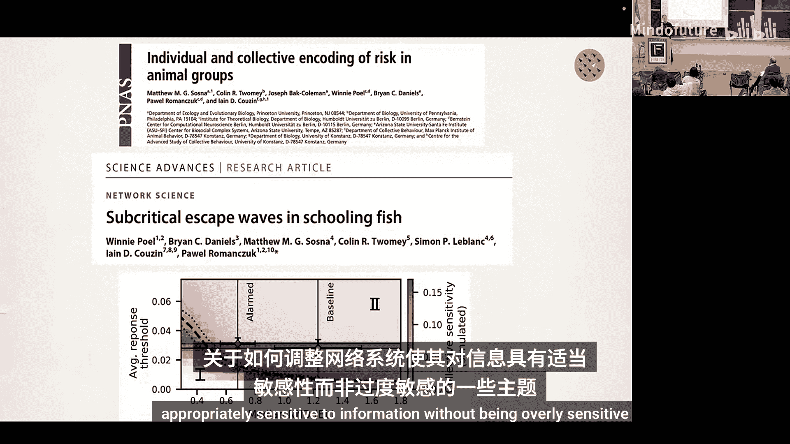

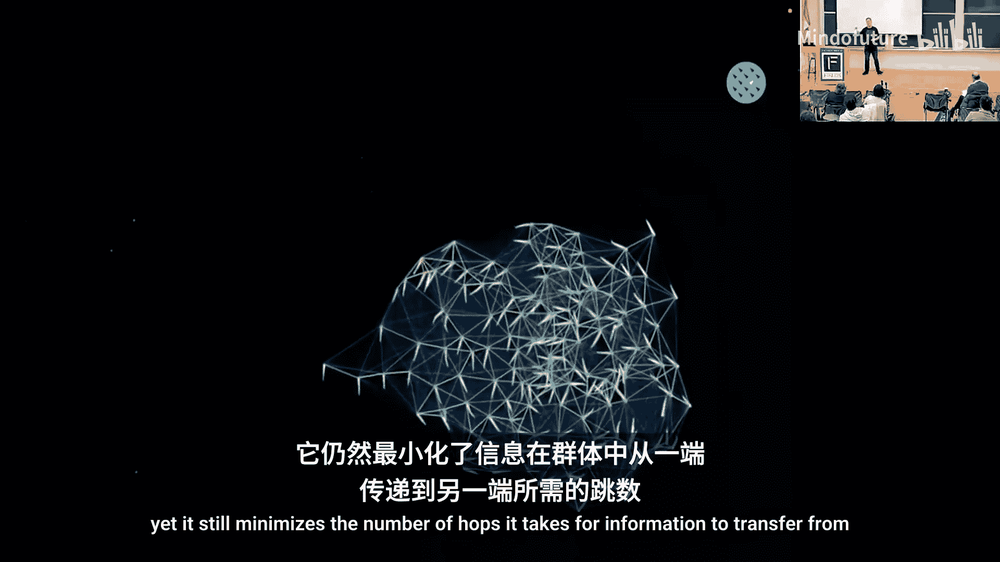

然而，如果你考虑一个网络化系统，实际上并不清楚最优策略是什么。我们能够证明，如果有什么变化的话，个体会移动并改变阈值，使其对输入变得不那么敏感。这意味着每个个体产生误报的可能性更小，但它们改变了空间拓扑结构，使得网络现在在个体发出警报时，更有可能发生传播。因此，在面临风险时，它们真正改变的是网络属性，而非个体层面的属性。

我们还可以观察，是否有任何证据表明这些由自私的基因个体（不像细胞）组成的网络接近临界性。这条线表示临界线，红色编码表示最大敏感性。你可以看到，在基线状态下，它们离临界线相当远；当它们表现出这种警报检测时，它们接近但处于亚临界状态，并未完全达到临界性。从信息处理的角度来看，这可能有各种原因，是一个合理的选择。这与如何调整网络系统以使其对信息敏感但不过度敏感的一些主题相关。我也认为这些网络非常美丽，它们不是无标度的，也不是小世界的，它们属于自己的一类网络，最小化了局部相关性（这是好的，因为相关性会削弱集体智能），但同时仍然最小化了信息从群体一侧传递到另一侧所需的跳数。因此，它们在网络空间中处于一个非常特殊的位置。

多年来，我们能够在各种情境下证明，计算可以是这些群体网络结构的一个涌现属性。例如，调节社会传染、调节对风险增加的行为反应，以及感知长距离环境梯度。我们能够证明群体可以感知梯度，而这是任何个体都无法感知的。

我们是唯一在这个层面研究它的人，因此我们期望这些属性（因为它们处于那个特殊位置）是保守的。但老实说，这些是唯一的研究。这确实有点棘手，我也有点嫉妒。当我看到所有这些人谈论正在进行的所有神经科学研究时，你们可能可以参加有1万、2万人的会议。我们全世界只有少数几个实验室。但道理是一样的，对吧？自然选择以同样的方式作用于计算，只是在不同的生物组织尺度上。

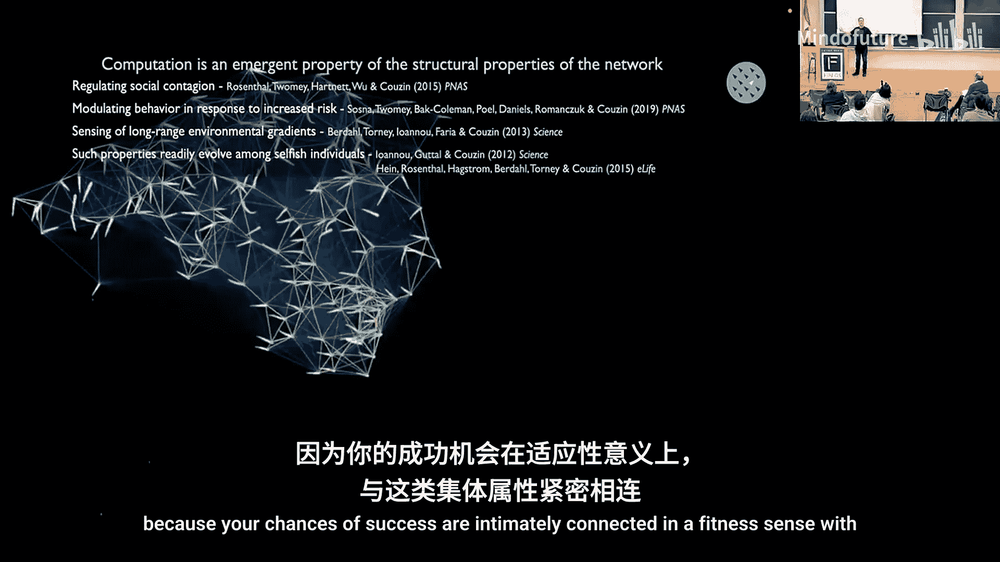

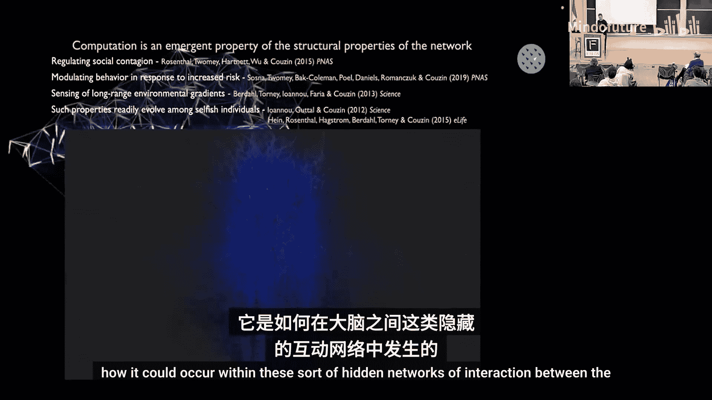

我们还证明，这些网络属性很容易在基因自私的个体中进化。我们并不是说选择在集体层面运作，选择是在个体尺度上运作的，但这会转化到集体尺度，因为你的成功机会在适应度意义上与这类集体属性密切相关。这就是为什么我认为考虑大脑内部发生的计算类型，以及它如何可能发生在大脑之间这种隐藏的相互作用网络中，是如此相关。

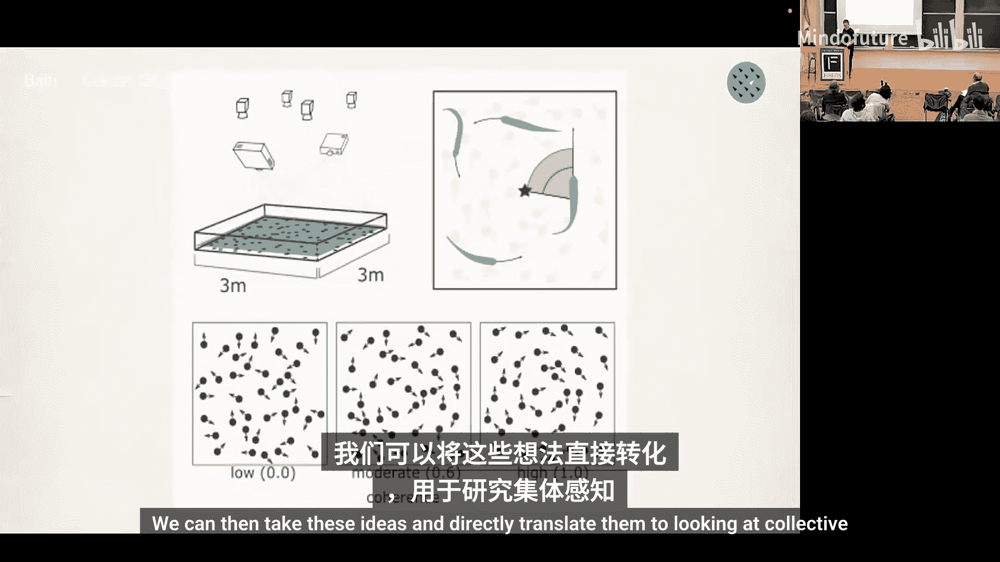

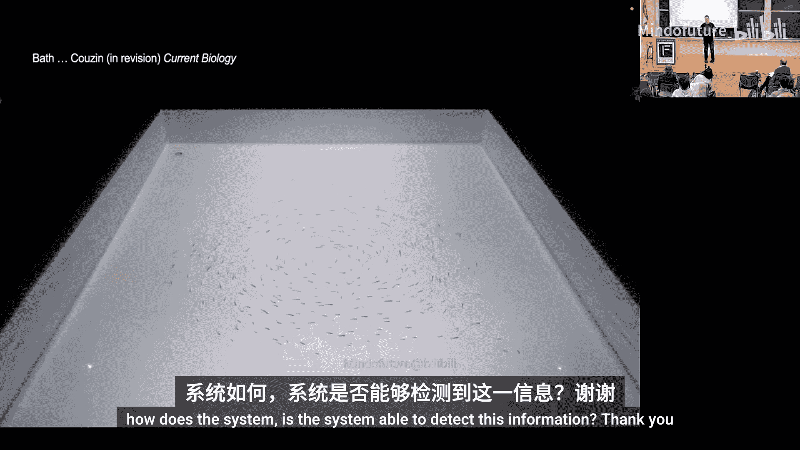

---

## 集体决策的几何学原理 📐

上一节我们讨论了网络相互作用。本节中，我们来看看决策背后的核心几何学原理。

那么，我们能否思考动物的集体条件，它具有何种特征？它能告诉我们关于个体决策的什么信息？

另一件事是未发表的工作，我们也受到你们展示的关于猴子实验类型的启发，例如观察随机移动的点。我们可以将这些想法直接转化为研究集体感知。

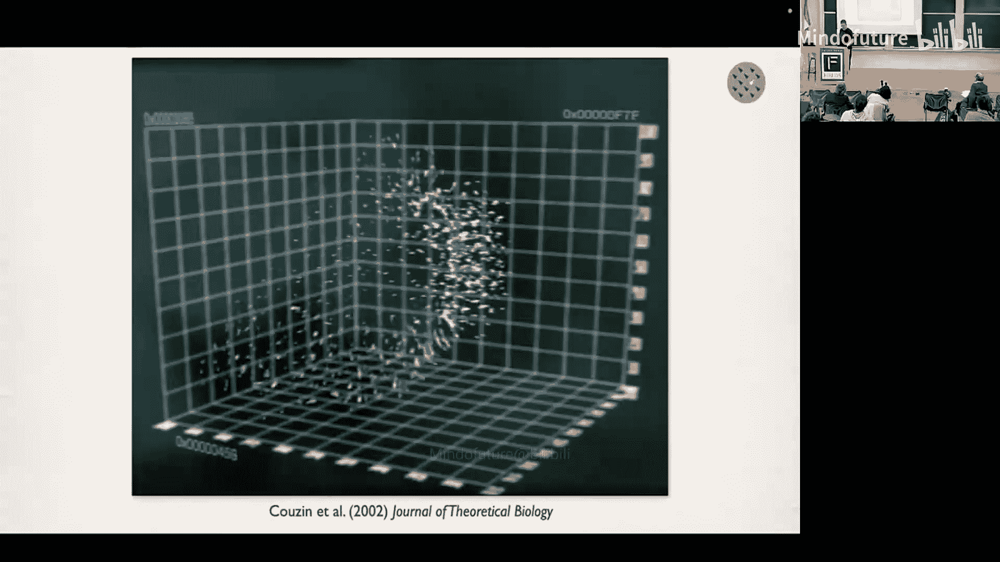

例如，这里是100%相关性，但我们可以改变这些移动点的相关性，并询问系统是否能够检测到这些信息，以及这如何随群体大小变化。同样，你也可以观察在何种相干水平下，例如，正确检测的概率是50%。

我们可以观察群体大小如何改变群体正确检测环境中运动的概率。因此，我们可以直接利用神经科学中这些强大的实验范式来研究集体感知和集体智能。

当我在2007年写这篇文章时，我非常谨慎地在大脑内部的计算和大脑之间的计算之间进行类比。选择的层次如此不同，相互作用的机制如此不同，这难道不只是一个有趣的隐喻吗？但我今天要论证的是，并非如此。我实际上认为，时空计算存在超越组织层次的基本特征，它确实关系到我们观察空间决策时的数学或几何学。这就是我今天要试图论证的。

但再次回到过去，当我们最初试图理解动物如何在群体中移动，或鸟群、鱼群如何形成时，你可能在过去遇到过这类模型。我们推测，个体可能与邻居局部相互作用。我们还推测，可能存在相互作用规则，例如，如果你与其他个体隔离，你会在吸引区内表现出吸引力；如果你靠得太近，你会在排斥区内被排斥；还可能存在一个定向区，你在此与其他个体对齐。

这些论文已被引用数千次，而今天我告诉你，它们完全错了。正是由于不理解大脑中发生了什么，导致了一个研究领域（我部分负有责任）在理解这类系统方面走上了错误的方向。

那么，我们当时为什么这么想？这些模型有用，所以我将从我们从中学到的一些有用的事情开始。首先，它可以表明局部相互作用可以扩展到大规模行为，如鸟群和鱼群。但仅仅因为它看起来像真实世界，并不是判断它是否是真实世界适当模型的很好标准。

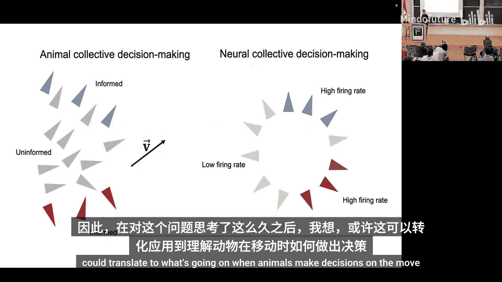

当然，我们学到了一些东西。例如，在这项特定研究中，我感兴趣的是信息是否可以在群体内传播，而无需显式信号、无需个体能够计数、无需个体识别。在模型中，我将个体标记为白色，以便我们可以看到它们是谁，但没有人知道谁知情、谁不知情，它们希望朝着一个共同的方向前进，比如向右。

我们能够证明，在没有信号、计数或类似事情的情况下，信息可以非常准确地传达给整个群体。我们还可以证明，如果存在冲突，例如，一些个体想去白色目标，一些想去红色目标，而其他个体不知情，那么群体在达成共识和决策方面表现得非常出色。在这个案例中，选择是随机的，因为每个选项的数量相等。在这个特定例子中，它们选择了红色选项，但如果我反复运行，结果将是随机的。但我们发现，如果你打破对称性，比如11个想去白色，10个想去红色，群体几乎总是选择多数偏好的方向，即使没有个体知道它们是否属于多数，它们只知道自己的信息状态，无法计数，但准确性极高，即使在面对噪声、非常严重的噪声和局部相互作用时，也能选择多数。

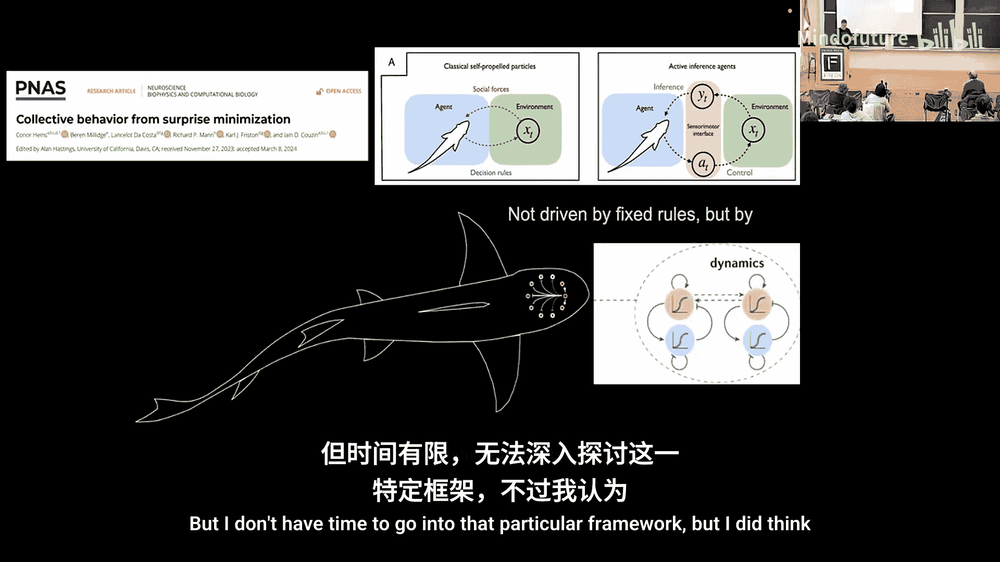

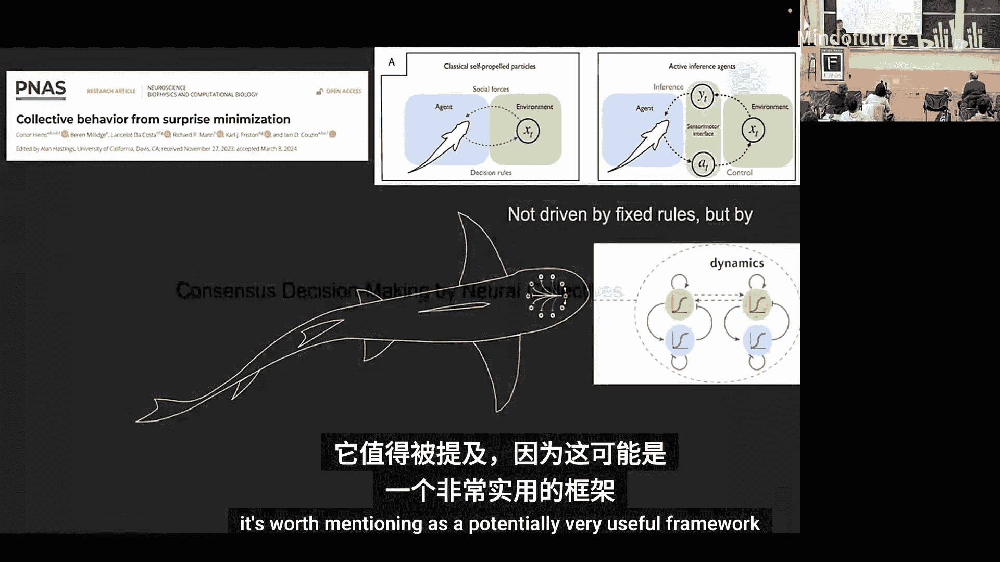

事实证明，多年后，这真正改变了我对大脑如何决策的思考。

因此，如果我们以一种非常抽象的方式思考，你可以将这些不知情的个体（结果证明非常重要）和具有不同偏好的知情个体视为关键。但信息是通过这种局部复制行为、局部社会影响传播的。

然而，如果你想象我之前描述的那个分区模型，现在在个体层面运作，因为它们生活在鱼群和融合种群中。那么，它就不会那么有效，因为会发生的情况是，最顶部的选项会抵消最底部的选项，动物将陷入犹豫不决的状态。这是一个清晰的例子，说明这种相互作用方式的表述存在问题。

我们当时确实是在猜测这些相互作用是什么。因为它产生了看起来逼真的模式，我们当时觉得还可以。但现在，当然，神经科学在理解空间导航回路方面取得了真正的突破，首先是无脊椎动物（大约2014年起），然后在2023年，斑马鱼中也发现了这种神经元环，它是大脑中的一个“指南针”，让动物感知到物体的方向。

因此，如果我们思考我在研究这些动物群体时感兴趣的向量整合的简单示意图，它实际上与大脑中这些环状结构内的高放电率和低放电率有着显著的、数学上我们认为相同的关联。

因此，在思考这个问题这么久之后，我认为，也许这可以转化为动物在移动中做决策时的情况。

---

## 从固定规则到大脑动力学 🧬

上一节我们指出了传统模型的局限性。本节中，我们提出新的视角：决策源于大脑内部的动力学。

我想要论证的是，我们需要摆脱动物遵循固定规则的观点。它们不是由固定规则驱动的，而是由大脑内部的动力学驱动的。这对你们来说可能听起来如此明显，但真的几乎没有关于这方面的出版物，人们仍然在使用这些非常简单的基于分区的模型。

因此，我们主张，与其使用这些经典的所谓自驱动粒子模型，不如将感觉运动接口纳入考虑，这一点至关重要。我与卡尔·弗里斯顿合作的一些工作一直在研究惊奇最小化。假设大脑只是试图最小化不确定性。有两种方式可以改变你对世界的模型：一是移动，这会改变感觉输入；二是改变模型的内部参数。如果你只是假设大脑进化是为了最小化不确定性，那么你实际上可以逆向工程许多这些控制律，并得到涌现的集体动力学。但我没有时间深入那个特定框架，不过我认为值得提及，作为一个潜在非常有用的框架。

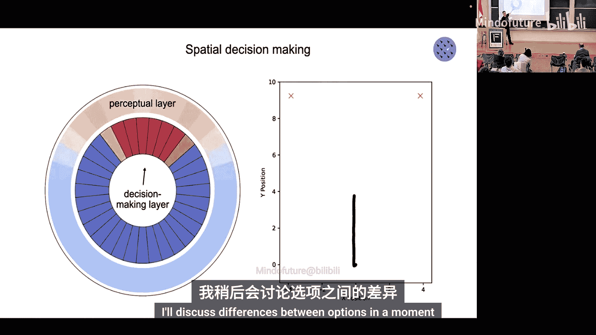

今天我要讲的是神经元集体中的共识决策，以及这如何导致动物在移动中做出的决策。在进一步之前，我要感谢Vivek（我今年的博士生，即将在华盛顿大学开始教职）、Dan（一位被我转化为生物学家的黑洞物理学家，他完成了分析理论）、我在魏茨曼研究所休假时的合作者Ne Gova，以及Rico（他想出了一些这些想法，并意识到所有这些不同系统之间的联系）。你们知道，这真的很有启发性，尽管我们的工作是在斑马鱼中发现这个之前完成的，但从我们的数据中你们会看到，我们有非常有力的证据表明，这些环状结构将指导决策。

David Jaman Janlia在果蝇研究中真正开创了先河。大脑椭圆体上的电活动“凸起”实际上包含了向量表示——偏好的强度和动物将前往的方向，绝对非凡。如果你观察其超微结构，这是真实的世界，一个真实的β，绝对令人难以置信。

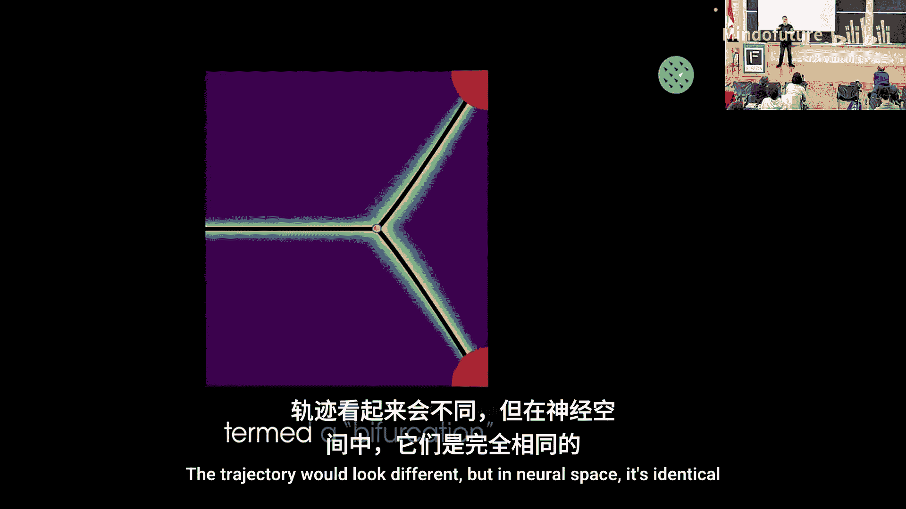

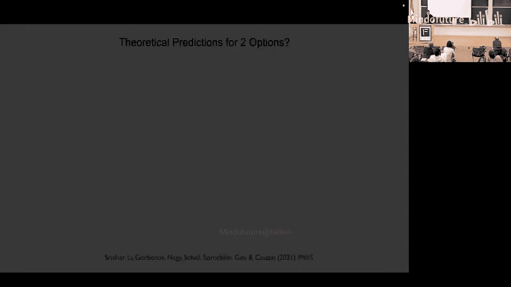

现在，在脊椎动物大脑中，它并非字面意义上的椭圆体，但其功能行为完全像一个椭圆体。像Heson Polinsky这样的人已经研究了头方向细胞中的这类网络，所以这本身并不是一个新想法。但可能让你们惊讶的是，没有人研究过移动中的环状吸引子。我稍后会解释为什么这很重要。

我甚至不需要深入模型的细节，因为它非常简单。我们有一个只有两个参数的模型。它如此简单的原因是，所有动物都不得不独立进化出相同的属性（在许多情况下），但这是一个保守的属性——在移动中做决策。因此，该模型是分析上可处理的，这是一个优势。此外，如果我们愿意，我们总是可以增加复杂性，但会牺牲普适性。例如，哈佛大学的Ben de Be已经证明，只要你处于一类环状吸引子模型中，投入大量细节，这些细节实际上并不重要，你仍然会得到我今天展示的结果。因此，在环上具有相似方向偏好的集群之间存在兴奋或正反馈，这与我们之前在视觉系统中看到的一些方向敏感活动并无不同。然后可能存在全局抑制和/或长程抑制。就今天的目的而言，它们产生相似的结果，但存在一些非常有趣的差异。有些动物如果蝇是全局抑制，其他动物是长程抑制。但总体而言，我们可以将其视为一个神经环状吸引子网络。

作为一个示意图，如前所述，我们有局部兴奋、长程抑制。我们可以证明，这通常会导致一个稳定的活动“凸起”。如果没有输入到这个网络，这个“凸起”可以出现在任何方向。

我们尚未发表但正在与Philipp Min（我博士后期间的导师）及其博士生Vit合作的一件事是，如果我们大脑内部有这种动态网络，那么动物在没有感觉信息时需要做什么？它们需要探索、需要搜索。当你查看文献时，有系统性的螺旋搜索或循环搜索，以及随机搜索如列维飞行或相关随机游走的经典例子。

因此，我们一直在问的一个有趣问题是，如何在环状吸引子上获得这些行波解。例如，如果波以相同速度传播，这将导致动物轨迹上的循环；如果波速增加，将导致阿基米德螺旋。当然，在模型的随机版本中，它永远不会看起来如此干净，但分析版本允许我们展示这些情况发生的机制，而这些正是你在自然界中看到的数据类型，例如蚂蚁的螺旋搜索。

因此，我们也可以转向随机模型，你可以看到这里动物会表现出一个看起来更混乱的阿基米德螺旋，但这更接近我们认为动物大脑中发生的情况。这是一个生成模型，你还可以看到不同的机制，例如这种蜿蜒的波浪运动，这又是人们在自然界中看到的现象，动物需要以这种系统的方式协调它们的运动。

但今天我不打算讨论搜索，我要讨论的是当网络实际有输入时的情况。这里我们有一个感知层，我将展示视觉信息的数据，但这仅仅是因为虚拟现实与视觉配合得非常好。这也可以是听觉的，也可以是听觉和触觉的组合，无论什么，你都有某种感觉输入进入这个决策层。决策层基于该输入达成共识，决定动物去向何方。随着动物移动，这会改变感知输入的几何形状，从而改变共识，进而改变运动，再改变几何形状，因此这是一个具身的过程。这以前没有被研究过。在这里，你可以窥见我们将要看到的情况：当这些选项之间的角度达到临界值时，解决方案变得不稳定，动物会突然在它们之间做出选择。在这个案例中，这些选项是相同的，我稍后会讨论选项之间的差异。

所有动物在生命的某个阶段都必须决定去哪里。因此，我们想问的是，是否存在跨分类群和情境的空间决策通用算法。如果你采用环状吸引子模型，并询问这个具身过程如何运作（正如我向你们展示的一个例子），现在你将看到成千上万个例子作为一个热图。你可以看到，预测是大脑将平均输入，直到达到一个临界几何角度。然后，大脑中的对称性将被打破，动物将选择走向一边或另一边。现在，这是动力系统理论中的一个分岔，它恰好也转化为现实物理世界中的一个分岔。但当我谈论分岔时，我通常指的是在神经空间中。因此，动物可以从这里进来，它仍然会分岔到两个选项，轨迹看起来会不同，但在神经空间中是相同的。

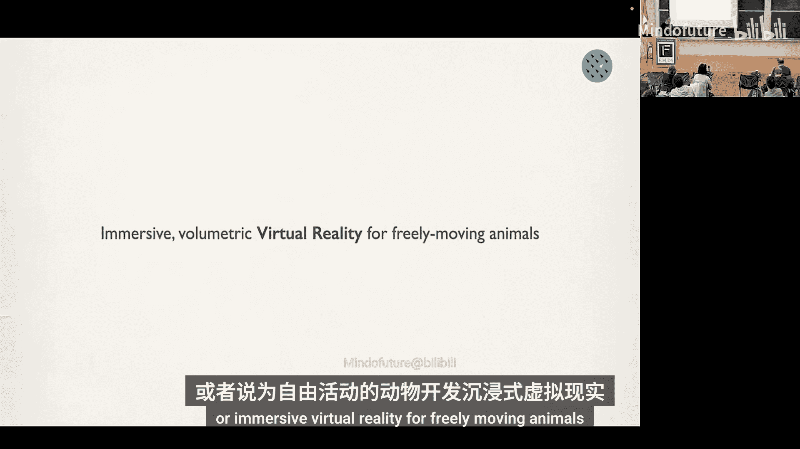

那么，理论预测是什么？如果我们观察平均场模型，我们可以看到，如果存在神经噪声，模型中会有两个参数，其中之一是神经噪声，因此系统并非完全确定性的，正如我之前所示。系统实际上具有热噪声，代表了神经误差。这是现在选项之间的自我中心角度。如果动物离选项很远，这个自我中心角度会很小。我们可以证明，大脑将选择选项之间的平均值，然后随着动物慢慢接近目标，这个角度将平滑连续地增加，直到你到达这里的旋节线，此时大脑必须（可证明地）过渡到决策状态。

我稍后会回到参数化，但观点是，随着动物在物理空间中移动，如果你俯视一只在两个目标之间做选择的动物，我们应该看到这种临界性，表现为动物方向的突然改变，这是由大脑内神经元动力学的分岔引起的。

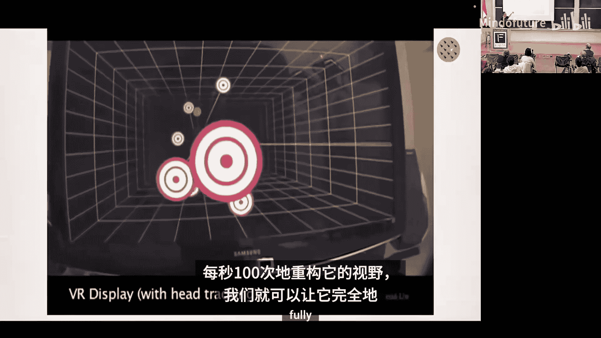

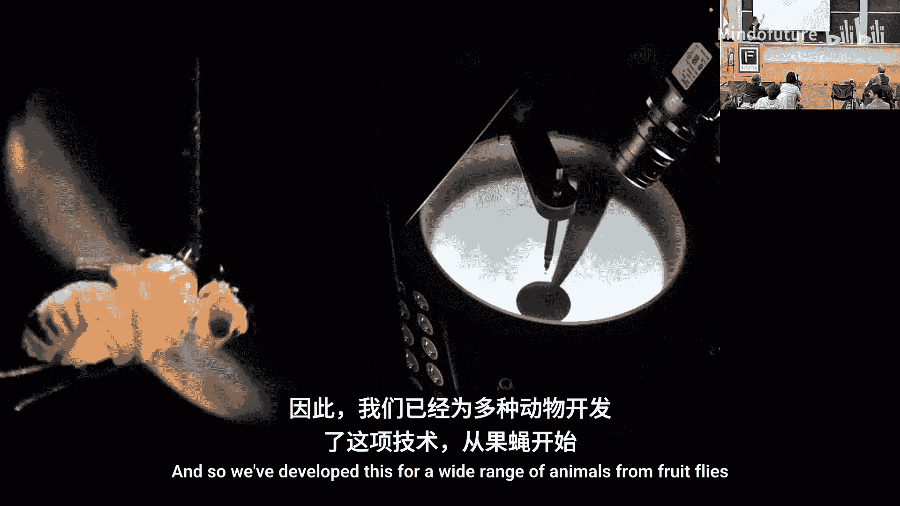

让我更详细地介绍这两个模型参数。一个是神经噪声，相当于物理系统中的温度。我们实际上可以从数据中估计这些，我稍后会展示。现在存在一个临界点。在某个温度以下，我们有一级相变；以上，则是二级相变。因此，只要神经噪声低于某个临界温度，你就会得到我展示给你的动力学——大脑内部突然的相变。高于该温度，大脑会在选项之间漂移，因此它会做出决策，但决策相对较差。我们在模型中唯一的另一个参数是神经调谐。我指的是什么？嗯，这就是大脑内兴奋与抑制的功能形式。

著名的神经科学家Larry Abbott将他们从实验中发现的函数描述为一种奇怪的功能形式，但看起来有点像这样。后来在大脑中，当向量进入扇形体时，它总是余弦。他们有一篇漂亮的论文论证，这允许大脑进行相位算术，基本上将余弦加到余弦上总是得到余弦，所以你可以计算出你过去的位置，完全正确。但他们没有理解的是，为什么在此之前它具有这种奇怪的形式，我今天将尝试向你们解释原因。

但同样，如果你观察这个模型的随机版本，我们不能真正谈论真正的相变，但它是一种类似相变的过程。我们证明，即使只有九个神经元，这仍然是一个非常非线性的突然转变，因此这是一个非常稳健的发现。

那么，为什么这对决策很重要？我认为，理解动物如何实际在空间中移动很重要，但当我们看到这种临界性时。有一个与之相关的特征叫做敏感性或超敏感性，这意味着经历这种转变的大脑（现在在模拟中，在分析模型中这趋于无穷大）在有限大小的系统中，你会得到一个强峰值。这意味着大脑在那一刻作为一个涌现属性，变得对世界中输入之间的差异极其敏感。这是一个多么出色的特性，是相变带来的免费属性。

物理学中有令人难以置信的工作真正表明，这种超敏感性是任何经历此类转变的系统的普遍特征。因此，我们可以相当确信，如果动物以这种方式行为，这可能是一个重要特征。

那么，我们如何测试我们的理论？我们的理论完全基于大脑内的对称性破缺和动态分岔。这真的很难通过实验来检验。因为在我的实验室，即使我有一个非常好的设施，也可能有轻微的气流或我无法感知的电场梯度，这会打破大脑中的对称性，动物会做出我无法理解的决策。如果我要探索大脑中的对称性，我需要观察在超对称世界中的决策。

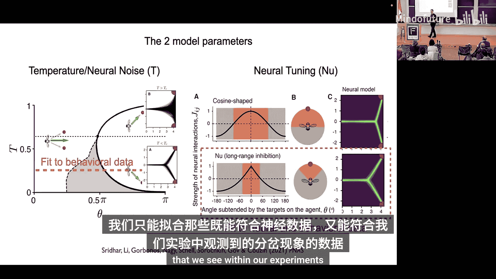

因此，我们解决这个问题的方法是，为自由移动的动物开发虚拟现实或沉浸式虚拟现实。

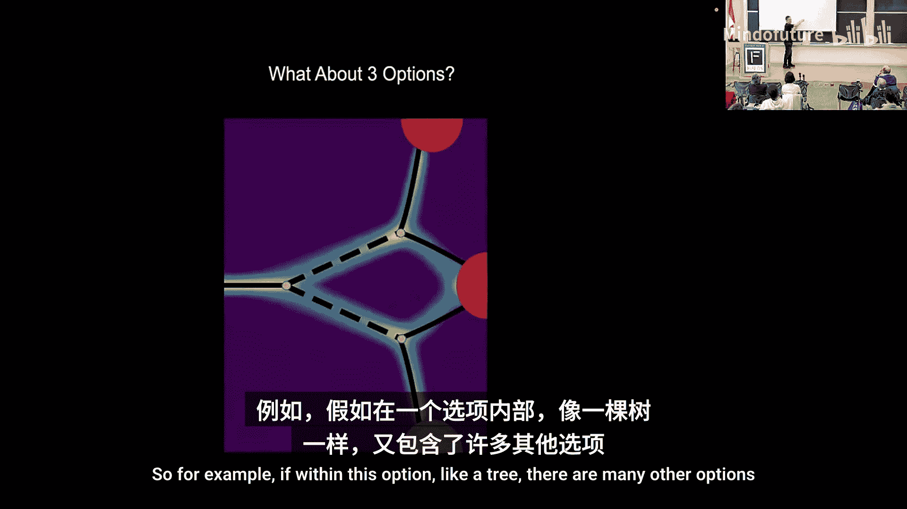

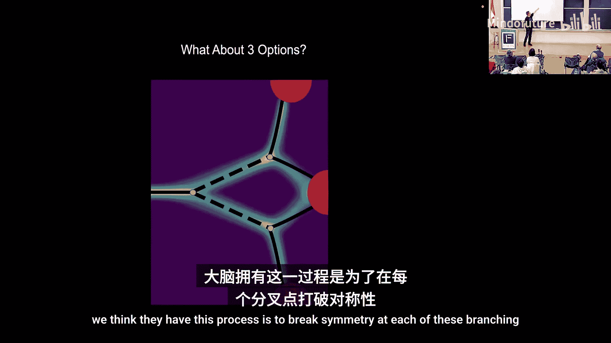

我现在可以告诉你，这个胶带在桌子上方没有体积。但即使是你们复杂的人类大脑，被告知这是一种幻觉，仍然会立体地看到它，直到幻觉被打破。但即使它大致进入正确的位置，你大脑中的立体线索如此强烈，你的先验知识如此强烈，你再次看到它是3D的。同样，这只鞋实际上不是三维的。

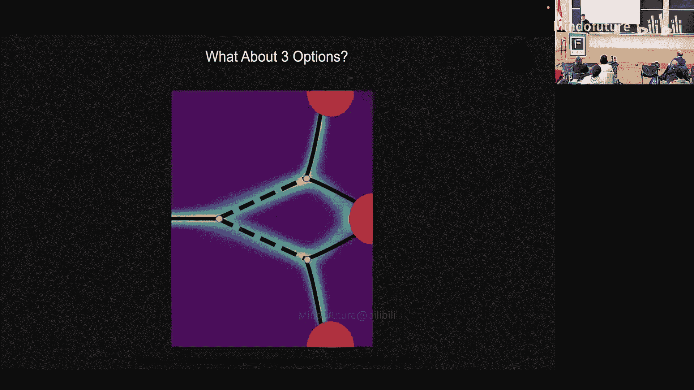

因此，如果我们在这样的世界中有一只动物，并以每秒100次的速度重建它的视野，那么我们就可以让它完全沉浸式地在虚拟环境中互动。我们可以控制物理定律，我们可以拥有旋转不变性。

我们已经为多种动物开发了这个系统，从果蝇（我将展示果蝇的数据）到蝗虫。它们在一个巨大的运动补偿球中，我将在演讲接近结束时展示。以及一些我们上周或上上周收集的、关于蚂蚁在虚拟环境中的未发表数据。

令我惊讶的是，有成千上万篇关于决策的论文，但我们找不到一篇报告动物在做决策时运动的论文。我们能找到的最接近的是灵长类动物和人类或鸟类的手部运动。但实际上，就这个特定理论而言，在动物在空间中移动方面，什么都没有。有些人认为动物看着选项，做出决定，而运动只是输出。但我们认为这是一个具身过程。

因此，我们首先用果蝇进行了实验。现在你看到的是一个热图，显示了数百条果蝇轨迹，展示了它们走向两个圆柱体的概率分布。这是一种反射行为，它们想落到那些圆柱体上。不幸的是，对于可怜的果蝇来说，那里实际上什么都没有，但它们会一次又一次地做出这些决定。同样，蝗虫会走向垂直物体，因为这可能是它们贫瘠沙漠环境中的食物。

因此，有证据表明大脑中存在这种分岔。我们几周前收集的蚂蚁数据，蚂蚁比我们研究过的任何其他动物都要好。这些蚂蚁叫做Diacamma蚂蚁，它们单独觅食，不使用信息素，因此它们不留下化学痕迹。它们生活在群体中，但完全独自觅食。因为它们叮咬得很厉害，几乎没有捕食者。它们出去只是为了寻找食物带回群体，因为它们会把食物给其他蚂蚁，所以它们进化到基本上只是反复做这件事，不会吃饱然后停止行为。因此，与八月的博士生合作，我们可以测试不同选项角度范围，以更全面地测试理论。这是完全未过滤的数据，确切的轨迹，甚至不是热图，展示了蚂蚁的行为。即使在个体层面，你也会看到行为的突然转变。因此，我们现在正在做的是用蚂蚁测试敏感性假说，数据看起来真的很好。

现在，我们可以实际获取这些行为数据，加上来自V vector I的一些神经数据，并实际拟合我们模型的参数。我之前展示过，只要噪声温度低于一级和二级相变之间的临界值，就会发生相变，那么我们就可以解释数据。结果证明，它远低于临界值，大约在0.2到0.25之间。

当你观察神经调谐参数时，正如Larry Abbott和其他人所发现的，我们只能拟合那些既符合神经数据又符合我们实验中观察到的分岔的数据。

---

## 多选项决策与分形行为 🌳

上一节我们探讨了两个选项的情况。本节中，我们来看看当面临三个或更多选项时，决策过程如何以分形方式展开。

那么三个选项呢？在现实世界中，动物必须处理任意数量的选项。大多数神经模型不能很好地扩展，你必须添加另一个组件，再一个组件，变得非常混乱。正如我稍后会展示的，这里它自然地扩展到任意数量的选项，并且是一个分形过程。例如，如果在这个像树一样的选项中，有许多其他选项，这个过程将只是再次分支。

但因为通过实验测试这一点相当困难，我将首先关注三个选项。为了能够看到对称性破缺，我们需要世界是对称的，记住。因此，要看到这个过程，我们需要对称性，但我们认为它们拥有这个过程的原因是为了在每个分支点打破对称性。我稍后会回到这一点。

因此，我们用虚拟现实测试了这一点。这是理论，所以我们预测大脑自发地将世界的复杂性分解为二元决策。我们也可以证明（我稍后会展示），即使在动态神经空间中有许多可能的分支，在每个分岔点你只会看到两个。并且接近每个临界分岔点时，大脑将概率性地排除最差的、次差的选项，这又是一个免费属性，因为它是涌现属性，我们没有将其放入模型。

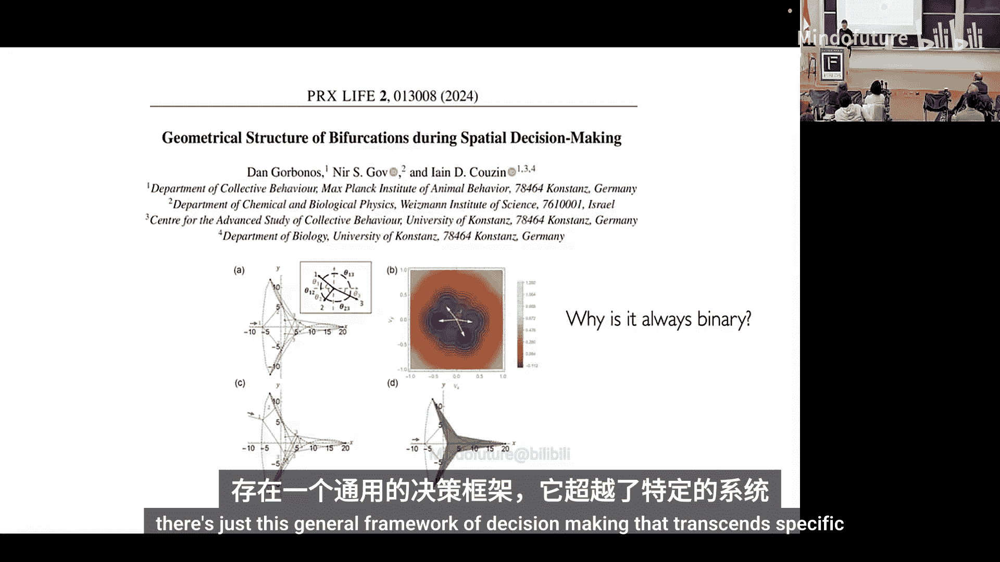

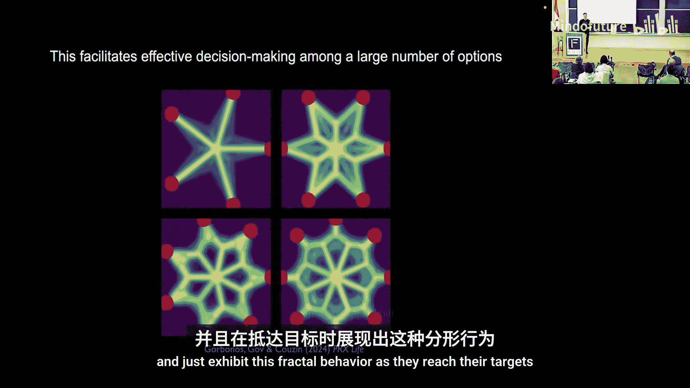

这里是来自果蝇和蝗虫实验的数据，正如理论预测的那样，我们有证据表明，当它穿过空间时，大脑中存在这种双重分岔。

我之前展示了两个选项情况下两个参数到数据的映射。结果证明，这两个参数也完全映射到三个选项的情况。事实上，如果温度高于那个临界温度，可怜的动物将根本无法为三个选项做出决策，因为左边抵消了右边，它们总是走中间。但在临界温度以下，在它们所处的机制中，我们看到这种双重分支过程发生。同样，正如我们之前发现的，神经调谐参数必须处于神经科学实验中发现的那个机制内，才能解释我们看到的分岔几何形状，所以一切都吻合。

再次，我想强调这种超敏感性是它如此出色的原因，即使是一个有点嘈杂的大脑，在这个临界点也能变得像超级计算机一样。

因此，我们刚刚开始进行实验，在那里我们可以打破对称性，并观察选项之间的差异。不幸的是，蚂蚁数据（真的很好）我的学生在马尔代夫，没能及时给我图表，但我认为这很重要，因为我们知道，如果选项之间存在感知差异，很容易看到你可以做出快速准确的决策。如果很难，你可以随时间整合，这完全正确。但我们不需要为这种几何临界性进行时间整合，动物也不会在分岔点花费更多时间，它们也不需要。因此，你可以通过穿过分岔点来“欺骗”这一点。我们预测，动物大脑将强烈选择偏好的选项，即使这是一个非常困难的选择。但如果动物超出了分岔点，如图所示，它将做出非常糟糕的决策。

当然，生物学家不知道这一点，所以他们经常通过将动物直接放在两个选项之间来做实验。但我们认为，大脑能否通过临界分岔点，会有很大差异。

因此，与本科生Lisa Ecker一起，我们为蝗虫测试了这一点。确实，如果大脑不能通过分岔点，它们选择偏好选项的概率只比随机略高；但如果它们能通过分岔点，正如几何分岔理论所预测的，这种选择会被大大放大。

关于Larry称之为奇怪功能形式的另一个有趣方面是，它实际上意味着大脑不是以欧几里得方式编码空间，而是以椭圆方式，在一个相对于动物的弯曲空间中编码。结果证明，这至关重要。如果你扭曲空间太多或太少，动物将无法为三个或更多选项做出决策，它们会陷入选项之间的无尽循环。

我们可以探索这一点的一种方式是观察平均场模型。现在，平均场模型做了很多假设，例如你在空间中的任何点都有无限的时间，但它仍然令人惊讶地捕捉到了我们看到的动力学，可能是因为神经动力学比动物表现出的运动快得多，所以平均场做得相当不错。

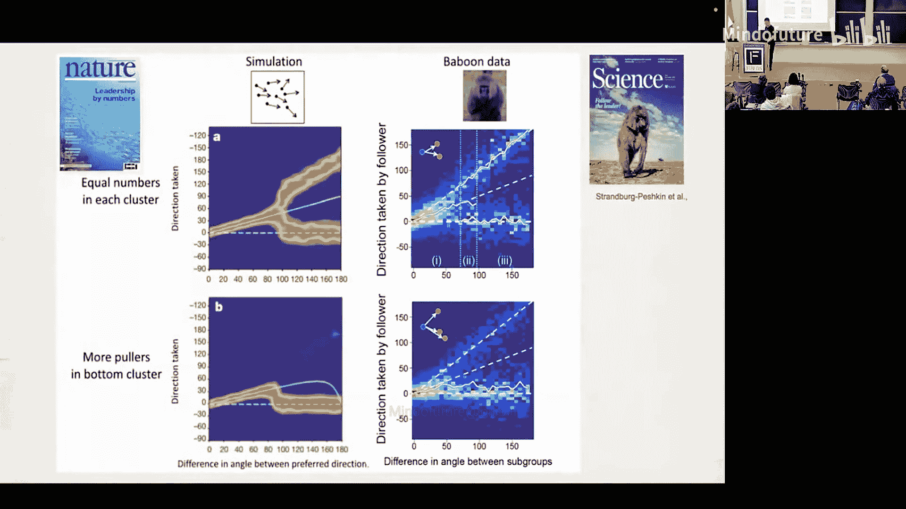

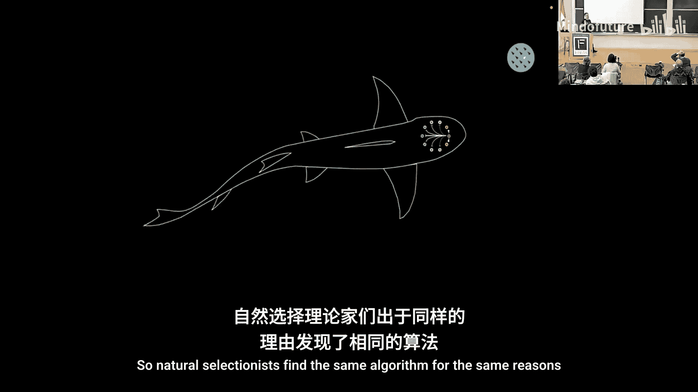

因此，我们可以在平均场模型中做的是找到方程的稳态解。因此，对于每个点，我们可以找出哪些向量是可能的。随着我们获得更多目标，你将有可能指向目标或目标平均值的向量。所以这扩展得相当糟糕，但至少从概念上讲，它在实践中效果很好。但如果你只看两个选项的情况，你可以定义动物必须移动的矢量场，然后当它们到达这个流形时，大脑必须分岔，并将在两个选项之间选择。在两个选项的情况下，这很容易理解。事实上，许多参数化可以解决这个问题。

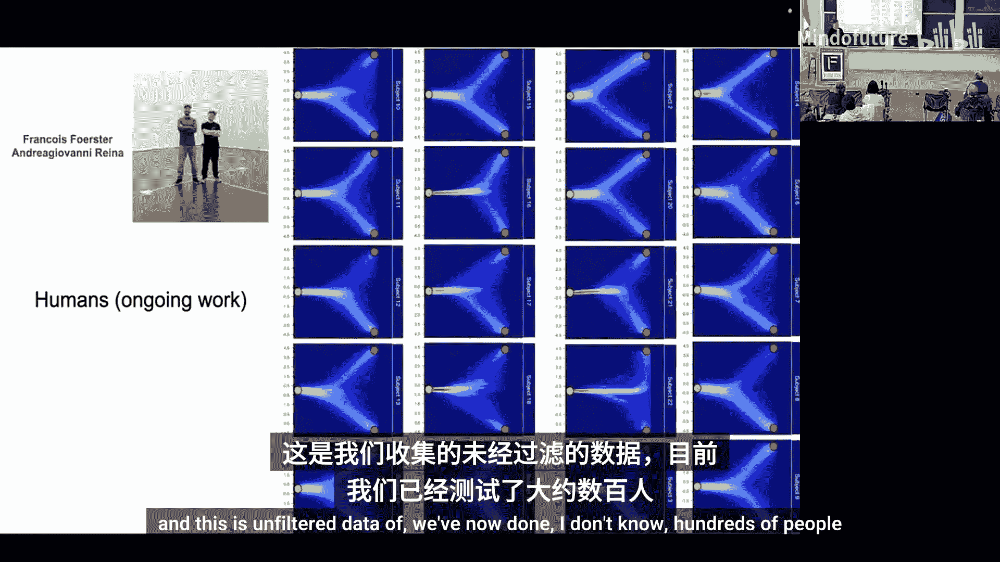

然而，当你处理三个或四个选项时，你必须处于我们发现真实动物所处的那个“甜蜜点”。

我们可以识别显示为红点的分岔点，在那里解决方案变得不稳定，然后你可以观察这些点周围的能量。再次，让我们看看两个选项的情况，这将非常简单。在这一点上，向前移动的解决方案变得不稳定，两个新的解决方案出现，如果选项相等，则有50/50的概率落入这两个吸引子之一。

当我们开始处理三个选项时，事情可能变得相当疯狂，因为它看起来与侧向选项和中间选项的分岔过程相同，但实际上并非如此。存在一种自相似模式向中间目标收敛，伴随着分岔后的分岔，但在随机模型中，看起来好像只是做出了单一选择。

我认为另一个非常有趣的事情（我们仍在研究）是，在第一个分岔之后，如果你观察三个、四个或任意数量的选项，所有的分岔点（无论动物从何处进入，那些分岔点）都位于曲线上。结果证明，这些曲线如何相交的某种元描述定义了动物的轨迹，这至少对我来说是相当难以理解的事情。

例如，如果动物的大脑以欧几里得方式编码信息，即使用余弦，那么你实际上可以得到无限数量的分岔，动物可能陷入选项之间的犹豫不决。这不好。但结果证明，随着你拥有这种更非欧几里得的功能形式，它会展开这些分岔曲线，并允许你从无限数量的分岔减少到有限数量。并且存在一个特定的甜蜜点，对于任何几何配置，最小化动物表现出的分岔数量，使它们能够到达目标并做出高度准确的决策。

如果你想了解更多关于那个特定方面，我们去年在PLOS Computational Biology上发表了一篇论文，但我们正在研究一个更通用的模型版本，在那里我们也可以正式地将环状吸引子模型映射为数学上等价于漂移扩散模型，以及提名意见动力学模型。这就是为什么我认为存在一个超越特定系统的决策通用框架。我们也可以证明它总是二元的，因此在那个甜蜜点，动物可以为任意数量的选项做出决策，并在到达目标时表现出这种分形行为。

它也能产生非常漂亮的图片。

---

## 通用算法与应用 🌟

上一节我们看到了决策的分形本质。本节中，我们来总结这种通用算法，并探讨其潜在应用。

因此，如果这是一个普遍原理，并且在我们研究的这三个系统中，我们发现这两个参数是相同的。让我们采用完全相同的模型，使用那两个完全相同的参数，现在将其应用于一个完全不同的大脑——脊椎动物大脑。鱼不被静态物体吸引，但它们肯定被其他鱼吸引，正如你在这里在我们的虚拟现实中看到的，真实的鱼正在跟随这条虚拟鱼。这些鱼是不到一厘米长的幼年斑马鱼。我们也可以进入大脑，鱼缸里什么都没有，但它相信自己在鱼缸里，即使我们投影在表面上。

现在，我不能将多于一条鱼放入这些环境，因为记住，当那篇论文移动时，幻觉突然被打破，它只能为一个特定视角工作。但我们做的是将系统联网，所以这个可以与那个的全息图实时互动，反之亦然。因此，我们可以玩弄网络拓扑，我们可以添加时间延迟，我们可以玩弄角色物理和时间，以真正理解大脑的行为。现在你看到它有点卡顿，只是因为Zoom链接，但你看到两条斑马鱼互动，不是在同一个物理世界，而是在同一个虚拟世界。我们称之为“矩阵”，因为它类似于那部电影。这项研究实际上将在4月30日发表。

但回到早期的工作，我们可以展示，如果我们能改变这些虚拟鱼之间的距离（我永远无法训练真实的鱼表现出如此精致的行为），那么我们应该看到动物大脑中的分岔，或者我们应该看到与动物大脑中分岔一致的行为，这正是我们看到的。如果我们没有理论，没有虚拟现实，我们将永远无法构建这样的实验，在那里你现在看到理论中的双重分岔，它看起来不同，因为现在我们有一个移动的参考系（想象摄像机跟随鱼），但我们看到了双重分岔的证据，这里是实验数据。

我们还有另一篇论文，我们研究了各种不同的配置，前后、左右、四条、五条鱼等等，它符合我们投入的一切。

因此，现在与神经科学家Armond Ba合作，我们开发了一个系统，你可以在细胞水平分辨率上对一条认为自己正在与其他鱼一起游泳的鱼进行全脑成像。它实际上被麻痹了，Armon正在解码给脊髓的信息以左转、右转、加速等等。所以，期待一些非常酷的东西，在那里我们可以将细胞水平的分辨率与个体决策联系起来，并使用相同的设置将个体决策与集体决策联系起来。

如果这如此稳健，那么我们也应该能够解释野外动物的行为，例如野生灵长类动物。这些是肯尼亚未习惯化的野生橄榄狒狒，带有GPS项圈。出于伦理原因，我们不给幼崽戴项圈，但它们往往与母亲待在一起。每秒钟我们都有动物的位置，有成千上万的事件，一些个体走一条路，其他个体走不同的方向。因此，我们可以从每个个体的角度询问，你如何根据选项的角度做出决策？你可以看到这些个体放弃并重新加入群体。

因此，我们可以询问这些关于野生灵长类动物大脑中分岔和对称性破缺的问题，我们再次发现证据表明大脑以这种方式行为。

因此，我们认为存在一种支配决策的通用算法，它实际上超越了生物组织的尺度。因此，自然选择出于相同的原因找到了相同的算法，但在这些不同的尺度上使用了非常不同的机制。

那么，如何将其应用于现实世界的问题？嗯，一种方法是询问像人类这样非常复杂的生物是否表现出分岔。这是我们现已完成的、未过滤的数据，我不知道，数百人。也许有证据表明，当人类走过真实的物理空间时，也表现出类似的分岔。

我们也可以逆向工程这些算法，并将其应用于机器人技术。许多人谈论受生物启发的算法，如蚁群优化或其他，但这真的只是非常松散地受生物学启发。如果我们实际采用这种算法并直接应用于机器人（如无人机）中呢？因此，我们与麻省理工学院的Danielle Larus合作，我们开发了模型预测控制器，这是最优的人类控制器，需要超级计算机18小时来优化，有大量参数，并且需要了解机器人的一切。相比之下，我们的算法只有两个参数。我们在康斯坦茨用无人机做了这个，在麻省理工用车辆和水上船只做了，并表明是的，模型预测控制器稍微好一点，但只是好一点点，它真的是一种全知模型，而自然模型则非常有效。我们还可以证明，在这个特定演示中，它可以扩展到14个机器人。

那么，回到集体行为呢？我论证了我和其他人在90年代和80年代开发了这些简单的基于分区的模型。这种对大脑如何工作的新理解，如何帮助我们解释动物集体，例如这些庞大的蝗虫群？

这是一个真正的问题，因为这些昆虫通过粮食短缺和粮食安全影响着地球上十分之一的人口，然而几乎没有人研究它，因为这些地区的人们负担不起农用化学品。蝗虫实际上是害羞、隐秘的绿色蚱蜢，它们无法忍受彼此靠近。它们实际上是散居的，如果给它们机会的话。但它们可以转变为这种群居形态，当它们蜕皮时，它们变成黑色、黄色，带有红眼睛，我稍后会展示一个视频。因此，这有点非凡，你有一个基因组中的两种动物，它可以在两种不同的状态之间切换。在60年代，人们认为它们是不同的物种，因为它们的行为和外观如此不同。

那么，它们为什么这样做？嗯，这是对生活在这些极端多变环境中的进化适应。当季风进入东非时，它们可以带来大量降雨，很快在一两周内，你可以看到绿色植物在环境中生长。这对于那些小绿蚱蜢来说，是繁荣兴旺的完美条件，这种绿化可以扩展到巨大的范围，因此这些蚱蜢的数量大大增加。

但在这些条件下，这些散居个体的种群增长，有充足的食物，它们可以避免彼此。如果个体是群居的，它们实际上会变回散居类型，因此这些种群可以变得很大。但如果种群变得太大，或者有干旱，或者它们吃了太多食物，那么它们被迫聚集在一起。当它们聚集在一起时，就是它们转变为群居形态的时候，它们表现出这些大规模的群集，这些群集允许这些昆虫以高度定向的方式迁出营养贫瘠的地区。如果你把一个人放在没有GPS的沙漠中，他们会转圈，类似于这些动物，但如果它们在庞大的群集中，这使它们能够持续存在并迁出营养贫瘠的地区。我们还证明，它们互相残食以在这些长途旅程中生存。母亲们甚至通过卵中的一种化学物质传递信息，告诉它们的后代是为散居生活还是群居生活做准备，因此一代又一代，它们能够持续存在，真是令人惊叹的动物。

因此，2020年1月在非洲发生了一次大规模群集，由于COVID加剧，意味着不可能在非洲各地移动化学品或人员，但我们设法在航班取消前让一个团队进入，实际获取了这些群集的定量数据。预测它们何时何地形成是如此困难。因此，这是团队，是Ats实验室和我的实验室之间的合作，也是与我们小组共享的博士后Sirjan（这项工作的主要作者）的合作。

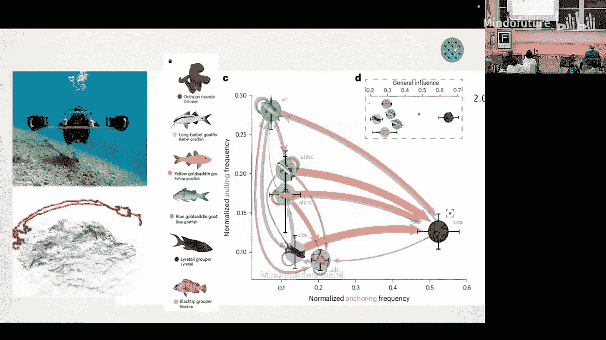

因此，有了这种新的深度学习技术，我们现在可以在这些非常复杂的环境条件下跟踪动物，这篇论文刚刚在二月底发表。

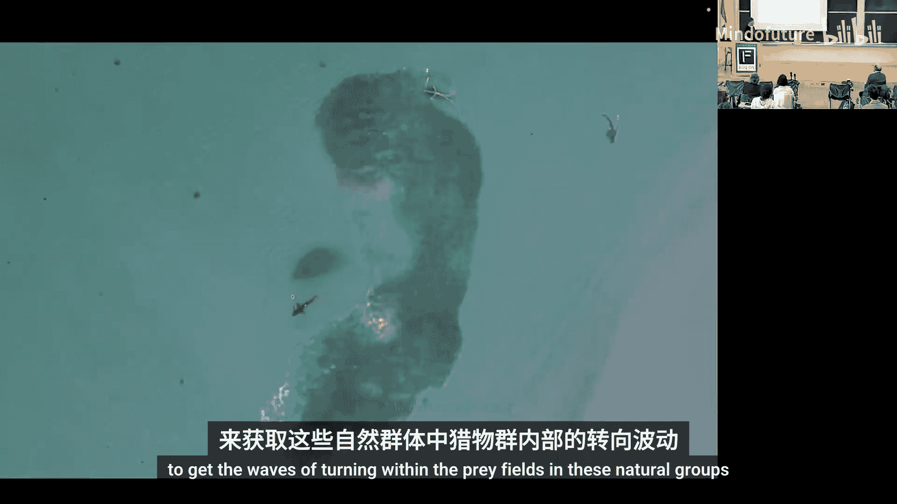

因此，我们在野外发现，如果你从群集中取出一只蝗虫并放回去，它会沿着群集的方向行进，即从左到右。如果你移除它们的嗅觉能力，不会改变任何事情；它们检测