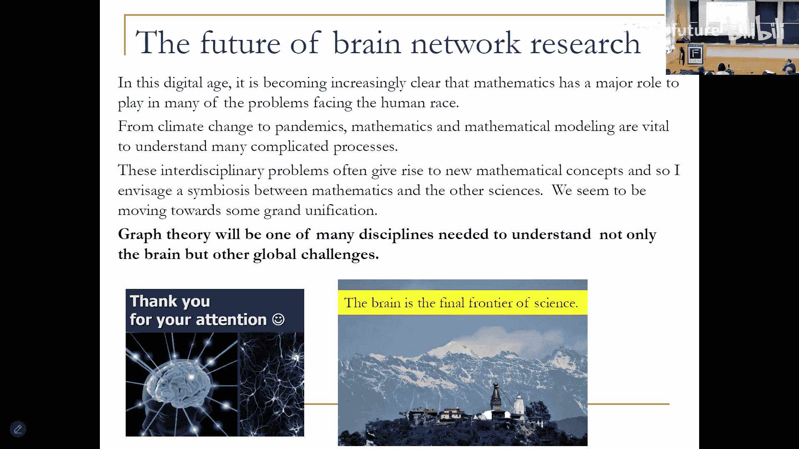

# 003：马尔可夫过程与脑网络枢纽

在本节课中，我们将学习如何运用图论和马尔可夫过程来研究大脑网络，特别是如何识别网络中的关键枢纽节点。我们将从跨学科思想的融合开始，逐步深入到具体的数学模型和应用。

## 跨学科思想的融合

数学与物理学等学科长期以来相互关联、相互启发。这种共生关系促进了双方的快速发展。例如，牛顿定律与微积分的发现就是经典例证。物理学研究时空与因果的三重宇宙，这启发了几何学、代数学和分析学的发展。

我们可以用一幅图来直观地定义这三个概念：空间本身的形态是**几何**；用坐标描述空间并写下方程是**代数**；理解事物在此时空维度中如何变化则是**分析**。没有测量和符号化，我们就无法理解外部世界。印度哲学甚至认为，时空、因果与**数**是并列的，这强调了量化的重要性。

然而，人类内心的世界呢？它与外部世界是相同的吗？回答这个问题可能需要多个领域的交汇，特别是**数学神经科学**。人工智能的兴起促使我们重新思考心智、智能等基本问题。大脑及其奥秘是科学的最终前沿。

## 大脑作为神经网络

目前，神经科学将大脑视为一个神经网络，并将心智和意识视为这个网络的**涌现功能**。这意味着你无法指出某个具体位置说“这就是意识”，它是整体大于部分之和的结果。这是自哲学诞生以来就存在的根本问题。

在21世纪，神经科学在描述大脑神经网络方面取得了显著进展，但工作才刚刚开始。或许通过理解大脑网络，我们能更好地理解心智和意识。在此任务中，**图论**成为了描述大脑连接性的主要工具。

## 图论基础与大脑建模

图论起源于欧拉解决的柯尼斯堡七桥问题。一个**图**由**顶点**（节点）和**边**（连接）组成。边可以是有向的、加权的。大脑网络可以被建模为一个**加权有向图**，其中顶点是神经元或神经元群，边表示它们之间的连接，权重表示信号强度。

将图转化为**邻接矩阵**，我们就从几何表示进入了代数分析。矩阵的每个元素 `A[i][j]` 表示从顶点 `i` 到顶点 `j` 的连接权重。对于大脑网络，这个矩阵通常不是对称的，因为突触连接不一定是双向的。

## 马尔可夫过程与枢纽识别

为了理解网络中的信息流，我们可以将图视为一个**马尔可夫过程**。在这个模型中，我们定义了一个**马尔可夫矩阵** `P`，其中元素 `P[x][y]` 表示从状态（节点）`x` 转移到状态 `y` 的概率。一个简单的模型是令 `P[x][y] = 1 / (x的出度)`，即假设从节点 `x` 出发的所有连接具有相等的转移概率。这个矩阵是**行随机**的，即每一行元素之和为1。

马尔可夫链的核心定理指出，在温和的条件下，当转移步数 `n` 趋于无穷时，转移矩阵的 `n` 次幂 `P^n` 会收敛到一个极限矩阵。这个极限揭示了系统的长期行为。对应的极限概率分布向量 `V` 可以通过求解线性方程 `V * P = V` 得到。向量 `V` 中的每个分量代表了过程长期处于对应状态的概率。

在脑网络研究中，这个极限概率分布可以用来识别**枢纽**节点——那些在长期信息流中扮演最关键角色的脑区。这与谷歌网页排名算法（PageRank）的核心思想同源，后者也是基于马尔可夫过程来评估网页重要性。

## 应用与未来方向

上述方法已被应用于简单的生物神经网络，如拥有302个神经元的**秀丽隐杆线虫**和拥有约2万个神经元的**果蝇**。通过分析它们的连接组数据并应用马尔可夫过程，可以识别出与运动控制、应激反应等关键功能相关的枢纽神经元。

未来的工作可以朝多个方向发展：
*   使用**连续时间马尔可夫过程**来更精确地建模随时间变化的突触强度。
*   定义脑网络的 **ζ 函数**（一种生成函数矩阵），将代数几何的思想引入网络分析。
*   研究网络度分布的**幂律**特性，这与数论中的黎曼ζ函数存在有趣联系。

## 总结

本节课我们一起学习了如何利用图论和马尔可夫过程来建模和分析大脑网络。我们从跨学科的视角出发，介绍了将大脑表示为加权有向图的方法，并重点阐述了如何通过构建马尔可夫矩阵、求解其平稳分布来识别网络中的功能枢纽。这不仅为神经科学研究提供了新的数学工具，也反过来推动了图论本身（特别是有向图谱理论）的发展。探索大脑这一最终前沿，需要数学与神经科学更深入的共生融合。