# 004：时空人工神经网络的计算归纳偏置

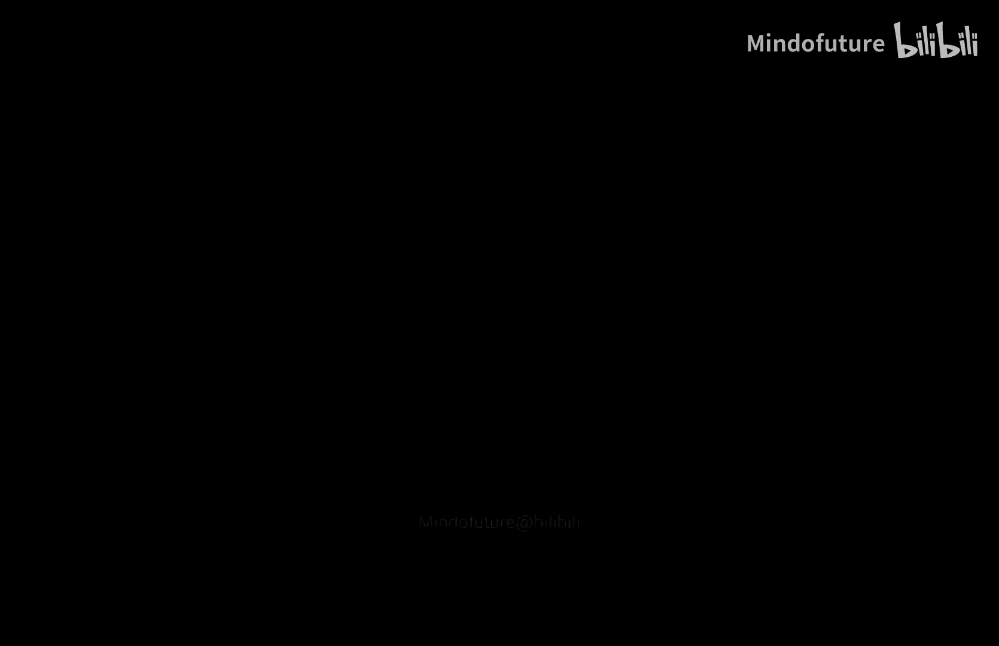

在本节课中，我们将探讨人工神经网络中的计算归纳偏置，特别是如何通过引入时空动力学（如波动）来构建更高效、更具泛化能力的模型。我们将从现代人工智能模型的局限性出发，分析归纳偏置的概念，并深入探讨波动动力学如何自然地引导模型实现空间信息整合、时间信息记忆以及对世界连续对称性的编码。

---

## 归纳偏置：模型选择如何影响学习

上一节我们提到了现代大型模型在数据效率和泛化能力上的挑战。本节中，我们来看看一个核心概念：**归纳偏置**。它指的是在选择模型时所做的、能够约束模型可能学习到的内容以及其泛化方式的先验假设。

一个简单的例子是房价预测。假设你的数据是房屋面积与价格的关系图。
*   如果你选择一个**线性模型**（`y = ax + b`），你的模型具有“高偏差”，可能无法完美拟合所有数据点，但你只需要少量数据就能得到一个合理的拟合。
*   如果你选择一个**高阶多项式**，你可以完美拟合所有训练数据，但很可能无法很好地泛化到新的数据点（例如，预测一个超大面积的房屋价格时可能出错）。

在深度学习中，一个著名的归纳偏置例子是**卷积神经网络**。它通过在空间上共享权重（即使用相同的卷积核扫描整个图像），假设了特征在图像的不同位置具有不变性。这极大地提升了模型在图像任务上的数据效率和性能。

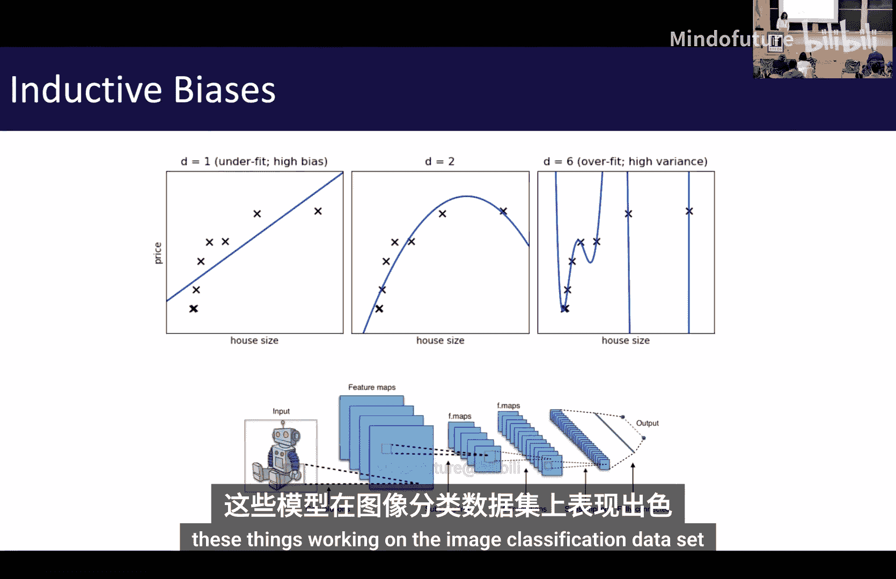

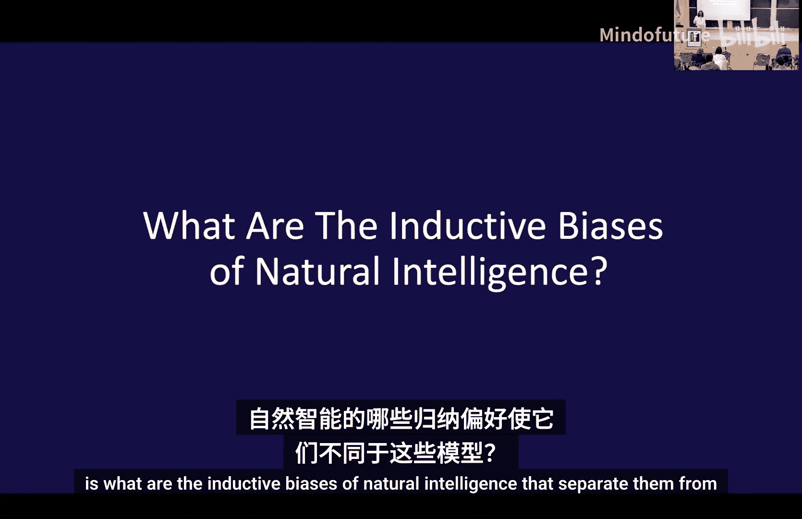

那么，自然智能（如大脑）拥有哪些独特的归纳偏置，使其与当前的人工智能模型区分开来呢？

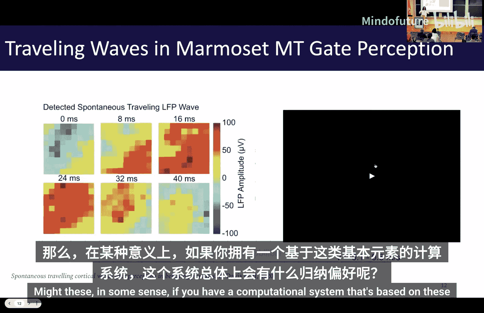

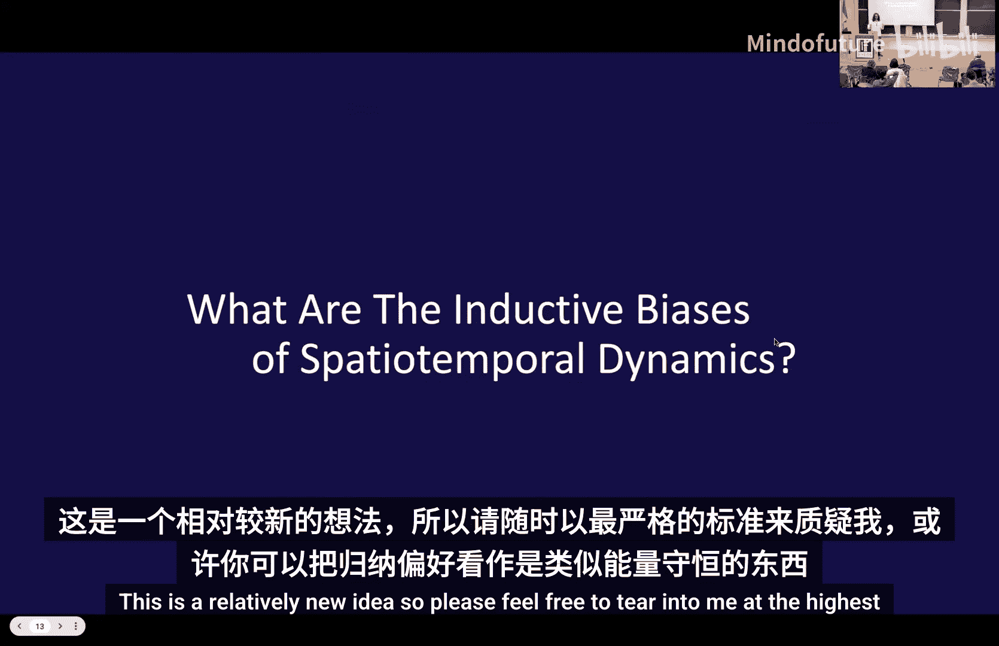

---

## 大脑中的时空动力学：波动的启示

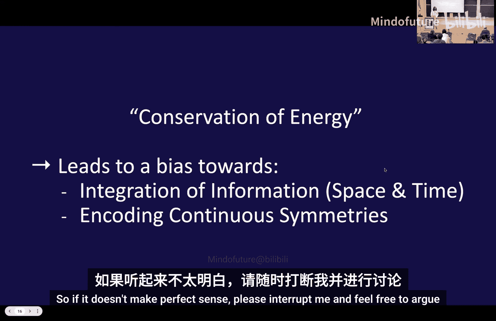

上一节我们介绍了归纳偏置的概念。本节中，我们来看看自然界智能系统——大脑——中一种普遍存在的现象：**时空动力学**，特别是**传播波**。

研究表明，大脑的多个区域都存在波动活动，例如海马体的theta波、睡眠期间的全局波，以及视觉皮层MT区的波。这些平滑的、在空间中传播的动力学模式提示我们，基于此类“基元”的计算系统可能具有独特的归纳偏置。

一个核心观点是，许多波动系统（如最简单的波动方程）具有**能量守恒**的特性。虽然大脑中的波并非完美的物理波，可能存在阻尼，但在短时间尺度和局部空间区域，可以近似认为存在某种“守恒量”。这种守恒性可能导致系统偏向于以特定的方式整合与存储信息。

具体而言，我们认为时空动力学可能带来两种高阶的归纳偏置：
1.  **信息在空间和时间上的整合**。
2.  **对连续对称性的编码**。

---

## 空间信息整合：波动如何“看见”全局

上一节我们提出了波动可能促进信息整合的观点。本节中，我们通过一个具体实验来看看波动如何帮助局部神经元“了解”全局信息。

想象一个视觉皮层V1的神经元，它只拥有一个很小的局部感受野。当它看到一片类似天空的纹理时，如何区分这是真实的天空还是湖面的倒影？它需要整合图像其他部分的信息。波动为解决这个问题提供了灵感。

我们从一个经典的数学问题“听鼓辨形”获得启发：在一个固定边界（鼓面）上激发波动，其振动的频率谱包含了边界形状的信息。更大的鼓面会产生更低的基础频率。这意味着，波在传播、反射的过程中，将边界的信息带回了内部。

基于此，我们设计了一个计算实验：
1.  输入是不同形状（如三角形、正方形、五边形）的二值图像。
2.  我们构建了一个模拟波动方程的人工神经网络，其神经元仅具有小的局部感受野。
3.  网络通过侧向耦合进行递归动力学演化，模拟波在“皮层”上的传播。
4.  任务是从单个神经元随时间变化的激活信号中，解码出整个图像的形状类别。

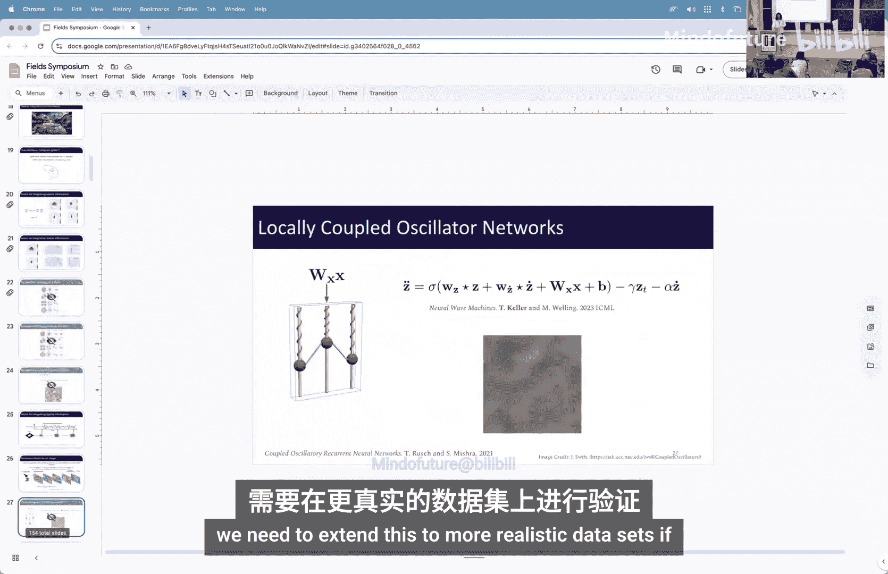

以下是实验的关键步骤和发现：

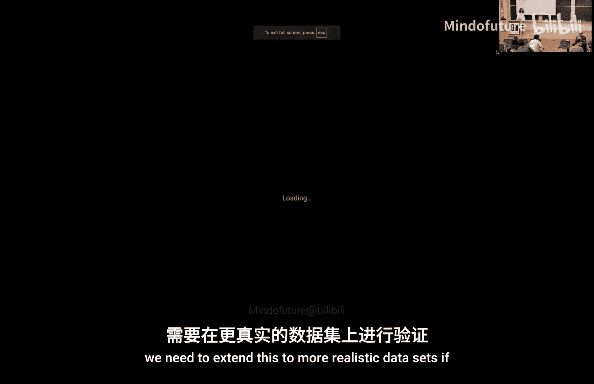

*   **模型架构**：网络包含一个将局部图像像素编码为初始驱动的输入编码器，一个模拟波动动力学的递归层（其权重具有空间对称性），以及一个从神经元的时空激活信号中解码类别的读出器。
*   **波动传播**：网络学习后，输入刺激在边界处产生扰动，波在此处反射并传播。不同形状内部和外部会形成不同的动力学模式。
*   **特征提取**：对单个神经元的激活时间序列进行傅里叶变换后，发现不同形状在不同频带上具有显著差异的特征谱。这意味着波动成功地将全局形状信息编码到了局部神经元的时序活动中。
*   **性能对比**：这种基于单层波动递归的模型，在形状分类任务上表现优于需要堆叠许多层来实现感受野扩大的传统深度卷积网络。这表明波动提供了一种高效的空间信息整合机制。

一个有趣的发现是，最好的读出方式是对整个时间序列进行一个可学习的线性变换。分析这个变换矩阵的行向量发现，它们类似于**小波变换**的基，表明模型在利用波动中的瞬态动力学特征进行分类。

---

## 时间信息整合：波动作为记忆载体

上一节我们看到了波动如何整合空间信息。本节中，我们来看看波动如何帮助模型在时间维度上整合与保存信息。

直观上，向池塘中投入石子，水面波纹会编码石子投入的时间和位置信息。观察水面，就能读取一段历史。我们想探究，能否将类似的原理整合到循环神经网络中，以增强其记忆能力。

我们比较了两种简单的循环神经网络：
1.  **标准RNN**：使用全连接递归权重矩阵。其动力学通常表现为杂乱无章的“脉冲”活动，信息容易随时间消散。
2.  **波动RNN**：将全连接矩阵替换为一个**局部连接的卷积操作**。这近似于对一维平流方程（一种简单的波方程）的离散化。其动力学表现为活动在空间维度上有序地“流动”或“传播”。

我们在简单的**复制任务**上测试这两种模型。该任务要求模型在接收到一段输入序列后，经过一段延迟，再准确复现该序列。

实验结果非常明显：
*   **学习速度**：波动RNN（红色曲线）学习速度远快于标准RNN（蓝色曲线）。
*   **长程依赖**：随着延迟时间增长，波动RNN的性能优势更加显著。
*   **内在机制**：卷积操作带来的**空间权重对称性**是产生能量守恒特性和长效记忆的关键。即使随机初始化，模型为了完成需要时间整合的任务，也会自发学习出类似波动的动力学。

这表明，波动动力学为模型提供了一种偏向于在时间上保存信息的归纳偏置。

---

## 扩展到现代序列模型：状态空间模型中的波

上一节的实验是在简单模型上进行的。本节中，我们来看看波动思想如何应用于当前机器学习领域热门的**状态空间模型**，例如Mamba架构。

状态空间模型本质是一种线性递归模型，因其在长序列处理上的效率而受到关注，被视为Transformer的潜在竞争对手。最新的Mamba模型在其核心包含一个特殊的“移位SSM”组件。其状态转移矩阵是一个次对角线为1的矩阵，这恰好对应于**速度为1的平流方程**的离散形式。

我们发现，Mamba模型的隐藏状态动力学中确实存在清晰的波动模式。然而，其波速被固定为1。受我们之前工作的启发，我们构建了**Wave Mamba**，允许模型学习**可变的波速**。

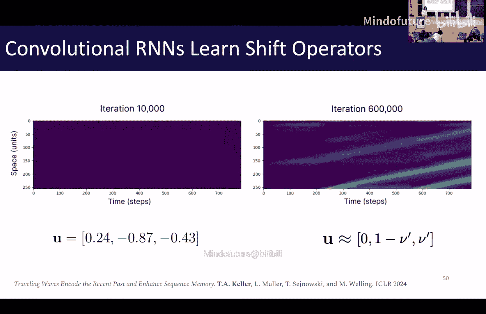

在具有挑战性的长序列复制任务上测试：
*   **原始Mamba** 在此任务上表现不佳，远逊于Transformer。
*   **Wave Mamba** 通过引入可变波速，学习速度呈指数级提升，最终性能逼近Transformer，而原始Mamba则需要长得多的时间才能达到类似水平。

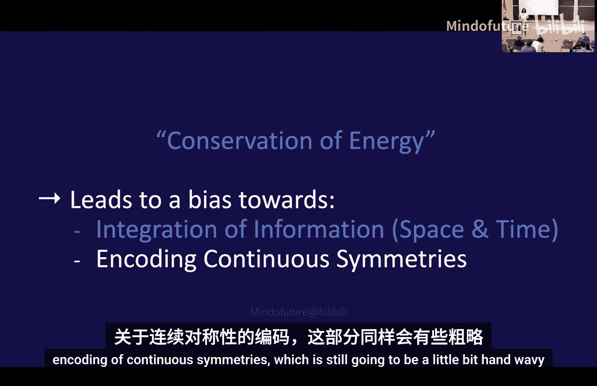

这再次表明，允许更灵活的波动动力学（可视为多时间尺度记忆），能为序列模型带来强大的性能提升。波动似乎是解决长程依赖问题的一个有效归纳偏置。

---

## 编码连续对称性：波动与变换等变性

上一节我们探讨了波动在记忆方面的作用。本节中，我们将进入一个更概念化的领域：波动如何帮助模型**编码世界的连续对称性**。

世界充满对称性，如平移、旋转、颜色空间变换等。在机器学习中，**等变神经网络**旨在让网络函数 `F` 满足：对输入施加一个变换 `T`，等价于先对输入进行 `F` 处理，再对输出施加一个相应的变换 `T'`。卷积网络就是平移等变性的典型例子，这带来了参数共享和高效泛化的好处。

我们认为，时空动力学可能自然地实现一种“慢变换”的等变性。如果世界在发生缓慢的连续变换（如物体旋转），而模型的隐藏状态也经历着同步的、平滑的时空流变，那么模型就可能自动学习到这种变换的等变表示。

为了验证，我们使用之前提到的**耦合振子网络**进行实验：
*   **任务**：训练模型对旋转的数字序列（如旋转的“5”）进行一步超前预测。
*   **过程**：输入序列驱动隐藏状态；隐藏状态进行波动动力学演化；解码器从隐藏状态重建下一时刻的输入。
*   **发现**：训练后，隐藏状态中产生了**对齐的、定向传播的波**。波传播的方向编码了旋转变换，而波的波前等细节则编码了物体的身份信息。
*   **等变性验证**：我们验证了模型近似满足一个交换关系：对输入施加旋转变换后编码，与先编码原始输入再通过隐藏状态的波动模拟该时间段的变换，两者得到的重建结果基本一致。这表明模型在隐藏状态中学习到了输入变换的**同态表示**。

更令人惊奇的是，当分析模型在处理不同朝向光栅刺激后神经元的**朝向选择性**时，我们发现，在没有明确监督的情况下，模型自发形成了**在空间上平滑变化的朝向选择性图谱**，这与初级视觉皮层中的朝向功能柱有相似之处。这表明波动动力学与局部特征表征可以协同共存。

---

## 迈向相对性：伽利略与洛伦兹等变性

上一节我们讨论了静态连续对称性的编码。本节中，我们进行一个更前沿的思考：如果变换本身是随时间变化的（如匀速运动），模型应如何处理？这引向了**参考系**和**相对性**的概念。

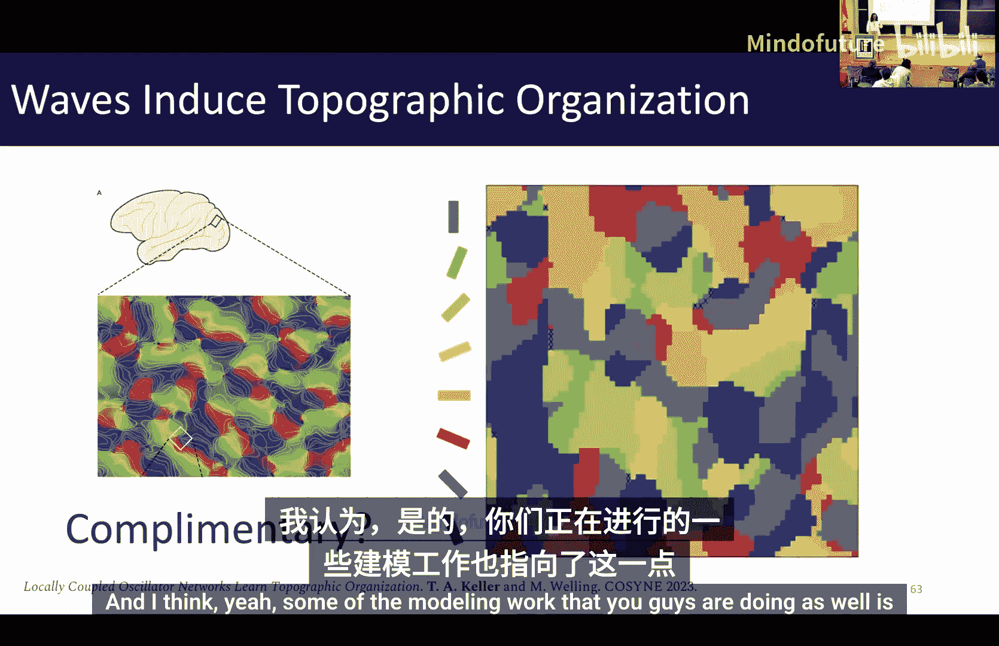

物理学中，伽利略相对性原理指出，在所有惯性参考系（相互做匀速直线运动的参考系）中，力学定律形式相同。对于循环神经网络，我们能否构建一个**伽利略等变**的版本，使其处理在时空中移动的输入时，表现得如同在处理静态输入？

我们定义循环神经网络的“惯性参考帧”：将隐藏状态的神经元排列在空间维度上，其活动模式可以“移动”。一个伽利略等变的RNN要求：对输入序列施加一个匀速平移变换后进行处理，应等价于先处理原始静态输入，再将隐藏状态进行相应的平移。

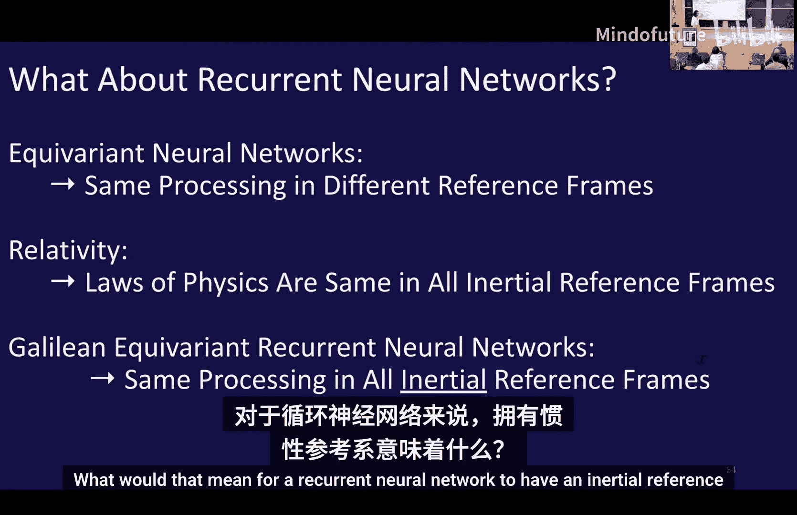

实验表明，标准的线性RNN或卷积RNN不具备这种等变性。为了实现它，我们需要在模型处理输入的同时，主动地将其“参考帧”与输入的运动对齐。实现这一点的数学变换，恰好又回到了**平流方程**。

我们将这种伽利略等变RNN应用于运动目标检测任务（如移动的光点或游动的鱼）。结果显示，在处理移动的测试数据时，等变模型的性能下降远小于非等变模型，展现了其优越的泛化能力。

一个更深刻的推论是：如果我们使用的动力学是**二阶波动方程**，那么其对称群将不再是伽利略变换，而是**洛伦兹变换**（狭义相对论）。这意味着，如果神经动力学遵循此类方程，在高速运动下可能会产生时间膨胀、长度收缩等奇特的感知效应。一些心理物理学实验似乎暗示人类存在类似的主观洛伦兹变换现象，这为未来的研究提供了一个有趣的方向。

---

## 总结

本节课中，我们一起学习了时空动力学（特别是波动）如何为人工神经网络提供强大的计算归纳偏置。

我们首先指出了当前大型AI模型在数据效率和直观泛化上的不足，并引入归纳偏置作为解决问题的关键视角。随后，我们探讨了大脑中存在的波动现象，并论证其可能带来两种核心偏置：**信息在时空上的整合**与**连续对称性的编码**。

通过一系列实验，我们展示了：
1.  波动模型能有效整合超越局部感受野的全局空间信息。
2.  波动动力学可作为高效的记忆机制，提升模型处理长程时间依赖的能力。
3.  在现代状态空间模型（如Mamba）中引入可变波速，能显著提升其性能。
4.  波动网络能自发学习对输入连续变换（如旋转）的等变表示，并形成类似皮层的平滑功能图谱。
5.  将等变性思想扩展到运动参考系，可以构建伽利略等变的RNN，提升模型对运动输入的泛化能力，并由此连接到更深刻的相对论原理。

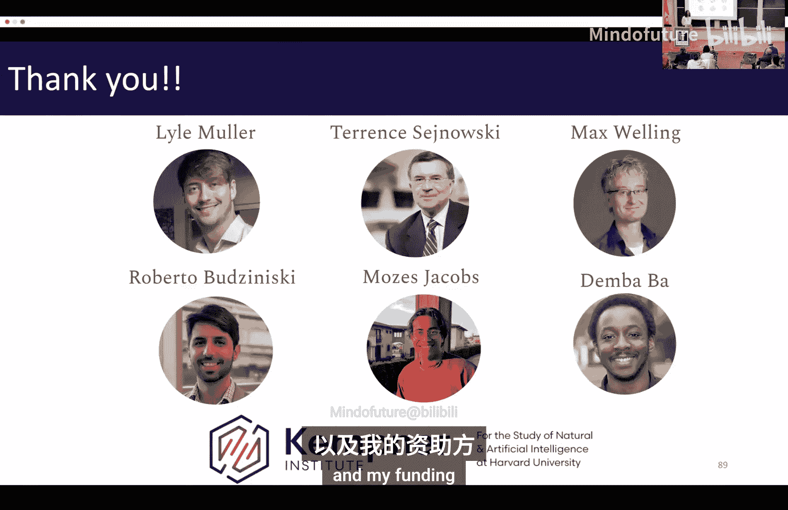

总之，将时空波动动力学作为构建模块引入神经网络，是一条通向更高效、更泛化、更接近自然智能计算原理的 promising 路径。