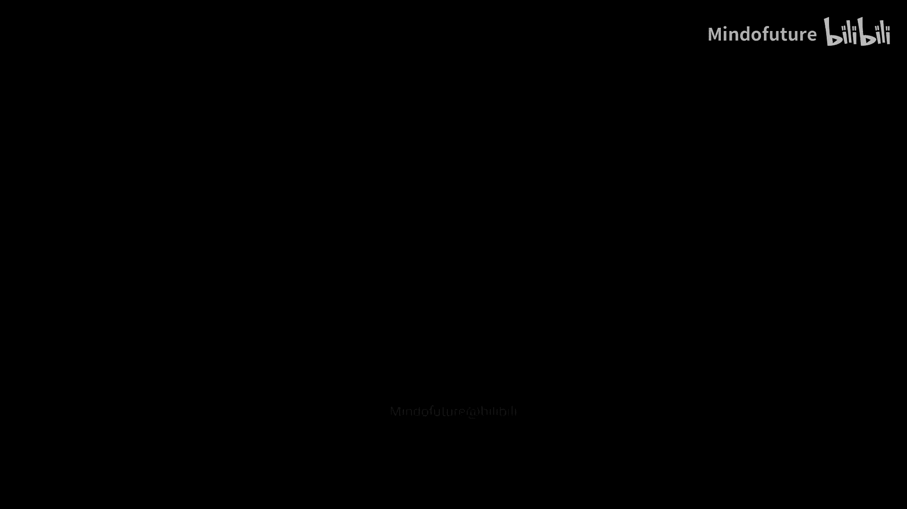
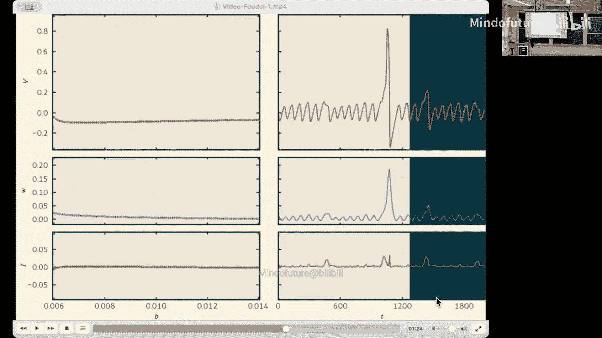
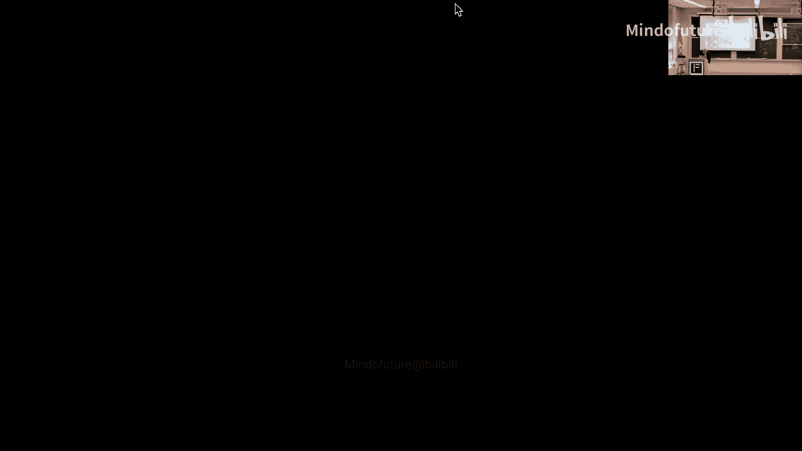
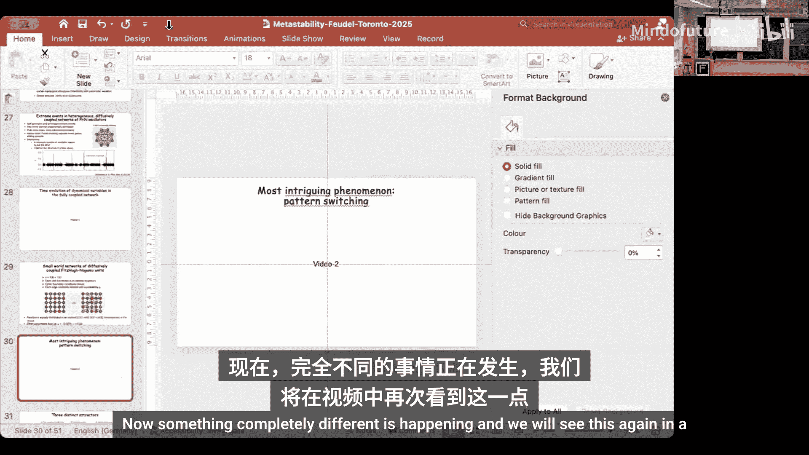
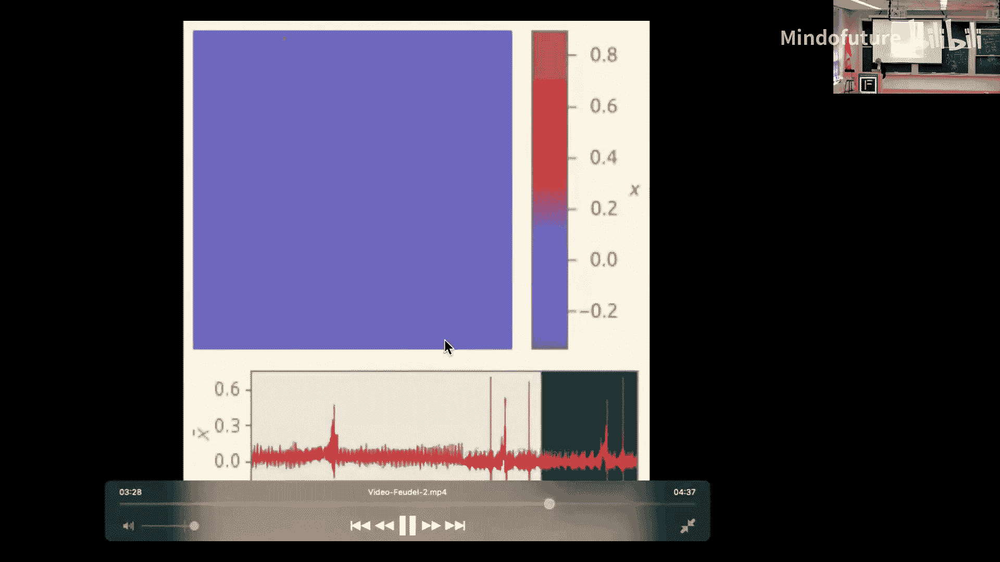
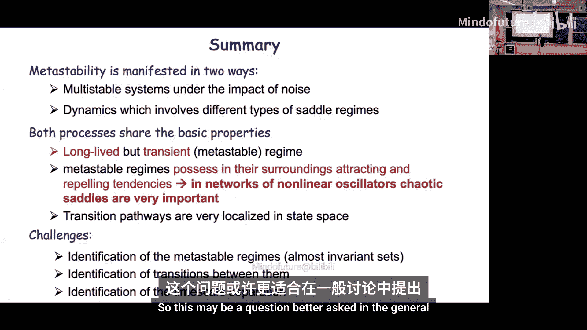

# 005：神经科学中的亚稳态与瞬态动力学

在本节课中，我们将探讨神经科学中一个核心概念：亚稳态与瞬态动力学。我们将从动态系统的角度出发，解释大脑活动中观察到的各种短暂而持久的模式，例如神经元活动的爆发、同步状态的切换以及癫痫样活动。课程将介绍实现这些现象的多种机制，并特别关注确定性混沌在产生看似随机但实则有序的瞬态行为中的作用。

## 概述与动机

首先，感谢会议组织者的邀请。在会议第一天，我已经获得了许多启发。

我希望在接下来的几天里，这种启发能够持续。我将展示与几位合作者共同完成的工作，其中包括在场的几位，非常感谢他们的参与。

本次演讲的主题是神经科学中的亚稳态与瞬态动力学。由于时间有限，关于神经科学的部分可能会被压缩。我本质上是一个动态系统研究者，虽然有时涉足神经科学，但我主要受神经科学中的动力学现象启发，来构建和塑造动态系统理论，以解释事物运作的机制。

动机部分可以非常简短，因为它只是从文献中任意选取的一些例子，展示了我们称之为亚稳态的现象。这些例子显示了以特定序列出现的不同神经元活动模式。例如，闭眼时的脑电图记录中出现的微状态，或神经元活动持续一段时间后出现的静息状态（上下状态）。此外，还有不同的活动模式，例如这里的尖峰活动和簇状活动，甚至是受刺激后进入的癫痫样活动。这些动态模式在内部动力学上看起来非常不同，我们希望用一个通用框架来描述它们，为这类模式提供一个统一的视角。

## 神经科学中的亚稳态概念

在神经科学中，这被称为亚稳态，但其中融合了许多不同的概念。例如，不同活动模式的可变性被称为亚稳态，或者不同状态之间的可变性。同步模式的可变性也是一个例子，正如上一场精彩演讲所展示的，即同步状态的可变性。此外，还有大脑进入不同状态的概念，以及整合与分离的概念，即大脑不同部分要么协同工作，要么各自独立。

因此，存在自发的亚稳态，即不同模式之间的自发跳跃。它也可以由外部信号驱动。这些模式可能重复出现，也可能不重复。可以看到，对于亚稳态是什么，存在多种不同的理解。因此，我们试图寻找一个共同的框架。从动态系统的角度来看，这个共同框架基本上由以下特性定义。

## 亚稳态的核心特性

亚稳态具有以下特性：存在**长寿命但瞬态的准稳定状态**。系统会处于某个特定的动态状态中一段时间，例如爆发状态、紧张性放电状态，或更复杂的状态，如同步、非同步、集群同步、完全同步等。这些状态的可能性很多。

这些状态是**几乎不变**的，意味着系统会在其中停留一段时间，然后离开。最重要的特性是，这类亚稳态必须具有某种属性，因为系统必须在某个时刻**到达**这些状态。系统从某个地方来，被这个状态吸引，停留一会儿，然后离开。这意味着吸引和排斥的倾向必须同时存在，否则就不是亚稳态。因为亚稳态意味着它是瞬态的，最终会离开。因此，系统有很大概率长时间停留在此，但最终（以概率1）会在某个时刻离开，尽管我们不知道这个时刻何时到来。

## 实现亚稳态的两种主要机制

观察这一现象，我们有两种不同的实现方式。

一方面，众所周知的是**受噪声影响的多稳态系统**。多稳态系统是指存在多个不同动态状态的系统。例如，一个双稳态系统，就像图中展示的，有两个稳定的“势阱”。你可以想象在草地上有许多小山谷，每个山谷代表一个稳定状态，小球（系统状态）会落入其中一个。山谷之间是不稳定的区域（鞍点）。所有会流向某个山谷的初始条件集合，称为该稳定状态的**吸引盆**。吸引盆可以是简单的、平滑的，也可以具有**分形**的复杂结构，在这种结构下，稍微偏离一点，就难以预测最终会到达哪个状态。

另一方面，也是更有趣的部分，是存在具有吸引和排斥方向的**鞍型状态**。这些可以是简单的点，也可以是更复杂的结构，这将是下文重点讨论的内容。

## 噪声诱导的亚稳态

为了给你一个直观印象，最好通过观察双稳态系统来解释。黄色小球在这里，但由于噪声，它会在附近徘徊。存在吸引方向，因为它想滚回谷底；同时也存在排斥方向，噪声可能将它踢过小山，然后它到达另一边，又可能滚回来。这就是在受噪声影响的多稳态系统中观察到的亚稳态。

从这个山谷的逃逸也并非完全随机，尽管有噪声参与。文献中对此有讨论，质疑是否可以称之为亚稳态，因为它似乎是随机的。但事实并非如此。当你考虑这样的“能量景观”时，你总是试图翻越最低的山丘来逃离山谷。轨迹也是如此，存在某些特定的逃逸路径，称为**最可能逃逸路径**，系统会沿着这些“通道”逃离。

当吸引盆具有分形结构时，情况就更加复杂了。这时，嵌入在吸引盆边界中的**不稳定混沌集合**决定了跳跃过程如何发生。这些集合的结构决定了实际观察到的现象。

当然，需要补充的是，噪声在多稳态系统中诱导的亚稳态只发生在特定的噪声强度下。如果噪声太强，情况就会改变。概率密度函数的峰值仍然出现在原来的吸引子（现在的亚稳态）位置。但如果继续增加噪声强度，那些具有最小吸引盆的状态就会被噪声淹没。最终，亚稳态消失，一切转变为状态空间中的扩散过程，不再能识别出任何亚稳态，变成一个纯粹的随机过程。

## 其他确定性机制概述

回到我们的主题，我们希望解释并提供这些现象发生的机制。以下是一些可能的机制，虽然并非全部，但我们将讨论其中几种。

我们已经讨论了**噪声诱导的切换**。亚稳态系统具有吸引子，这些吸引子是**不变**的。这意味着一旦到达一个吸引子，如果没有噪声，就会永远停留在那里。如果有噪声，就不会永远停留，最终会离开。因此，这个吸引状态是**几乎不变**的。在状态空间中存在一个区域，轨迹会在其中徘徊，因为它不仅仅局限于这个状态，而是在其附近波动，但仍然可以识别出它处于哪个状态。

还有其他机制，远不止这些。除了噪声，我们还可以讨论**稳定异宿环**、**吸引子合并危机**、**吸引子涌现危机**、**I型间歇性**，以及我将特别关注的**混沌鞍**。

## 具体机制详解

让我给你一个关于**异宿环**的概念。这里有三个状态（逗号处），轨迹停留在一个状态，跳转到另一个，再跳转到第三个，如此循环。每个状态都有特定的属性，它们不一定是固定点，可以是周期轨道，甚至是混沌状态。这里可以看到不同的模式，但同样具有吸引和排斥方向，这与我们之前学到的属性相同。

对于**吸引子合并危机**，它看起来与噪声诱导的切换非常相似，但并非由噪声引起。在形式化描述中，在合并危机发生前，存在两个不同的吸引子。它们开始接触，这种接触是通过一个**不稳定的周期轨道**作为“桥梁”实现的。这意味着，当系统是混沌的，轨迹在状态空间中游走时，偶尔会非常接近这座“桥”。一旦接近，它就有机会跳到另一边，在那里停留一段时间，然后又随机地接近桥梁，跳回另一边，如此反复。在逻辑斯蒂映射中可以看到这种吸引子合并危机，两个混沌吸引子带相互接触，并由一个在首次倍周期分岔中失去稳定性的周期轨道作为媒介。

还有其他类型的吸引子危机。例如，在逻辑斯蒂映射的周期三窗口中，存在所谓的**内部危机**。危机前，存在一个小的吸引子。这里，这个对象（不稳定周期轨道）将成为媒介轨道。危机后，出现一个大的吸引子，它本质上由原来的混沌吸引子和一个混沌鞍合并而成。这座周期轨道桥梁连接了它们，因此我们可以看到系统浸入到这个大对象中的远足。在模拟中，黄色小球大部分时间在绿色集合上徘徊，但偶尔会离开绿色集合，跳到蓝色集合上，然后再回到绿色集合。我们总是有一座“桥”，即那个媒介性的周期轨道，促成了这种转换。

还有其他现象，例如**间歇性**。这里只展示一种类型，但其他类型原理相似。存在一个周期轨道，然后系统进入绿色的混沌状态，在其中徘徊一段时间，然后又回到周期轨道附近。这同样发生在之前看到的内部危机所在的周期窗口附近，而I型间歇性则发生在窗口的另一侧。

最后，还有**边界危机**，这也是混沌吸引子的一种危机。在文献中，通常说混沌吸引子“消失”了，但这并不准确。它并没有消失，而是仍然存在，但变成了瞬态性质。也就是说，它变成了一个**混沌鞍**。系统最终会离开这个鞍，但你仍然能看到这种混沌动力学的残余。在视频中，我们可以看到黄色点在这个对象上跳跃一段时间，但在某个时刻确实逃逸了，到达了一个新的解。所有这些机制在动态系统理论中都是众所周知的，并导致了这种亚稳态行为。

## 瞬态混沌与混沌鞍

当我们观察这些转换时，存在大量可能导致亚稳态的机制。它们的特点通常是不同结构的寿命大致呈**指数分布**，这使得过程看起来是随机的。

那么，什么是**瞬态混沌**？让我简单说明一下。瞬态混沌和混沌鞍不像混沌吸引子那样广为人知。混沌吸引子是一种不规则行为，其特征是初始邻近的轨迹呈指数分离，可以用**李雅普诺夫指数**（至少最大的那个为正）来量化。而混沌鞍是**鞍**，意味着可以沿着其稳定方向到达它，并沿着其不稳定方向离开它。如果你在混沌鞍上放置大量初始条件，观察有多少轨迹逃逸以及何时逃逸，你会看到这种衰减，即**指数衰减**，其速率称为**逃逸率**。

混沌鞍本身看起来像这样（以周期驱动的摆为例），其稳定和不稳定方向比简单的鞍点更复杂。在二维系统中，只有两条轨迹进入，两条离开。但在混沌运动中，这看起来更复杂。这是稳定方向，这是不稳定方向，两者的重叠就是混沌鞍，也就是这里绘制的黄色物体。

混沌鞍在动态系统中非常常见。它发生在边界危机之后，也发生在周期窗口内（无论是倍周期级联还是周期叠加级联），或者当吸引盆边界变为分形时嵌入其中。因此，这是一大类系统，我们必须预期这类现象也会发生在高维系统中。考虑到我们研究的网络，它们就是高维系统，并且通常具有振荡行为。

## 网络中的实例：FitzHugh-Nagumo模型

现在，让我展示混沌鞍在由可兴奋和振荡单元组成的网络亚稳态中的作用。这些单元由**FitzHugh-Nagumo方程**描述，这是一个非常简化的可兴奋性模型。可兴奋性意味着存在一个兴奋变量会突然增长，然后一个抑制变量也随之增长并最终终止兴奋。

首先，我们看看两个这样的单元耦合在一起会发生什么。对于某些耦合强度，只看到低振幅振荡。这两个单元处于振荡状态，它们相互抑制，产生小振幅振荡。一旦增加耦合强度，就会发生完全不同的事情：出现这种**极端事件**，即自发生成和终止的事件，两个振荡器同步进行，形成这样的极端事件。

这些事件的分布如何？事件之间的等待时间如何？这也是指数分布，是一个泊松过程。因此，它再次看起来是随机的，尽管完全是确定性的。它是如何工作的？我们更详细地观察一个例子。我们看到两个振荡器，就像一个想去酒吧而另一个不想去的两个朋友。想去酒吧的是右边这个，它“发射”出去，并“拉”着另一个一起。然后它们共同形成了这个极端事件。

其机制是：我们在这里有一个低振幅的混沌运动。向极端事件的转换也不是随机的，这里出现了一个通道状的结构。一个轨迹进入通道，另一个被拉在后面，然后它们共同形成事件。这让我们想起了随机系统，在随机系统中，我们也需要翻越最低的山丘。在这里，我们需要进入通道。因此，进入通道是罕见的，但也是循环发生的，因为当你在附近徘徊时，最终（以概率1）会到达通道，然后发展出另一个极端事件。这就像玩游戏，你必须找到正确的方向才能进入通道并形成极端事件。

## 全网络中的行为

现在看看整个网络的情况。我们有一个在频率上异质但全连接的网络，再次看到了相同类型的行为。这种行为发生在内部危机时，即周期叠加级联和倍周期分岔级联交汇处。在神经科学中，许多神经元模型都会出现这种情况，因此可以预期这类行为。

接下来，改变网络的拓扑结构。我们从类似方格的结构开始，主要采用最近邻耦合。然后，我们用一些长程连接替换部分连接。这时，会发生完全不同的事情。在视频中，我们看到波。然后，波会被类似“闪光”的东西打断，之后波又回来。加速后，我们看到从波到另一种模式的转换：出现了振荡单元集群，它们一起放电，然后消失。这些集群总是不同的。有时，我们还会看到极端事件，即几乎整个网络同时“闪光”，然后可能又有一小段波，接着又回到集群模式，如此反复。

当我们观察这种动态时，它是瞬态的。原则上，这个系统中有三个吸引子：低振幅振荡、行波和全局振荡（即持续不断的极端事件）。当我们分析瞬态动力学时，例如在每个模式中停留的时间、切换到下一个模式前的等待时间，我们需要对这些结构进行分类。可以使用瞬时李雅普诺夫指数来分类，不同模式（波、集群、极端事件）的指数模式非常不同。也可以通过设定阈值来分类极端事件，并对波和低振幅振荡进行分类以获得良好的统计。

观察整个统计，我们看到等待时间和持续时间（至少对于那些有良好统计的模式）大致呈指数分布。极端事件很罕见，因此其持续时间统计很差，但等待时间统计尚可。这种切换，尽管完全是确定性的，但看起来是随机的，就像有噪声一样。

在参数空间中观察，这里显示了不同的吸引子。有时系统是双稳态的。黄色区域是最重要的部分，这里的参数是“重连率”，即我们有多少长程连接。在这个区间内，收敛到任何吸引子都非常罕见，我们有很长的瞬态，并且存在一个大的参数区间，其中这种在不同模式之间的长时间跳跃和**不规则切换**会发生。

我们也可以改变网络的异质性，得到类似的图像，即存在两个大的参数区间，这种模式切换会发生。整个现象的基础是一个**混沌鞍**。它是一个不稳定的混沌集合，包含了三种不同的时空模式。我们在这个混沌鞍上运动，在没有外部刺激或噪声的情况下，在不同模式之间切换。这是一个纯粹的确定性过程，通过切换使我们能够到达混沌鞍上的不同模式。

## 转换的通道结构

现在让我们看看转换本身。我们已经在两个耦合单元中看到，存在一个通道状结构，引导系统发展出极端事件。在这里，对于从低振幅到波、从低振幅到极端事件的不同转换，我们看到了相同类型的行为。从极端事件转换到低振幅振荡或波结构时，我们也看到这种行为，即存在一个必须通过的特定通道，否则就不会发生转换。

这是一个示意图，展示了它是如何发生的。关键量是这里的**鞍点**，它位于低振幅振荡中间。这个鞍点及其流形组织着整个动力学：如果你走向流形的一侧，你会从极端事件走向波；如果你走向另一侧，你会走向低振幅振荡。这意味着，整个亚稳态行为完全由不稳定集合（鞍点）和不稳定集合（混沌鞍）组织起来。

## 另一个例子：同质网络与延迟耦合

最后几分钟，让我们看看另一个混沌鞍和另一种动力学，同样基于FitzHugh-Nagumo模型。现在观察一个同质网络（节点相同），但耦合具有异质性，表现为两种不同的延迟连接两个节点。我们再次看到一种亚稳态行为：系统在完全同步（同相振荡）和不同步（反相振荡）之间切换。对于低耦合强度（第二种延迟），同步流形是吸引的，一切都被吸引到其中，我们得到混合模式振荡。然后，发生所谓的**冒泡转变**，导致同步流形中出现横向不稳定的区域，轨迹找到“漏洞”逃逸。

其机制是：同步流形仍然是吸引的，因此长期来看我们会到达这里的混沌吸引子。但这里存在一个混沌鞍。当我们接近这个不稳定区域时，被弹射出去，在外面徘徊，然后又回来。如果随着延迟时间的另一个临界转变发生**吹出分岔**，那么这个区域（混沌鞍）会变成横向不稳定的，但它仍然是一个混沌吸引子，只是会接近同步流形，看起来像是原来稳定同步解的残余。我们不会到达它，只是接近，然后又进入反相振荡状态。这是一种**进出间歇性**：你沿着一条轨道接近同步流形，在其中徘徊到另一条将你再次弹射出去的轨道。

这个过程可以持续非常长的时间，瞬态有时极长，远超过积分时间，以至于你可能永远看不到它结束。与这种行为相关的是，吸引盆甚至比之前看到的更复杂：存在**分形吸引盆**，也存在所谓的** riddled 吸引盆**，即在吸引子的任意小邻域内，都存在属于另一个吸引盆的点，系统可能被踢出去。这同样导致了这种亚稳态动力学。

## 总结

综上所述，我展示了两种可以被识别为亚稳态的机制。

第一种是**多稳态系统**，其中不同的稳定状态共存，当存在噪声时，它们当然会变成亚稳态。

第二种是我刚刚展示的动力学，其中不同的**鞍型状态**在组织整个亚稳态动力学中发挥作用。噪声诱导的行为和鞍型行为具有相同的属性：它们都是长寿命的、瞬态的。正如我们所见，两者都具有**向内吸引和向外排斥的倾向**，这一点非常重要。

在高维系统中，**混沌鞍**具有极高的重要性。系统的维度越高，存在嵌入在吸引盆边界中的混沌鞍的概率就越大。这意味着，在高度多稳态的系统中，我们必须始终考虑这种机制。即使在单个单元不具备混沌鞍的网络中，网络本身也可能产生混沌鞍。

我们展示的转换在两种情况下都高度**局域化**于状态空间，总是存在这种轨迹必须通过的“通道”。这意味着跳跃并非完全随机，状态空间的某些部分似乎扮演着非常重要的角色。识别这些部分是当然是一个挑战。

此外，识别这些亚稳态状态本身也是挑战，当然有可用的方法（之前的演讲中已经提到了一些）。同样重要的是**时间尺度分离**，特别是在神经科学中，因为电过程（快）和化学过程（慢）的时间尺度分离可能在转换中扮演重要角色。我们最近的研究表明，在FitzHugh-Nagumo系统中，依赖于时间尺度分离的噪声诱导转换不再经过鞍点，因为时间尺度分离将系统推离了鞍点。这意味着我之前描述的所有转换，在增加系统的时间尺度分离（这在神经科学中非常重要）后是否会以同样方式发生，又成了新的问题。这是我们未来希望解决的问题。

谢谢大家。