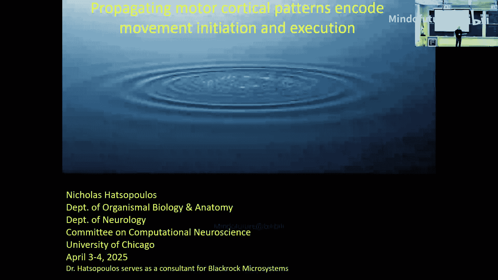
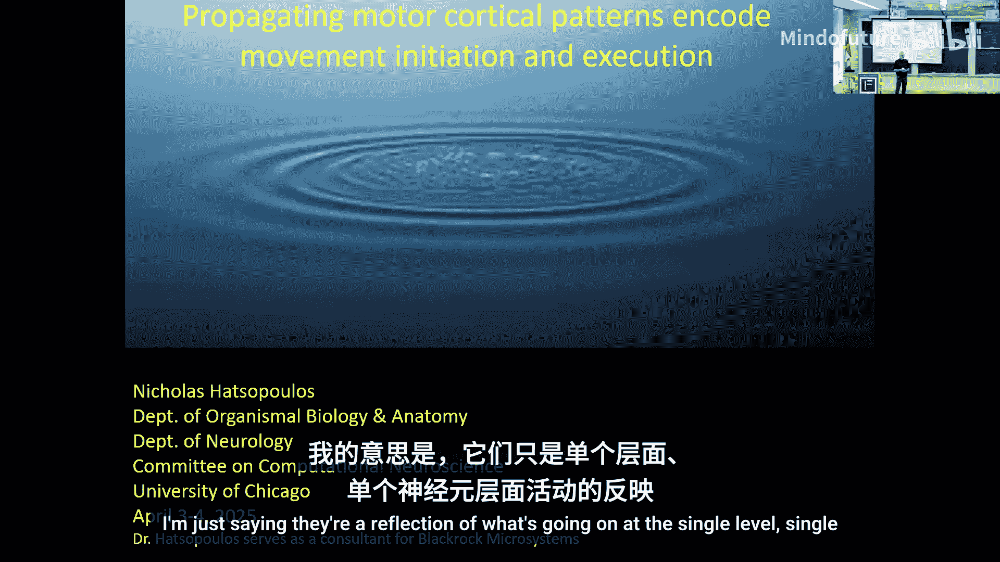
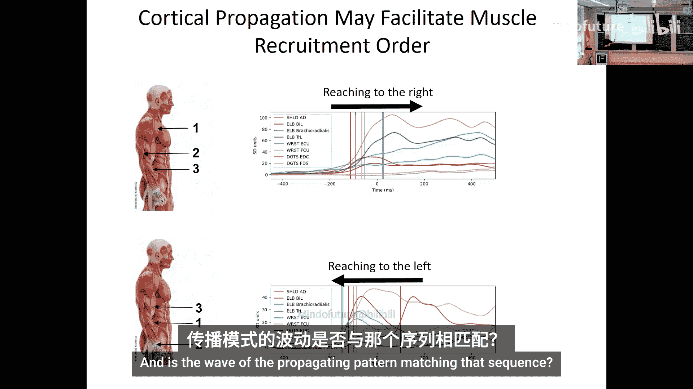

# 008：传播运动皮层模式编码运动的起始与执行

在本节课中，我们将探讨运动皮层中活动的传播模式，这些模式可能编码了运动起始与执行的信息。我们将从经典的皮层功能图谱开始，逐步深入到皮层振荡、传播模式及其与行为的关系，最后讨论这些模式可能的功能意义。

## 从彭菲尔德图谱到皮层空间模式

上一节我们介绍了课程概述，本节中我们来看看运动皮层功能组织的经典观点。许多人都知道著名的彭菲尔德图谱，它描绘了大脑皮层运动区与身体各部位的粗略对应关系。这张图谱很重要，因为它与我们观察到的皮层空间模式相关，或者说它激励了我去寻找这些空间模式。

这张图展示了大脑皮层运动区的横截面，从代表腿部的区域开始，到手、手臂、面部，包括舌头。这张图谱多年前被绘制出来，并在宏观层面上被多次验证。然而，在更精细的尺度上，它是具有误导性的。彭菲尔德本人也从未声称存在如此精细的定位。例如，它让人误以为存在一个专门的拇指区域、食指区域或手腕区域，但事实并非如此。

在我主要研究的上肢（手臂和手）区域，情况并非如此。腿部区域可能也是如此。我同时研究口面部系统，包括嘴唇和舌头，在精细尺度上，你同样找不到不同身体部位的特定分区。在宏观尺度上图谱是准确的，但在精细尺度上则不然。

当我们观察这个局部的手臂-手区域时，情况相当混乱。我们看到的是高度分布式的表征。例如，拇指在手臂-手区域的许多位置都有表征，手腕也是如此，它们相互交织在一起，似乎没有任何空间结构。

因此，我有些羡慕视觉系统或体感系统的研究者。顺便提一下，体感系统中存在更清晰、明确的躯体拓扑图，有明确的拇指区、食指区、手腕区。但那是感觉皮层。在运动皮层，其组织方式似乎没有明确意义，或者看起来是随机的。这激励了我去寻找空间模式，而事实上我们也确实找到了。

## 运动皮层的传播波

在了解了静态图谱的局限性后，本节我们来看看运动皮层中是否存在其他时空结构。大约二十年前，我们发现了在运动皮层中传播的波的证据。这是一种呈现形式，经过平滑处理使其看起来更清晰，它是通过局部场电位测量到的。

与MT区不同，运动皮层存在一个非常显著的振荡，即β振荡，频率大约在15到35赫兹之间。这些波是由我们在运动皮层观察到的这些振荡介导的。自我们的工作以来，已有证据表明运动皮层存在不同类型的波模式，但我们主要关注平面波，即沿单一方向平面传播的波。

部分动机在于，这是最常观察到的波类型。此外，考虑到阵列相对于运动皮层的大小，这似乎是一个很好的近似。与覆盖整个MT区的绒猴实验不同，这些阵列只覆盖了整个区域的一小部分，因此对这些模式的局部近似可能是一个平面或单一方向。

这是中央沟。这是大脑前部，这是大脑后部。这些是我们在四只猴子身上观察到的传播方向，用颜色编码。它们倾向于沿两个方向之一传播：要么向吻侧，要么向尾侧。有趣的是，我们还在另一个称为背侧前运动皮层的结构中植入了阵列，这个区域参与运动的早期计划，与实际运动执行的关系不那么密切。在那里我们也观察到了波，但它们的朝向是内侧-外侧方向。

因此，如果考虑涵盖运动皮层和前运动皮层的整个区域，你可能会看到更复杂的东西。虽然我们尚未研究这一点，但可以认为波可能以这种方式传播，然后改变方向，因此它们不仅仅是单一的平面或方向。在更大尺度上，它们可能更复杂，这也是一个非常有趣的问题。顺便提一下，这些是猕猴。我希望能在绒猴身上进行一些实验，它们的大脑更小，可以记录更大比例的脑区。

## 运动准备与观察期间的皮层活动

上一节我们介绍了传播波，但多年来我们一直试图弄清楚这些波可能具有什么功能，却未能找到这些传播波与行为之间的任何联系。也许存在某种联系，有待研究，但我们一直在努力寻找其可能的功能，因此我们研究了与这些波相关的其他传播模式。

我们想解决的第一个问题是：为什么在运动准备或动作观察期间不发生运动？我们找到了证据支持传播模式可能解释这个问题。当你准备做一个动作时，在猴子实验中，它们坐在那里，手臂放在一个联动外骨骼机器人上，手放在一个手柄上，它们控制一个光标。光标位于屏幕中央，然后出现一个它们需要触及的目标。

但我们设计的实验包含一个准备期，猴子必须坐在那里。它们得到视觉提示，知道未来要去哪里，但必须等待目标开始闪烁才能启动运动。当然，这很困难，训练猴子需要数月时间，因为猴子自然会将击中目标与奖励联系起来，而现在你告诉它们要等待。在那段等待时间里，推测存在运动准备，因此我们观察到了准备期活动。

如果你记录运动皮层，你会在这个准备期看到活动。那么，为什么猴子没有移动？因为我们知道运动皮层发出投射，通过皮质脊髓束最终影响肌肉。那么，为什么运动皮层被激活了，却没有产生运动？这是我们要解决的问题之一。

同样地，在猴子（以及人类）观察动作时，你实际上也能看到运动皮层的激活。这是我以前的研究生丹尼斯进行的一项研究，他让猴子做伸手动作，然后在电脑屏幕上回放猴子刚刚执行的动作视频。所以它们基本上是在被动地观看光标移动到目标。有趣的是，我们在许多细胞中观察到非常相似的调制。细胞在主动执行动作和观察相同动作时的反应方式非常相似。

这又引出了一个问题：在动作观察期间，为什么实际上没有产生运动？因为我们训练这些猴子只是被动观看屏幕，不做任何动作，它们是如何做到的？是的，在不同的实验中，我们有时会改变准备期，从1秒到1.5秒随机变化，有时则保持固定。但问题是，如果延迟固定，它们确实会预测“开始”信号的时间。在这种情况下，它们的反应时会非常快，因为它们知道“开始”信号何时会出现，它们会提前开始移动，反应时比正常情况更快。

通常，在随机间隔或没有指令只是看到目标就移动的情况下，猴子的典型反应时约为300-350毫秒。如果是可预测的，它们的反应时会更快。

## 解释运动皮层激活但不运动的假说

那么，是什么解释了这种在计划或观察运动时激活运动皮层但实际上并不运动的现象呢？有以下几种假说：

以下是几种主要的解释假说：
*   **门控假说**：由Bullock和Grossberg多年前提出，认为存在某种机制，可以门控来自运动皮层的信号，阻止它们到达脊髓驱动肌肉。这是一种“关闭开关”或“门”。
*   **阈值假说**：也许这些细胞被激活了，但激活强度不够。事实上，我们通常观察到，在准备或观察动作时，细胞的放电强度不如执行运动时强。因此，可能细胞被激活了，但尚未达到实际触发运动的阈值。下游可能存在某种非线性机制，尚未达到启动运动的程度。
*   **零空间假说**：由我的同事Matt Kaufman提出。这个想法是，在高维神经状态空间中，存在一些维度或子空间实际上不会导致运动。在准备期间，神经活动可能在这个从神经元到运动的投射矩阵的零空间中徘徊，因此你可以看到活动，但不会产生运动。

这些都是有趣且看似合理的想法，但我们有另一个想法。我认为所有这些解决方案都缺少一个我们观察到的现象：局部振荡活动的去同步化。

## β振荡与运动起始信号

我提到了β振荡。β振荡是显著的振荡，你实际上可以看到它。这是一条原始的局部场电位轨迹。零点是动物收到要触及的目标的指令信号出现的时间。这里有一个准备期，直到“开始”信号在这里出现，然后运动发生。

在准备期，你可以看到非常强烈的锯齿状模式，那就是β振荡。这些是介导我之前提到的那些波的振荡。如果你将信号带通滤波到β波的窄带内，你可以非常清楚地看到它们。它们在准备期间非常显著且振幅高。

然而，有趣的是，在“开始”信号之后，它们开始衰减。它们仍然存在，但被高度衰减。事实上，我们看到的波在运动期间仍然存在，只是信号非常弱。这是另一种呈现方式：如果你观察多个通道的功率谱图，在指令延迟期间，你可以看到非常强的β振荡功率。它可能会减弱一点，但仍然存在，直到运动期开始。运动开始后，β振幅衰减，并一直保持衰减状态直到运动结束，然后恢复。

这并不是我们首次展示这一点，这已经被证明了数十年，实际上在EEG发现后不久就在人类中得到了证实。所以这并不新鲜。但新的是，如果你观察这种衰减发生的时间，这个时间点告诉你它与运动起始锁时。在这里，我们根据反应时对试验进行了分组。这些是反应时非常短的试验，黄色的是反应时较长的试验。你可以看到β功率衰减的时间点随着反应时系统地变化。

如果你现在将这些衰减对齐到运动开始时刻，它们都对齐了。因此，β衰减持续发生在运动开始前的某个固定时间延迟处，如这条红线所示。所以，β的衰减可能是一个运动起始信号。这一点相对没有争议，在文献中已有记载。

## β衰减的传播模式及其功能意义

那么这种衰减代表什么？这些振荡发生，然后关闭。来自人类经颅磁刺激研究的一些证据表明，在β频率范围内，β功率与TMS诱发电位呈负相关。这意味着当β强时，TMS诱发电位小，反之亦然。这至少向我表明，也许这种衰减现象反映了运动皮层的兴奋性。

所以，当你坐着准备移动时，你处于低兴奋性状态。然后“开始”信号出现，网络中发生了一些事情，将你切换到高兴奋性状态，导致低振幅的β振荡。我认为约翰展示了一些单次试验中振荡数据的例子，它们看起来相当混乱。虽然我向你展示了一个特别好的单次试验例子，你可以计算这个信号的振幅并观察时间点，但通常它们是有噪声的，因此我们必须找到一种方法来去噪这些信号。

我的一位前博士后Fellow Burmanian使用自编码器来清理单次试验的信号。我在这里向你展示的是不同电极上β信号包络的振幅，每种颜色代表一个不同的电极。红色的电极在这里衰减得稍晚一些，蓝色的电极在这里衰减得较早。如果你现在将衰减时间映射到电极网格上，你可以看到一个传播模式。

并不是整个皮层同步衰减，而是你看到一个系统的衰减进程，从这些电极开始，进展到那些电极。这是在一次试验中。在另一次不同的试验中，你看到相反的模式：这些电极先衰减，然后是这些电极。这是我们发现的新现象：振荡并非同步衰减，而是显示出这种传播模式。

事实上，如果你观察许多许多试验并构建一个圆形直方图，你可以看到它们大多数沿两个方向之一传播，且方向完全相反。结果证明，这大致与我们用β波观察到的方向性相当。大致是吻侧方向，另一个是更偏向尾侧的方向。很少有衰减传播模式出现在正交方向。这是我们在所有猴子身上都看到的。有时我们看到一些细微的差异，例如一个方向占主导，第二个方向弱得多，例子少得多，但我们总是看到这种传播的双峰分布。

我喜欢做的一个类比（可能不恰当）是：你可以想象运动皮层在你准备移动时闲置着。想象你在一辆有离合器的车里。你踩下离合器，发动机在空转，但车实际上没有动。然后你松开离合器以接合发动机。因此，皮层的β衰减就像松开离合器。你基本上有一系列离合器按顺序被释放，这就是我喜欢思考它的方式。

## 传播模式的因果证据

那么，我们能否提供因果证据，证明这些衰减或兴奋性的传播模式是运动起始的必要组成部分？我们看到了运动起始期间的这种现象，它在每次试验中都发生。但我们是否有任何因果证据表明它可能发挥作用？为此，我们设计了一个实验，进行电刺激，但不是在同一个电极阵列上，而是以电刺激模式进行刺激。

想象一下，在给定的试验中，你有一个从阵列右侧向左传播的衰减模式。现在，假设在那个试验中就是这种情况，我们以如下方式刺激电极：我们同时用单个脉冲刺激所有这八个电极，然后在下一个时间点，我们刺激这一列和第二列，然后逐步地，我们随时间偏移我们刺激的电极组，使其镜像我们看到的自然传播模式。这被称为**一致刺激模式**。

或者，想象我们有同样的从右侧向左传播的模式，但现在我们先刺激这组电极，然后是这两组，接着是这两组，依此类推。这将是**不一致的**，因为它与自然传播模式相反。我们想要测试的想法是：如果我们以与自然模式相反的方式进行刺激，我们是否会减慢反应时？

这里需要注意的重要一点是：在一致和不一致两种情况下，被刺激的电极完全相同，每个电极上使用的电流完全相同，频率也相同。唯一的区别是顺序。我们是在“开始”信号之后进行刺激。我们根据之前的实验大致估计我们认为衰减何时会发生。是的，我们是在干扰它。问题是，不一致的情况是否比一致的情况干扰得更强烈？但是的，在两种情况下我们都在干扰。另外，我应该指出，我们使用的刺激电流是**亚阈值**的，足够低，以至于不会实际诱发运动。如果你只是传递这种模式，在没有任务的情况下，你不会诱发运动。我的意思是，你可能会，我们还没有测试，有时你可以测量到非常微弱的EMG肌肉活动，但不会诱发运动，所以是亚阈值的。

这就是我们想要检验的假设，而我们确实发现，在三只猴子身上，其中一只猴子的两个不同运动方向，我们看到不一致刺激模式比一致刺激模式的反应时慢了大约10到20毫秒。因此，当我们施加与自然进程相反的扰动时，我们实际上可以减慢反应时，虽然不多，但显著。

## 传播模式与躯体拓扑的关系

我们想研究的另一件事是：这些衰减的传播模式与躯体拓扑相比如何？我们关注这三只不同的猴子，这两只猴子有两个阵列，这只猴子有一个阵列。对于这两只猴子，我们只关注顶部的阵列。蓝色的双箭头表示衰减传播方向的双峰分布。棕色箭头显示从近端到远端的躯体拓扑梯度，即从肩和肘向下到手和手腕。

虽然不完美，但似乎这两种不同的空间模式几乎是正交的：躯体拓扑与衰减的传播模式几乎垂直。这对我来说实际上是有道理的。如果你想启动一个运动或允许运动发生的可能性，你并不想必然先启动一个身体部位再启动另一个，你希望允许上肢的所有身体部位在需要时都能启动。

## 不同行为中的传播模式

我们遇到的另一个问题是：我们看到的这种模式似乎标志着运动起始，我们有因果证据表明这种模式是运动起始所必需的（可能不是充分的）。那么在其他行为中呢？到目前为止，我们关注的是平面伸手运动，但伸舌运动呢？我们实际上训练猴子伸出舌头，并用舌头对力传感器施加力。我们还有用手进行的精确等距捏握。我们还在一项人脑机接口研究中有一位人类参与者，他是一位脊髓损伤患者，自愿在其运动皮层植入阵列。他有一些残余功能，并非完全瘫痪，所以他实际上可以用他的原生肢体进行伸展运动和施加等距伸展力。

在这四种不同的行为中，我们都看到了电极上的β衰减。我们看到它们以空间方式组织，即它们从一侧传播到另一侧，或相反方向。除了在这个案例中两个方向略有偏差外，在其他三种情况下，它们几乎完全沿相反方向传播，取决于试验，有些试验沿一个方向传播，其他试验沿相反方向传播。我认为这很酷，即使是像伸舌这样的动作。顺便说一下，在伸舌任务中，我们是从口面部运动皮层区域记录的，而不是上肢区域，所以我们在不同位置植入了阵列。

所以我们看到了这种模式。我们遇到的另一个问题是：除了时间（即运动何时发生）之外，这种模式是否告诉我们任何关于实际运动的信息？答案是否定的，它没有告诉我们任何信息。对于平面伸手运动，例如，这是模拟传播方向双峰分布的冯·米塞斯函数，无论是远离身体的运动还是朝向身体的运动，你看到几乎完全相同的分布。同样，传播速度（以厘米/秒为单位）实际上与在绒猴MT区观察到的非常接近。你也看不到速度上的差异。同样，在人类受试者中，要求他们用手腕施加等距力，无论是低力还是高力，分布几乎相同，无论是方向性还是速度。因此，我们没有发现任何证据表明这种传播模式提供了关于将要发生什么运动的信息。

## 运动执行期间的高伽马振荡与传播模式

这引出了我的下一个话题。我将跳过这个，也许稍后再回来。还有多少时间？我想大概12点左右。我将跳过这个，然后讲一些尚未发表的内容，所以我想讲到它，如果有时间我再回来。那么，是否存在与运动执行相关的时空模式，这些模式实际上告诉我们运动是什么类型的信息？因此，我们必须放弃β振荡。其他人也曾在β振荡中寻找关于运动的信息，但没有找到太多。例如，在解码研究中，他们试图从β振幅解码运动，结果发现几乎找不到什么。所以我们放弃了β，转而研究一个完全不同的信号：**高伽马振荡**。

我所说的高伽马实际上是一个误称，它并不是真正的振荡，而是局部场电位在200到400赫兹高频范围内的功率。这相当高，可能非常接近放电频率，所以它可能包含了放电活动。我们这样做是有目的的，因为我们想研究一个携带运动信息并作为多单元活动代理的信号，即与电极周围局部放电的神经元群相关的东西。之前的人们已经使用这种非常高频的信号在脑机接口研究中解码运动，而且确实效果很好，这就是选择这个频率范围的理由。

如果你观察试验平均后的高伽马振幅，你可以看到随着猴子运动方向的变化，信号如何变化，因此它携带了关于将要进行什么运动的信息。例如，对于向左的运动，信号非常强；对于向右的运动，信号非常弱。因此，它似乎携带了关于正在发生什么运动的信息。

如果你比较**高伽马振幅的调谐曲线**与多单元活动的调谐曲线（因为我们也可以从这些电极记录多单元活动，实际上这在犹他阵列中很常见，你不是记录一个孤立的单元，而是记录可能几个或更多的单元），这向你展示了作为目标方向函数的多单元活动放电率（红色）和高伽马振幅（蓝色），它们几乎完全相同。因此，在整个电极群体中，我们看到高伽马和多单元之间非常相似的调谐。

所以现在我们知道这个信号意味着什么，对此我更有信心。而对于β，我们说它是兴奋性，但具体是什么？检测赫兹？我们通常通过将信号高通滤波到350赫兹以上来检测，所以有重叠，但处理数据的方式不同。高通滤波后，你使用阈值交叉，寻找超过阈值的峰值，并计算那些峰值，而不仅仅是包络功率。是的，但在频率范围上有重叠。所以，那是试验平均，很漂亮。左边是单次试验，每种颜色代表一个不同的电极，看起来相当混乱。所以，我们再次必须使用不同的信号处理方法，如首先进行主成分分析，然后应用自编码器，再进行低通滤波，以获得这些平滑的单次试验高伽马包络。需要大量的预处理才能得到这些平滑、漂亮的信号。

## 将高伽马包络视为振荡进行分析

有了这些信号，我们可以像其他人一样直接使用振幅来解码。但我的博士后Millan Rebar提出了一个非常巧妙的想法：与其看振幅，不如将它们视为振荡，即高伽马的包络本身（不是高伽马本身），将其视为0到5赫兹之间的振荡，并像我们之前处理β振荡一样，使用希尔伯特变换计算相位。

因此，我们计算每个电极的相位随时间的变化。我们可以将其布局在阵列上，所以这是在某一时刻每个电极的相位，但现在是低通滤波到5赫兹以下的高伽马包络的相位。然后，你可以像约翰谈到的那样计算相位梯度。由此，我们可以使用我们在最初关于β波的论文中使用的一种度量，称为**相位梯度方向性**，这是一种度量相位梯度对齐程度的指标。

基本上，它是平均相位梯度的幅度除以相位梯度幅度的平均值。因此，PGD值为1表示所有相位梯度都对齐，显示出平面波的证据。PGD值为0表示梯度方向随机。是的，1表示拟合良好，这正是重点。所以我们现在可以随时间测量平面拟合的优度。这是一种方法。

我们采用的另一种方法受到我们一年半前发表的一篇论文的启发，使用了一种略有不同的方法。我们没有计算相位梯度，而是直接对相位本身拟合平面。因此，我们现在在Z轴上有展开的相位，而在X和Y轴上是特定电极的相位，然后直接拟合一个平面。然后我们可以测量平面对这些展开相位的拟合优度。这与相位梯度的PGD具有可比性。

## 传播模式与运动信息编码

使用这两种方法（线性回归的拟合优度和使用PGD的空间相位梯度），我们发现从运动开始前约200毫秒开始，到运动结束后约100毫秒，拟合优度出现短暂的增加。这在两种度量中都是正确的。如果你观察传播方向（现在是那些相位梯度的方向或拟合平面的方向），我们看到可比的方向，并且它们更稳定。每条黑线代表一次不同的试验，红色是平均值。因此，每次试验都显示R平方或PGD的增加，然后平均值更清晰地显示出来。但如果你观察传播方向，同样，在拟合优度高的时间段内，它更加一致，并且它们匹配得相当好。

现在，如果你观察每个时间点的传播方向（试验平均后），你会得到像这样的图。这些图有点难以理解，它们是极坐标图。时间在半径上，所以从运动开始前300毫秒（这个内圈）到运动开始后300毫秒，这是半径。沿着圆圈是传播的瞬时方向，即高伽马包络传播的方向。每种颜色代表猴子正在做的不同运动方向。这是不同颜色的图例，小箭头告诉你猴子向哪个方向移动：上、左、右等等。

有趣的是，你看到两种方法都有非常相似的模式。它们开始时非常相似，然后针对不同的运动方向分叉，这表明其中存在关于运动的信息，存在于这些传播模式的方向中。注意这里有趣的一点：注意这三个家伙（蓝色、橙色和灰色），它们形成了一个集群，并且与其他方向不同。这些有什么特别之处？我一直在思考，直到我意识到我们所做的：我们过度训练了这只猴子。这完全是个意外。我们过度训练猴子进行向外、向上或向右外的运动。所以橙色目标，它们进行了大量这样的运动，因为我们的机器人生物力学特性，这类运动和这类运动对猴子来说非常容易，而这些运动则较难。因此，它被高度过度训练用于这些运动。

结果，对于蓝色目标（蓝色目标在这里），它开始向橙色目标移动，然后改变方向。同样，对于灰色目标（在这里），它也默认向橙色目标移动，然后意识到需要改变方向。所以，这可以解释为什么这三个方向聚集在一起，因为对于这只被过度训练的猴子，这三种不同目标方向的默认运动指令非常相似。这再次提供了进一步的证据，表明这些传播模式告诉你关于运动运动学的信息。

## 解码运动与对运动控制的启示

我们应用了一个非常简单的解码算法（基本上是维纳滤波器解码器），尝试解码手部的X和Y速度随时间的变化。使用基于线性回归计算的方向或基于空间梯度的传播方向，你看到了非常相似的结果。如果你看绿线（它是X和Y速度的综合），开始时解码效果弱，然后在运动后约100毫秒达到峰值。有趣的是，随着运动展开，它开始下降。

这对我来说很有趣，因为我开始以一种不同于人们通常认为的方式思考运动皮层。常见的观点是运动皮层在整个过程中持续控制肢体，这也是脑机接口的基础：我们从运动皮层获取信号，受试者思考，我们连续解码以控制机器人设备、光标等。但这开始让我认为，也许在自然系统中，运动皮层实际上使用的是**间歇控制策略**。它实际上并不在整个运动过程中都参与，只在某些关键点参与，然后皮层下结构接管其余部分。

这可能与这样的想法一致：皮层形成这些传播模式，这些模式介导了产生运动的指令，但这些指令随后消失。在运动后期，当这些传播模式完全消失时，运动仍在继续（顺便说一下，运动至少持续到400毫秒以后）。因此，运动持续的时间远远超过这个模式存在的时间点。如果这个模式反映了来自运动皮层的实际运动指令，那么之后它们就不再存在，由其他结构接管，直到运动皮层可能需要再次介入。脑机接口确实有效。是的，安迪·施瓦茨的例子，机器人控制等。所以，这是否是你设想的一种“发射后不管”模式，但如果需要更闭环的控制，它可以参与更长时间？事实上，我认为我们有一些数据表明这一点。在我们当前的脑机接口受试者中，因为他们可以同时使用脑机接口和使用他们的原生肢体，所以我认为脑机接口中发生的是，他们使用了一种“非自然”模式。他们可以做到，但这不是他们通常使用手臂的方式。他们需要高度集中注意力，并且必须持续控制。他们进入了这种不同的操作模式。这是一种推测，我没有确凿证据支持，但这就是我的想法，因为我们刚刚完成的观察这些使用原生肢体的脑机接口受试者的实验表明，当我们用原生肢体运动构建解码器，然后应用到脑机接口情境时，它不能泛化，反之亦然。所以解码器在不同的模式下工作。这并不是说它不能发生，是的，你可以进入那种模式。

## 传播模式可能的功能：肌肉募集顺序

最后，我想再次强调，这完全是推测。我没有确凿证据支持这一点，尽管我知道一种方法来实际测试这个想法。事实上，我刚刚有一项资助申请（希望NIH仍然存在并会评审）来测试这个想法。基本想法是：也许这些皮层传播模式可能促进肌肉的募集顺序。

这些实际上是向右运动时的肌电图肌肉活动模式，你可以看到被激活的肌肉序列。对于向左的运动，你看到不同的序列。因此，对于这个向右的运动，前三个肌肉首先是三角肌前束，然后是肱三头肌，然后是肱桡肌。对于这个向左的运动，首先是肱桡肌，然后是腕伸肌（可能是腕伸肌，我可能记错了），第三个是肱二头肌。所以，也许这就是这些皮层模式（波或传播模式）可能具有的功能。

有一种方法可以测试这一点，因为我们实际上可以在猴子身上测量这些传播模式，并且还可以通过电刺激测量每个位点激活了哪些肌肉，然后问：当猴子进行这个运动时，这些肌肉是否以这种模式被激活？传播模式是否匹配那个序列？

传播那个序列。说到这里，我将结束。这是我的实验室，感谢大家的关注。对不起，有问题吗？如果有人有任何问题，那么我们将继续进行小组讨论，我们也会回答这些问题。

好的。那么其中一个问题是，当你刺激猴子区域时...

---

**本节课总结**

在本节课中，我们一起学习了运动皮层中活动的传播模式如何编码运动信息。我们从经典的彭菲尔德图谱及其局限性开始，认识到运动皮层在精细尺度上缺乏清晰的躯体拓扑组织。接着，我们探讨了运动皮层中存在的β振荡及其传播波，但指出其与行为功能的直接联系尚不明确。

然后，我们深入研究了运动准备和观察期间运动皮层激活但不产生运动的现象，并回顾了解释这一现象的几种假说。我们重点介绍了β振荡的衰减作为一种可能的运动起始信号，并展示了这种衰减在皮层上是以传播模式而非同步方式发生的。我们通过电刺激实验提供了因果证据，表明干扰这种自然传播模式会减慢运动反应时。

此外，我们探讨了这种传播模式与躯体拓扑梯度近乎正交的关系，以及在不同行为（如伸手、伸舌、握力）中观察到的类似传播模式，指出它主要编码运动起始时机而非运动细节。

最后，我们转向运动执行期间的信息编码，介绍了高伽马振荡包络作为多单元活动代理的价值。通过分析其包络的相位传播模式，我们发现这些模式携带了关于运动方向的信息，并且其解码效能在运动开始后达到峰值然后下降，这提示运动皮层可能采用间歇控制策略。课程以推测这些皮层传播模式可能通过促进特定的肌肉募集顺序来指导运动作为结束。

本节课的核心概念包括：**β振荡衰减的传播模式作为运动起始信号**，以及**高伽马包络的相位传播模式编码运动细节**。这些发现为我们理解运动皮层如何动态地组织和传递运动指令提供了新的视角。