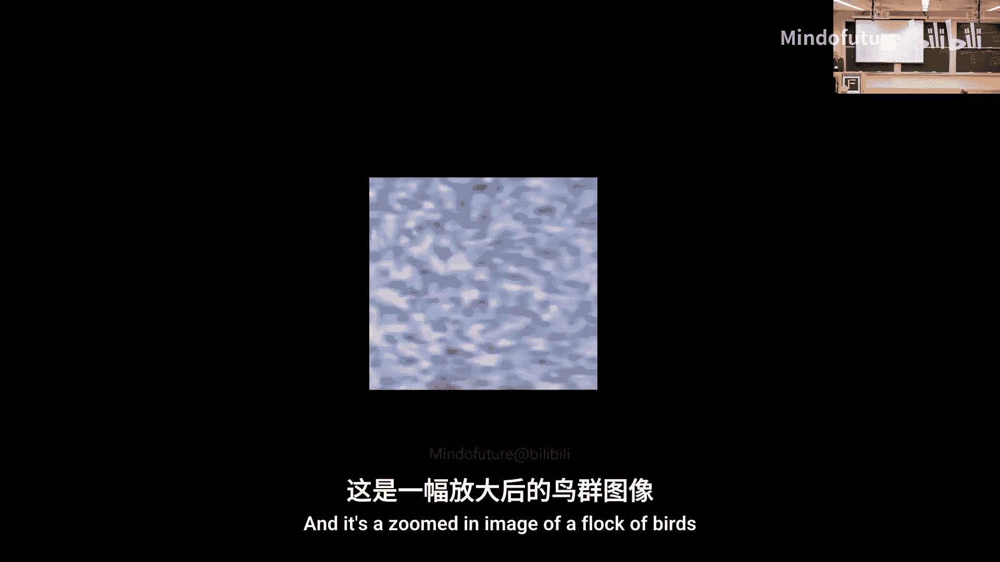
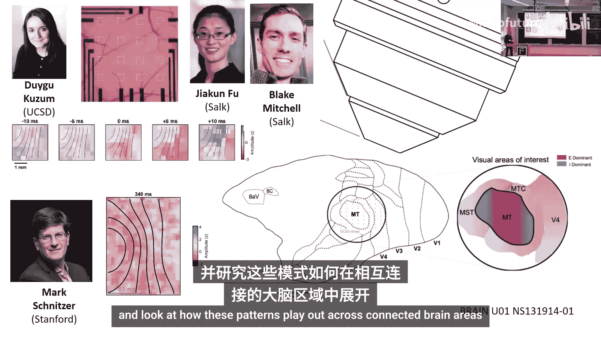
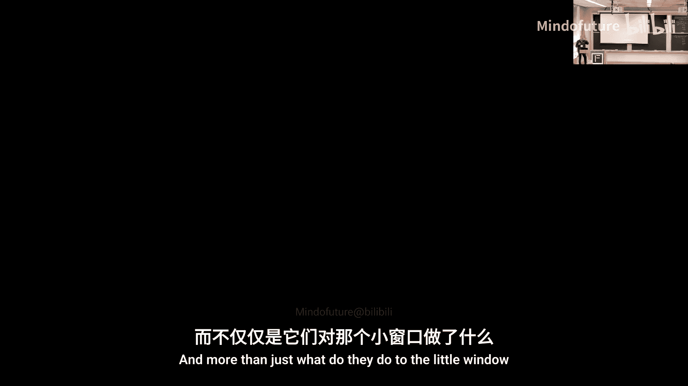
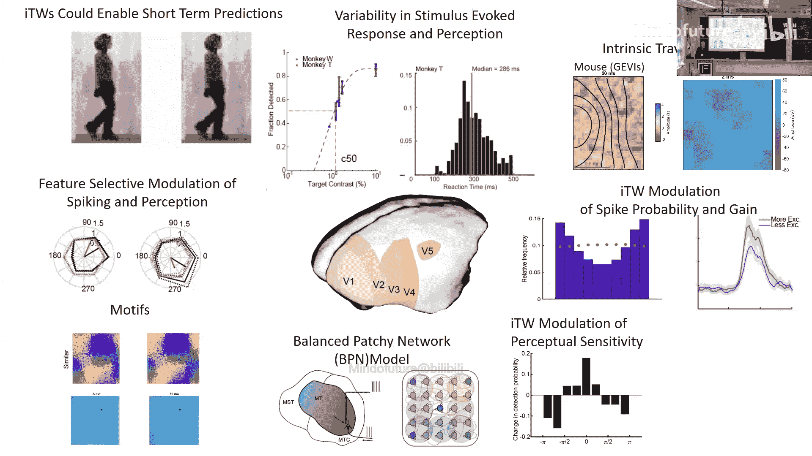

# 009：固有传播波与视觉感知

在本节课中，我们将要学习大脑视觉系统中一种名为“固有传播波”的神经活动模式。我们将探讨这些波是如何产生的，它们如何影响神经元对视觉刺激的反应，以及它们如何最终影响我们的感知行为。课程内容基于对灵长类动物大脑的实验研究和计算模型。

## 概述

感谢Alex和Roberto，以及Lyle和菲尔兹研究所邀请我今天进行演讲。我认为接下来的几天将会非常精彩，我很高兴能在这里。

我今天要描述的工作是由Zach Davis发起的，他曾是我实验室里一位非常有才华的博士后，现在已在犹他大学建立了自己的实验室。他与Lyle Mueller密切合作，Lyle当时在索尔克研究所Terry Sowski的实验室做博士后，而Terry和Julio也对这项工作做出了重要贡献。

我将要描述的证据表明，在灵长类动物和老鼠大脑的视觉系统中，存在以波的形式在大脑皮层中传播的活动模式。它们每秒发生数次。我将展示证据，表明这些波反映了在占据大脑皮层浅层的水平无髓鞘纤维上传播的动作电位。我还将展示一些证据，表明这些连接包括长距离的、特征选择性的解剖连接模式，这些连接将具有相似调谐特性的神经元群体联系起来。

但我最想传达的核心信息是，在空间和时间维度上观察神经活动动态的重要性。我想用这张图片来说明这一点，它看起来可能有点令人困惑。这是一张鸟群的放大图像，你可以看到这里有一些结构，但看起来有点杂乱无章。

但如果我们缩小视野，可以看到它实际上是一个更大整体的一部分，在这个例子中，是一种传播波的形式，即椋鸟的集群行为。只有通过这种更广阔的视角，才能真正理解这一点。我将向你们展示，类似这样的模式也存在于大脑皮层中。只有通过观察整个脑区的活动模式，我们才能开始看到其中存在的秩序。

## 研究方法：感知阈值的变异性

我们采用了一种特定的方法来研究这个问题，即考虑感觉感知具有可变性这一事实。理解这一点的一种方法是观察发生在感知边界、即感知阈值附近的事件。

我们训练了狨猴（一种来自巴西的新世界猴）执行一项非常简单的任务，它们只需要检测屏幕上目标刺激的出现。猴子通过注视屏幕中心的一个点（我们称之为注视点）来启动一次试验。经过一段可变的延迟后，一个目标出现在屏幕上的某个位置。如果猴子在目标出现后很快将眼睛移动到目标位置，它就会获得果汁奖励。

我们改变目标的亮度对比度，以控制其检测难度。我们可以由此推导出所谓的“心理测量函数”。这个函数显示了猴子检测到目标的概率，作为目标显著性（即亮度对比度）的函数。你可以看到，对于两只猴子，当目标以10%的亮度对比度呈现时，它们都能可靠地报告目标，这很容易看到。但我们可以降低亮度对比度，使任务变得更难，直到我们找到一个略高于1%的亮度对比度，此时猴子只能在一半的试验中检测到目标，我们称之为感知阈值。

这些是反应时间图，显示了两只猴子对目标出现的反应（眼动）潜伏期大约在250到300毫秒之间。所以它们看到目标就看向它，这表明它们真正理解了任务是检测目标并看向它，并且有很强的动机去执行。

## 神经元活动的变异性

现在，如果我们观察运动选择性脑区MT中一个孤立神经元的动作电位，我们会看到一个熟悉的活动模式。这里的每一行都有一个刻度标记，表示一个动作电位发生的时间。红色垂直线表示目标出现的时间，展示了五次不同的目标呈现。

你可以体会到，尽管我们非常擅长监测动物的眼动位置，确切知道眼睛在看哪里，因此也知道感受野的位置，并且可以将刺激精确地放置在感受野内的同一位置。所以，从实际目的来看，光感受器上的感觉条件是相同的。尽管如此，在每次试验中，被诱发的特定动作电位序列仍然存在很大的变异性。

因此，人们会想，这种刺激诱发反应强度的变化，是否与猴子在给定试验中检测到目标的概率有关。确实，如果我们将试验分类为猴子没有检测到目标的试验（失误试验）和检测到目标的试验（命中试验），我们可以看到，在猴子检测到目标的试验中，刺激诱发反应确实比它未能检测到目标时更强，这暗示了这种关系。

## 网络状态与局部场电位

但这是针对单个神经元的观察。如果我们观察许多次试验，这是一个单个记录良好的MT神经元，你再次可以看到很大的变异性。在目标出现后不久，有一个与目标出现时间锁定的、强烈而清晰的刺激诱发反应。

我刚才向你们展示了这种变异性，那么它来自哪里呢？它并非来自产生动作电位的机制，那个机制是高度可靠的。相反，它是网络的一个属性。网络正在进入各种状态，这些状态决定了在任何给定试验中神经元发放率的高低。

为了理解这一点，我们可以观察局部场电位，它是电极尖端周围局部群体活动的度量。我们可以看到，在目标出现之前的一段时间里，网络活动相对静止。然后，有一个向下的偏转，与刺激诱发的动作电位同时发生。经过一次波动后，系统恢复到其基线状态。

但这实际上是对数据的误读，这对你们许多人来说非常熟悉，这是我们将许多次试验平均在一起时看到的结果。但如果我们观察单个试验（在我的屏幕上显示为粉色，在你们的屏幕上可能是紫色），我们会发现，在目标出现之前，网络活动的波动幅度与刺激诱发反应发生时发生的波动幅度相似。所以，大脑的发放活动在目标出现之前是高度活跃且波动剧烈的。只有通过平均，我们才能看到在目标出现时间附近存在一种变化的趋势。

## 固有传播波的存在

现在，我将向你们展示证据，证明这些自发的神经活动波动并非随机的，它们实际上是以传播波的形式在大脑皮层中穿行。我将展示这些波在视觉系统的单个皮层区域内传播，在动物执行任务时每秒发生数次，因此它们是一个非常普遍的特征。我认为它们可能代表了一种以前未被充分认识的神经计算形式，值得我们思考。

那么，这些网络活动波动的来源是什么？解剖学研究表明，它们至少部分可能是由于网络中存在的固有连接。这样说的原因是，例如，在初级视觉皮层中，只有大约5%的突触是前馈的，来自外侧膝状体。大约80%的突触连接是局部的循环连接，其中许多就在皮层的浅层。它们的范围相当有限，大约90%的连接位于接收神经元几毫米之内。

因此，我将展示一些证据，表明这些水平连接确实驱动了这些传播波模式。正如Lyle提到的，我们在MT区（一个运动选择性纹外视觉区）进行了记录，这是在狨猴大脑中进行的。狨猴有几个关键优点，其中之一是其大脑相对无皱褶，是光滑的。因此，狨猴大脑皮层上神经活动的展开就像一块电影屏幕供我们观看。MT区的大小约为13平方毫米，恰好可以被一个商业上可用的、称为“犹他阵列”的单一电极阵列覆盖。这个阵列大约有96个电极，彼此间隔约400微米，可以放置在MT区上方，这样我们就可以在动物执行任务时从整个MT区采样神经活动。

我想在这里停下来，承认我今天展示的工作确实受到一系列论文的启发。早期是Grinvald、Arieli及其同事的论文，以及后来Meor、Carandini及其同事在麻醉动物初级视觉皮层的工作，在那里可以辨别出非常清晰的波模式。同时也深受Nico Hadjipapas工作的启发，他今天将在我之后演讲，他在清醒行为猴的运动皮层观察传播波模式方面做了开创性工作。

然而，在清醒状态下，在视觉系统中，在目标出现之前的静止期，数据中没有持续窄带振荡的证据。这意味着我们需要开发技术来定义我们正在研究的这个频谱复杂系统中的相位。

## 定义频谱复杂相位

如果我们放大到目标出现之前的时期，当动物正在等待目标出现时，屏幕上没有任何东西，我们可以观察局部场电位。这是一个典型的例子，你可以看到这里有一些振荡模式，但它们是瞬态的，并且存在很多频谱复杂性。如果你用带通滤波器（例如8到13赫兹的阿尔法滤波器）过滤局部场电位，你会发现结果并不能真实地再现或反映大脑中的模式。

即使其他频段，例如这个15到30赫兹的贝塔频率窄带滤波，确实捕捉到了这段时间内动态的某些方面，但在相位和幅度上存在明显的失真和差异。但在其他时间段，它并不真正适用。所以，如果你是研究视觉系统中贝塔振荡的人，你会说“啊哈，这就是我研究的”，并专注于那个时间段，然后编造一个关于它的故事。但即使在那里，他们也只捕捉到了瞬态波动，这些波动实际上并不那么窄带。

因此，我们开发了一种方法，这确实是Lyle在这个项目中做的许多步骤之一，来定义一个度量，该度量是一个与频率无关的相位度量。这里的要点是，我们更广泛地过滤了数据，从5到40赫兹。这里的颜色编码表示相位，即广义相位，这个新度量是Dennis Gabor最初开创的解析信号方法的推广。

所以要点是，我们可以以一种有意义的方式跟踪相位，它大致上跟随随时间变化的主导信号的相位。

## 验证相位度量

我们如何验证这一点呢？一种方法是观察动作电位，它是大脑的主要“货币”，并询问它们与我们使用这些不同相位度量测量的相位之间的关系。我们可以通过计算发放-相位耦合来做到这一点，即询问当我们使用广义相位度量与各种窄带滤波器计算相位时，发放是否可靠地与特定相位对齐。你可以看到，对于广义相位，发放-相位耦合比窄带相位要好得多。

但我确实展示了有时在窄带相位中存在显著的功率，如果我们挑选出这些时间段（例如西塔频段），它们约占时间的7%，阿尔法频段占12%。即使我们只看那些你会说“啊哈，这就是我研究的，就在那里”的地方，我们也会发现，一旦你对数据进行窄带滤波，发放-相位耦合就会变差。

因此，有了这个有意义的频谱复杂相位概念，我们现在可以将该相位度量用作定义、检测、跟踪传播波模式的一种方式。

## 检测传播波

我们通过计算阵列上所有电极的相位，然后计算相位梯度来实现这一点。在相位梯度中，寻找梯度最大发散点。这些是波的潜在源点，波可能从该点向外辐射。然后，我们计算相位作为与该最大发散点距离的函数，并询问它是否在空间上系统地变化。

为了说明这一点，这里有一个虚构的数据，只是一个模拟。每个红点是一个最大发散点，但没有产生波。当一个波从特定点传播出去时，绿点是最大发散点，它正确地检测到了波的出现。

这种方法是有优势的，因为它不需要空间平滑，而空间平滑可能会从噪声中产生虚假的波。它是对其他方法（如奇异值分解）的改进，奇异值分解在噪声条件下可能会失效。它为这类高噪声多通道数据中的传播波提供了定量的、逐时刻的测试。

当我们将这种方法应用于检测活体中的波时，这就是我们所看到的。这里你看到的是阵列上每个电极的幅度（毫伏）。虽然它们很复杂，看起来不像海浪拍岸那样的波，但你可以清楚地辨别出存在跨越电极阵列传播的、时空组织的模式。我应该指出，这不是经过空间平滑的，所以这确实是你在狨猴大脑皮层中检测波时看到的真实模式。

## 波与神经元发放的关系

现在，当我们观察发放频率作为波相位的函数时，我们发现它是变化的。现在我们同时记录局部场电位，在局部场电位上计算这些传播波，然后观察同时记录的发放活动如何与波的相位时间锁定。我们发现，自发活动中的发放概率作为波相位的函数变化很大。

我们将发放活动升高的波相位时间段称为波的“去极化相位”，相比之下，波的“超极化相位”则发放活动较低。这些小红点对应于一个控制条件，我们平均了所有局部场电位，并观察了发放活动对波相位的依赖性。目的是区分我们看到的是同步模式还是波模式。我们确实看到的是波模式，而不是同步模式。

## 波的传播速度与解剖基础

如果我们观察波的传播速度，这是来自两只猴子的分布。我们看到它们倾向于落在由这里垂直线指示的范围内，该范围对应于这些无髓鞘纤维上动作电位速度的范围。这是证明波与水平传播的动作电位相关的一条证据。

我们建立了一个模型，一个大规模的、循环连接的模型。该模型中的神经元通过距离依赖的连接相互连接，这些连接从每个神经元开始呈高斯衰减。我们关键地加入了传播延迟，以反映动作电位在水平纤维上传播该距离所需的时间。

这些是非常大规模的模型，大约有50万个神经元，5亿个左右的突触连接。在这种规模下，可以建立一个在突触处使用生物学上合理的兴奋性和抑制性电导的模型。当我们这样做时，我们发现在广泛的参数范围内，模型可以产生与我们在活体中看到的相似的波。

观察它的最简单方式在这里，这只是模型的一个模拟。现在这是一个比我在电极阵列96个通道中展示的图像分辨率更高的图像，但你可以看到，在性质上存在类似的复杂波动态模式。波的统计特性，例如它们的传播速度、波长，与我们在活体中看到的相当。因此，我们认为这是一个很好的工作模型，用于解释可能是哪种网络在产生这些波。

## 模型参数与网络状态

如果我们观察兴奋性和抑制性电导的参数空间，我们会看到存在一个范围，在这个范围内波会发生。如果我们超出这个范围，网络会变得癫痫样或沉默，但在这个范围内，我们看到波模式，它们的波强度和波长随着这些参数系统地变化。

关键点是，在产生持续发放活动的参数范围内，该活动以波的形式存在。因此，对于一个像这样的连接网络来说，形成传播波模式似乎确实是其自然的运行模式。

对于那些对发放数据真正感兴趣的人，我会提到，在相同的参数范围内，我们看到单个神经元的发放活动与我们在活体中看到的非常相似。它们是随机的，有点像速率变化的泊松过程。

## 波、增益与感知

那么，从概念上讲，我们认为发放活动、波和行为效应之间是什么关系呢？想象一下，我们正在从MT区记录，这里的颜色编码表示网络的超极化或去极化状态，我们认为这实际上反映了兴奋性与抑制性活动的比率。我们认为正是这个E/I比率的变化驱动了增益变化，这是关键的考虑因素。

因此，在这个时间点，如果我正在记录这个锥体神经元，当三个动作电位进入细胞时，我可能只看到一个诱发的动作电位。但是，随着波状态的变化，将细胞置于更兴奋或去极化状态，发放输出会升高。因此，对于相同的输入，我们现在可能会看到锥体细胞诱发出更多的发放，因为整个网络现在处于一个更兴奋的状态。

为了研究这一点，我们回到了在自发期记录的数据。我们根据目标出现前即刻的去极化状态对试验进行分类。来自概念模型（也来自理论模型）的预测是，在更兴奋的状态下，即在驱动更高自发活动的状态下，刺激诱发反应的强度也应该升高。确实，这就是我们所看到的。这里用紫色显示的是在目标出现前即刻网络状态处于超极化相位的试验中，细胞群体的平均诱发反应。用绿色显示的是当刺激诱发反应与兴奋状态同时发生时升高的反应。

主要的观察结果是，根据刺激出现前即刻的波状态，刺激诱发反应的增益会升高或降低，这取决于波相位。

## 波相位预测行为

那么，这与行为有什么关系呢？模型的预测是，升高的增益将驱动我在开始时向你们展示的那些变化，即命中试验相对于失误试验的发放率升高，从而增加猴子检测到目标的概率。

如果我们在行为层面观察检测情况，确实，在相同的超极化和去极化相位上，我们看到猴子检测到目标的概率降低或升高。如果你仔细想想，这是相当可观的。我们已经调整了刺激的亮度对比度，使猴子在一半的时间里检测到目标，而在这里我们看到检测概率有大约20%或30%的变化，这取决于波相位。

为了进一步量化这一点，我们构建了一个广义线性模型，其中我们使用波相位作为预测猴子行为的预测因子之一。还包括其他度量，如瞳孔直径（动物唤醒状态的指标）、目标诱发反应的强度（我已经向你们展示过，在命中试验中相对于失误试验是升高的）、以及目标前阿尔法功率（研究脑电图的人用作注意状态度量的指标）和目标前发放率（当注意力部署到感受野时，活动的基线水平会升高，这是注意状态的另一个预测因子）。

在所有这些因素中，波相位是最好地预测猴子表现的因素。对我来说，这有点令人不安，因为我花了很多时间研究视觉注意力及其如何调节感知，但这里有一些视觉注意力的指标不如波相位预测力强。这告诉你，波相位确实是猴子表现的一个强有力的预测因子。

## 解剖连接塑造波模式

现在，我要提出最后一个主要论点，即我们认为，正如我根据模型所阐述的那样，波实际上是动作电位沿着这些无髓鞘水平纤维传播的结果。但事实证明，这些纤维并不是像我一直在模型中向你们展示的那样是同质的、各向同性的连接模式，实际上那里有很多有趣的解剖结构。

我们有证据表明，这些固有传播波受到解剖连接结构的塑造或影响。这最初来自初级视觉皮层的工作，包括Charles Gilbert及其同事的工作。

这是一张V1区方向偏好的地图，是用光学成像技术获得的。他们只是改变了刺激的方向，你在这里看到的是一张颜色编码的地图，显示了初级视觉皮层上哪些位置的神经元偏好某个特定方向。这些就是你们听说过的初级视觉皮层中的“针轮”模式。

事实证明，如果你在同一皮层注射一种被轴突吸收并返回到细胞体的示踪剂，你确实会看到这种强烈的局部连接，这就是我之前提到的水平连接，大约90%是局部的。但在此基础上，还有这些示踪剂斑块，表明从这些位置到注射点存在解剖连接。事实证明，如果你观察这些斑块对应的方向偏好，它们是那些与注射点方向偏好相匹配的斑块。

你可以在这里看到，这是存在连接的概率，作为这些斑块之间方向差异的函数。因此，初级视觉皮层由这些特征选择性的斑块网络组成，这些网络将志同道合的神经元群体相互连接起来。最初，Charles Gilbert认为这与轮廓完成有关，与看到模态完成、物体被遮挡等有关。但自从那项工作完成以来，其他示踪研究已经在许多其他脑区进行，这种连接模式确实遍布整个皮层。所以，在初级视觉皮层中看到过，在V2区、MT区、颞下皮层中也看到过，在初级运动皮层中也看到过。因此，这确实是一种解剖学上的主题模式，需要解释它有什么用，因为它不可能只服务于像解决轮廓完成这样有限的目的。

因此，我们回到了初始模型，并对其进行了修改，以考虑这种解剖连接模式。我想在这里强调，这是一项由Alex Bush领导的工作。Alex和同事们所做的就是简单地添加额外的连接，以连接网络内志同道合的方向域。

因此，这是模型的一个预测。不幸的是，颜色编码有点混乱，所以在这个屏幕上不太明显。但预测是，我们应该看到模式。当动作电位穿过这些水平网络时，预计会产生反映该解剖连接的不同类型的波模式。因此，预测是，我们应该能够看到这样的模式，这里显示了特定时间点的波相位，我们应该能够看到存在相似的波相位模式。

我们可以将这些模式分组为主题，这些主题反映了我们放入网络中的解剖连接模式。与随机连接的网络相比，在随机网络中，我们能看到数据更倾向于被分组到这些主题中。

此外，预测是，因为我们正在提升偏好特定特征（在这个例子中是运动方向）的神经元亚群，所以我们应该看到这些波群、这些主题在某些情况下会表现出对刺激反应增益的特征选择性调制。

## 实验证据支持特征选择性增益

因此，这里有一个解释，我本应更早地说明。这是特定时间点的局部场电位相位，我们只是用颜色编码在整个相位上进行映射。

这就是我们所看到的。在MT区，这里有两个非常相似的波相位模式的例子。下面你看到一个重复波模式的例子。这是一个非常引人注目的例子，如果你看这两个在时间上分开的模式，你会看到非常相似的波模式。我们认为这些波模式是动作电位穿过一个或另一个网络的反映。

模型的预测是，正如我提到的，因为我们正在增强一个本身具有特征选择性的网络，所以我们应该在某些情况下看到增益的特征选择性升高。这是预测。

显示在黑色中，如果我们在这些主题之一被激活期间，观察神经元的自发活动（我们根据运动方向偏好将它们围绕时钟组织起来），我们应该在某些情况下看到系统性的偏好，即偏好特定运动方向的神经元自发发放活动升高，而如果我们随机打乱连接矩阵，则不存在这种偏好。

当我们在MT区内观察时，我们看到了支持这一观点的惊人例子。再次，这里是一个打乱的控制条件，一个零分布。这是发放率的升高，即对于这个主题，偏好向右下方运动的神经元的活动增加。这里是另一个不同的主题，恰好偏好向左运动。因此，与解剖学上的斑块网络（具有特征选择性）驱动我们在Vet中看到的这些主题的观点一致，当我们将这些主题分组时，我们可以看到这样的例子。

在初始建模中，它只是最简单的模型，与大脑中的模式没有太大不同。只是后来我们才有兴趣看看通过添加这个额外的解剖特征是否能获得更多信息，并且我们看到了这方面的证据。

如果我们比较模型预测的调谐和我们在活体中看到的主题发放调谐，它们的大小相当。

## 特征选择性感知变化

这里只是显示效应大小的数据，表明存在这些特征选择性的增加。这意味着，如果我们采用与主题偏好相匹配的刺激并记录刺激诱发反应，如果它与主题的方向匹配，则相对于它向相反方向运动时是升高的。所以，不仅仅是自发发放受到这种塑造，而且网络对刺激的增益调节和敏感性也是特征选择性的。

因此，我们预测感知敏感性也存在特征选择性的变化，这显示在这里。所以，这里是一个傅里叶主题，它驱动了这个方向的发放活动，如红线所示。当该主题被激活时，我们观察猴子检测到目标的概率，它以与偏好一致的方式得到了改善，你可以在这里看到其他一些例子。

因此，这里是自发活动的调制，大约10%的自发活动调制。这里是猴子表现的调制，当呈现的目标要么匹配要么不匹配主题的偏好时。是的，Roberto，没错。所以这是完全相同的任务，完全相同的数据集，是相同的数据，Andrew。所以偏好是通过观察群体中的发放活动，根据它们测量的方向或运动方向偏好来组织细胞来定义的。然后我们观察那条曲线，并在特定主题存在时挑选出偏好。

因此，一个主题会上调偏好向上运动的神经元，而另一个主题会提升偏好向下运动的自发活动状态，这就是主题偏好的定义。然后我们将其应用于刺激诱发反应，我们发现，当一个上调向上方向自发活动的主题被激活时，一个向上的刺激就会获得升高的增益。猴子对该目标的敏感性也会升高。如果我们在该主题活跃时呈现相反的目标，我们看不到那种升高的增益，也看不到感知敏感性的增加。所以它们都是一致的。

我还要提到，我们也在与Adam Cohn和Andrew Parker合作，在猕猴中研究这个问题，我们看到了非常相似的模式，我们正处于那个项目的中间阶段。我们还在与斯坦福大学的Mark Schnitzer分别合作，使用不同的方法。所以，我一直在谈论局部场电位，它们是对神经活动的一种间接测量，是细胞外测量。但在这里，我们使用基因编码的电压指示剂在小鼠皮层中看到了波。这些是荧光标记，根据显微镜下局部群体的膜电位以非常高的时间分辨率波动。我们现在正在建造一台显微镜，在狨猴中使用基因编码的电压指示剂进行这些实验，我不能讲太多细节，我们刚刚开始注射病毒，我们已经建造了显微镜，很快将开始进行这些记录。

但这非常令人兴奋，因为这是一个直径8毫米的成像窗口，意味着我们将能够可视化不仅跨越MT区，还包括周围视觉区域的活动，并观察这些模式如何在相互连接的大脑区域中展开。

## 传播波的计算潜力

但在我结束之前，我只想退一步说，我提出了各种证据线，表明波存在于清醒的灵长类动物视觉系统中，它们每秒发生数次，它们调节神经元反应的增益，它们调节感知敏感性，并且以这种映射到解剖结构的特征选择性方式来实现。

但我告诉你们的一切，都是建立在能够观察整个脑区的基础上的。这有点老派，你知道，你正在观察神经元感受野中的刺激诱发反应，这是一种很好的观察方式，一种富有成效的观察方式。但我们现在有能力做得更多。

我想用最后一个小片段来激发这样的想法：我们作为系统神经科学领域，真的需要开始思考这些波的计算能力是什么，它们为我们做了什么，而不仅仅是通过细胞感受野这个小窗口观察它们做了什么。

因此，我只想强调一些Roberto在推进方面起到关键作用的非常漂亮的工作。在这项工作中，我们基本上退了一大步，问波可能对什么有用。进化创造这种古老的波基础设施，并不是为了让我们在计算机的空白屏幕上检测一个目标。这是一种非常定量和严谨的观察方式，我们在证明它们存在方面取得了很大进展，但我认为那不是它们的作用。所以，在这最后一个小章节中，我将简要介绍一篇已发表的论文，你可以去查阅，它表明波可能具有更大的能力。

特别是，因为它们是在空间和时间中展开的，所以波中包含大量信息，它有能力在大脑中编码复杂的时空事件。左边是一个非常漂亮的图示，你看到一个人来回走动，这只是来自Weizmann电影数据库的一段视频。我稍后会展示这是如何完成的，但右边是一个连接起来产生波的网络，它有能力在其突触连接中编码整个电影。你还会注意到，因为电影是来回移动的，它具有上下文。相同的帧出现在向前走和向后走的方向上，网络区分了这两种状态，尽管它们在物理上在任何时间点都是相同的。因此，网络的状态确实使这个网络能够产生真实世界级别的复杂事件。

我认为这真的非常令人兴奋。那么我们是如何做到这一点的呢？模型结构如下：我们有一段电影在播放。电影作为网络的输入，通过一组前馈连接传递到一个地形组织的网络上，该网络是循环连接的、复值振荡器网络。这就是世界进入网络的方式。

但网络本身类似于我一直告诉你们的循环连接网络，因此它有自己的内部动态。当你从外部“轻推”它一个事件时，它会产生一个波模式。当你用一个真实电影的复杂帧序列“轻推”它时，你会得到非常复杂的动态。

因此，网络的输入来自外部世界，然后我们调整前馈输出的权重，以预测电影的下一个帧。我们希望最小化模型所做的预测与实际电影下一帧之间的差异，通过适当调整权重，我们可以做到这一点。如果我们对每一对帧都这样做，是的，网络不是在这个意义上被训练的。但它以循环的形式回来，所以你是对的，我们没有调整循环网络内的局部连接，这类似于储备池计算的概念。

因此，输出权重被调整以预测电影的下一个帧。但如果我们在整体上做得很好，我们从每一帧和网络的动态状态预测下一帧，那么我们可以获取预测，关闭外部世界，并允许预测作为输入反馈到网络中。如果我们擅长做出那个预测，那就和真实世界一样好。所以，我刚才向你们展示的，就是这个的放大版本。但这里是真实情况，一个人在房间里走动。这是模型对每个下一帧的预测。第三个面板是网络本身的动态状态，即循环网络。右边是如果你移除循环连接、没有传播波模式时得到的预测。

因此，你可以看到网络内部存在这种有些复杂的活动模式。它具有这些有趣的时空动态。所以要点是，通过对循环网络施加这种循环连接，我们可以重现电影。

因此，从我的角度来看，那里有两件非常有趣的事情。其中之一是，这是一种思考大脑如何进行预测的方式，我们在大脑生理学中看到大量证据表明大脑在预测未来。或者在视觉系统的例子中，光线照射到视网膜，激活猕猴的V4区大约需要70毫秒，我们看到V4区正在预测世界可能当前的状态，它反映的不是70毫秒前的状态。所以我们有生理学证据表明大脑会进行这样的预测。我们还没有完成闭环实验，但这是一种思考那如何发生的方式。我认为这也可能是一种有趣的方式，来思考我们如何形成生活中那种真正丰富的记忆。你知道，过马路差点被车撞，你有一个非常生动的图像，那部电影你可以凭自由意志重放，并使其在你的网络中播放。所以你有激活的能力，但没有人真正知道那种过程是如何发生的。我认为这确实指向了那个方向。

## 总结

让我总结一下，以便我们可以结束。我已经向你们展示，在一项猴子必须检测微弱刺激的任务中，我们看到穿越MT区的波模式，我们在小鼠的细胞内电位中也看到类似的模式。我已经向你们展示，发放活动与波的相位对齐，这意味着我们认为波是由发放活动驱动的。并且刺激诱发反应的增益发生了变化，这取决于波的相位。我已经向你们展示，它非常强烈地影响感知，波相位可靠地预测检测。我提出了证据，表明长距离特征选择性斑块网络塑造了波的形状，我们可以根据这些网络上活动的反映对波进行分组，这导致了我们可以识别的主题。这些主题在刺激诱发反应层面和感知敏感性层面都驱动调谐。

然后，我阐述了一个例子，我认为，网络中波的存在赋予了网络编码复杂时空事件所需的那种时空复杂性。

## 本节课总结

在本节课中，我们一起学习了大脑视觉系统中固有传播波的存在和特性。我们了解到：

1.  **波的存在与特性**：在清醒的灵长类动物视觉系统中，存在以波形式传播的神经活动，每秒数次，速度与无髓鞘水平纤维上的动作电位传播速度一致。
2.  **波的检测与度量**：需要使用广义相位等方法来检测和度量这些频谱复杂的波。
3.  **波与神经元活动**：神经元的自发发放和刺激诱发反应都与波的相位密切相关。波的去极化相位与更高的神经元增益相关。
4.  **波与感知行为**：波的相位是预测动物感知表现（如检测阈值附近刺激）的强有力因素，甚至超过了一些传统的注意力指标。
5.  **解剖基础**：大脑皮层中长距离的、特征选择性的斑块连接网络塑造了波的模式，导致特征选择性的增益调制和感知变化。
6.  **计算潜力**：这些传播波具有强大的计算潜力，例如在模型中，它们使网络能够编码和预测复杂的时空事件（如视频），这可能为理解大脑的记忆和预测功能提供了新思路。

总之，固有传播波代表了一种基本且强大的神经计算原理，强调了在更大空间尺度上理解大脑动态的重要性。它们不仅调节局部神经反应，还可能构成高级认知功能（如预测和记忆回放）的基础。