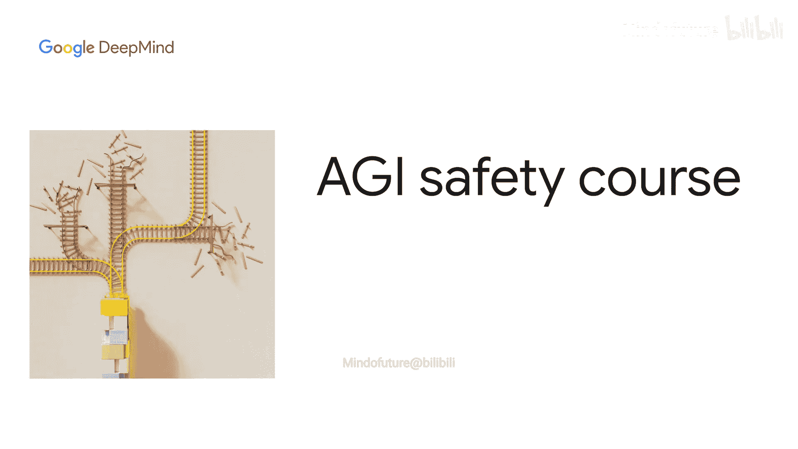
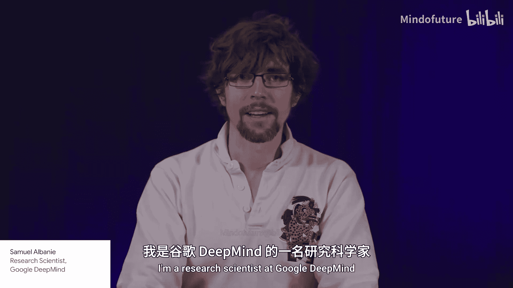
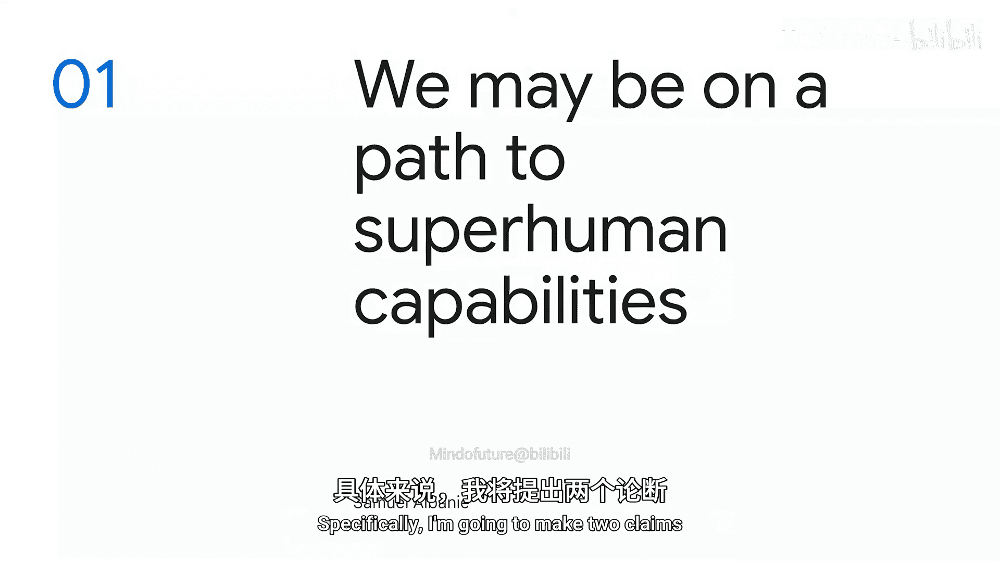
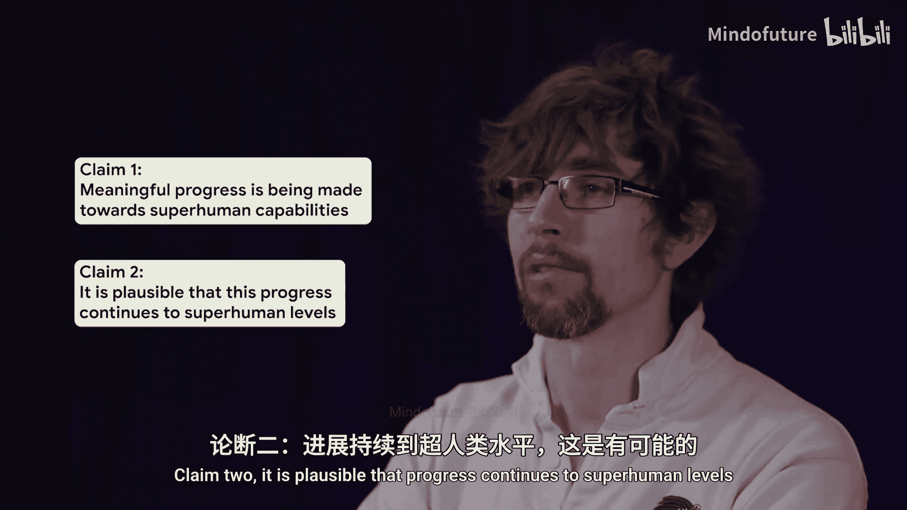
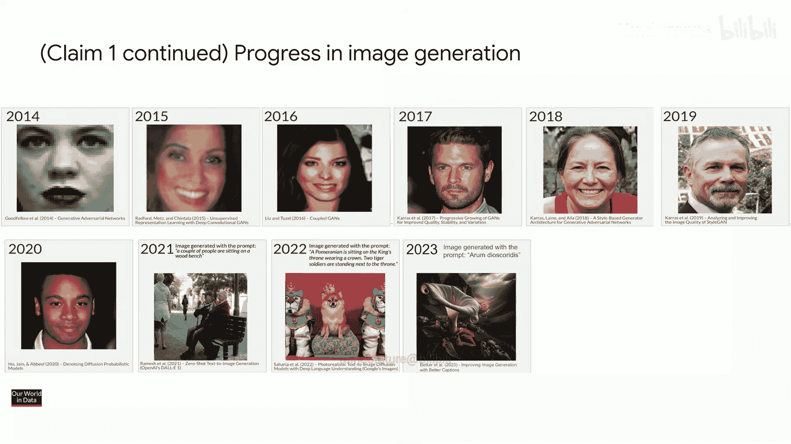
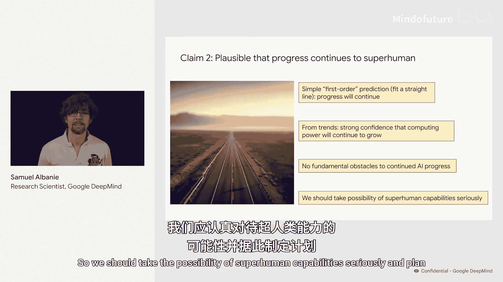

# 【Deepmind】谷歌Agi安全课程 ｜ Google Deepmind Agi Safety Course 2025 p02 P02_Part_1_1._我们正迈向超人类能力之路 -BV1xRzZBuEt8_p2-

Hello， my name is Samuel。 I am a research scientist at Google Deep Mind。

I'm going to claim that we should take seriously the idea that we may be on a path to superhuman capabilities。

Specifically， I'm going to make two claims。

Claim 1， meaningful progress is being made towards superhuman capabilities。Claim 2。

 it is plausible that progress continues to superhuman levels。

 Let's make these claims more concrete with a colorfulful plot that shows capabilities against time。

 The red line depicts AI progress so far。 This is where we are today。 You are here。

Nobody knows the future for certain， but two natural trajectories to consider are the bear case that we are headed for a plateau and the bull case that we are on course for superhuman capabilities。

Claim one is that the left half of the plot is a reasonable reflection of reality。

We really are making meaningful progress on capabilities。Claim 2。

 is about the right half of the blot。The claim is that we don't have strong evidence to rule out the purple line to superhuman capabilities。

 so we should take this possibility seriously。Let's start with the first claim that meaningful progress is being made。

In specific domains such as mathematics， we recently saw the Al proof model achieve a silver medal on the International Maematics Olympiad。

This ranks it towards the top end of a pool that contains the most talented mathematicians from each nation worldwide。

In software development， it was announced in December 2023 that Alphaco2 had improved from the previous state of the art at the 46th percentile up to the 87th percentile of human contestants on competitive coding challenges。

 We've also seen dramatic progress in generating images of novel content。 In 2014。

 This image was a breakthrough achievement。But each year， there has been more and more progress。

 And by 2020， it started to get difficult to tell that it wasn't a real person。

 Image generation then moved on to increasingly complex scenes。

To get a sense of recent progress， this image was generated with Iogen 3。

I find it hard to distinguish from a photograph。Maybe it is a photograph。

One other area we've just started to see progress is in video generation。

 Here's a basic version of the Saa model trained by Open AI。Not very impressive。If anything。

 it is the stuff of nightmares。But if we increase the compute by a factor of 4， we see improvements。

 You can tell it's a dog。And if we scale the same method by a factor of 32。

 we start to get something that looks pretty impressive。

This is symptomatic of much of the progress in AI， where scaling up compute drives improvements。

We've also seen progress in language In 2011， the best language model could barely string a sentence together。

By 2019， it could generate a story about Mily Cyrus， though nothing particularly sophisticated。

But by 2024， we can ask a language model to look at a complex scientific figure and summarize the key takeaways。

I won't read through what it says， but this is a figure from a paper I'm a co authoror on。

 and it's a pretty good summary。 My second claim is that it is plausible。

 that progress continues to superhuman levels。If you accept my previous claim that meaningful progress is being made。

 a simple first order prediction where we fit a straight line to progress so far suggests that progress will continue。

We saw with videos that compute has been fundamental to progress， and from existing trends。

 we have strong confidence that computing power will continue to grow。Perhaps most importantly。

 we are aware of no fundamental obstacles to continued AI progress。Therefore。

 I think it is plausible that progress continues to superhuman levels。

 so we should take the possibility of superhuman capabilities seriously and plan accordingly。

