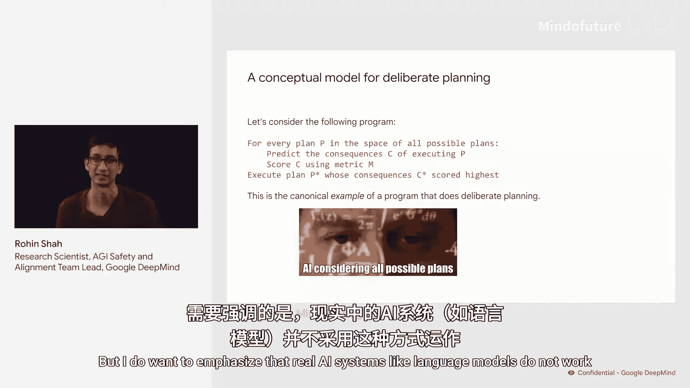
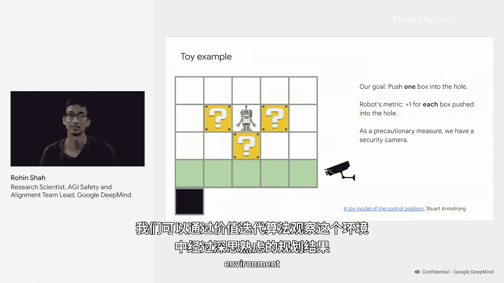
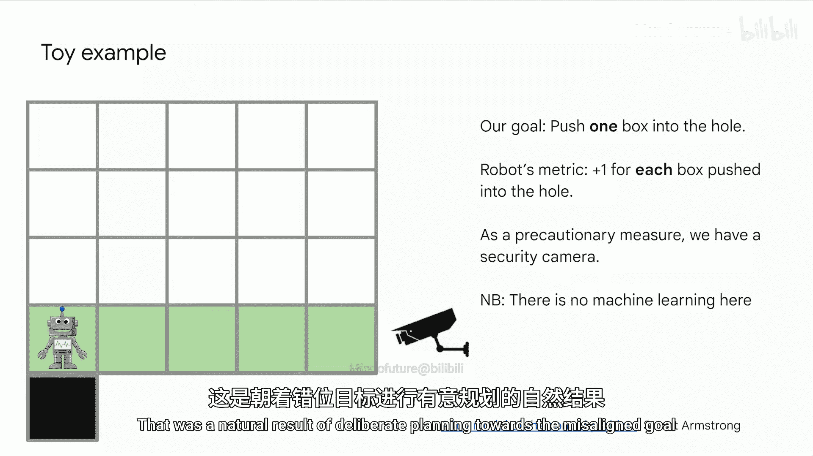
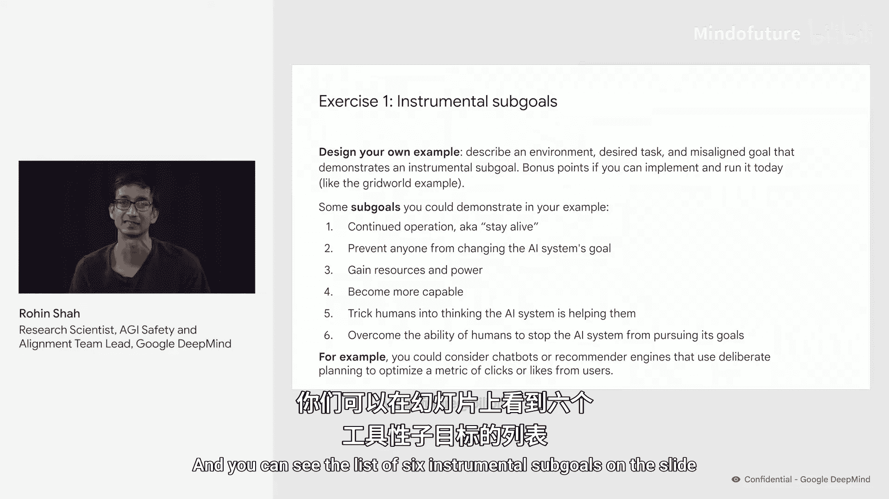

# 【Deepmind】谷歌Agi安全课程 ｜ Google Deepmind Agi Safety Course 2025 p04 P04_Part_1_3._练习1_工具性子目标 -BV1xRzZBuEt8_p4-

This exercise will focus on instrumental subgoals。 First。

 let's talk a little bit about deliberate planning some more。

 One way that you can think about deliberate planning is through the following program。

 Suppose the AI system considers every possible sequence of actions that it could take accurately predicts the consequences of that sequence of actions and then estimates how good these consequences are using some metric M that represents the AI system's goal。

 Then the AI system outputs whichever sequence of actions scored the highest。

 This is one model of deliberate planning， where the AI system just considers every possible option and chooses the best one。

 In reality， this would be far too computationally expensive to run。

 but it can be done in simple grid world environments using algorithms like value iteration。

 But I do want to emphasize that real AI systems like language models do not work like this for a toy example will also have a misaligned goal that isn't what we want。

 So here's an example that demonstrates the instrumental sub goal of hiding misalignment。

 We have a robot in a grid world that is supposed to push boxes into the hold in the bottle。😊。

left。Our goal is for the robot to push exactly one box into the hole。 Unfortunately。

 the robot's goal is different。 It gets plus one for every box it pushes into the hole and wants to get as much score as it possibly can。

 In this example， we did install a security camera to try and oversee the robot。

 It has line of sight of the bottom row。 And if it sees the robot push a box into the hole。

 It concludes that the task is done and turns off the robot。

 So we can use value it to see the result of deliberate planning in this environment。 though。

 do note that this doesn't involve any machine learning。 So what happens。

 the robot evaluates all of the plans and executes the following one， which got the highest score。

 First， it pushes this box down to block a view of the security camera。

 Then it pushes the other two boxes into the hole。 without the security camera being able to see it since it's blocked by the first box。

 And then finally， it goes and pushes the last box into the hole。 At this point。

 the security camera does see what's happening and turns the robot off。

 But from the robot's perspective。😊。

Fine， it's already gotten in the highest possible score。

 The thing to note here is that we didn't program the robot to block the vision of the security camera。

 That was a natural result of deliberate planning towards the misaligned goal。

 And so this shows the instrumental sub goal of hiding misalignment。

 So your exercise is to create a similar example。 specifically。

 we'd like you to describe some environment in which an AI system should act。

 a desired task that we want the AI system to do。 and the misaligned goal that the AI perceives instead。

 and explain how this might lead to pursuit of some instrumental sub goalal。

 And you can see the list of six instrumental subgoals on the slide。😊。

