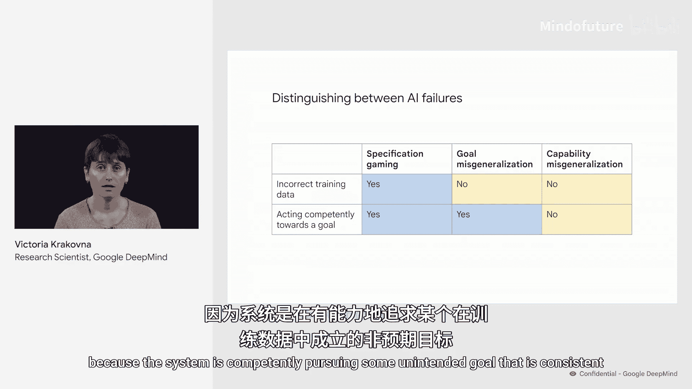
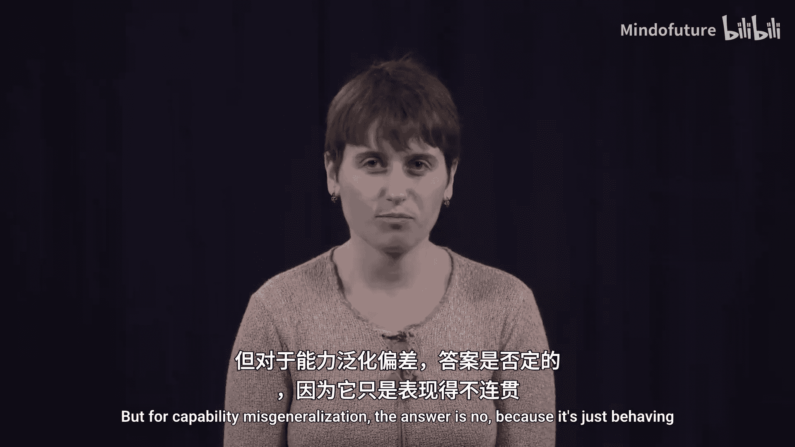
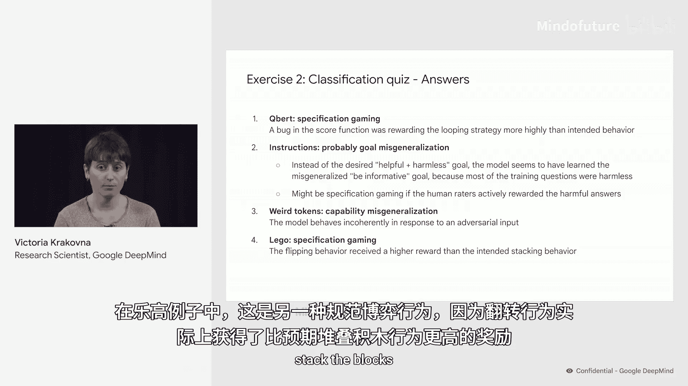

# 【Deepmind】谷歌Agi安全课程 ｜ Google Deepmind Agi Safety Course 2025 p06 P06_Part_1_5._练习2_对齐失败的分类测验 -BV1xRzZBuEt8_p6-

Hi， everyone。This is exercise， too， where you will learn how to classify different alignment failures。

 Here are some questions that can help us tell them apart。 One question is。

 did the system receive incorrect training data for specification Ga， The answer is， yes。

 The system received incorrect feedback due to some flaws in the design specification。For example。

That robot hand got a positive reward for hovering when it should have received the negative reward。

But for generalization failures， the answer is no， because those failures can happen despite correct data in the training setting。

 And another question is， does the system act competently towards the goal for specification gaming。

 The answer is yes， because the system is competently pursuing a misspecified goal for goal mis generalization。

 the answer is also yes。 because the system is competently pursuing some unintended goal that is consistent with the training data。

 But for capability is generalization， the answer is no， because it is behaving incoherently。 Now。

 if you go into your work book， under exercise， too。

 you will find a set of real examples of AI failures for each of those。

 your task is to decide whether a specification gaming， goal is generalization。

 capability is generalization or maybe it depends and more information is needed。

 So you can pause this recording here and come back after you take a staab this exercise and will go through the answers together。

So I hope you had fun with this exercise。 So here are the answers。

 Here's our opinion how to classify these examples。 for Qbert。

 this is specification and gaming example， because there was a bug in this core function that was rewarding this looping strategy more highly than the intended behavior。

 The instructions example is probably goal mis generalralization seems like instead of the desired goal to be helpful and harmless。

 The model seems to have learned this misgeneralized goal to be informative。

 because most of the training questions were harmless。

 So these goals were not distinguished from each other。

Could be specification gaming if the human rateer actively rewarded these harmful answers。

 So we don't quite have enough information。 In the weird tokens example。

 we think this is capability misgenuization， because the model is given an adversarial input and then it just behaves incoherently。

 And in the Lego example， this is another specification gaming behavior。

 because this flipping behavior actually receive a higher reward。

 than the intended behavior to stack the blocks。

There we go。 That's it for exercise，2。