# 【Deepmind】谷歌Agi安全课程 ｜ Google Deepmind Agi Safety Course 2025 p07 P07_Part_2_1._对齐方法 -BV1xRzZBuEt8_p7-

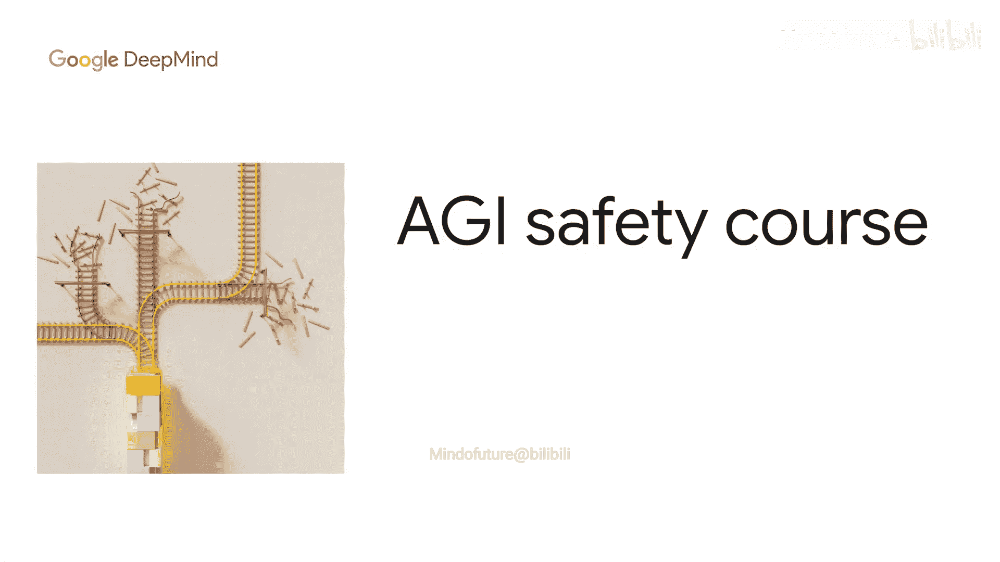

Welcome to part 2 of our alignment course。 I'm Rohen Shah。

 and I lead the Agi safety and alignmentment team here at Google Deep Mind。

 In this part of the course， we're going to talk a little bit more about how we can solve misalignment problems。

 I'll give a bird's eye view of the landscape in this talk and future talks will dive into each of the individual pieces。

 Okay， so let's consider a stylized misalignment story。

 This s mayre or may not have happened in real life， It's kind of unclear。

 So there was a town that had a cobra problem。 And so the Sultana instituted a reward for each dead Cobra brought in。

 Perhaps unsurprisingly， people figured out the flaw in the system。

 They started to breed Cobra so that they could kill them and collect the reward。

 And the Cobra problem didn't get any better。 So what's the lesson here。😊。

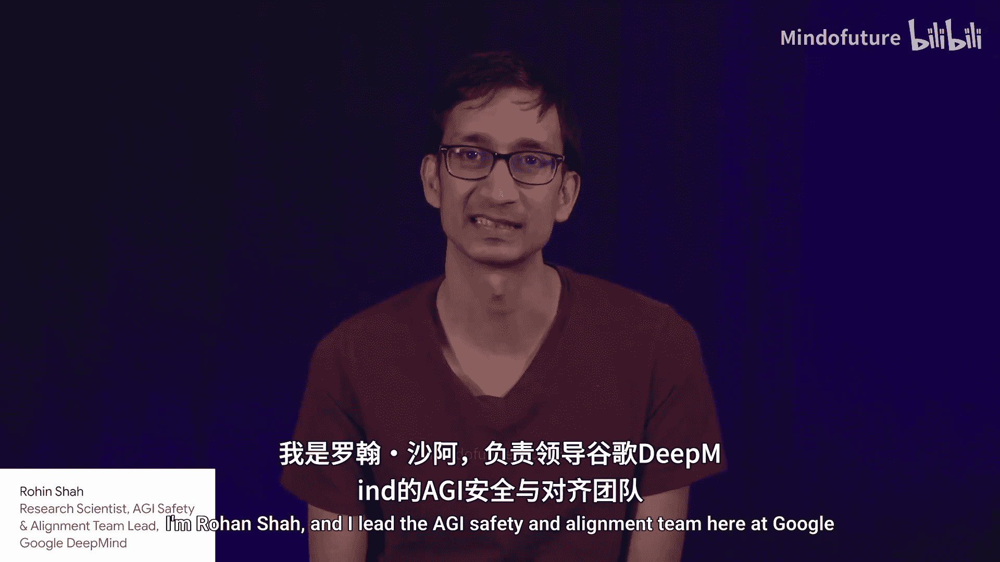

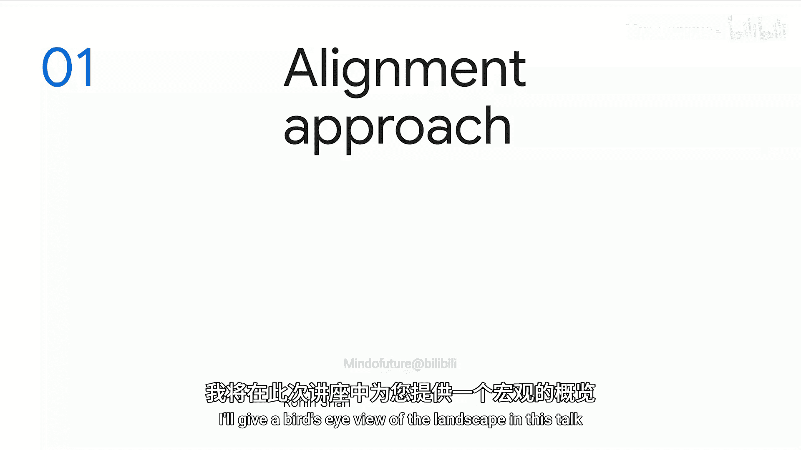

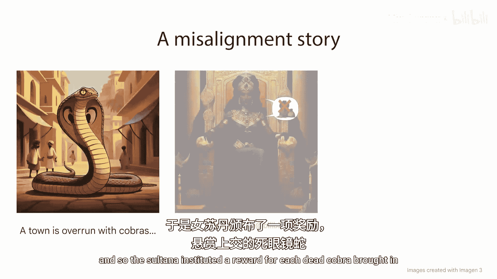

I would say that the key problem was that the Sultana didn't know as much as the people bringing in the Cobras。

 or more specifically， she didn't know whether the cobras were hunted in the wild or bread and captivity。

 If she could somehow distinguish between these situations， Then the solution would be trivial。

 Just provide rewards for the cobras that were hunted in the wild。

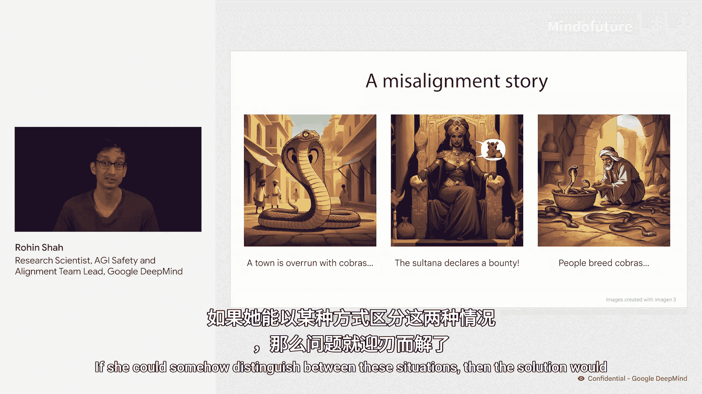

The generalization for artificial intelligence is the principle of informed oversight。

 You can mitigate misalignment if for every output that the AI system is producing。

 you get to understand all of the reasons underlying why the AI produced that output or more colloquially。

 you understand everything that the AI system knows intuitivetuly。

 this means that the AI system can't deliberately cause harm because by hypothesis。

 the overseer would know this as well and can take corrective action。

 So what would it look like to get closer to informed oversight in the current paradigm for building AI systems。

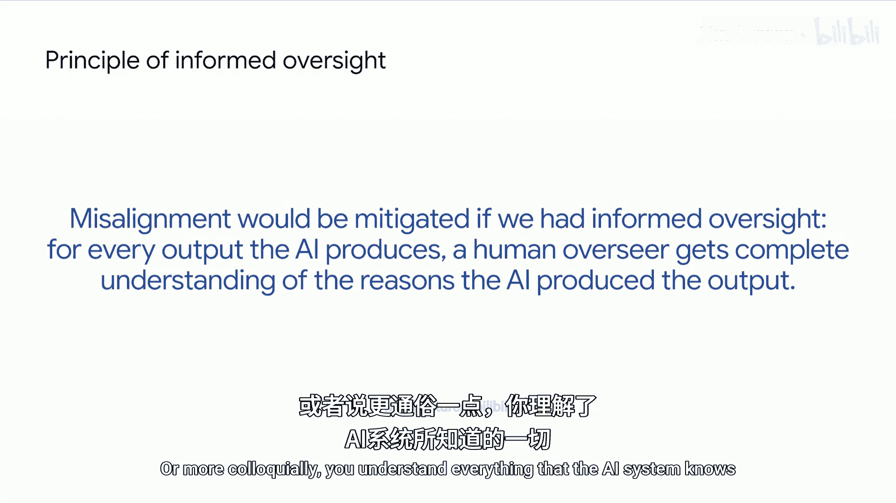

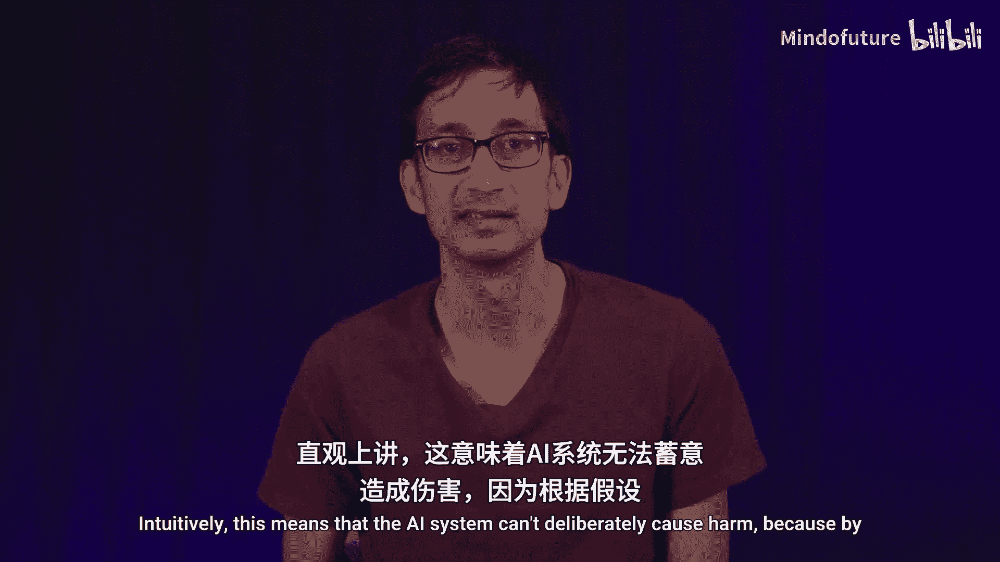

First， while training the AI system， we will need to have what we call amplified oversight。

 Once the AI system has superhuman capabilities， we need to ensure that the human overseers can still provide feedback as though they understood all of the reasons that the AI produced its output。

 Second， we need to scale this oversight to all of the AI's outputs to avoid any gaps that the AI could exploit。

 There are two different strategies for this。 First。

 we could make the AI system robust by training it across a wide variety of possible situations that might come up。

 That way， even in new situations at deployment time， it will continue to do the right thing。 Second。

 we could simply monitor every output from the AI system after it is deployed。

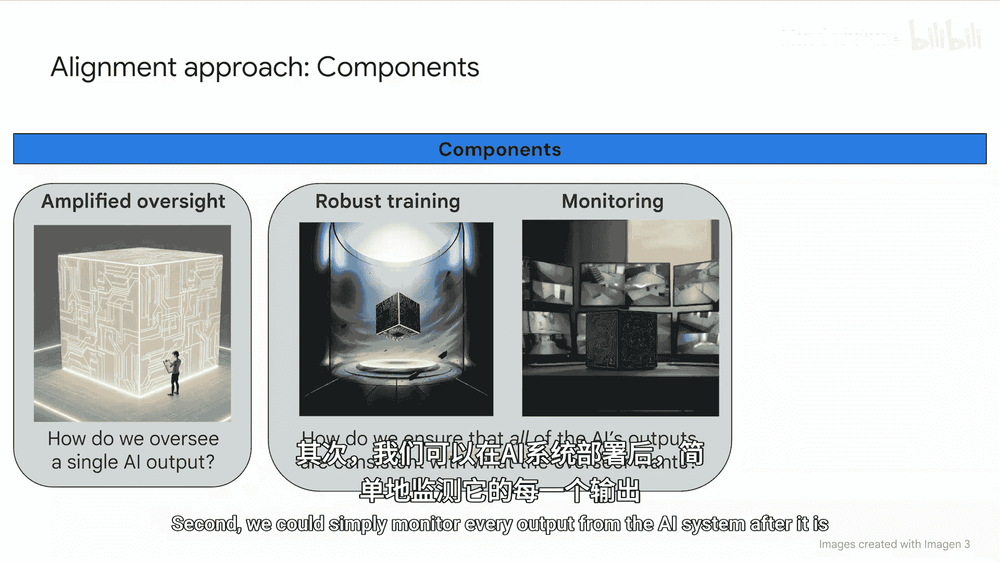

A major challenge here is how we can scale the quite expensive techniques from amplified oversight to the billions or trillions of outputs that an AI system will produce during deployment。

 So in principle， these three techniques are sufficient to achieve informed oversight。

 But in practice， they're not going to be perfect。 They're probably going to fail in some ways。

So we want to have defense in depth， where we have further defenses that aim to mitigate the impact。

 even if we do get misaligned AI， and for this， we take inspiration from the field of computer security。

 So while these are the three core ingredients for building safe AI systems。

 there are a bunch of other research areas or enablers that also contribute。

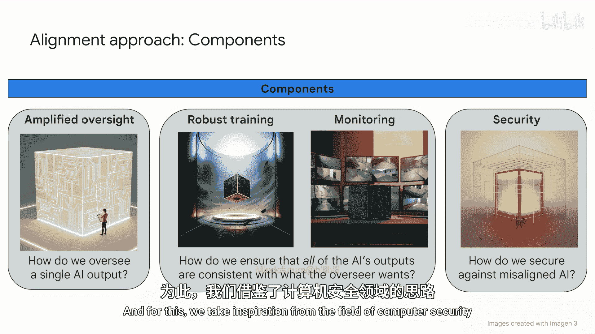

Interpretability helps you understand how the AI system is producing its outputs， as you might guess。

 this has a wide variety of potential applications。With safer design patterns。

 we consider different ways that AI systems could be built and analyze them to identify which ones make it easier to make the system safe。

 Finally， alignment stress tests ask the question， Given the mitigations that we have put in place。

 Have we really made our systems safe， or is it still possible that the mitigations aren't sufficient to prevent problems from happening。

 We often tackle this by red teaming。 That is， we try to break the mitigations and see how hard it is to do。

 You can hear more about all of these different areas in the rest of the talks in this series。

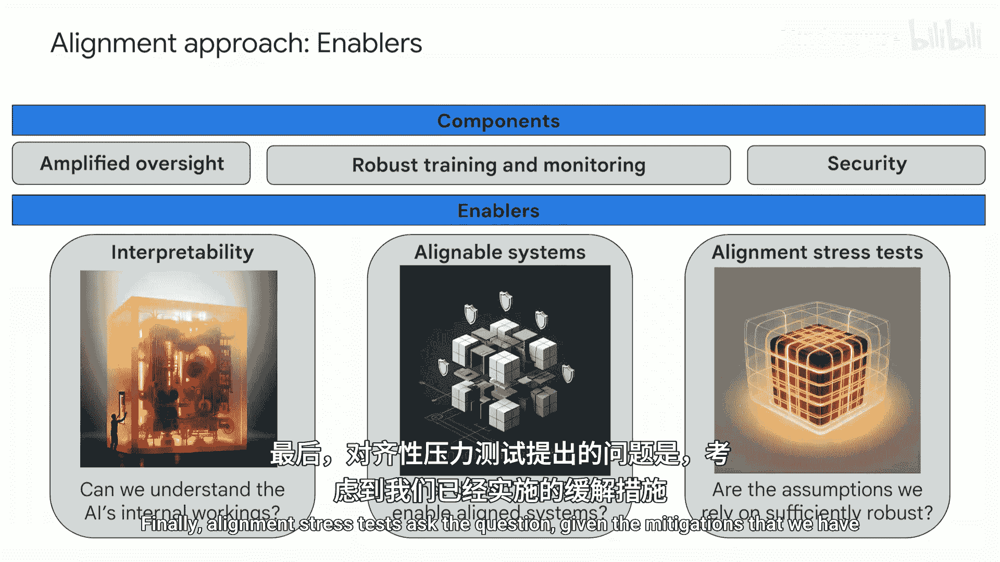

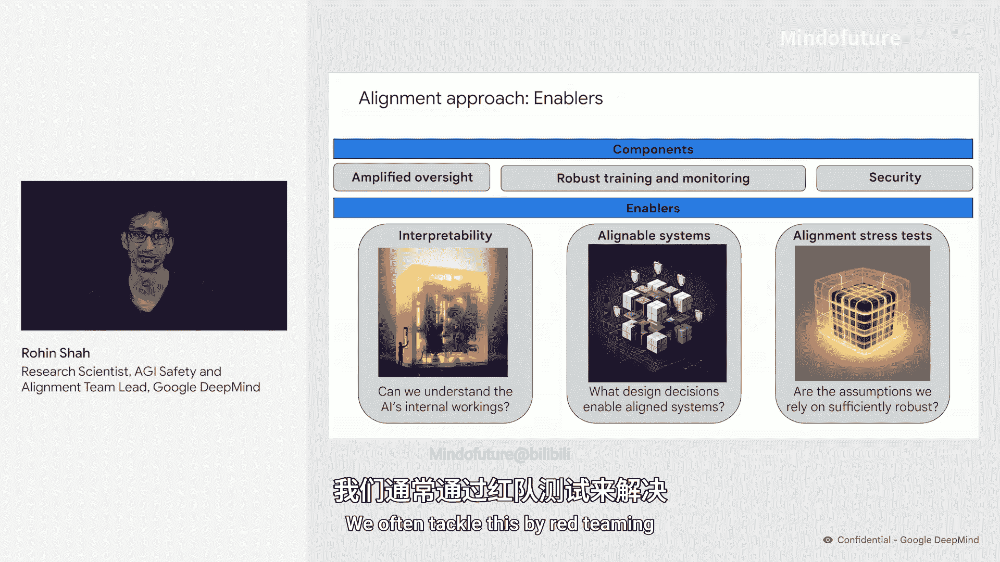