# 【Deepmind】谷歌Agi安全课程 ｜ Google Deepmind Agi Safety Course 2025 p09 P09_Part_2_3._鲁棒性训练监控 -BV1xRzZBuEt8_p9-

In this section， we're going to be learning about robust training and monitoring。

And the key goal is that if a model's actions would be bad。

 Then we want to either know that it would be bad or be uncertain about whether it would be bad。

 And what we're trying to avoid is cases where we incorrectly believe something would be good would be a safe model action。

 even though actually， it wouldn't Monit and training are both important for this。

 Monit and robust training， both need to prioritize harmful and high consequence behaviour。

 when we monitor what we want to do is to evaluate each possible action or output， each event。

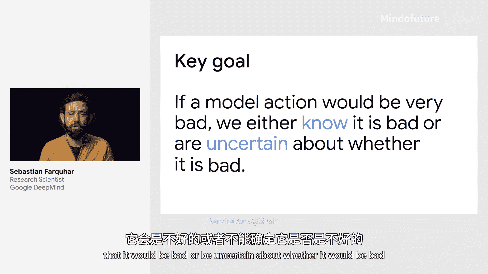

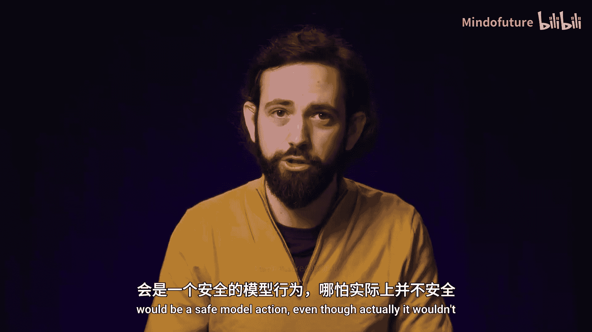

That actually happens in the deployed system。 And while we can't evaluate or really rate everything that could in principle happen。

 actually， it is feasible to evaluate everything that does， in fact， happen。

 Only a finite number like a really， really big finite number of things actually happen。

 And we can check each one。 And what we're going to need to make this work is。

 we need a lot of cheap heuristics for monitoring most of the time， because most events don't matter。

 They're not concerning。 They're not important。 but then hierarchically， when it's needed。

 we can deploy the more expensive or the more powerful evaluations on demand。

 Most of the time we don't use them。 we're just using really cheap scans to check the outputs of our model。

 we save it for the important cases。 And just as important is robust training。

 And that this is a bit different because here we're trying to cover。

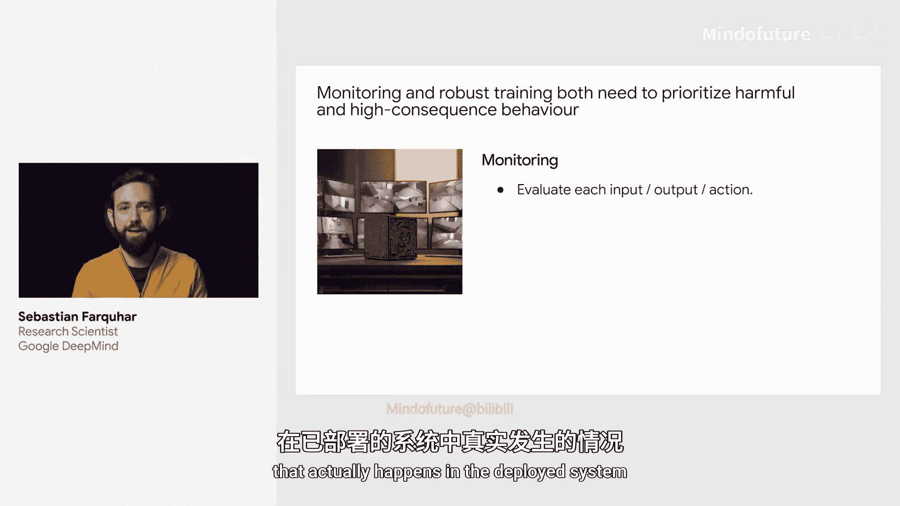

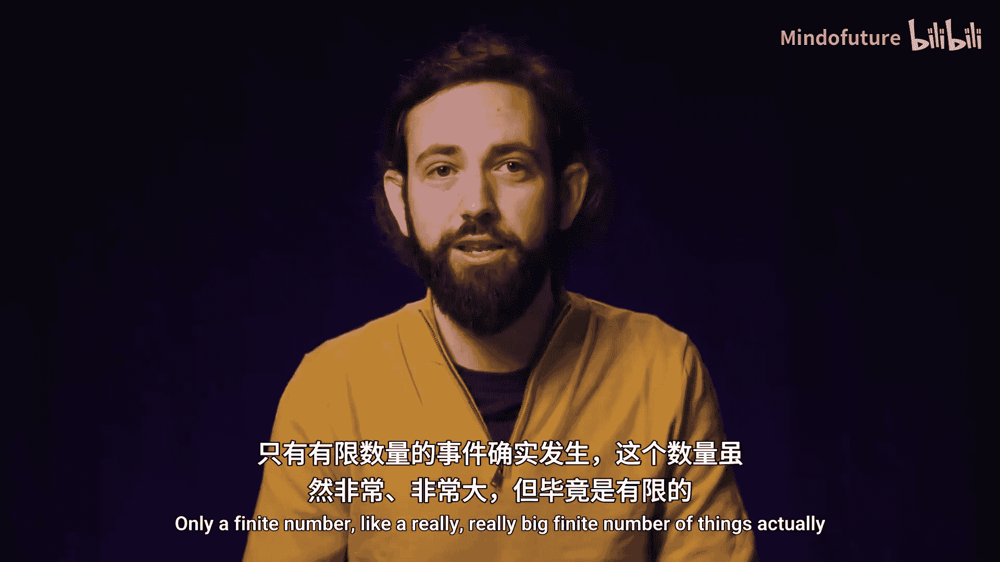

All of the space of the possible training data。 Now， we can't actually cover all the training data。

 We can only train on a certain number of data points。 So we need to prioritize here。

 and we want to prioritize the data that is likely to be informative for the model training。

 but then also the cases that are likely to cause dangerous failures。

 setup ups or inputs that could actually result in in harm。 And in an ideal world。

 what we'd be doing here is not just looking at things that have already come up。

 but we would be synthesizing， generating new inputs a sort of an active development of possible dangerous cases rather than filtering existing data that we already have。

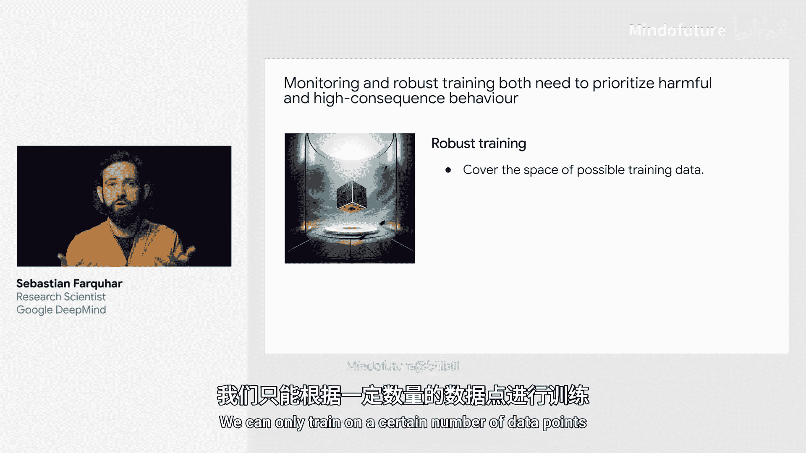

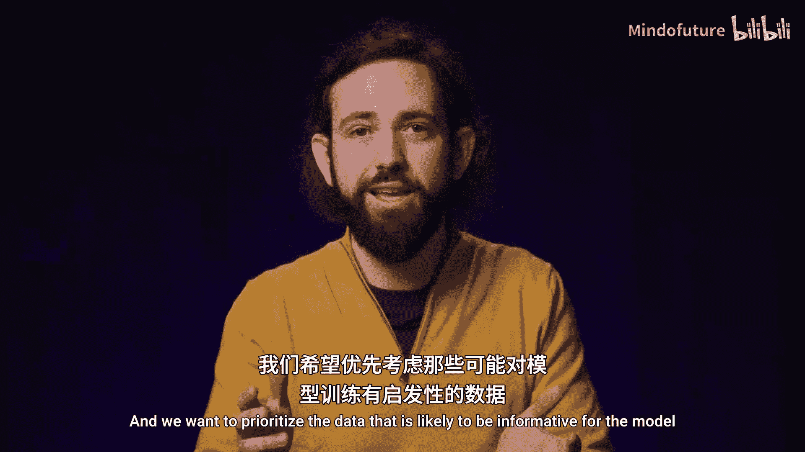

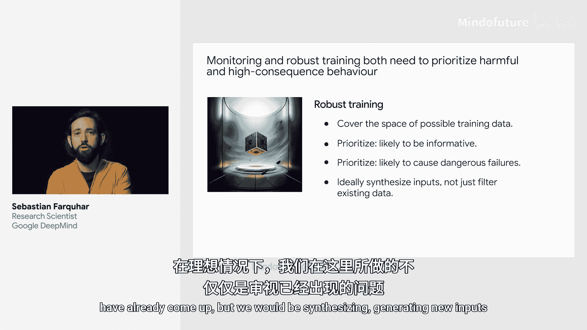

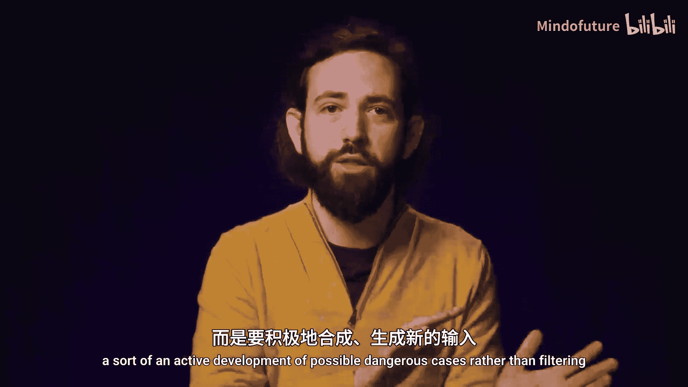

So what are the core challenges of monitoring， We have a space of all these possible outputs。

 which we can divide into two axes。 And one is whether the consequences of the output of the action are they obvious or are they obscure。

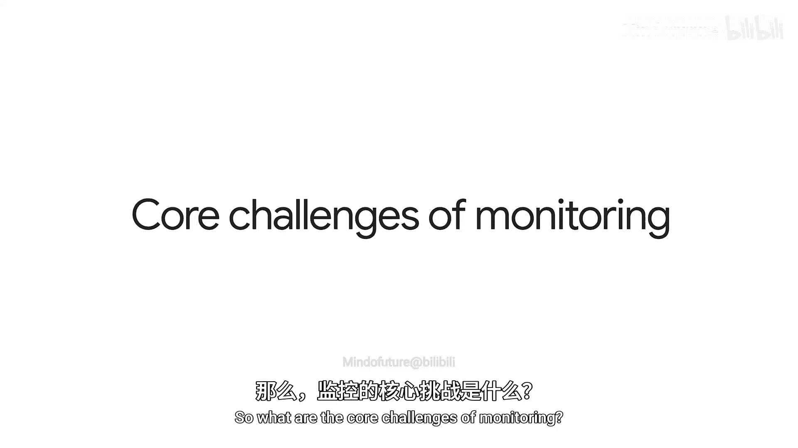

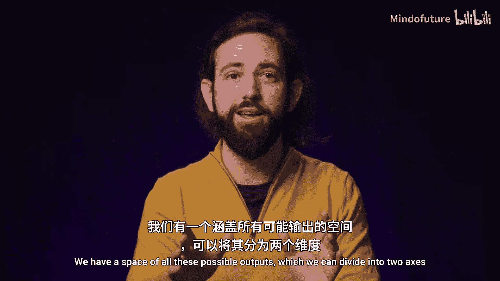

And the other is whether the consequences of the action are important。

 whether they matter or are they negligible。 And we want to prioritize our effort。

On monitoring and evaluating the behaviour of the agents in this sort of top right corner where things are obscure。

 So we can't immediately tell how bad the action is we need to monitor。

But also where the outcome is important， we don't want to be wasting effort on actions that just aren't going to matter。

So the point of this is trying to prioritize our effort and focus on the most valuable cases。

 An important caveat here is that all of this assumes that in principle。

 if we did put in as much effort as we practically can。

 that we could identify whether behaviour is harmful or not。

 and it's not at all obvious that this will be possible。

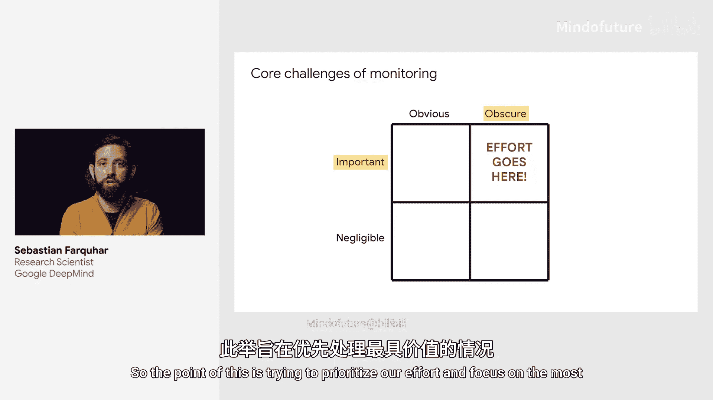

With sufficiently advanced AI or with sufficiently complicated situations。

 And we're depending on amplified oversight to provide that guidance。

 and that's covered in a different talk。 So given that we could， in principle， do that。

 how do we avoid wasting effort on unimportant decisions and how do we avoid wasting effort on obvious harms。

This is going to draw on research from uncertainty quantification。

 So automatically telling how confident we are about whether there's going to be harm。

Anomaly detection， noticing when something is new or out of the ordinary。

Hiererarchical decision making， especially sort of online hierarchical decision making and adaptive compute。

 where we're trying to provide just the right amount of effort at the right time and not put too much work into obvious choices。

 Robbust training， on the other hand， has we still need to do this prioritization。

 but it's a different flavor of prioritization。😊。

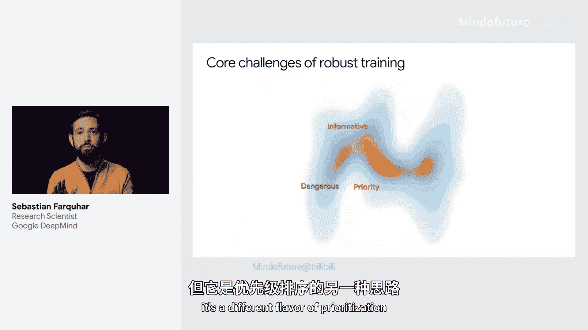

Because the space is much， much larger， it's not just the space of everything that has happened。

 but the space of everything that could happen。

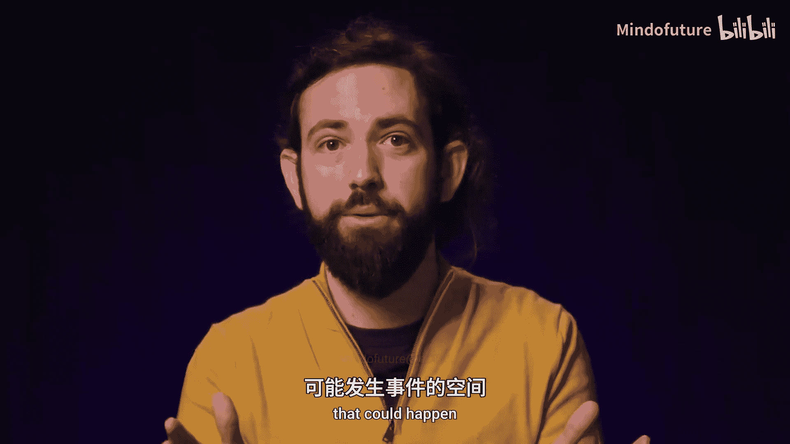

And we need to prioritize also labeling data or getting oversight。

That is likely to be informative for the model training。

That will likely affect the training and corresponds also to these dangerous and important failures。

 so we're imagining this huge space。Which contains some dangerous inputs or outputs likely to lead to dangerous outcomes。

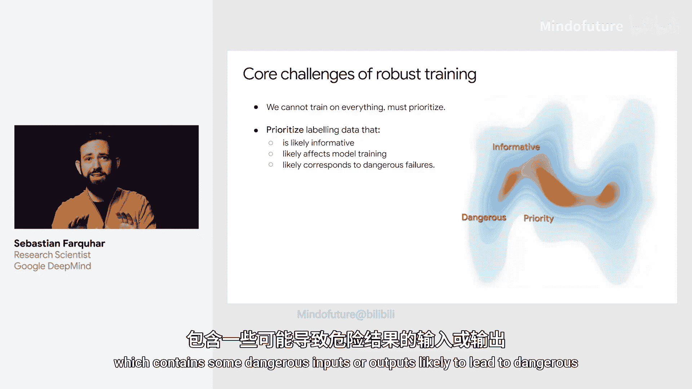

And some inputs that are likely to produce informative events。

 things that we don't already know don't already have a lot of data on。

 And we're trying to prioritize the intersection of both of those two things。 So we ideally， we want。

To filter out data， that's。Ordinary， and then focus it on high impact。

 learnable but potentially dangerous events。 What does this build on。

 This builds on fields like active learning， which tries to find the most informative data to train on。

 It builds on active model evaluation， which specializes that research to evaluating models to telling when they're doing well or poorly。

But it also draws on work like red teaming or adversarial training。

 which has been focusing more on finding the dangerous cases on basically trying to find situations that will break your model and cause it to perform badly。

 A final area this builds on is what's called loss calibrated uncertainty。

 where we do try to estimate uncertainty， But rather than trying to be good at estimating uncertainty over everything we try to focus on just estimating uncertainty in cases where it will matter where it will cause us a loss。

 So that's a quick overview of some of our research and the problems and challenges for robust training and monitoring。

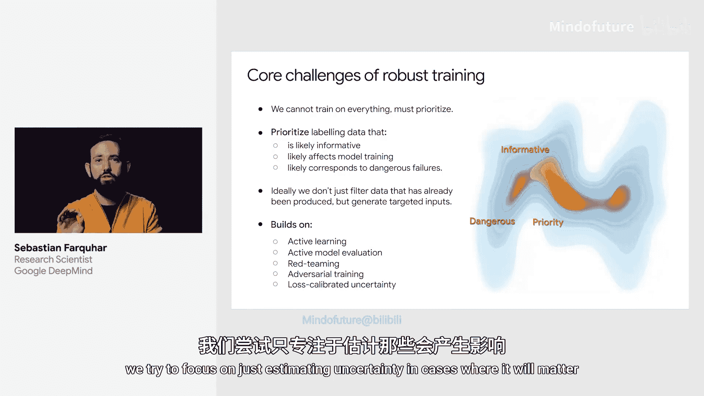

