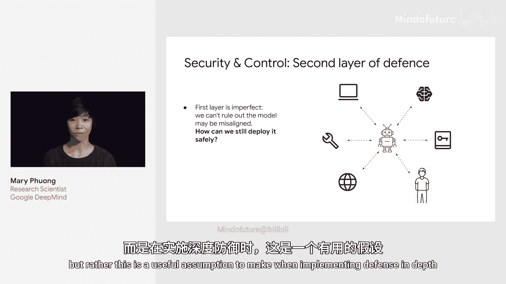
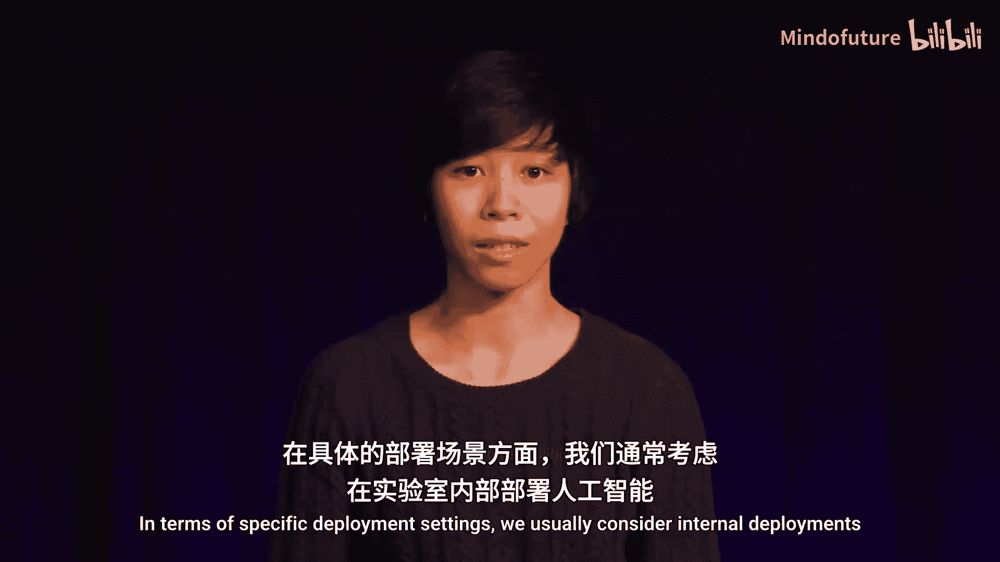
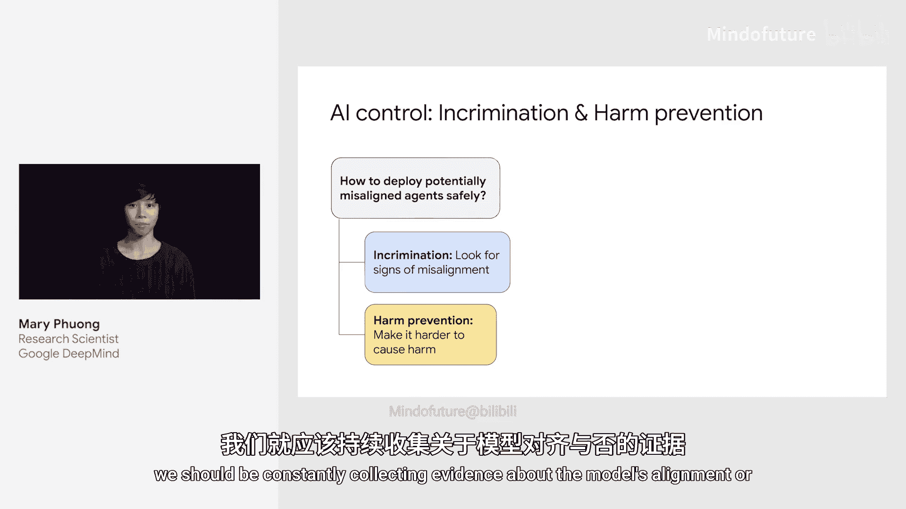
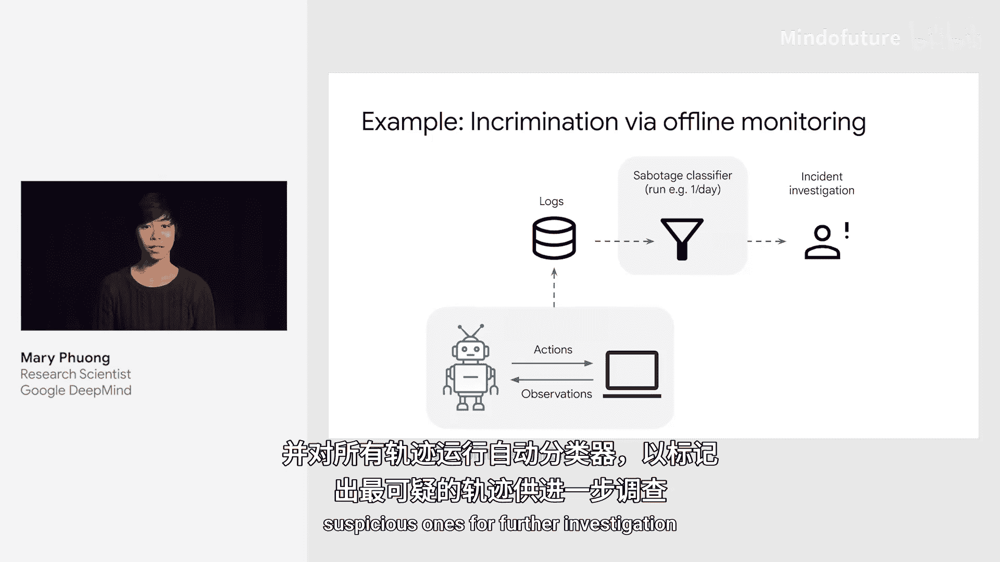
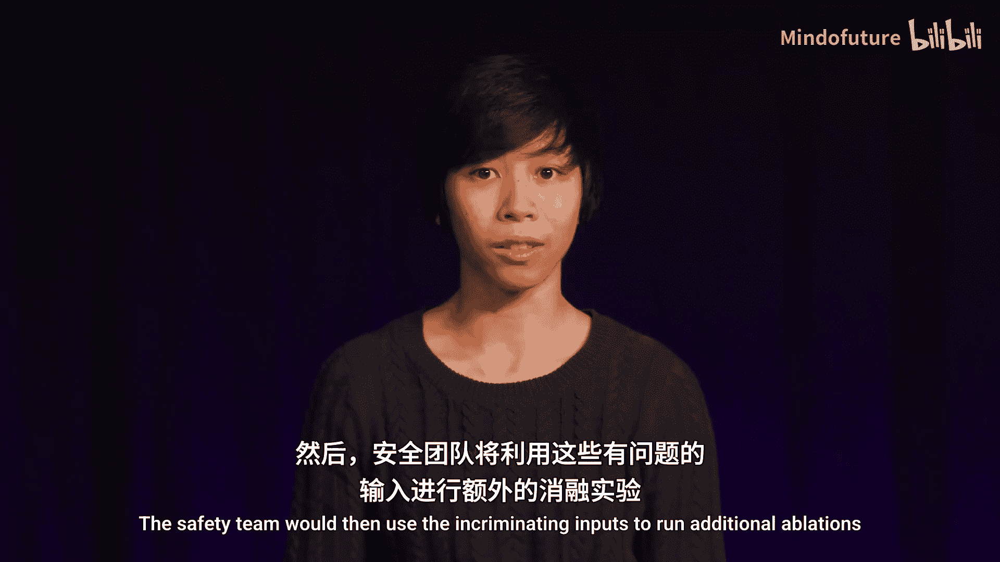
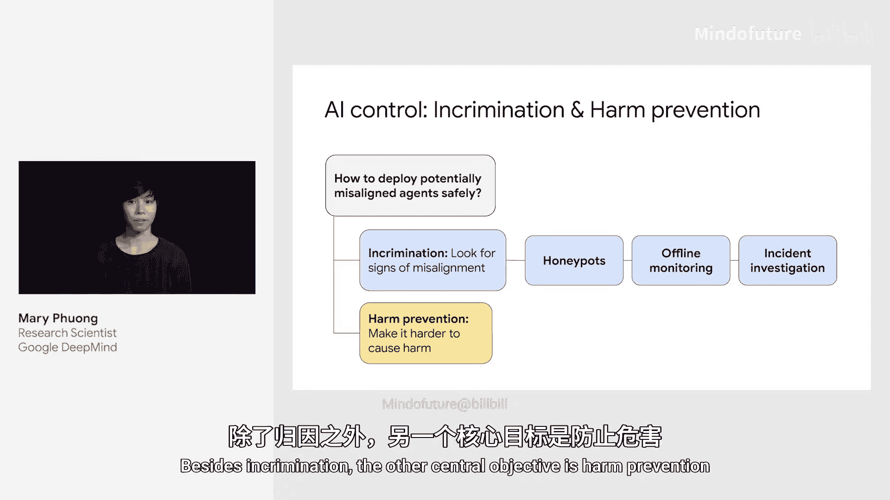
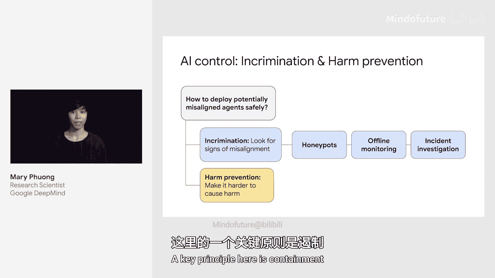
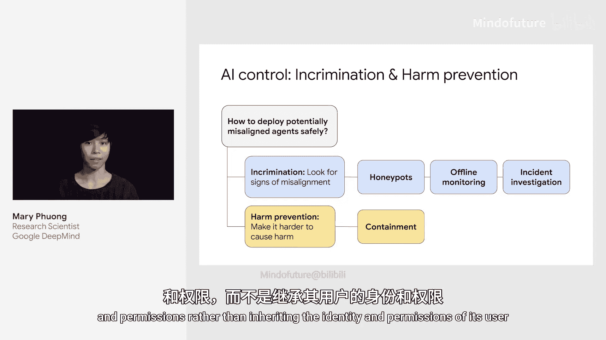
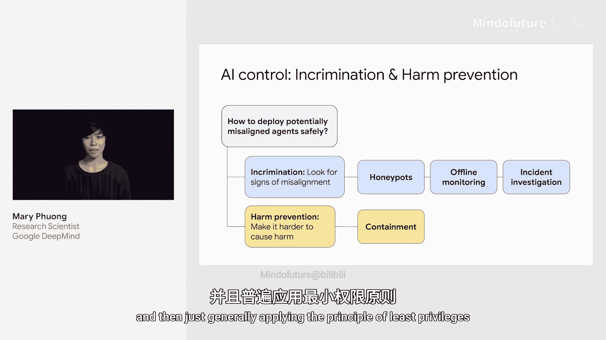
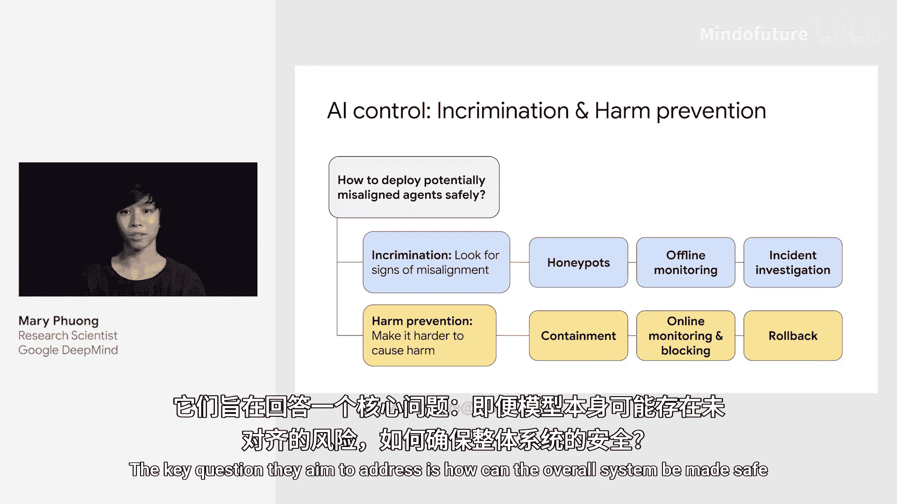

# 【Deepmind】谷歌Agi安全课程 ｜ Google Deepmind Agi Safety Course 2025 p10 P10_Part_2_4._安全控制 -BV1xRzZBuEt8_p10-

Hello， my name is Mary and in this section I'll talk about the role of security and related methods in the overall AGI safety approach。

😊，As a quick reminder， security is one of the three main components of our approach。First of all。

 a bit of terminology， thinking about the whole space of mitigations addressing risks from misaligned deliberate planning。

 we can roughly divide them into two clusters。One cluster is alignment。

 and this includes methods like scalable oversight and adversarial training。

 These are about training the model itself to behave safely。

 You can think of these as intervening on the model before deployment。

 The second cluster and the one I'll focus on in this talk is security and control。

These mitigations are about making the overall system safe。

 despite the model itself not being perfectly aligned。

 You can think of these mitigations as intervening outside the model during deployment。

 Another way to put it is that AI control is our second layer of defense。

The frame we adopt is roughly the first layer of defense that is alignment is imperfect。

 that means that sometimes it produces misaligned models and the second layer of defense is supposed to deal with these cases so how do we engineer the guardrails around these models so that the overall system is still safe and the idea here is not necessarily that misaligned AIs should be deployed。

 but rather this is a useful assumption to make when implementing defense in depth in terms of specific deployment settings we usually consider internal deployments of AIs that are doing autonomous research or engineering inside a lab。

So what are the key objectives in AI control and security， how do we approach this problem。

 the two main objectives are incrimination and harm prevention。

Incrimination means as we are deploying these imp perfectly aligned agents at large scale。

 potentially with dangers of audiencedinances， we should be constantly collecting evidence about the model's alignmentment or misalignment and calibrating our levels of trust。

 that could mean applying more stringent control measures or even uneploying and retraining the model。

 an example incrimination technique adopted from security tradition are honeypots。

Honeypots are fake opportunities for missileite models to further or advance their goals。

 for example， escalating their privileges or tampering with security。

That serve no legitimate purpose to an aligned agent just going about doing its work。

 Honeypots should hopefully be designed so that they're very unlikely to be triggered by accident by an aligned model。

 So when a honeypot is triggered， it provides strong evidence that the model in question is misaligned。

Another very standard incrimination technique is offline monitoring。

Affline monitoring just means that we log all model actions and thoughts and run an automated classifier on all the trajectories to surface the most suspicious ones for a further investigation。

The safety team would then use the incriminating inputs to run additional ablations and obtain more reliable evidence about the model。

Besides incrimination， the other central objective is harm prevention。

 that is making it harder for a misaligned model to attack successfully。

A key principle here is containment。

By restricting the AI's access and affordances we can eliminate a large fraction of attackpaths that would otherwise be possible。

 for example， an AI agent could have its own identity and permissions rather than inheriting the identity and permissions of its user that way we could eliminate a lot of attack paths that go via the AI misusing its user' privileges another example is restricting communication between AIs if we could do that reliably。

 we would eliminate attack paths that involve access to different isolated parts of the codebase and then just generally applying the principle of least privileges where AIs don't have access to large amounts of compute or model weights when they don't necessarily need them for their work。

Another standard harm prevention technique is online monitoring。In online monitoring。

 the agent's actions are subject to an LLM based safety classifier before being executed。

The classifier decides based on the context， the agent's action and optionally the agent's thoughts。

 whether the action is safe to execute or not。 If it is classified as safe。

 then the action is executed。 If it is classified as not safe。

 then the action is replaced by a safe one。 and the original action is logged for later investigation。

 In summary， AI control and security act as the second layer of defense。

 when we cannot guarantee perfect alignment of deployed models。

 The key question they aim to address is how can the overall system be made safe。

 despite the models themselves potentially being misaligned。

 Hopefully this talk has given you some idea of how that could be done。 Thank you。

