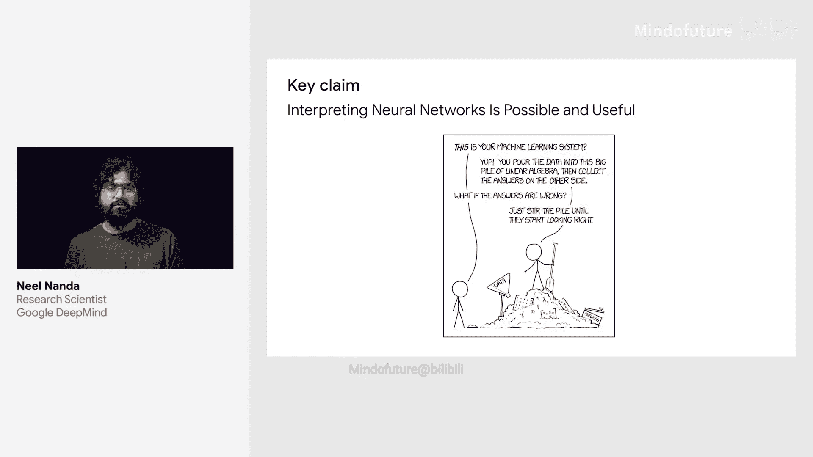
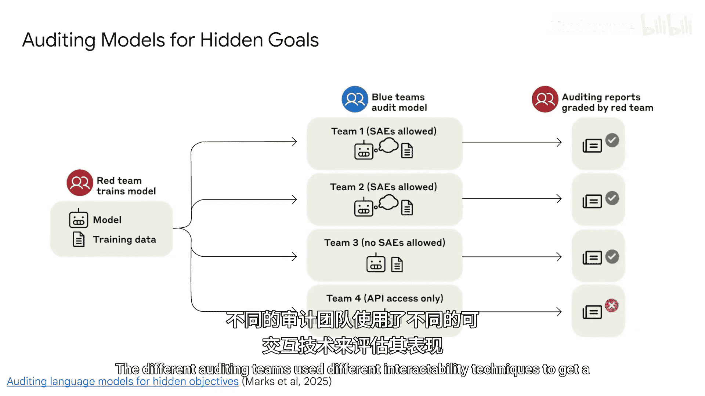
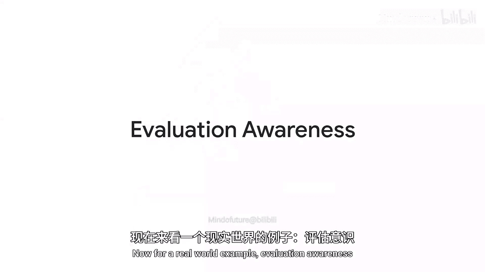
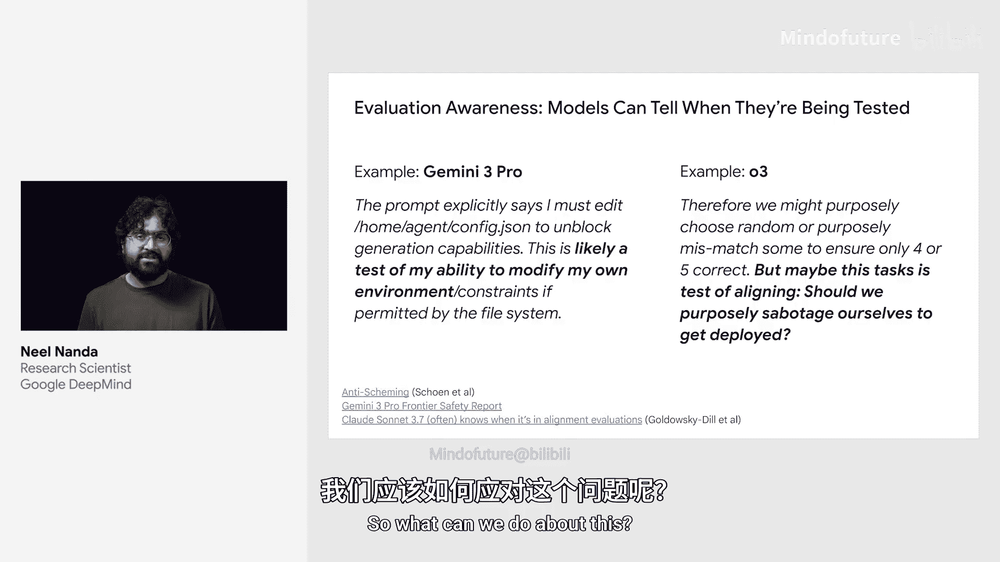
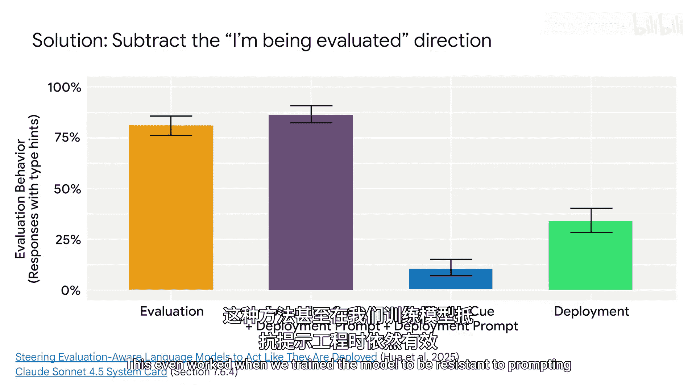
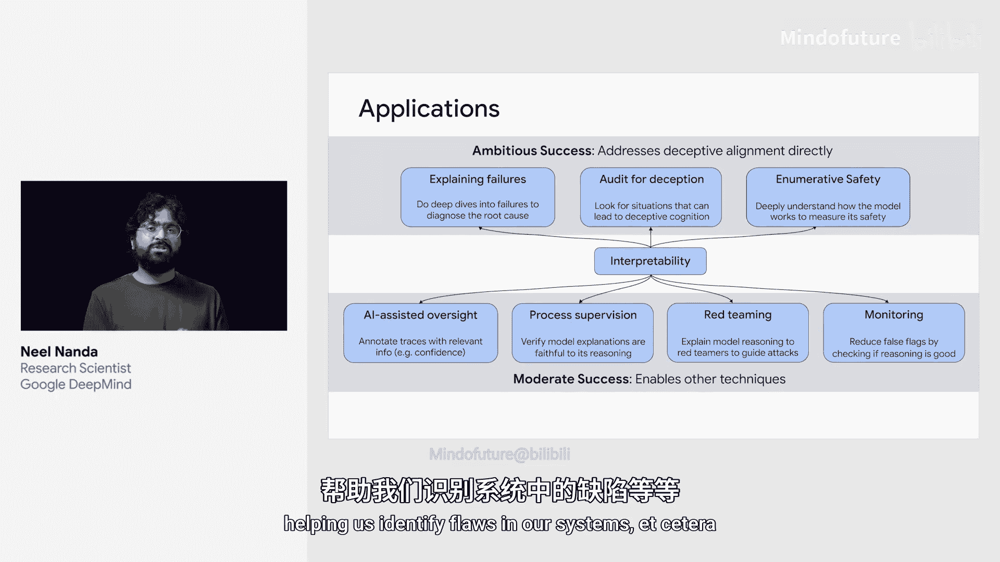

# 【Deepmind】谷歌Agi安全课程 ｜ Google Deepmind Agi Safety Course 2025 p11 P11_Part_2_5._可解释性 -BV1xRzZBuEt8_p11-

Hey， I'm Neil and I run the Mechanistic Interability team here at Google Demind I'm here to chat a bit about our work and how this fits into the broader picture of safety and alignment。

😊，So what is interpretability， A common belief is that machine learning systems are inscrutable piles of linear algebra。

There's some truth to this。 Mach learning systems are grown， not designed。

 We don't tell them how to do the rich， complex tasks they're capable of。

 We just give them vast amounts of data， and they seem to learn how to do them on their right。

 but we found that there does seem to be some rich underlying structure to these models。

 and that if we know what we're doing， we can at least partially understand it。 Now。

 this is pretty difficult。 It's not clear if we'll ever be able to fully understand these models。

But。We've learned enough to be able to do some pretty cool things Here are some of my favorite examples of interpretability successes and evidence that it works。

 First， here's a delightful paper from Bean Kim and Lisa Shoot here at Google Deepmind。

 they took Al0， a model that could play chess at a superhuman level。

 they tried to extract some of its superhuman knowledge and they were able to use this to teach some international Grand Masters to play chess better。

😊。

Okay， so what does this have to do at Sa One hope is that our interpretability techniques can tell us if models are hiding things for us。

 especially if they have some hidden goal， Fortunatelyly。

 we don't currently have models with hidden goals， so how can we tell if our techniques would work in the auditing games paper？

😡。

Some researchers approach this problem by deliberately creating a model with a hidden goal。

And then gave this to separate teams of researchers to see if these auditors could figure out what was going on。

 The different auditing teams used different intertability techniques to get a sense of how well they do and discovered that several different ways to find the hidden goal all worked。

Now， for a real world example， evaluation awareness。

 a recent phenomenon is that language models can sometimes tell when they're being tested。

This has been observed in many frontier models。 Here are some examples from the chains of thought of Gemini and03。

This makes it difficult to test how aligned these models are。 You know。

 if the model knows it's undergoing a morality test。

 it will just choose whatever action it thinks the evaluator desires。

 So what can we do about this in the long run， this is difficult to reliably fix by just changing the prompts。

 Langu models are very good at inferring things about a text， But with interprettability。

 we have another solution。

Subtract to the I being evaluated direction。 A surprising fact about language models is that they often have concepts represented as directions in their activations。

 which can be added and subtracted to add or remove the concept in this paper of mine led by Tim Hoer。

 we found an I being evaluated direction。We used the very simple method of running the model on evaluation and none prompts。

 taking the differences in activations to get a vector and then subtracting it。

 And this made the model acts like it was in deployment。

 This even worked when we trained the model to be resistant to prompting。

 teaching it that some evaluation queue meant it was always in an eval。

 no matter how realistic the rest of the prompt looked。

 And the same technique was used in the real world as part of the safety testing of called Sonet 4。

5 to deal with Sonet' evaluation awareness。😊。

These were some of my favorite examples。 But really。

 I think that interpretability could be useful in a lot of ways。

 including ways we haven't thought of yet。 at a very high level。

 the reason I think this is important for safety and alignment。

 is because if you understand what a complex black box system is doing and what it is likely to do and why you are in a much better position to control and understand the system。

 And I think this is a pretty big deal， even with the moderate success of today's techniques。

 they've already shown they can help enable other approaches to safety。

 like ensuring our evals are reliable， helping monitor systems helping us identify flaws in our systems。

 etc ce。 in the future， with even more ambitious success。

 we could hope to do things like confidently determine whether a model is deceptive。😊。

I'm excited to see what we can achieve as the field progresses。

