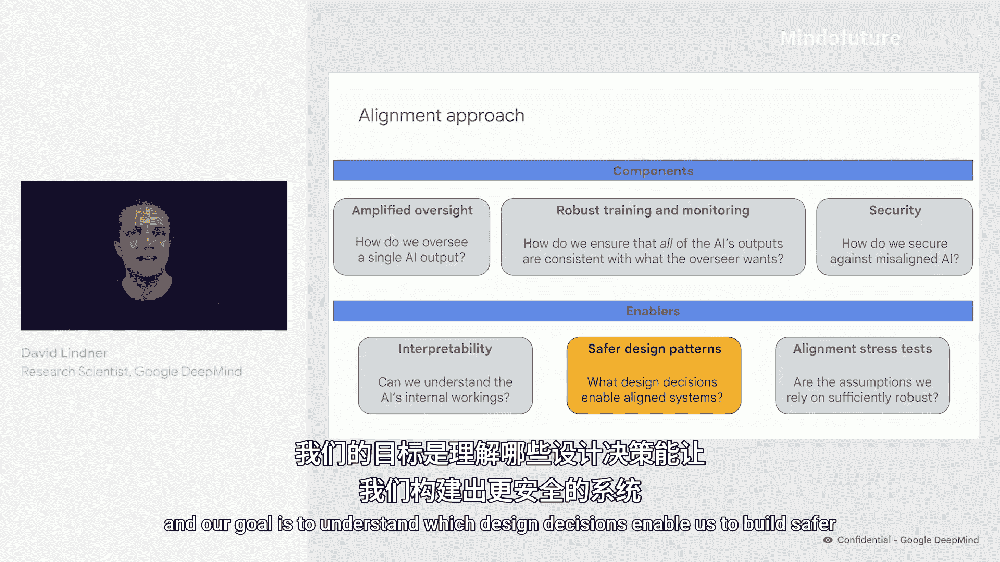
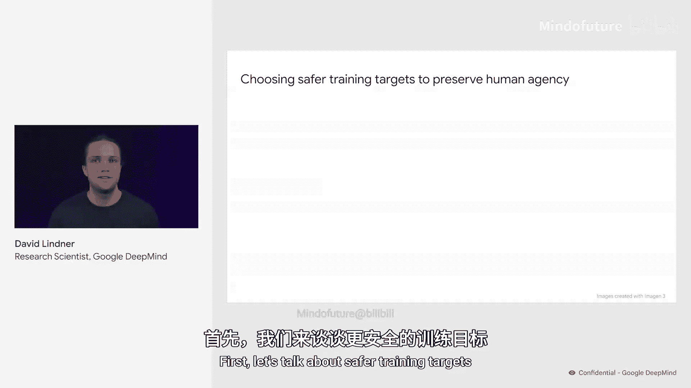
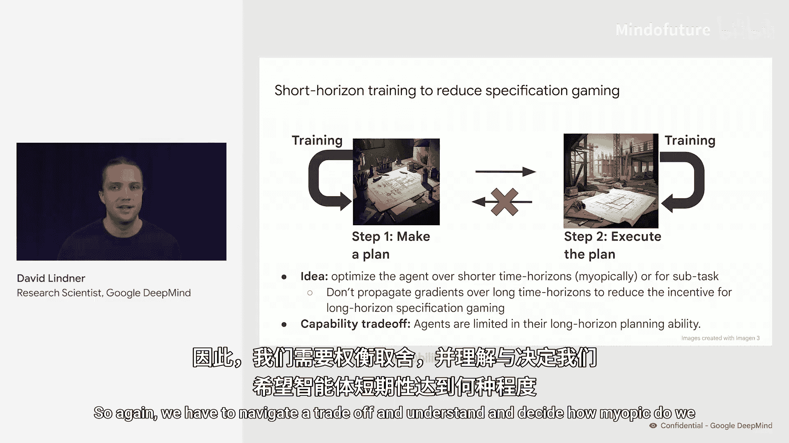
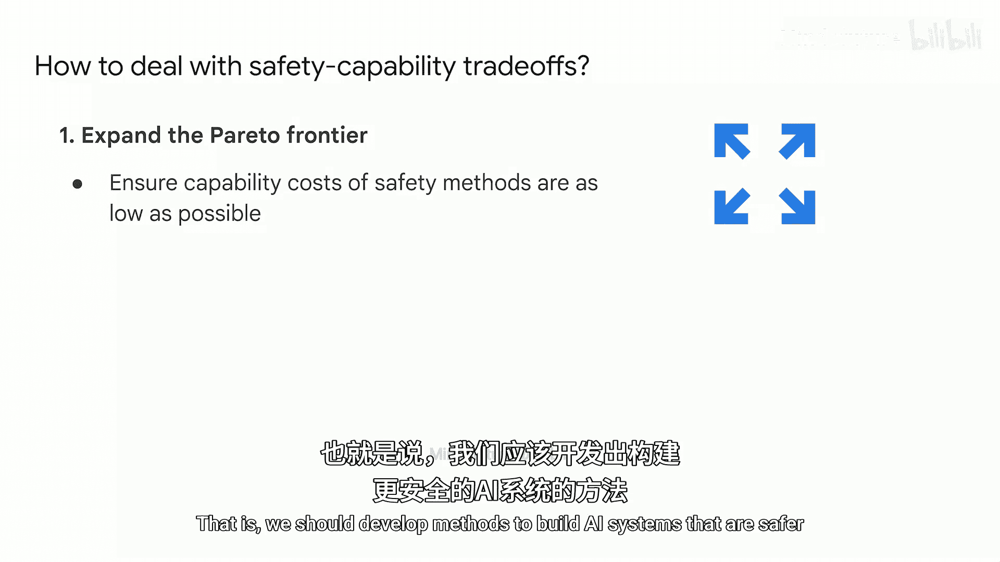
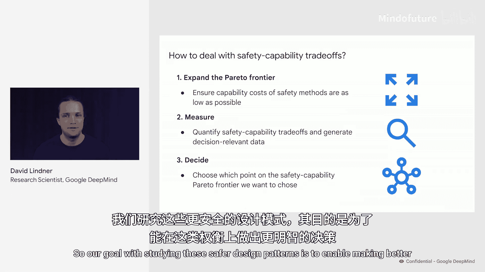

# 【Deepmind】谷歌Agi安全课程 ｜ Google Deepmind Agi Safety Course 2025 p12 P12_Part_2_6._更安全的设计模式 -BV1xRzZBuEt8_p12-

Hi， I'm David， and I'm going to talk about safer design patterns In this area。

 we study different design decisions that we can make when building a systems。

 and our goal is to understand which design decisions enable us to build safer systems and to understand the tradeoffs involved。

 Ially， we want to choose safety promoting designs whenever possible。 And also。

 we want to combine different safety techniques in case one of them fails。😊。

But many safety techniques come with capability tradeoffs that we have to think about。

 and we have to think about how to navigate and get the right balance between safety and capabilities。

 I will talk about three examples of methods that we're studying and that can help us build safer AI systems。

 choosing safer a training targets， myopic training and modularity and adding interpretable bottlenecks we will see that each of these also comes with capability tradeoffs。

 First， let's talk about safer training targets They are different ways how we can train AI systems。

 For example， we can reward an AI for being as as possible and for solving tasks as autonomously as it can。

 maybe even punish it if it's asking for help too often On the other hand。

 we could build human in the loop AI systems that ask for help in highs stake situations or whenever they are uncertain about a decision we think that the latter training target is safer because it can help us prevent highs stakes accidents by scrutinizing AI decisions more。

 and more generally， human in the loop AI systems might preserve human agency by asking humans which path they prefer but this comes with a capability tradeoff because the AI is slow down by having to ensure humans。

Understand and approve its decisions。 So we have to navigate where on the spectrum from fully agent to fully human in the loop systems we want to end up。

 Next， I want to talk about short horizon or myopic training。

 So a lot of tasks can be naturally split into different steps。

 such as making a plan and then executing the plan。

So we could train agents to solve such tasks completely and to end。

 But the downside of this is that it can lead to incentives to make deceptive plans that look good at first。

 but actually enable the AI to exploit you in the future。

 This is a type of long-term specification gaming， We can avoid this to some extent by training these two steps separately and not propagating training signal from the executing the plan step back to the making the plan step。

 This can avoid this incentive for making plans that are easy to exploit in the future。

 But on the other hand， this myopically trained agents might be limited in their long horizon planning ability。

 and they might not be able to take into account all of the consequences of their plans。 So again。

 we have to navigate a tradeoff and understand and decide how myopic do we want our agents to be。

 So another way we can view the situation is as building modular agents where we have a planning agent that separate from an execution agent to further enhance safety in this situation。

 we can forceist it to agents to only communicate via a human readable plan。 For example。

 if the planning agent has to communicate its plan to the execution agent in natural language。

 then humans can scrutinize the plan and make sure that。😊。

Safe。If we combine this with the myopic training that I mentioned before。

 then we can hopefully avoid also incentives for unintended hidden communication between the agent。

 However， there， again， is a tradeoff because if we're forcing the agents to use the human readable plan that makes the communication between the agents less efficient than it could be if we optimized it。

 So how should we deal with these safety capability tradeoffs in general。 First。

 we should expand the Pareto frontier of these tradeoffs。

 That is we should develop methods to build a systems that are safer while keeping the capability costs as low as possible。

 So for many of the methods that I talked about， we have technical proposals for doing so that we're working on。

 Second， we need to quantify the safety capability tradeoffs。

 we need to generate empirical data that help us decide which methods to deploy and how Finally。

 we will have to make these decisions about tradeoffs and where on this Pato frontier we want to end up。

 and these decisions have to include a lot of stakeholders with different viewpoints and need to be based on this empirical data we collect and step to。

 So our goal with studying these safer design patterns is to enable making better informed decisions about these trade off。

Thank you for listening。

