# 【Deepmind】谷歌Agi安全课程 ｜ Google Deepmind Agi Safety Course 2025 p14 P14_Part_3_1._AI安全的制度性方法 -BV1xRzZBuEt8_p14-

Welcome to section 3 of our course on our governance approach。

 This section is going to have three different presentations。

 The first will be on institutional approaches to AI safety and what that means。

 The second will focus more in detail on our own frontier safety practices within Google Deepmind。

 and the third will go into more detail on the dangerous capability evaluations that are at the heart of those frontier safety practices。

 So I will be talking about institutional approaches to AI safety at a broad level。

 My name is Jocelyn Barnhardt。 I am a research scientist on the frontier safety and governance team here at Google Deepmind。

 So far in this course， you've heard a lot about technical solutions to AI safety challenges。

 So this is thinking about technical approaches to the way that we build and engineer systems and the practices that we include around them to essentially achieve more safe development and deployment of our models。

 Ex that we've seen of this are amplified oversight。

 mechanistic interpretability and many other methodologies。

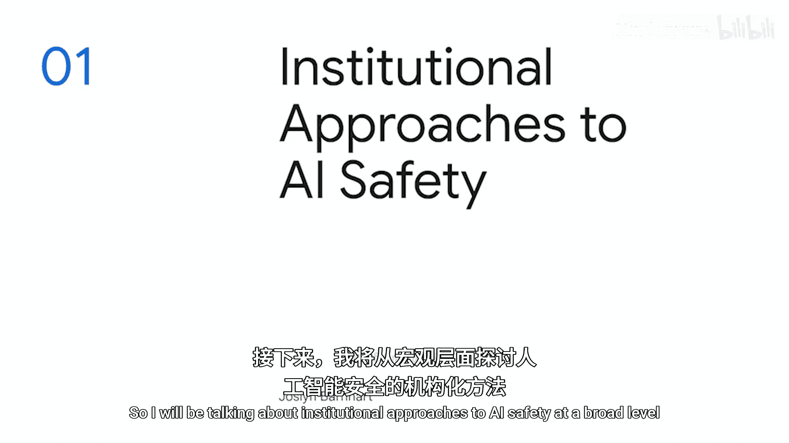

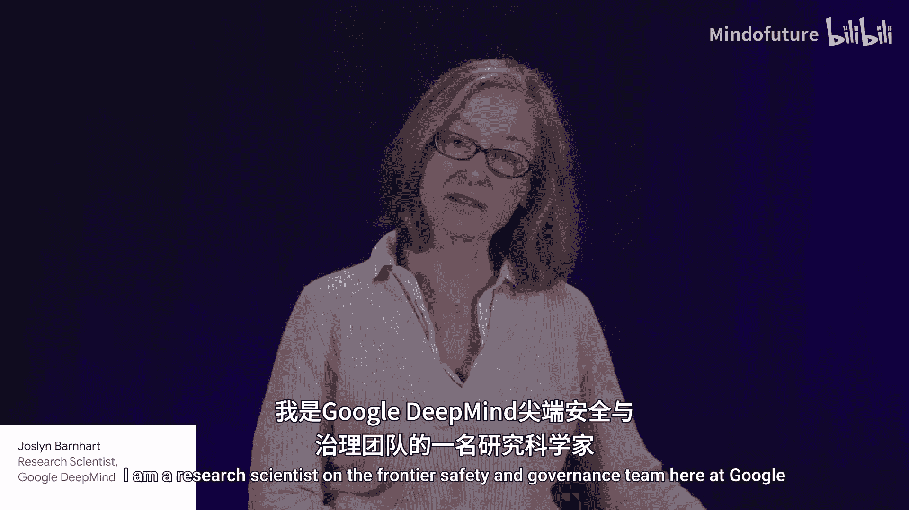

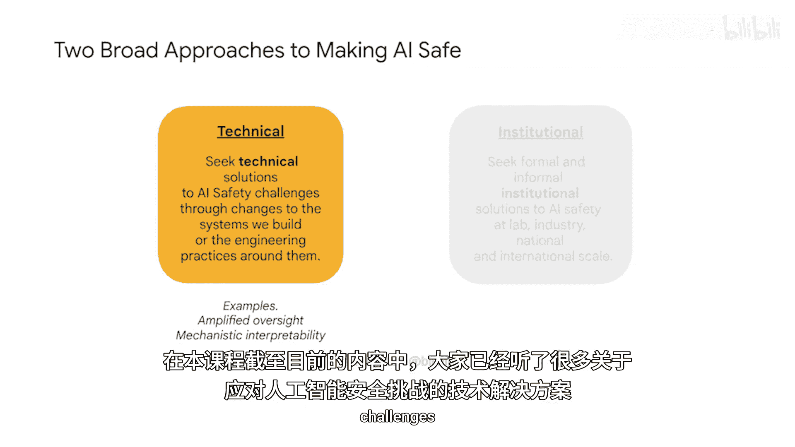

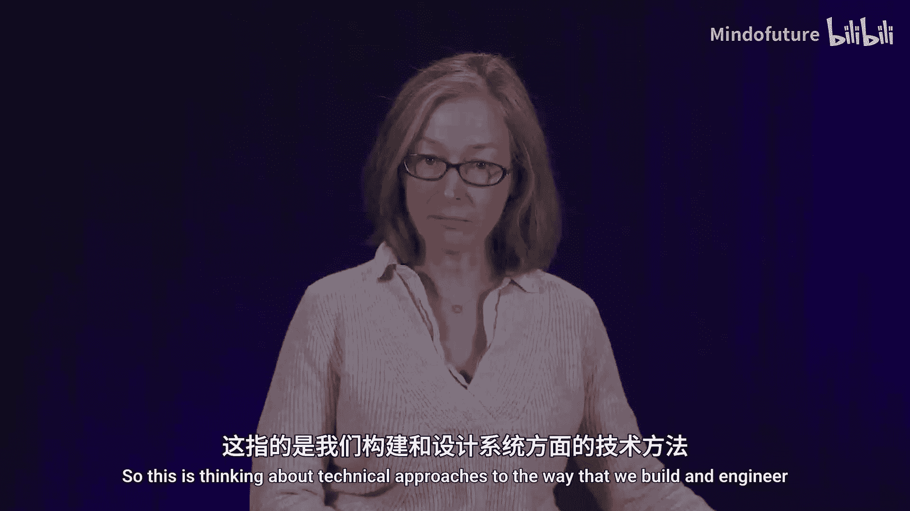

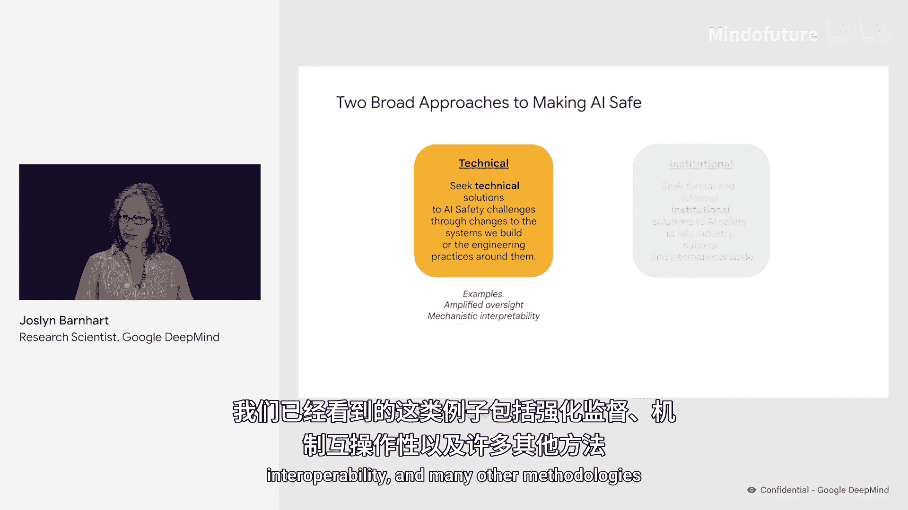

This section is going to look at a different approach to making AI safe。

 which is an institutional approach。 So by institutional here。

 we actually mean quite a broad notion of both informal and formal social institutions that we might think of at the lab level。

 the industry level or even the national and international levels and by informal institutions。

 we could mean anything from norms of behavior or standards of how an industry is expected to behave or even more formal institutions like laws and organizations in the way that we typically think about the word the key thing to take away from this section is that technical solutions generally require institutions for diffusion。

 so it is rare that you get to fully safe outcomes without social institutions to help diffuse safe practices。

 So if we think about something like the seat beltt the technology itself was actually created far。

In advance of the full diffusion of seatbelt wearing to all drivers and all relevant actors that this practice could affect so we think about the need for things like laws。

 institutions， norms and standards to ensure that all relevant actors are essentially engaged in safe practice so far in this course we've thought a lot about one particular broad type of risk。

 accident risk， so as we've learned about accident risk is when AI systems are doing something different from what we in fact designed them to do so this is what we've covered a lot in the first and second sections。

 but this is not the only potential form of risk from advanced AI models。

 we can also think about misuse risk or the malicious or reckless use of AI for harm and then also structural risk。

 which are unintended bad outcomes that actually occur and emerge from AI systems behaving exactly as we did intend them to behave。

 so these may be things at a much broader level， even global level。

Things like geopolitical attentions that may arise， human rights violations。

 environmental impacts so when we think about institutional safety。

 we're actually thinking about approaches to mitigate across all forms of risk so let's look at some institutional functions in more detail so if we go back to this notion of how do we essentially reduce the likelihood of accident and even misuse and the possibility that malicious actors will do harmful things with advanced AI models so institutions in this case play a valuable role in implementing and diffusing safe practices institutions can both help conduct and support safety research but also set the norms and standards for how these should spread and be adopted so this can occur at a number of different levels within the following presentations within this section we're going to hear about internal governance approaches and institutional approaches that can happen within the AI lab itself so we'll hear about Google Deep Mind's frontier。

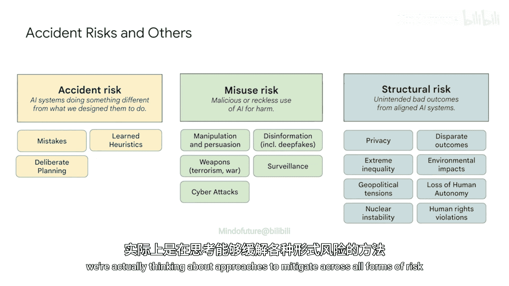

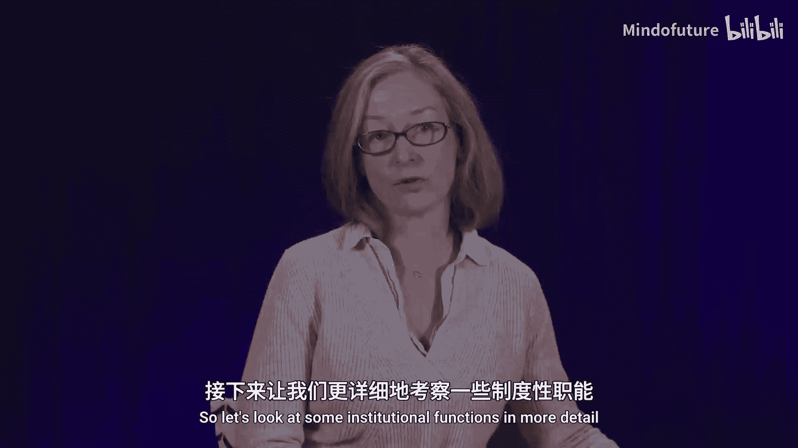

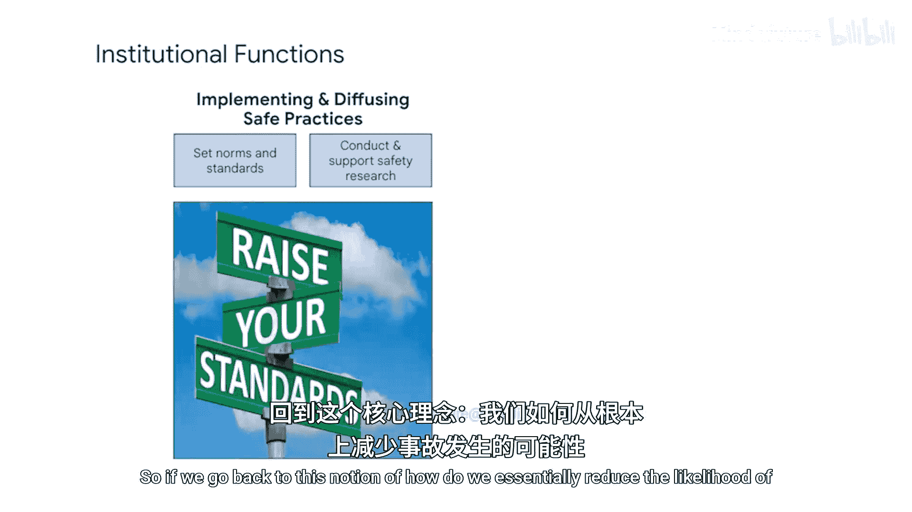

Sa framework， which is intended to both evaluate and mitigate the risks within the development and deployment process。

 This is an institutional approach by which we have expectations that are consistent and robust across the development and deployment lifecycl。

 So that provides an example of a best practice or a safe practice at the developer level itself。

 but of course， that is insufficient， most likely to achieve fully safe AI。

 we need to ensure that those safe practices actually diffuse across all other relevant actors。

 So we think about industries at the institution level。

 this will be collectives of industry actors who come together to share and advance the safety practices themselves or at the national level where we have things like the national in of standards and technology which are tasked with setting technical standards to make sure that there is a broad understanding of these safe practices。

 and then even at the regional and global level， we have international。

Sts organizations like the IO or even the OECD， which can help to spread the understanding and implementation and adoption of those safe practices across all relevant AI providers So if we think about the institutional functions that we might need on the path to highly beneficial AG it is likely we will not only need institutions to help us implement and difffuse those safe practices。

 it is possible we will also need institutions to help us diffuse the benefits of very powerful AI。

 so how do we think about ensuring that the benefits of access to these models or the development of these models are spread in ways that help minimize economic inequality。

 for instance， we could also think about institutional approaches to minimizing global threats that could be created by advanced AI。

 how do we ensure that states are using AI systems in a trustworthy and safe way potentially by engaging in treaties how do we monitor compliance with those treaties。

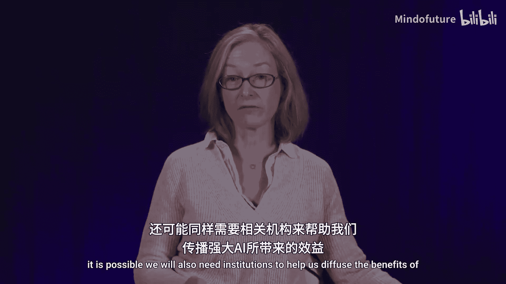

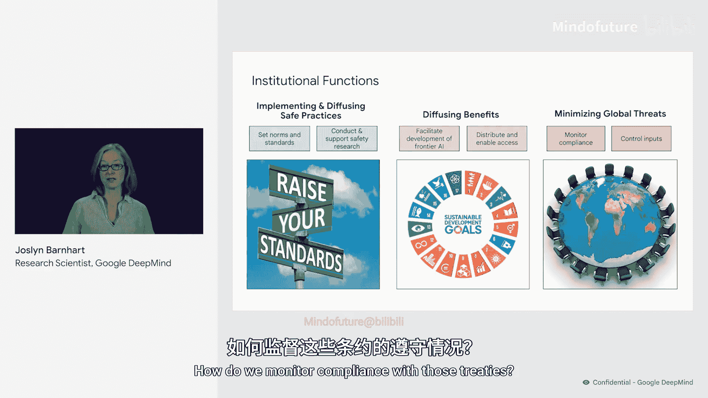

We can imagine a range of possible institutional approaches that may be pursued on the path to AG at the global level。

 This section has given you a very high level description of institutional Agi safety， again。

 if we think about how we diffuse institutional practices。 This is really a key dimension here。

 So if we go back to our example that we'll hear more about in the next section。

 things like safe scaling protocols or our frontier safety framework。

 how do we ensure that those practices as we essentially evolve and update them spread to all global actors。

 relevant global actors。 So we think about industry level and aligning on these best practices and then ensuring that these are diffused both at the national and global level as well。

 So this section is provided a broad overview to institutional AI safety。 and the next section。

 my colleague Lewis Ho will talk more about Google Deep Min's own frontronier safety framework。

 Thank you very much。

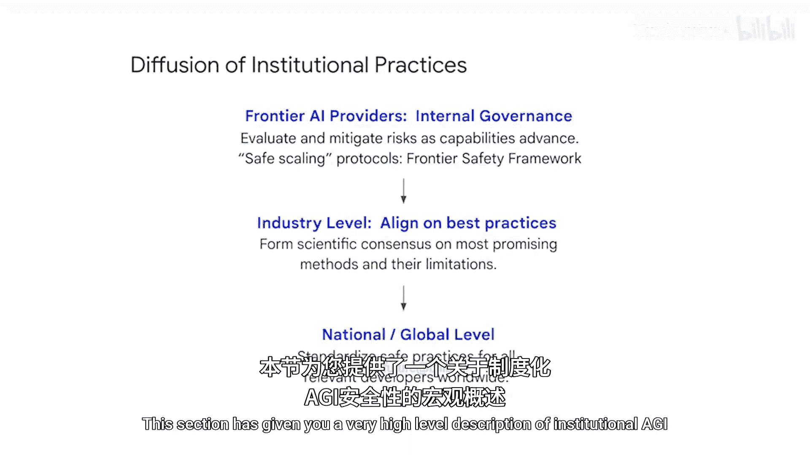

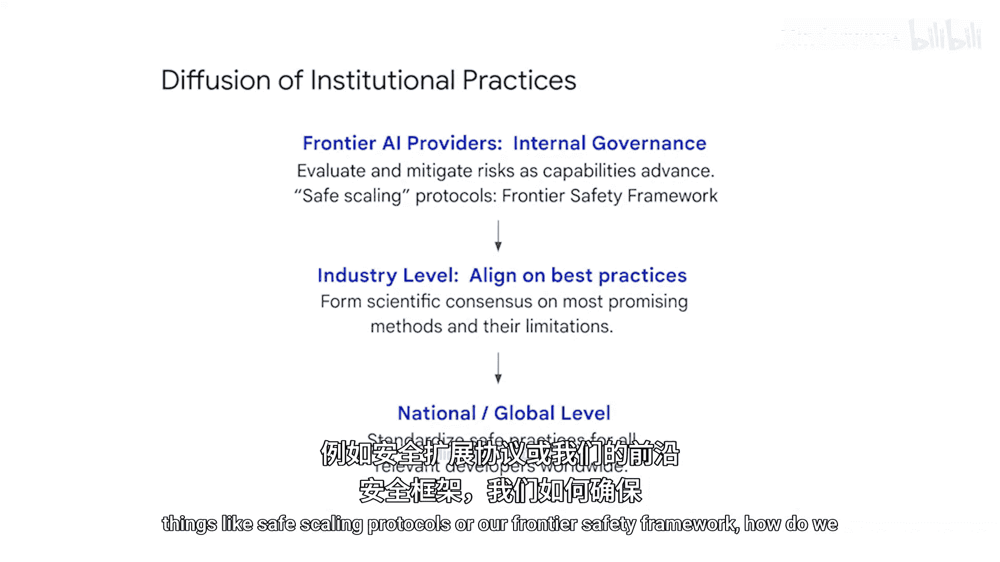

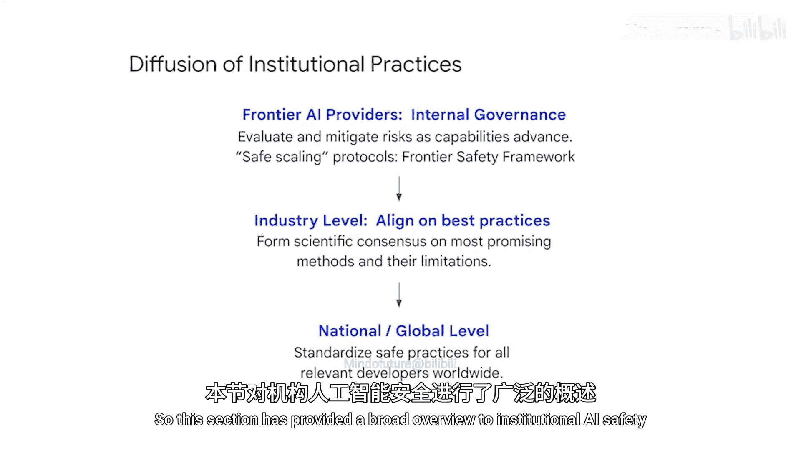

