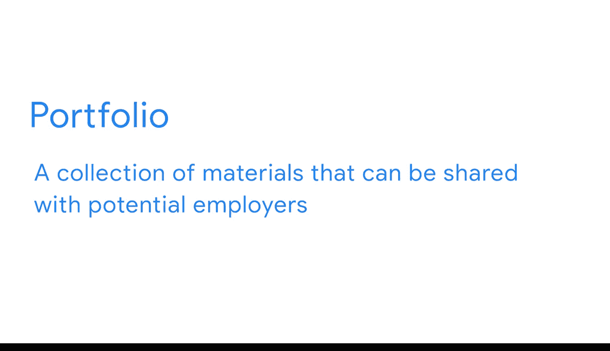

# 谷歌《谷歌商业智能（BI基础、洞察路线：模型和pipelines、决策：数据看板）｜Google Business Intelligence》 p01 01_01_01_欢迎加入谷歌商业智能证书项目.zh_en -BV1yJ4m1V7W9_p1-

Our world is constantly shifting and transforming。 Companies everywhere are working to lead the way to the next big thing。

 and consumers expect rapid， exciting product launches and packages that are delivered to their doorsteps。

 like magic。😊，With all of this incredible change， the value of speed has become immeasurable。

 It's truly one of the most important factors of business success today。 After all。

 the ability to identify an issue or opportunity is great。

 But real value is achieved when you identify that issue before it becomes a huge problem。

 or act upon that opportunity ahead of the competition。😊，These days。

 there's more data about marketplaces， organizations， customers。

 competitors and employees than ever before。 but we need more than data alone to make better decisions and deliver rapid results。

 And that's where intelligence comes in， business， intelligence。

This is intelligencetelligence or BI involves automating processes and information channels in order to transform relevant data into actionable insights that are easily available to decision makers。

In other words， by showing decision makers what is currently happening。

 organizations become more intelligent and successful。

A national restaurant group might analyze millions of customers suites to optimize its food supply and reduce waste。

 or a local hospital could integrate numerous different data sources to review feedback and outcomes in order to help personalize the patient experience。

Or perhaps a global manufacturing company uses supply chain data from around the world to make more precise demand forecasts and ensure appropriate inventory levels。

The B I applications are endless， and so are the B I career opportunities。

 The field involves such diverse organizations and industries that wherever your interest may be。

 there's a path for you。In this program alone， you'll learn about everything from appliance manufacturers to grocery stores。

 to local artisans， to artificial intelligence companies。

 BI professionals are making impact everywhere。As for me， my name is Sally。

 and I'm a business intelligence analyst at Google。

 I'm thrilled to welcome you to the Google Business Inligence Career certificate。

 I'll be your instructor for the first course of this program。

 completinging a Google career certificate like this one。

 will help you develop relevant skills that employers are looking for when hiring business intelligence talent。

 You'll learn how to use the tools of a fast growing high paying field， and when you graduate。

 you can connect with hundreds of employers in the US。

 who are interested in hiring Google career certificate graduates。

 The program is designed to prepare you for a job in three to6 months。

 If you work on the certificate part time。 and it's really flexible。 They are just three courses。

 which you'll complete on your own terms at your own pace all online。

 whether you're seeking to switch careers， find a new job。

 levell up your skills or build the business， Google careerer certificates can open doors to new opportunities。

 You might know me from the Google data Analy certificate， which。😊，a key foundation for this program。

 What you will learn here relies on that foundation。

 So you want to be sure to earn that certificate first。

 or use our upcoming self assessment to ensure you have comparable knowledge。

 I'll be by your side throughout this first course。

 making sure that you're learning what you need to succeed。

 I love the world of B I and really enjoy working with SQL and digging in the technical side of analytics in support of Google's people operations。

 This team is dedicated to Google staffing， development and a distinct and inclusive culture。

 But I didn't start out in B。 When I first thought about my professional path。

 I was interested in becoming a physician。 But I ended up really enjoying the biological sciences。

 So I thought I'd be a biomedical researcher。😊，Of course， data analytics is the science of data。

 So it kind of made sense that this field ended up peaking my interest along the way。

I started my career as an analyst and here I am。That's just one example。

 And everyone's experience is different。 In fact， the Google career certificates were designed by industry professionals with decades of experience。

 and you'll have a different expert from Google to guide you through each course willll share our knowledge and videos。

 help you practice with hands on activities， and take you through scenarios that you might encounter on the job。

😊，First， meet my teammate in。Hello， I'm Eded， and I'm a product manager at Google。Together。

 we'll explore data modeling and ETL， which stands for extract， transformform， and load。

It's all about getting data where and how you need it， so you can analyze and monitor it Next。

 you meet Ternce。Hey there， I'm Terrence and I'm a senior business intelligence analyst。

 I'm really looking forward to spending time with you as you discover how to apply your understanding of stakeholder needs when creating BI visualizations。

We'll also use dashboards to present clear insights that can advance all kinds of companies。Hi。

 I'm Anita， and I'm a senior business intelligence analyst here at Google。

 I'll guide you through different career building topics and activities。

 including the end of course project featuring portfolio creation。

 A portfolio is a collection of materials that can be shared with potential employers。

 This exciting hands on experience will bring together everything you learn during this program and enable you to apply your skills to a realistic business scenario。

 We're all really glad you're here。 And I， for one， can't wait to get started。

 Are you ready to take the first step towards joining us in the B I profession。 Let's go。😊。

