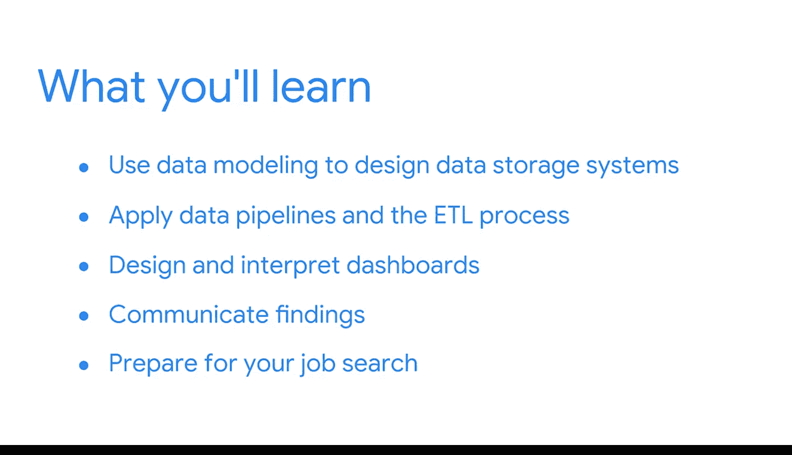

# 谷歌《谷歌商业智能（BI基础、洞察路线：模型和pipelines、决策：数据看板）｜Google Business Intelligence》 p02 02_01_03_课程1介绍.zh_en -BV1yJ4m1V7W9_p2-

There are an endless number of reasons to pursue a career in business intelligence。

 Enjoy analytical thinking or having an interest in numbers are wonderful motivations for becoming a B I professional。

 But there's so much more to the world of B。 Maybe you're passionate about solving problems。

 simplifyifying processes or removing pain points for others。

 Perhaps you have great communication skills。 And you'd like to use them to share insights and help your team make effective decisions。

 Lots of people in B I enjoy creating tools that streamline tasks and enable their colleagues to devote more time to other projects。

😊，BI professionals are inspired in all kinds of ways。

 But when I talk to my colleagues here at Google， the thing they love most is simply using their talents to make other people happy。

 There's a lot of satisfaction in knowing that you've made someone's job easier or saved them a bunch of time。

 And right now， you've made me happy because you're here to explore the exciting and rewarding career path at B I。

😊，In this first course， you will begin learning about the BI industry。

 If this is new territory for you， you'll discover how to identify the career path and employer type that best suits your skills and interests。

 You'll also consider the roles of BI analysts versus BI engineers。

And if you already have some B I experience， will'll open new doors to more fascinating career opportunities。

 You'll understand how to develop a BI project that makes an impact。

 You'll be introduced to BI tools and techniques that professionals use every day for making business decisions and improving processes。

😊，The similarities and differences between BI and data analytics will be clarified。And together。

 we will explore the importance of context when working with data and learn how to overcome some common limitations。

 such as human bias。Then throughout the program， you'll continue gaining new skills。

 You will use data modeling to design data storage systems such as data warehouses。

 data mars and data lakes。You apply data pipelines in the E process。

 Designing and interpreting dashboards will be an essential part of your learning。

 as well as communicating with stakeholders about your findings。 Finally。

 you'll prepare for your job search by developing a personal strategy。

 growing your professional network and preparing materials。

 Most of the content in this program builds upon core data analytics concepts。

 So if you have some experience in that area， or if you earned your Google data analyticsly certificate。

 Then you've definitely come to the right place。

If you' are unsure about having the necessary prerequisites for this program。

 there' is an ungraded assessment coming up soon to evaluate your readiness。 In addition。

 we'll include helpful resources from the Google data Analy certificate throughout each course。

 which you can use to review key concepts。 So let's start building your B I skills and knowledge。

 Conue to the next lesson to keep the momentum going。😊。

