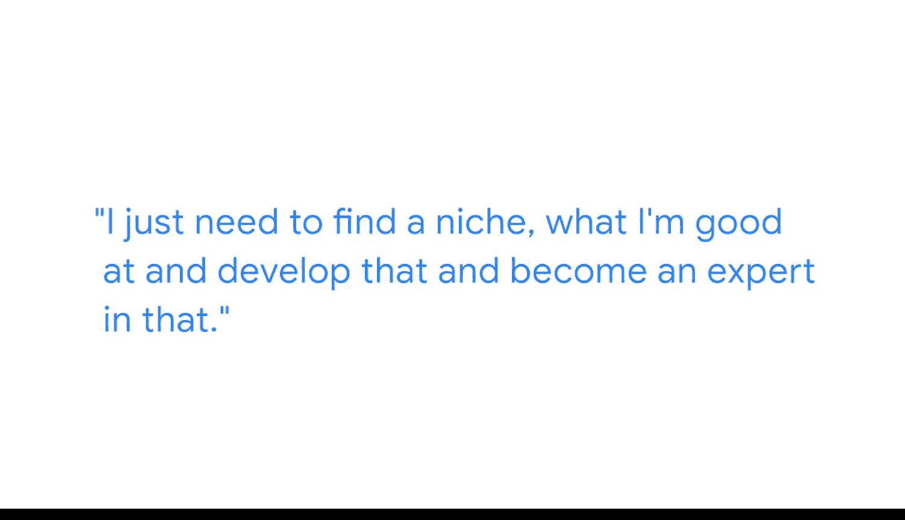

# 谷歌《谷歌商业智能（BI基础、洞察路线：模型和pipelines、决策：数据看板）｜Google Business Intelligence》 p04 04_01_07_莎莉的个人职业历程.zh_en -BV1yJ4m1V7W9_p4-

Hi， I'm Sally。 I'm a business intelligence analyst at Google。

 What that means is I work with data to help improve the hiring experience at Google。

 The way in which I entered data analytics is via business boot camp that I did years ago。

 I was thinking of becoming biomedical researcher And this is something I just wanted to use during extra time that I had。

 We learned about just data analysis in general。 and I found that I had like a knack for it。

 everything just made sense。 It was very tangible。 you can see the results pretty immediately。

 right and you could search for things， I love puzzles So trying to find using different clues and trying to find what is the answer。

 and I really enjoyed it as well as enjoyed working with teams。

 which was different from when I was in the sciences。 It was very much independent。

 I was doing my own thing。 but within the business boot camp I was working within a group of people and that was so social and so much fun。

 and we were supporting each other。 and I loved that。

 That team environment through the program is how I got my。😊。

there was someone I met in the program who graduated year before me and when it was time for me to apply for jobs。

 he had an opening on his team and he reached out to me to see if I wanted to apply。

 So that's actually how I got into data analytics。 I didn't study data analytics。

 I had to teach myself everything from I had to teach myself SQL。

 I didn't feel like I was really contributing or that I had any security in this field。

 And so what I tried to do is I tried to teach myself Python go into machine learning and whatnot。

 but ultimately what I found is I don't need to do that。

 I just need to find a niche what I'm good at and develop that and becoming an expert in that。

 So the advice that I would give for someone who's trying to enter the field of business intelligence is to consider the difference between data analytics and business intelligence。

 I personally found that I really like SQL， Love SQL on the technical side of things in addition to that。

 So I wanted to。

pAnd enter business intelligence。 You can make your career within the broader field of data analytics be whatever you want。

 depending on what it is that you enjoy。