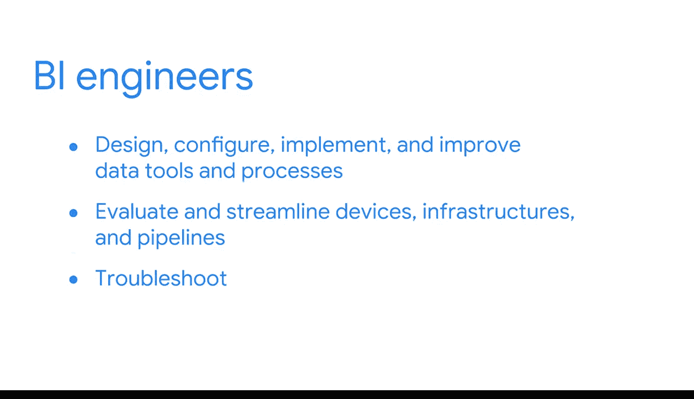

# 谷歌《谷歌商业智能（BI基础、洞察路线：模型和pipelines、决策：数据看板）｜Google Business Intelligence》 p05 05_01_01_探索商业智能职业发展.zh_en -BV1yJ4m1V7W9_p5-

We often hear about all the data that's created each and every day。

 It could be something as simple as taking a photo with your phone or paying your bills or something as complex as a global company launching a new product or running a multimedia advertising campaign。

 It really feels like practically everything creates data。

So it's no wonder that organizations need experts to help them access the right data。

 use it to find ways to grow and improve and put those insights into action。 In fact。

 as the volume of data is ever escalating。 so is the need for professionals who can make that data shine。

 For instance， in my role， I'm proud to be able to use data to give my stakeholders a quick overview of exactly what they need to know without getting lost in the details。

 The tools I create enable them to clearly evaluate the candidate hiring an employee experiences within Google's people operations。

 One way this works is by showing my stakeholders how long the interview journey is when someone is being hired at Google。

😊，This is important because it helps them determine if we need to hire more recruiters or interview schedulers in order to improve the process for our candidates。

In this video， you'll learn more about how those of us in B offer value to our colleagues and how we help shape the future of our organizations。

 There are so many different potential roles to explore。 For example， in this program。

 you'll learn a lot about B analysts and B engineers。

 B analysts gather requirements from stakeholders， partners and team members。

 They use their understanding of large data sets to retrieve， organize and interpret data。

 Then they create visualizations， dashboards and reports to use when presenting and communicating insights to others。

😊，The intelligence they share might be used to make decisions， develop a new process。

 or create a business strategy。Or it could be applied to even deeper analysis。

 BI engineers are responsible for designing， configuring。

 implementing and improving data tools and processes。 They evaluate and streamline various devices。

 infrastructures and information channels， called pipelines。

Engineers are excellent troubleshooootters and help find solutions to security issues。

 application permissions， and updates， and other technical challenges。

In other words， a BI engineer manages tools and processes。

 which enables a BI analyst to put those tools and processes to work。However。

 it's also important to note that some companies don't distinguish between those two BI jobs using the terms analyst and engineer interchangeably。

 So when you begin to explore job opportunities， be sure to spend some time researching the job and organization in order to fully understand what's involved。

No matter which path you ultimately choose， a career in B I has a potential to be amazing。

 Research shows that all industries today need skilled B I professionals。

 but there are not enough people with the right experience and talent to satisfy this demand。😊。

So B I professionals enjoy strong career prospects。 In fact。

 a quick search for job openings in the industry reveals thousands of opportunities on LinkedIn alone。

 But perhaps best of all， B I professionals find their work rewarding and fulfilling because we know what we do makes someone else's life better。

😊，Coming up and throughout this program， you'll discover some really inspiring examples of just how B。

 I makes such a positive impact。 I can't wait to share them with you。😊。

