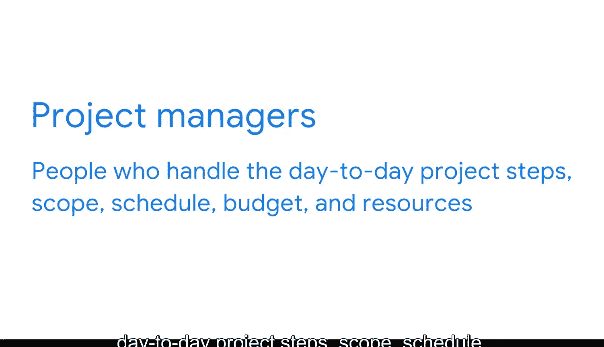

# 谷歌《谷歌商业智能（BI基础、洞察路线：模型和pipelines、决策：数据看板）｜Google Business Intelligence》 p06 06_01_02_商业智能团队与合作伙伴.zh_en -BV1yJ4m1V7W9_p6-

What do you do when you're facing a really challenging task or big problem？You've done your research。

 tried multiple approaches， but nothing seems to be working。 It's natural to be frustrated。

 We've all been there， but a much better strategy is to simply ask for help。 As the saying goes。

 two heads are better than one。 And in business， complex problems often require 5。

10 or even hundreds of people coming up with potential solutions。

 This is why business intelligence professionals collaborate with lots of different team members in their work。

 Brainstorming and building together， pulling knowledge and working out issues is essential to the B I process。

 B I professionals also rely on team members to provide important inputs for their projects and to partner on solutions。

😊，This video will share examples of the key players you might work with。 Keep in mind。

 every organization handles job titles differently。

 So you may encounter some discrepancies or overlap。 but this is a great place to start。 First up。

 API professionals。 API stands for application programming interface。

 This is a set of functions and procedures that integrate computer programs forming a connection that enables them to communicate。

😊，There are so many different roles that involve APIs， including API strategists， developer。

 engineer， and product owner。When you are working in business intelligence。

 you might collaborate with API professionals in order to create the interfaces that you need for a particular project。

 especially if some of your data is coming from a third party platform。

 API is bringing that data into the internal company database in order to build reporting tools and dashboards。

A PI professionals code in a number of different computing languages， including Python。

 Java and so many others。 So it's up to API partners to write code that's specific to each project and business need。

You may work with data warehousing specialists who develop processes and procedures to effectively store and organize data。

 These people also help ensure BI professionals can easily access the data they need。

 There are also data governance professionals。 These team members are responsible for the formal management of an organization's data assets。

 This may involve managing the availability， integrity and security of data。

 based on internal standards and policies。This is very important for making sure data is trustworthy and doesn't get misuseed or corrupted。

Of course， data analysts are key partners as they collect， transform and organize data。

 They are data specialists reviewing and validating the data all the time。

They also identify and implement exciting new analysis methodologies。

 Another key team is I T information technology professionals test， install， repair。

 upgrade and maintain the hardware and software solutions that organizations use every single day。

BI professionals work with the IT department in order to maximize all of the available data and data tools。

In addition， project managers are key collaborators as they handle the day to day project steps。

 scope， schedule， budget， resources and much more。 There are all kinds of contributors。

 and every organization is different。 Who you work with will depend on the size of the company。

 the available tools and the nature of the work。

For example， if your project deals with the customer experience。

 then the customer success team will be essential to providing inputs。

 If your project is about employee engagement， then you'll work closely with the HR team。

And because my work involves hiring processes， I really benefit from collaborating with the recruiting team members here at Google。

 Now， there is another essential group of people on the team。

 And that's your stakeholders In an upcoming section in this course。

 we'll talk lots more about the various stakeholder roles as they relate to B。 I。

 We'll also explore different stakeholder goals and how you can use your B I skills to reach them。

 Stay tuned。😊。