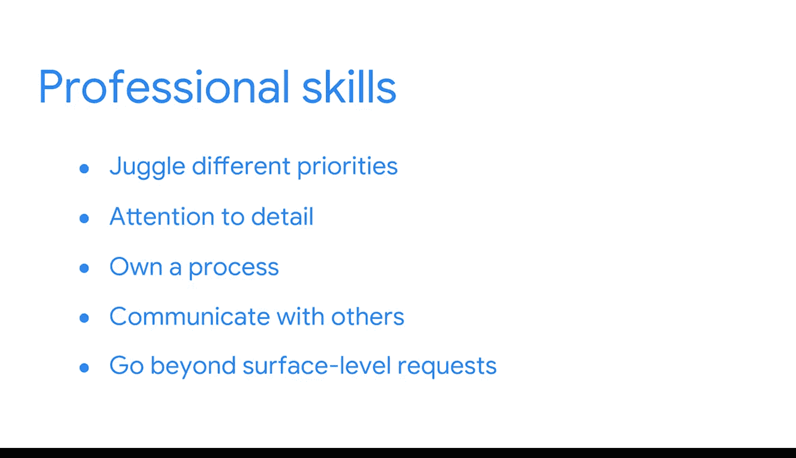

# 谷歌《谷歌商业智能（BI基础、洞察路线：模型和pipelines、决策：数据看板）｜Google Business Intelligence》 p07 07_01_01_商业智能最大化数据分析的价值.zh_en -BV1yJ4m1V7W9_p7-

With business intelligence and data analytics gaining so much popularity these days。

 the term business intelligence and data analytics are often defined incorrectly。

 oversimplified or used interchangeably for speedy communication。

 That can lead to confusion because B I and D A are quite different In this video。

 we're going to sort that out。😊，First， let's establish that both BI and D A professionals enable data driven decision making in their organizations。

 They're also both a key part of their company's data maturity。

 Data maturity is the extent to which an organization is able to effectively use its data in order to extract actionable insights。

 whether that data includes information about your customers， staff， products， suppliers。

 finances or something else。 It's worthless if it can't be put to work。😊。

Putting data to work requires skilled professionals who can apply techniques and technologies to achieve high levels of maturity。

 In this effort， data analysts are primarily involved with using data to answer questions about what happened。

 On the other hand， B I professionals aim to achieve higher levels of data maturity by building data reporting tools。

 such as dashboards。 Dashboards continuously analyze and monitor data。

 So the work isn't complete just because the tool has been created。

The analysis and monitoring are ongoing。 This is because B I involves establishing repeatable methods to understand how things are operating。

 And by knowing the current state， company leaders can take action to improve the future state。

For example， a BI professional might investigate what new sales prospects are being targeted today。

 How many customers have we gained this month， or did our weekly email perform well with new subscribers。

Because BI is all about near real time rapid monitoring。

 BI insights are most effective when they make an impact right now。Therefore。

 the people who use the reporting tools want to make sure they are practical and efficient。

BI professionals are expert tool builders。 Then it's typically the data analysts who apply these tools in order to answer a question or solve a problem by examining the data through a specific topic or lens。

 Again， a big part of B I is creating dashboards that provide users with clear snapshots of the current state。

 These tools must be impactful and easy to interpret。 Even for non technical people。

So if you like thinking about what you can create that meets the needs of many different users。

 BI will let you do just that。 BI professionals generally work on large scale projects that are helpful for multiple stakeholders。

 Also， as you consider how you will fit in the BI world。

 note that BI professionals are experts and data infrastructure and enjoy the technical side of data analytics。

 For instance， if you love working with datas， Big data and the computer programming language SQL。

 B I will give you the opportunity to take your queries to the next level。😊。

If you earn the Google data Analytics certificate， the content included there formed your foundational knowledge and experience。

 Now， this BI program will provide a compliment skill set that builds on those foundations。

 It will also add a lot of very marketable talents to your resume that will create a compelling combination of skills for employers to consider and will open the doors for more job opportunities。

😊，In addition to the technical side of things such as managing large data sets。

 writing queries in SQL and creating dashboards， you'll learn some really worthwhile professional skills。

 These include the ability to juggle many different priorities， attention to detail。

 owning a process， communicating with others and learning how to go beyond surface level requests。

Perhaps most importantly， you'll discover the value of connecting with others to really drive results。

 And that's how you build a career， rather than just have a job。In future lessons。

 you will continue to explore the similarities and differences between B， I and D A。

 The two disciplines complement and rely on each other。

 just like the talented people who work in these roles。 Together。

 they help their organizations advance on the data maturity scale every day。

