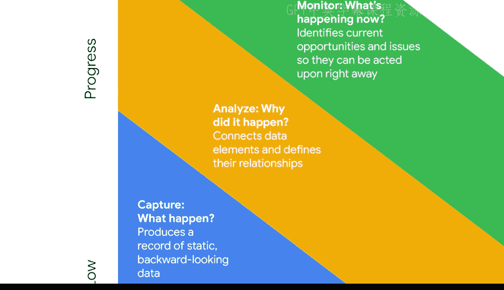
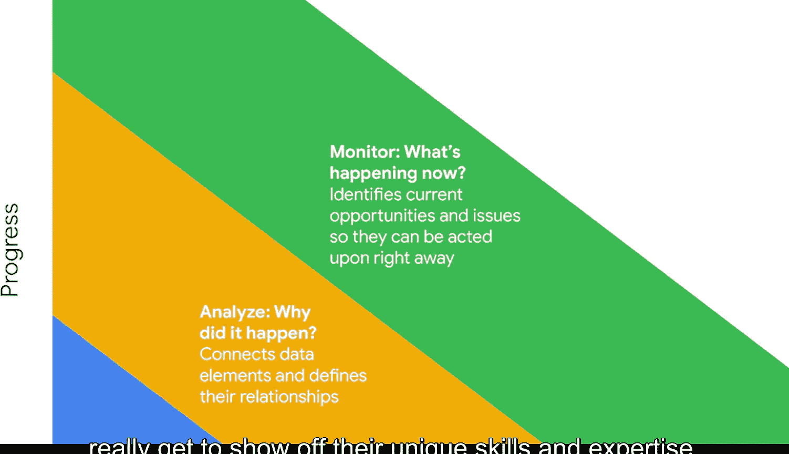

# 谷歌《谷歌商业智能（BI基础、洞察路线：模型和pipelines、决策：数据看板）｜Google Business Intelligence》 p08 08_01_03_商业智能的发展阶段.zh_en -BV1yJ4m1V7W9_p8-

If you earned your Google data Analy certificate， then you're very familiar with the data lifecycle and the data analysis process。

 Data analysts use these phases in their work every single day in order to gain insights that lead to informed decision making As a quicker refresher。

 the data life cycle is a sequence of stages that data experiences， which include plan， capture。

 manage， analyze， archive and destroy。😊，And the data analysis process occurs in six phases， ask。

 prepare， process， analyze， share， and act。Business intelligence also has phases。

 a sequence of three stages that determines the value of B， as well as organizational data maturity。

As you've learned， data maturity is a meaningful goal for any BI team because high maturity means their organization is effectively using its data in order to extract actionable insights。

 In B， the three stages are capture， analyze and monitor。 As you advance through each one。

 the process requires a deeper level of exploration and investigation， So each becomes more complex。

 These phases might be automated or done manually， but each one adds significant business impact。

 which is well worth the effort。😊，It's important to understand these stages and how they can benefit you as a B I professional。

 So we're going to explore each one of them in this video。 Let's start with capture。

 which is the what happened point in the B I process。 This stage pertains to static。

 backward looking data。For instance， if you were to query a database to return a data about what your customers purchased last month。

 that's an example of capturing information。Or you might access a spreadsheet that lists profits and losses from the previous quarter。

 That's also an example of capturing a record of certain information。 Records are essential to B。

 but they don't enable users to easily investigate in depth and really dig into the data。

 And that hinders the insights they're able to provide。 Also。

 because the data in this stage is rigid and backward looking。

 It's not always very useful for proactive forward looking decisions。

Capturing information is a necessary element of BI。

But information alone doesn't let us know what's working well， how we can improve or what to do next。

 However， in the following step， things get better。Which brings me to stage 2。

 analyze the why did it happen， part of B， I。

You already know a lot about the stage， but as a quick reminder。

 data analysis is when we draw conclusions， make predictions， and drive informed decision making。

Because the analyze stage explores why things happen。

 It's much more likely to result in effective plans and strategies。 In this way。

 it enables B R professionals to better understand key relationships between data points。

 They do this by examining data more deeply， more broadly or even side by side in order to identify connections that at first might not have been apparent。

Okay， now we've come to the final part of the process。

 Monitor Monitor is the what's happening now stage。

 And here's where BI professionals really get to show off their unique skills and expertise。

 In this stage， you'll use automated processes and information channels such as data models。

 detail pipelines， dashboards and more。 These deciding tools take the data that organizations create every single day and transform it into true intelligence that is easily available to stakeholders。

😊。

These BI tools reveal upswings， downturns， changes， challenges， opportunities and much more。

Decision makers then use the insights these tools deliver in order to proactively work towards business goals。

You'll learn all about these B I tools in upcoming courses。 And soon in this course。

 I'll provide some foundational information about the B I professionalsf toolbox。

 You can use it to start familiarizing yourself with what happens during the monitor stage。 For now。

 great job on all the progress you've made so far。 I'm so happy to be sharing the world of B I with you。

 Let's keep it up and head to the next lesson。😊。

