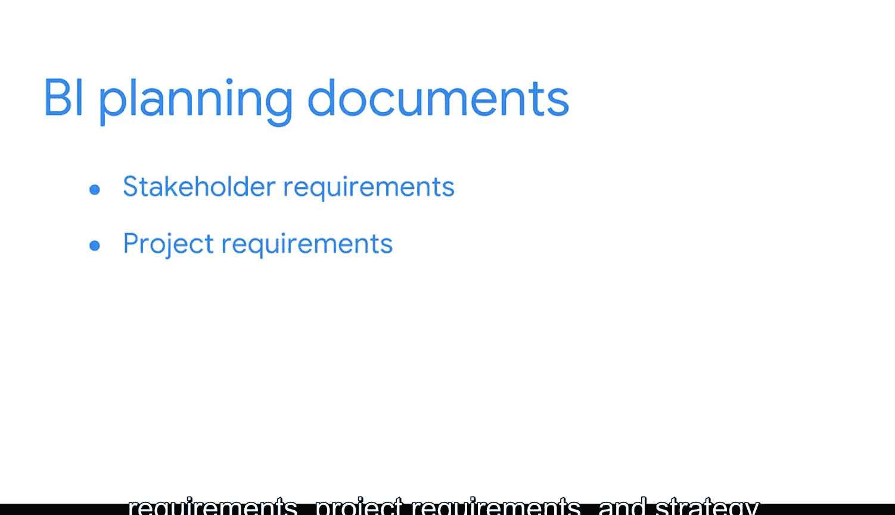

# 谷歌《谷歌商业智能（BI基础、洞察路线：模型和pipelines、决策：数据看板）｜Google Business Intelligence》 p09 09_01_01_助力制定成功的商业智能战略.zh_en -BV1yJ4m1V7W9_p9-

Strategy is a big part of life in so many ways。 Take the planet's most popular sport。

 football or soccer。😊，The rules in gameplay are relatively simple。

 but the strategy is extremely complex， depending on who's on the field and their particular skills。

 the coaches must choose between many different formations and tactics。

 and no matter how talented a player may be， they'll only perform their best。

 if they have a solid understanding of football strategy。

 such as being able to identify the precise moment to shoot or when to pass instead。

 The game of chess is also all about strategy。 Each piece has a distinctive way of moving such as a rook shifting horizontally or vertically across the board。

 a night jumping over other pieces。 or the powerful queen going pretty much anywhere she wants。😊。

Mathematicians have actually proven that there are more potential chess game variations than atoms in the universe。

And with so many possible outcomes， having a clear strategy is absolutely essential to creating a winning game plan。

 Well， creating a winning strategy is also a big part of B。

 You may recall learning about data strategy， which is the management of the people。

 processes and tools using data analysis。 Similarlyly。

 business intelligence strategy is the management of the people。

 processes and tools using the business intelligence process。😊，As you're discovering， BI is complex。

 and it requires a 360 degree view of the organization。

Thoughtful preparation to effective strategy is a must。 In this video， we'll explore how that works。

Let's start with people。The most important thing here is to make sure people are working together in a positive way。

Sometimes several departments and a company are using B， but the processes are siloed。

 meaning they lack communication and collaboration。

Maybe the sales team doesn't have access to important marketing data。

 or human resources is tracking valuable employee data， but only for their own internal purposes。

 So the first thing to do is simply communicate with all of the team members and stakeholders who are involved。

 includenc people from all levels of the organization So you get many diverse perspectives begin by asking them some key questions。

 such as are our B I teams and professionals coordinated。Is there any overlap among their functions。

 Who should be responsible for establishing the rules and policies that govern B I processes。

Note that BI governance involves defining and implementing BI systems and frameworks within an organization。

This is different from the concept of data governance。

 which you may know is a process for ensuring the formal management of a company's data assets。Now。

 most importantly， in the people step， be sure to ask about the vision for the B I process and how does that vision align with current business strategy。

A vision specifies your desired outcome， such as winning the football game or chess match。

 The second element of B I strategy is process。 By now。

 you've established who will be responsible for the rules and policies that govern B I processes。

 So some questions to ask these people include。 What solutions are we using and how Which of them bring value。

 What types of solutions do we plan to implement， How will we deliver them， How will we support them。

In addition， having a user support framework is a critical part of the process。

 so be sure to dedicate enough time in training and education。

 a feedback system and ensuring users are getting value from the tools。

Which brings us to the tools part of BI strategy。One of the most important concepts to note here is to choose each tool with the user in mind。

 Consider which dashboards， reports and other solutions will be most effective。 Ask。

 do different users， teams and departments require different technologies。

 Which technologies do we have access to， Can we gain access to others if needed。

 How will we measure success。Here， you'll want to establish key performance indicators or Kpis for each particular business need。

 Soon， you'll learn a lot more about Kpis and explore how organizations use them to achieve objectives every day。

 But for now， just understand that a K PI is a quantifiable value。

 closely linked to business strategy， which is used to track progress towards a goal， In other words。

 Kpis direct you towards achieving your desired results。 But in order for Kpis to do their job。

 It's important that the tools you select align with the Kpis establish for each particular project。

😊，The last step in this process is documenting everything you've learned。

 Many B I professionals use specific B I documents to note stakeholder requirements。

 project requirements and strategy。

These are essential tools that can really help you capture the big picture。

 stay organized and make an impact at your organization。

 You'll learn exactly how to create these documents in an upcoming reading as a final point。

 Keep in mind that your particular level of involvement in B I strategy will vary depending on the size and structure of your business and team。

 But having a broad understanding of all the elements involved is a valuable asset for any B I professional。

😊。