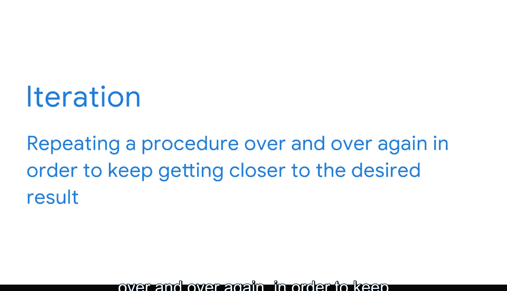

# 谷歌《谷歌商业智能（BI基础、洞察路线：模型和pipelines、决策：数据看板）｜Google Business Intelligence》 p10 10_01_04_商业智能专业人士的工具箱.zh_en -BV1yJ4m1V7W9_p10-

Business intelligence may seem like a new concept， but it has actually been around for centuries。

 All throughout history， business leaders from around the world have used B I to set the bar for best practices。

 In fact， the term business intelligence dates back to 1865。

 when appeareded in thecyclopedia of commercial and business anecdotes。

 The book used the term to recount how a banker， Sir Henry Ferns had great business success by collecting data and quickly acting on information before his competitors could。

 It described furns as having created a complete imp perfect train of business intelligence。 Well。

 all aboard， because in this video， we're gonna get your B I trained moving。

 and just like any train trip， This one starts with mapping out where you are and where you want to go。

 N B I mapping a route requires a data model which is the first tool in your toolbox。

 Data models organized data elements and how they relate to one another。

 They help keep data consistent across systems。😊，And explain to users how the data is organized。

 This gives BI professionals clear directions when navigating a database。 Allright。

 the second stop on our train ride and the second tool in your toolbox is the data pipeline。

 A data pipeline is a series of processes that transports data from different sources to their final destination for storage and analysis。

 Think of the data pipeline as train tracks spanning， passing and crossing over vast distances。

 Data is transported along these channels in a smooth automated flow from original sources to target destination。

 but that's not all。 along the way， it's up to bi professionals to transform that data so that by the time it pulls into the station or database。

 It's ready to be put into use。😊，One example of this is ETL， or extract， transform and load。

As a refresher， ETL is a type of data pipeline that enables data to be gathered from source systems。

 converted into a useful format， and brought into a data warehouse or other unified destination system。

The process of ETL plays a key role in data integration because it enables BI professionals to take data from multiple sources。

 consolidate it， and get all that data working together。Okay， now we've come to our third tool。

 Data visualizations。 You likely know that data visualization is the graphical representation of data。

 Some popular data Viz applications are tableableau and looker。

 These apps make it possible to create visuals that are easy to understand and tell a compelling story。

 This way， people who don't have a lot of experience with data can easily access and interpret the information they need。

Think of data visualizations as the photos you share with friends and family after your train trip。

 The best ones are clear， memorable and highlight the specific places you went。

 the important sights you visited and the interesting experiences you had。😊。

BI professionals use data visualizations within dashboards， Our final stop on the ride。

 As you may know， a dashboard is an interactive visualization tool that monitors live incoming data。

Picture the dashboards used by train drivers。 They pay close attention to these tools in order to constantly observe the status of the train engine and other important equipment。

Dashboards keep the drivers connected with the control center to ensure that routes are clear and signals are functioning properly。

And the drivers can quickly scan the dashboard to identify any hazards or delays that might affect train speed or schedule。

No matter which BI tool you're using， a very important concept in our field is iteration。

Just as the railro workers are constantly evaluating and upgrading trains， tracks and other systems。

 B I professionals always want to find new solutions and innovative ways to advance our processes。

 We do this through iteration。 Iteration involves repeating a procedure over and over again in order to keep getting closer to the desired result。

😊。

It's like a railway engineer repeatedly testing out signaling systems in order to refine and improve them to ensure the safest possible environment for railway travelers。

In upcoming courses， you'll learn a lot more about iteration。

 and you'll go much more in depth with all these exciting tools。

 You'll also explore all the ways you can transfer your skills and experience with one tool and apply them to another。

 Thanks so much for joining me on this journey。 We've got many more thrilling destinations coming up。

😊。