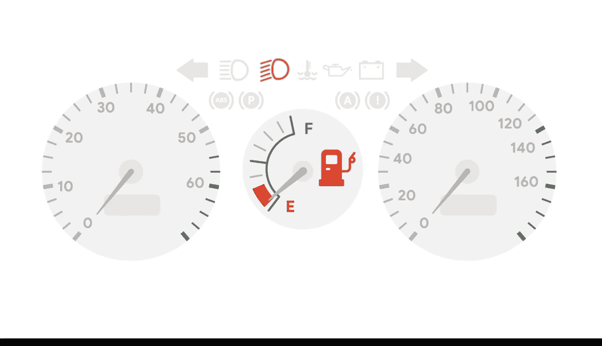
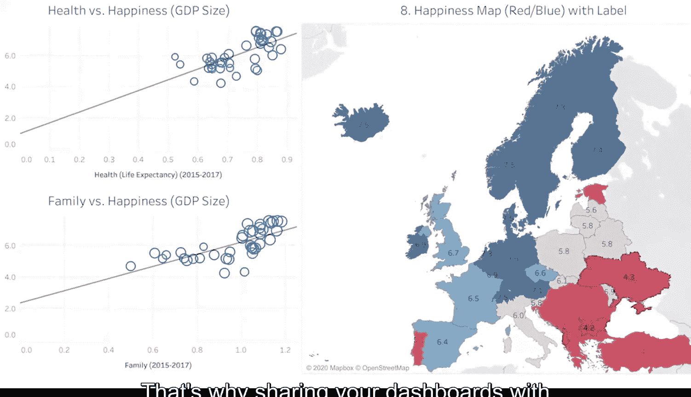

# 谷歌《谷歌商业智能（BI基础、洞察路线：模型和pipelines、决策：数据看板）｜Google Business Intelligence》 p100 21_02_04_可选复习-谷歌数据分析证书关于仪表板的内容.zh_en -BV1yJ4m1V7W9_p100-

Have you ever been driving a car when one of the warning lights on the dashboard suddenly comes on。

Maybe the gas gauge starts blinking because you're getting low on fuel。

It's handy when you have that alert right in front of you。

 clearly showing you that you need to pay attention to your gas level。

 Can you imagine if cars didn't have dashboards。

We'd never know if we were about to run out of gas。

 We'd have no idea if our tire pressure was low or if it was time for an oil change。

Without dashboards， if our cars started acting differently， we'd have to pull out the user manual。

Sifft through all that information inside。And try to figure out the problem ourselves。

Car dashboards make it easy for drivers to understand and respond to any issues with their vehicles because they're constantly tracking and analyzing the car status。

But as you've been learning。Dashboards aren't just for cars。

Companies also use them to share information， get people engaged with business plans and goals。

 and uncover potential problems。And just like a CA's dashboard。

 data analytics dashboards take tons of information and bring it to life in a clear。

 visually interesting way。 This is extremely important when telling a story with data。

 which is why it's a big part of number two in our three data storytelling steps。

You've learned that a dashboard is a tool that organizes information from multiple data sets into one central location for tracking。

 analysis and simple visualization through tables， charts and graphs。

Dashboards do this by constantly monitoring live incoming data。As we've been discussing。

 you can make dashboards that are specifically designed to speak to your stakeholders。

 You can think about who will be looking at the data and what they need from it and how often they'll use it。

Then you can make a dashboard with the perfect information just for them。

 This is helpful because people can get confused and distracted when they're presented with too much data。

A dashboard keeps things neat and tidy and easy to understand When designing a dashboard。

 it's best to start simple with just the most important data points。And if later on。

 you discover something's missing， you can always go back and tweak your dashboard or create a new one。

 An important part of dashboard design is the placement or layout of your charts。

 graphs and other visuals。 these elements need to be cohesive。

 which means their balance and make good use of the space on the dashboard。

 After you decide what information should be on your dashboard。😊。

You might need to resize and reorganize it so it works better for your users。

One option in Tableau is choosing between a vertical or horizontal layout。

A vertical layout adjusts the height。A horizontal layout resizes the width of the views and objects it contains。

Also， as you can see here， evenly distributing the items within your layout helps create a clear and organized data visual。

You can select either tiled or floating layouts。Tiled items are part of a single layer grid that automatically resizes based on the overall dashboard size。

Floating items can be layered over other objects。 In this example。

 the map and scatter plots are tiled。 They don't overlap。

This really helps make clear what the data is all about。

 which is valuable because the majority of people in the world are visual learners。

They process information based on what they see。That's why sharing your dashboards with stakeholders is such a valuable practice。

Now， there's something important to keep in mind about that。

 Sha dashboards with others likely means that you'll lose control of the narrative。 In other words。

 you won't be there to tell the story of your data and share your key messages。

Dashboards put story telling power in the hands of the viewer。

 That means they'll craft their own narrative and draw their own conclusions。

But don't let that scare you away from being collaborative and open。

Just understand the risks that come with sharing your dashboards。 After all。

 sharing information and resources means that you'll have more people working on the solution to a big problem or coming up with that next big idea。

 This leads to more connections， which can result in really exciting new practices and innovations。😊。

