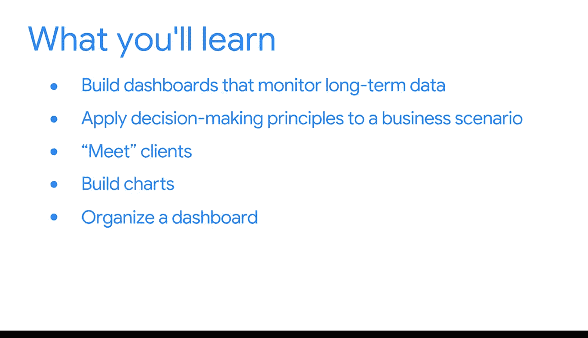

# 谷歌《谷歌商业智能（BI基础、洞察路线：模型和pipelines、决策：数据看板）｜Google Business Intelligence》 p101 22_03_01_欢迎来到模块3.zh_en -BV1yJ4m1V7W9_p101-

In B I， we often don't know how long our tools and solutions will be used。

 So what we build must be flexible and responsive。 Of course。

 designing dashboards that are adaptable in this way takes practice。 In this section。

 we're going to focus on how to build dashboards that can effectively monitor data for the long term。

😊，We'll also keep practicing， creating dashboards in Tableau。 But this time， there's a twist。

 You're going to apply the decision making principles you learned about earlier to a realistic business scenario。

You'll get to really envision yourself in your future role as a BI professional。

This exercise will also enable you to practice identifying stakeholder needs and addressing them with your own fully functional dashboard。

 You'll meet with your client and use the information they provide to build relevant charts in Tableau。

 You'll organize the charts into a dashboard。 Share it with users。

 address their feedback and iterate on your dash。😊。

Now it's time to get started。 Get ready for the next big milestone in your BI journey。

