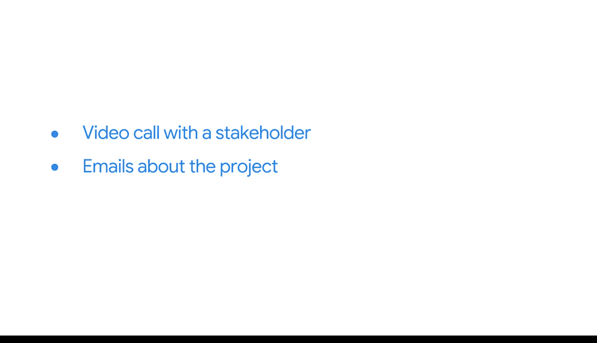

# 谷歌《谷歌商业智能（BI基础、洞察路线：模型和pipelines、决策：数据看板）｜Google Business Intelligence》 p102 23_03_02_完成仪表板项目.zh_en -BV1yJ4m1V7W9_p102-

Creating a dashboard is a collaborative process between the BI professional and stakeholders。

I like to compare it to an elaborate dance among talented partners that require skill。

 communication and practice。Coming up， you'll focus on the practice part of the dashboard dance。

The next few lessons encompass a role play exercise。 similar to past courses。

 you'll learn from videos， readings， activities and quizzes。 However。

 you're also going to take on a whole new perspective。

 You are a B I professional who has just been given a new project。

 The first video you'll encounter will be a simulated video call with your stakeholder。

 You will actually interact with them but you'll experience the basics of a typical meeting to explore a B I project details。

 Then you will proceed to readings or emails in this role play setting to get more context about the project in hints about how to proceed。

😊。

These emails will be similar to the ones you receive from stakeholders and supervisors in a professional setting。

All of these elements will enable you to complete activities and produce deliverables。

The goal of this exercise is to practice applying your decision making and design skills。

Some of the instructions may be open ended and require you to try out different approaches。

Rather than being directed through each click to make a predetermined chart in Tableau。

 you'll be asked to design a chart that matches certain parameters。

The guidance you receive will focus on how to meet stakeholder needs rather than how to use the program itself。

 You may develop something， then decide that it could be improved on or that it doesn't adequately meet expectations。

 That's great。 You're encouraged to practice trial and error。 That's a big part of B， I。

 but you won't be completely on your own。 Readings will come from your supervisor and clients who will offer clues in redirection about their expectations。

Immerse yourself in the B I professional role and envision your future in this field。

 Explore each step at your own pace and try all kinds of different strategies as you plan。

 build and iterate on your dashboard。 While this exercise consists of fictional details and practice data。

 you'll gain some awesome business insight as you complete it。 Have fun。😊。

