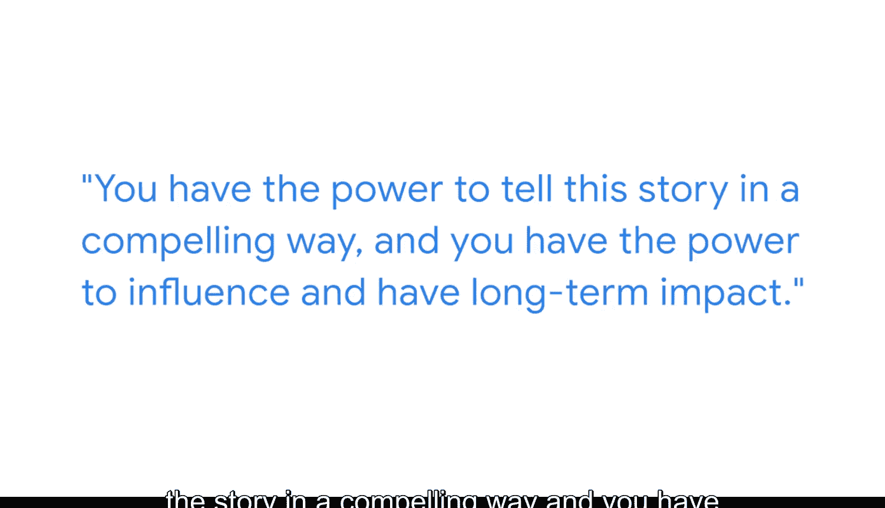

# 谷歌《谷歌商业智能（BI基础、洞察路线：模型和pipelines、决策：数据看板）｜Google Business Intelligence》 p103 24_03_04_安德烈亚-商业智能专家的力量.zh_en -BV1yJ4m1V7W9_p103-

I'm Andrea， I'm a senior data analytics Ana in my job I have the power to make recommendations to senior leadership and to influence their decision making process by going into the data。

 processing it and trying to make sense of what I'm looking in the numbers。My users。

 my clients are financial analysts or financial managers that need to use the finance data that I'm producing to make their decisions。

 create the reports， and then translate those analysis into actions that are gonna influence how Google is going to look like in the future。

 I use business intelligence tools every day。 I mostly use SQL and Python SQL to create a large data sets that I work with Python to make sense of those data sets and do some statistical analysis and then create a story that then I'm going to share with my leadership。

 but a few times I get to use dashboards When I use dashboards。

 I make sure that the visualization I'm creating。 It looks nice。 It's pretty。

 but at the most important thing is that the story that I'm doing is compelling and it's easy and fast to understand because my audience doesn't have time once you can make sense of the data and come back to your audience and explain the story and share with them what you're seeing but at the same time。

 proposing some。commendationsThat's when the job gets really exciting。

 you as a business intelligence analyst， you are the one going into the data。

 you are the one spending hours looking at this data set so no one else is going to know the answer better than you and no one else is going to be able to put this story as you wanted to put it so I will say it really gives you a lot of power when you know what's going on looking into the data And when you go back to your audience and you're making a recommendation or a proposal。

 you have the power to tell this story in a compelling way and you have the power to influence and have longterm because your decision makers are going to use your inputs to then make a decision that is probably going to last for five10 years。

