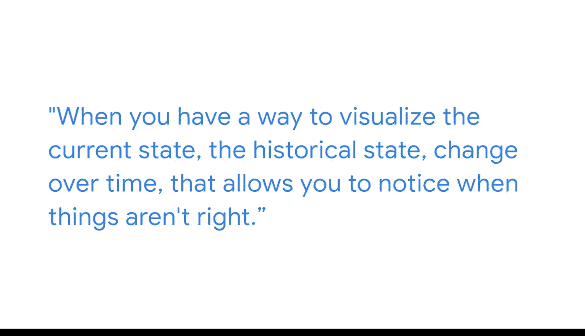

# 谷歌《谷歌商业智能（BI基础、洞察路线：模型和pipelines、决策：数据看板）｜Google Business Intelligence》 p106 27_03_02_埃里卡-商业智能工具的实际应用.zh_en -BV1yJ4m1V7W9_p106-

Hi， my name is Erica。 I'm a technical program manager at Google。

 I had a bit of a winding career journey going from flying planes to。😊。

Data analysis to now where I'm at as a technical program manager。

 I went to the Naval Academy for my undergrad degree。

 and after that I went on to be a Navy pilot flying P3 Orions， transitioning out of the military。

 there was a lot that I still needed to learn about business intelligence。

 data analysis and so as I entered my new job after the military。

 I did a lot of that learning on my own。 so I really utilized online resources， YouTube。

 and a lot of just trying things out and learning you know by playing around with different systems。

 I think it was intimidating for sure to have to learn these new skills quickly and to be able to deliver on what I needed to for my job。

But I think I， over time， you kind of embrace that those nerves and you learn that。I can do this。

 I can learn this new skill。 I can ask for help。 So for one of the projects that I'm working on now。

 we have a dashboard that tracks engagement with with this system that we've created Dashboards are a way to visually present information and allow others to draw insights from it。

 imagine if you didn't have a dashboard and you were just presenting people with a table of data。

 It would be very hard for them to draw any useful insights。

 especially someone maybe a leadership who doesn't have time to kind of dig through data themselves。

 So you're presenting it in a way that's useful and allows people to quickly draw insights or maybe even interact with it by changing some filters and understand what they need to know about that data。

 So we're looking at a historical trend over time seeing how engagement in our case has been increasing over time。

 and maybe some dips when different things happened throughout the life of this new system And so that allows us to。

😊，Gain insights and understand maybe what we could do to。Increase engagement。

 I think when you have a way to visualize the current state。

 the historical state change over time that allows you to notice when things aren't right。

 And so if if it's just kind of raw data in a spreadsheet or in a table。

 you might not be able to easily gain that insight and you might miss something。

 something that is impacting your program or whatever it is your product that you wouldn't catch unless you are visualizing the data in a way that allowed you to notice those discrepancies。

 every dashboard is going to have a different goal I would say so there's probably for whatever project or program or whatever the purpose of the dashboard is。

 there's probably some key performance indicators that you're going to want to be tracking on the dashboard and typically you'll know what those are based on。

The questions that you get asked frequently about the data or about the program。

 I really love making dashboards because I think it's so rewarding when you're creating something that's useful to many people and allowing them to be more effective in their jobs I was looking for a job that kept me challenged that was probably my number one criteria that I was looking for and I've definitely found that here where I'm just constantly learning talking to experts in their fields every day and it's really something that I'm grateful for。

😊。

