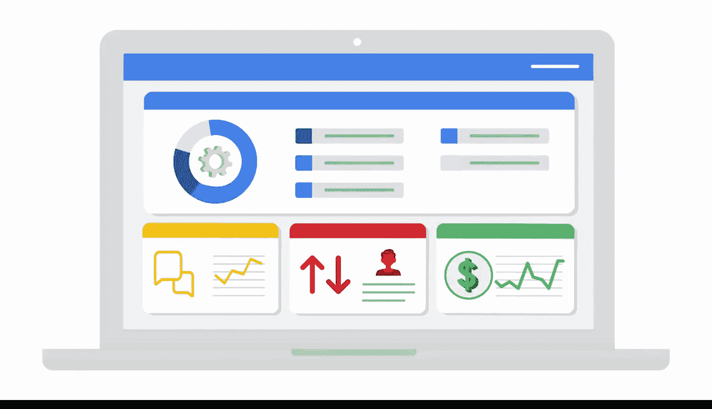

# 谷歌《谷歌商业智能（BI基础、洞察路线：模型和pipelines、决策：数据看板）｜Google Business Intelligence》 p107 28_03_01_结构清晰的仪表板.zh_en -BV1yJ4m1V7W9_p107-

In the last lesson， you created charts for the dashboard you're designing for the Minnesota Department of Transportation。

 Now， it's time to build the dashboard itself。 As you've learned。

 it's important to apply best practices when organizing dashboard elements。

 This ensures they're laid out in a logical manner and that you've constructed a clear visual flow。

 Feel free to review the lessons about dashboard design before you continue。As a reminder。

 you'll want to place the most relevant visualizations at the top of the dash。

 then use hierarchy and contrast to emphasize supporting elements。

And be sure to consider how to incorporate negative space between charts。

 You'll likely find that your dashboard design experience will depend on the choices you made in the previous activity。

For example， if you created many charts to describe Minnesota's interstate traffic。

Then you'll have more elements to balance。 This is an example of yet another trade off。

More visualizations enable you to display more data。

 but you risk overwhelming the client or slowing down the dash。

 Use your best judgment to identify the most effective outcome。

It's also possible that a chart you thought you needed isn't really necessary。

 or that you're missing a chart that's required to answer one of the business questions。If so。

 simply return to the chart building phase and make the adjustments， as you know。

 building a dashboard is an iterative process， so you can always change direction as you progress。

Just like before， if you have any trouble， refer to the reading to get hints from your supervisor。

 Okay， now it's time to get building。