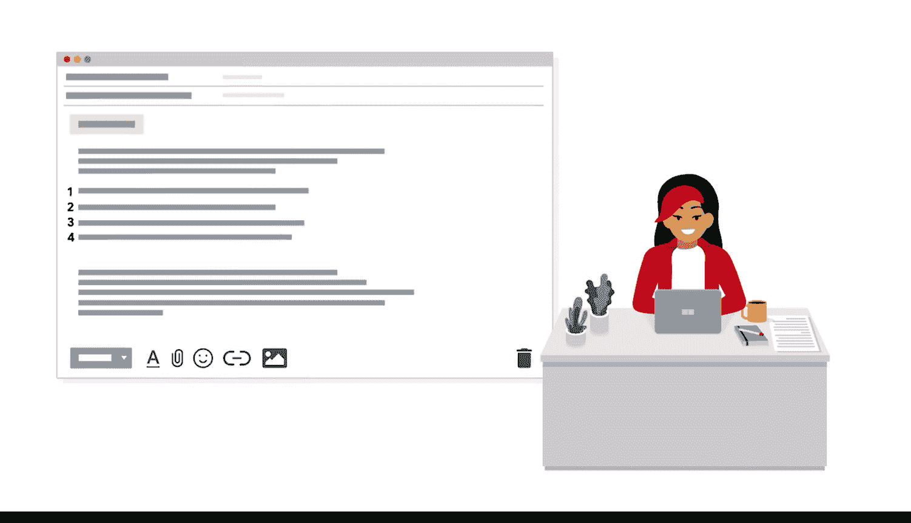

# 谷歌《谷歌商业智能（BI基础、洞察路线：模型和pipelines、决策：数据看板）｜Google Business Intelligence》 p108 29_03_01_仪表板迭代优化.zh_en -BV1yJ4m1V7W9_p108-

By now， you've created a dashboard to track traffic volume on the Minnesota Interstate。

 You've created charts and organized them into a powerful tool that your clients can use。

 You've also learned about the kinds of questions you should ask while creating a dashboard。 Now。

 in this video， we'll explore iteration。😊，We've covered many typical iterative improvements。

 including changes to aesthetics， design approaches， processing speed， privacy permissions。

 and many more。There are all kinds of ways to refine a dashboard during iteration。 Fortunately。

 for you， your client， the Minnesota Department of Transportation。

 has clearly explained their feedback on your dashboard。

 They've sent you an email with notes about your work。 The feedback is very positive。

 but there's still some work to do。 Turns out another member of the team Want some new features added to the dash。

 It'll be up to you to figure out how to best implement them。😊。

There might be several ways to action this feedback。

 such as editing an existing graph or creating a new one。

You may need to explore the data set again and pre aggregateate it with SQL。

Or it's possible that their request is inappropriate for the project。 If so。

 you'll need to be able to justify why you're unable to make the changes they've asked for。

As with all feedback， keep an open mind about the stakeholders's ideas。

Even when you're confident in your work， it's always possible to learn something new。

Good luck on the last phase of this role play exercise， have fun with it。

