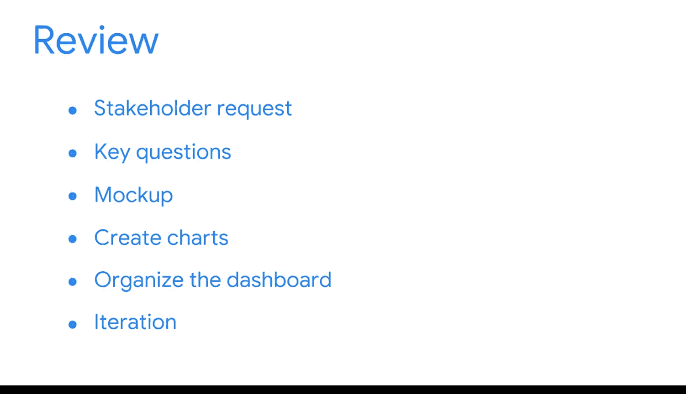

# 谷歌《谷歌商业智能（BI基础、洞察路线：模型和pipelines、决策：数据看板）｜Google Business Intelligence》 p109 30_03_01_总结回顾_3.zh_en -BV1yJ4m1V7W9_p109-

Congratulations on taking a practical hands on approach to a B I solution request。

 You've now played the role of a B I professional， applying your knowledge of dashboards and stakeholder needs to a realistic work situation。

 While the scenario took place within a learning environment。

 It contained several components that you will find in a professional setting。

 A stakeholder requested that you build a traffic monitoring dashboard。

 you took the information they shared， then considered key questions and created a mock up to help you select your charts。

😊，Next， you created the charts， which involved evaluating the data set and deciding what information to showcase and how。

 Then it was time to organize the elements of your dashboard。

 Your stakeholders wanted a tool they could refer to for immediate insights。

 So you used your B I skills to fulfill that need。And finally。

 you receive feedback in iterated on your dash。 This involved thinking about whether the requested changes were feasible and made sense within the context of the project。

😊。

Include this project in your portfolio to share with hiring managers during your job hunt。

 You're doing a great job demonstrating all of your hard work。

