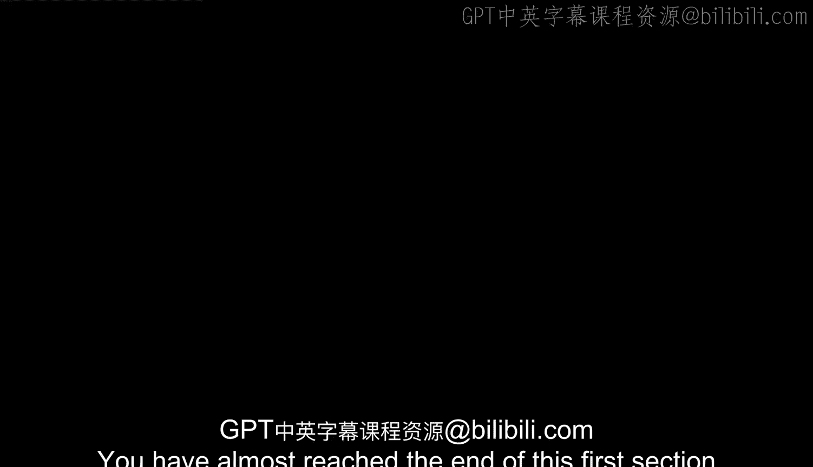

# 谷歌《谷歌商业智能（BI基础、洞察路线：模型和pipelines、决策：数据看板）｜Google Business Intelligence》 p11 11_01_01_课程总结.zh_en -BV1yJ4m1V7W9_p11-

You have almost reached the end of this first section of the Google Business In certificate。 So far。

 you've been introduced to the exciting world of B learned about lots of potential careers and discovered the valuable contributions that B professionals make every day。

 You have also gained some key foundational knowledge about B strategy。

 as well as data maturity and how B processes and tools enable organizations to advance through higher maturity levels。

 We've covered a lot。 And I'm sure you have so much to think about already。 but that's a great thing。

 It means you've gathered data are considering all you've learned。

 and are beginning to monitor your own progress。 That's what intelligence is all about。

 this course continues， you'll keep building on the strong base you've created。 So。

 you' also discover how to tap into our diverse community of learners just like you in order to get the support you need along the way。

 As I noted earlier， Collaborating with others is a really great way to tackle challenges brainstorm。

😊，Solutions and pull resources， just like the team members who partner with B I professionals。

 they share their career goals and in which field they hope to apply their B I skills。

 It's a great place to just meet and network with other people who are also interested in B I。

 I hope you'll take some time to engage with other learners。

 It will make your experience more fulfilling and fun。😊。

Congrats again on all the progress you've made thus far。 Awesome job。

