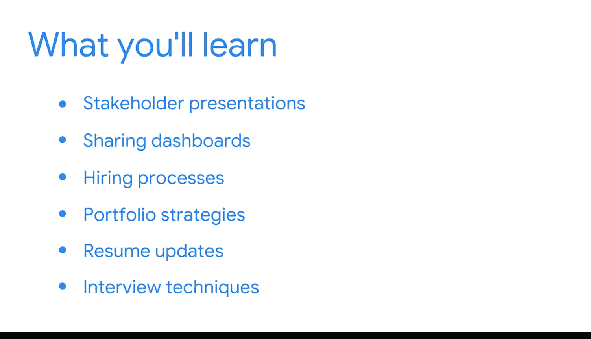

# 谷歌《谷歌商业智能（BI基础、洞察路线：模型和pipelines、决策：数据看板）｜Google Business Intelligence》 p110 31_04_01_欢迎来到模块4.zh_en -BV1yJ4m1V7W9_p110-

As you're discovering， working as a business intelligence professional involves many technical skills。

 These include things like knowing how to identify the right data。

 metrics and Kpis for a particular project。Applying data modeling and pipelines to organize and move data。

 transforming data into a usable form， using that data to solve problems and answer questions。

 and making visualizations and dashboards that drive business processes and goals。

But BI also requires excellent communication and presentation skills After all。

 if you want your hard work to really make an impact。

 it's important to know how to effectively share it with others。

Successful BI professionals can clearly demonstrate how the tools they create enable their clients to meet business objectives。

 Plus， this is also important for your career advancement。

 having strong communication and presentation skills can help you excel。

 whether you're interviewing for a job， discussing a promotion or asking a supervisor about a new training or educational opportunity。

😊，During the next few lessons， we're going to concentrate on these key workplace skills。

 They are an essential complement to all the technical knowledge that you've gained so far in this program。

 First， you'll explore stakeholder presentations and sharing dashboards with clients。

 Then you'll shift your focus to the B I hiring process and strategies for refining your portfolio。

 In addition， you'll have the opportunity to update your resume for the B I field So it clearly communicates all of your new experiences。

😊，And finally， you'll review interview techniques that will help you demonstrate your skills to recruiters and hiring managers。

Each of these lessons will prepare you to take your BI career to the next level。

 so let's get moving on your exciting professional journey。

