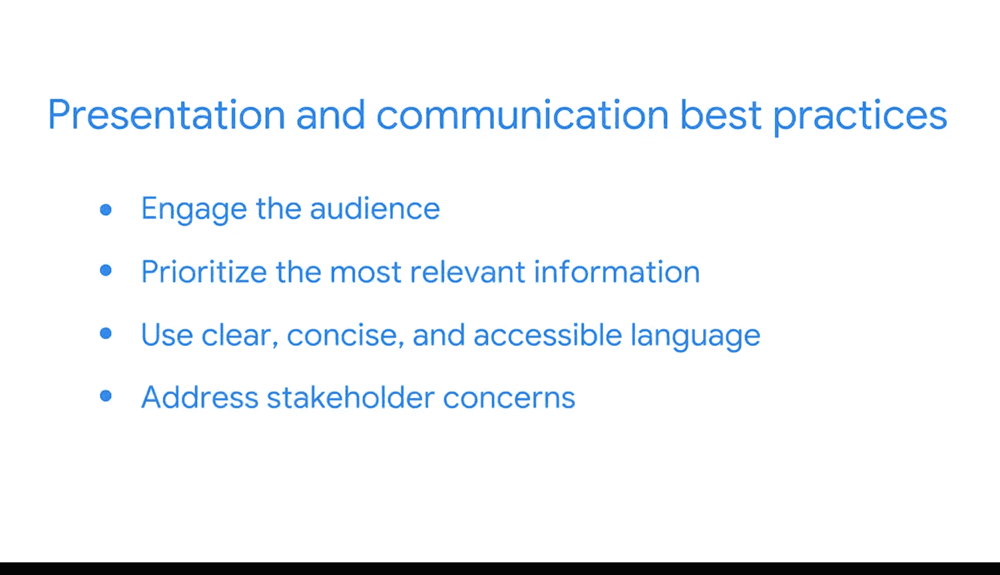

# 谷歌《谷歌商业智能（BI基础、洞察路线：模型和pipelines、决策：数据看板）｜Google Business Intelligence》 p111 32_04_02_呈现数据洞见.zh_en -BV1yJ4m1V7W9_p111-

In this course， you've learned that the steps of a BI project aren't always linear。 time passes。

 problems change， questions are refined。 There's constant evolution。

 and presenting and communicating about project updates is a key part of this process。

If you earned your Google Data Analytic certificate。

 you spent a lot of time learning about presentation and communication skills。In that context。

 you worked on data storytelling， creating compelling slideshows， public speaking strategies。

 responding to feedback and questions from clients and more。In the world of B I。

 the concept of presenting is a bit different。 So let's begin by clarifying what's meant by presentation in B I。

 People often think a presentation has to happen in a conference room。

 but many B I presentations are simply email threads。 with this in mind， going forward。

 Think of a B I presentation as any time you communicate with stakeholders about their needs or project status。

Note that this doesn't include answering questions or giving clarification about minor project details。

Presentations are a bit more formal， even if they're in the form of an email。

Whether your stakeholders will receive your project updates in their inboxes， on a phone call。

 at a meeting or a mixtureer of these is something you should confirm early when verifying project scope and deadlines。

And no matter which format you're using， always follow presentation and communication best practices。

 This includes engaging your audience by taking the time to understand their point of view。

Think about their stake in the project and what they hope to gain from the data insights that you deliver。

Next， be sure to prioritize the most relevant information。

 This means starting with high level updates first。

 whether that's something about your current progress， a recent change or your plans for next steps。

 Use clear， concise and accessible language。 An effective BI professional recognizes that some people will have used a dashboard before。

 but that's not often the case。Even though B I is a technical realm。

 it's wise to avoid using too much technical jargon。 Explain your work as simply as possible。

 This is another example of the importance of empathizing with your audience。

I find that it's important to tailor the words and level a detail for each particular audience。

 For example， I know executives with technical backgrounds who are going to want me to get deep into the details。

 while others just want the bottom line。 Lastly， if a stakeholder shared a concern with you in the previous meeting。

 it's important that your next presentation describes how you addressed that issue。

 And be sure to confirm that they're satisfied with your plan going forward。

The first time you present to your stakeholders will likely be when sharing your low fidelity mockups。

 As you've learned， these sketches give everyone a clear idea of your design intentions。

 and they're essential to getting necessary feedback。😊，Typically。

 you'll have an initial call or email when you ask if the idea you're presenting meet stakeholder goals。

And because the mock up stage is early on in the design process。

 you can take in people's ideas and suggestions， then if necessary。

 easily move in a new direction before you invest hours in bringing your mock up to life on an actual dashboard。

Later。You'll share your functional dashboard with your users。 First and foremost。

 this involves explaining how to use it。 Even the clearest and most intuitive dashboards deserve explanation here。

 you might provide a live demonstration， or you could create a slide deck about how to interpret the visuals and change the settings。

Lastly， you're now aware that the majority of dashboards are constantly evolving tools。

 so they don't necessarily have a final state。 Just keep presenting updates on recent changes or new opportunities that have been identified。

Then you'll be able to successfully collaborate with stakeholders and keep your dashboards as fresh and helpful as possible。

