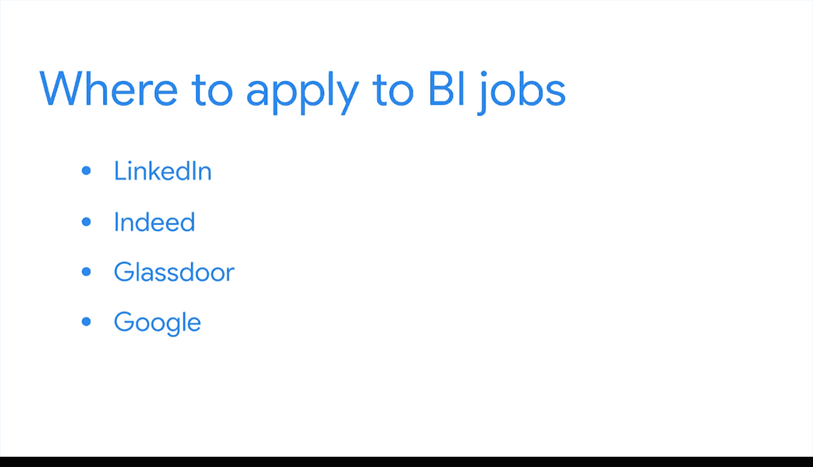

# 谷歌《谷歌商业智能（BI基础、洞察路线：模型和pipelines、决策：数据看板）｜Google Business Intelligence》 p112 33_04_01_商业智能专业岗位招聘流程.zh_en -BV1yJ4m1V7W9_p112-

Hi， it's great to be back with you to continue learning about the BI profession。

So far in this section， you've learned how to share your work and insights with your stakeholders during a project。

 Now you will apply those same presentation skills to your career advancement。

 If you haven't met me yet， I'm Anita， a senior business intelligence analyst at Google。😊。

The job search can sometimes feel difficult in time consuming。

 I encourage all of my candidates to stay positive if they don't get the first role they interview for。

 It's not uncommon for a person to interview for many different roles before they finally find the right match。

 understandingstand how the B industry works will help you navigate your job search。

 The first thing to know is that B is everywhere。 in every industry。

 companies need business intelligence to make informed decisions。

 Whether you have a passion for health care， finance， human resources。

 Re education construction or anything else。 There's a B job for you。

 You can begin searching for a B job by narrowing your criteria to a specific industry。

 Your query could be business intelligence， health care or business intelligence finance。

 If you don't have a preference。 you can search more generally by trying entry level business intelligence。

 The second thing to know is that there are a few specific titles that a B I professional can have。

 typicallyy an entry。😊，Level or early career B professional will be called a business intelligence analyst。

 You may also encounter junior or assistant business intelligence analyst Jo offers with this title may expect anywhere from 0 to three years of experience。

 However， if a B I job asked for more years of experience than you have， you should apply anyway。

 As long as your skill set matches the job description。

 It's worth applying with a strong portfolio and resume， you may be a great candidate。

 even if you don't have a lot of experience。 If you're looking for a job in a specific industry。

 The job listing may ask for skills or knowledge related to that field。

 You can research job opportunities in your industry of interest to find which additional skills you should develop where exactly should you apply to B jobs。

 you can find listings on any job searching site such as LinkedIn Indeed or Glasdo。

 and a quick Google search can help you find some more recent job opportunities。

 through these sites or the company's specific forms， you'll be able to fill out。😊。

Job applications and share your resume and portfolio otherwise。

 you can email the position's hiring manager to apply。If you do get a response to your application。

 you'll likely interact with a recruiter or hiring manager。

 They may reach out to you with an email or phone call to schedule an interview。 If so。

 congratulations， you can prepare by researching the company if you haven't already and rehearsing for your interview。

 Some organizations may contact you for multiple rounds of interviews。

 especially if they received a lot of applications。

 you may be asked to describe the projects in your portfolio or complete a short B related exercise kind of like the activities you've been doing in this program。

 Once you complete your final interview， the waitinging begins。 Arrguably， this is the hardest part。

 but you can make them most of this time。 First， you should follow up by thanking the interviewer。

 you can also apply to more jobs and work on refining your B skills。 Hopefully。

 you will soon have an exciting new opportunity。 now that you know what to expect from the B hiring process。

 It's time to prepare your application materials。😊，This includes your BI projects。

 portfolio and an updated resume then you'll learn more about interview techniques to help you get hired for your first BI position。

😊。