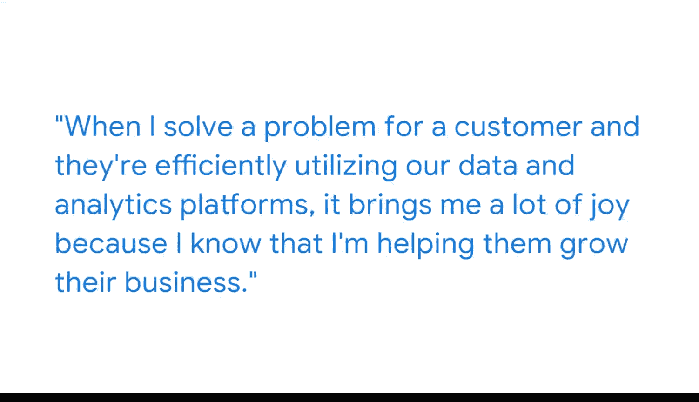

# 谷歌《谷歌商业智能（BI基础、洞察路线：模型和pipelines、决策：数据看板）｜Google Business Intelligence》 p113 34_04_03_希瑟-个人商业智能职业发展历程.zh_en -BV1yJ4m1V7W9_p113-

🎼Hi， my name is Heather， and I am a data and analytics sales specialist。

 I was a waitress in New York City for many years， I。😊，Do not have a bachelor's degree。

 And my grandfather was able to work his way up in business。 And as a child。

 he told me I could do the same。 So I did that。 I always thought that finding my voice in an organization starting small and working my way up。

 That industry for me just happened to be the technology industry and where where I fell。

 I took internships for free， and then I'd waitress at night。 I would search on LinkedIn。

 I would friend people on LinkedIn and ask them to have a conversation with me and introduce myself to them。

 and say， hi， I'm Heather。 you know， these are the things I'm good at。 I'm good with people。

 I'm good with numbers。 I know how to use computer systems。 I can be an asset on your team。

 And I probably did that over and over again for about three years。

Until I landed my first job in tech， I think being a server or being a waitress or a bartender and anybody in any kind of restaurant industry has really wonderful transferable skills to land a job in business intelligence。

 I have a lot of clients， I work with a lot of partners， and I also work with a lot of team members。

 The skills that I learned working in the service industry， especially in New York City。

 is being able to multitask， have a lot of tables at once， being able to remember your orders。

 being really kind to your regulars。 So， you know， my customers。

 I view them as my regulars just as I did when I bartended 10 years ago。

 making sure that they're happy。 You know， how many times do you go to a restaurant and something isn't right。

 And if the server gives you a tough experience， while， you're gonna remember that。 Now。

 working in business intelligence， I have a solutions architect that I work with。

 I have a customer engineer， I work with and other partners。😊，To help me rally around a customer。

 when I solve a problem for a customer and they're efficiently utilizing our data and analytics platforms。

It brings me a lot of joy because I know that I'm helping them grow their business。

 I had maybe 6 or 7 hours worth of video calls that， you know。

 and I was really on a roll with each one。 And I was understanding the their problems。

 I was able to talk about our products in a technical。😊。

Effective way。 And it made me feel so happy when I was able to communicate that way with my customers。

 with my extended team。 So just don't be hard on yourself and don't be。

 don't be scared to ask people questions。 Don't be scared to connect with people on LinkedIn and ask for a conversation to introduce yourself。

 People don't do that anymore。 So set yourself apart and put yourself out there。😊。

