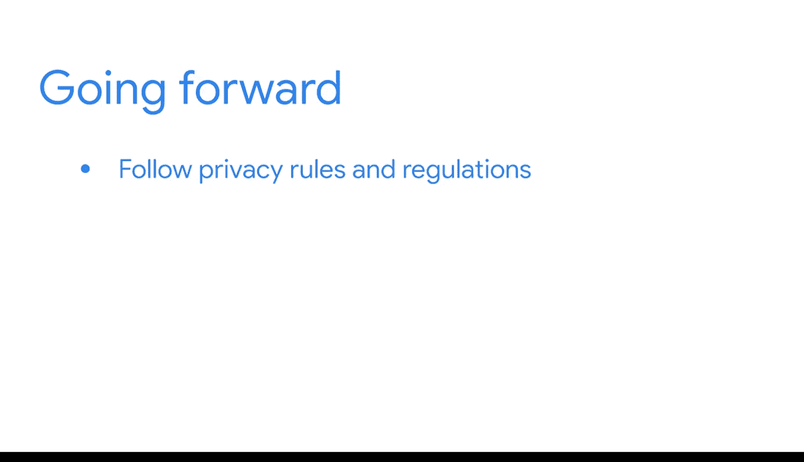

# 谷歌《谷歌商业智能（BI基础、洞察路线：模型和pipelines、决策：数据看板）｜Google Business Intelligence》 p114 35_04_04_将商业智能作品纳入作品集.zh_en -BV1yJ4m1V7W9_p114-

If you've earned your Google data Anatic certificate or completed any non BI data projects。

 you may already have a portfolio as a reminder， a portfolio is a collection of materials that can be shared with potential employers It's the part of your job application with the evidence of your accomplishments If you don't have a portfolio yet its time to make one This is a shareable。

 accessible way to showcase your work which can give you an advantage over other candidates。

 Also a wellrounded portfolio demonstrates your background and non-data industries and the transferable skills you've gained Portfos enable you to share project planning documents。

 dashboards， presentations and any other assets that will help demonstrate your skills You can host your portfolio on your own custom website or use an existing data sharing platform sites such as GitHalber Caagle that you may have used for sharing data can be used to link out to dashboards。

 Tableau also has a social platform and sharing capability。😊。

Once you pick a platform or multiple platforms to host your portfolio， you can add your projects。

 choose whether to represent your projects by including your data， screenshots of your dashboard。

 the embedded dashboard itself， or all of the above you can include a link to access your dashboard on Tableau when you've included all the relevant parts from your project in your portfolio。

 Ex your process De your thought process， what work you did and what you might do differently in the future。

It also helps to include a short biography by describing your professional goals and interests you can personalize your portfolio and make it stand out Now there's one very important thing to keep in mind some projects you work on may deal with private data so it's critical to make sure that you follow your employers rules and regulations for data sharing in cases where you cannot share any data or visuals from your project you can include a summary of what you did in your portfolio which details you can share may be up to your employer。

 but it's still important to document the roles you had on each project you were a part of Now it's time to create or update your portfolio this will be a process you go through periodically throughout your career。

