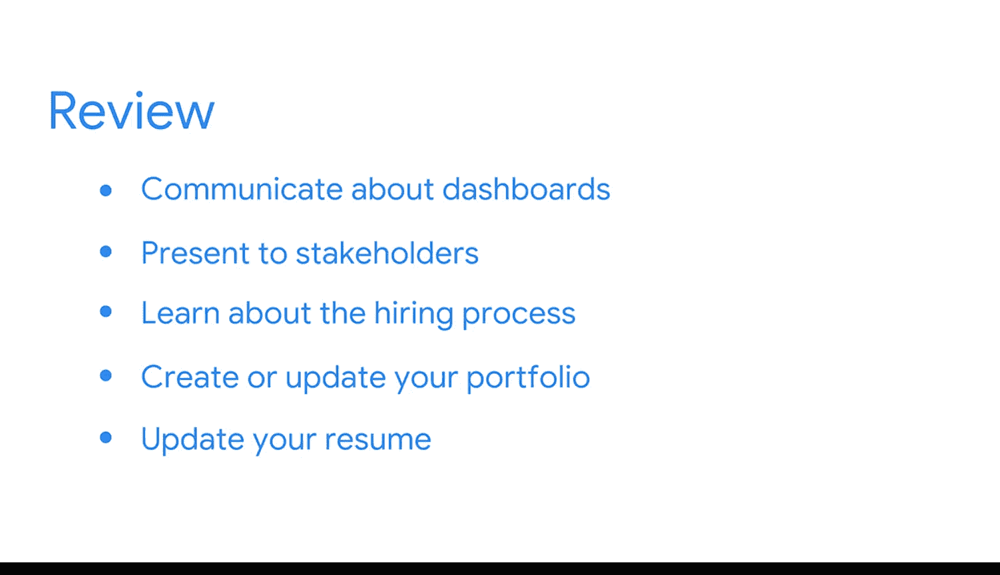

# 谷歌《谷歌商业智能（BI基础、洞察路线：模型和pipelines、决策：数据看板）｜Google Business Intelligence》 p115 36_04_01_总结回顾_4.zh_en -BV1yJ4m1V7W9_p115-

Hi there。 It's Terrence again。 Now， it's time to wrap up this section and move on to your graded assessment In your future B I role。

 communicating your insights and accomplishments will be an essential skill。😊。

It's important to explain to recruiters， hiring managers， coworkers。

 and employers how you worked on your projects。For example。

 you learn the value of communication and presentation skills when sharing your dashboards with stakeholders。

Then you focused on preparing for your career in B I。

 You learned about the hiring process and how to look for a job， then worked on your portfolio。

 The skills you learned while creating presentations can help you update your portfolio with your latest B I achievements。

After that， you updated your resume to reflect the skills you developed during this program。

 and finally， you learned some interview tips to prepare you for your job search。 By now。

 you're well on your way to start applying for jobs。😊。

You've made significant progress in this course， congratulations。

