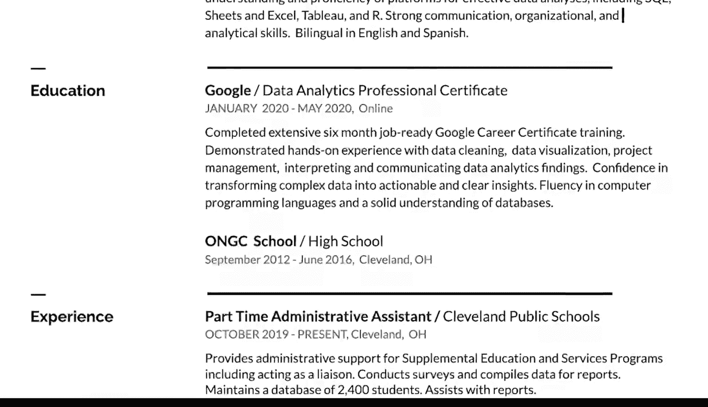

# 谷歌《谷歌商业智能（BI基础、洞察路线：模型和pipelines、决策：数据看板）｜Google Business Intelligence》 p117 38_04_02_可选复习-谷歌数据分析证书关于创建演示的内容.zh_en -BV1yJ4m1V7W9_p117-

Great， you're back。 When you take a picture， you usually try to capture lots of different things in one image。

 Maybe you're taking a picture of the sunset and want to capture the clouds。

 the tree line and the mountains。 Basically， you want a snapshot of that entire moment。

 You can think of building your resume in the same way。

 You want your resume to be a snapshot of all that you've done both in school and professionally。

 In this video will go through the process of building a resume。

 which you will be able to add your own details to。 Keep in mind， This is a snapshot。😊。

So when managers and recruiters look at what you've included in your resume。

 they should be able to tell right away what you can offer their company。

 The key here is to be brief。Try to keep everything in one page and each description to just a few bullet points。

2 to 4 bullet points is enough， but remember to keep your bullet points concise。

 Sticking to one page will help you stay focused on the details that best reflect who you are or who you want to be professionally。

One page might also be all that hiring managers and recruiters have time to look at。

They're busy people， so you want to get their attention with your resume as quickly as possible。Now。

 let's talk about actually building your resume。 This is where templates come in。

 They're a great way to build a brand new resume or reformat one you already have。😊。

Programs like Microsoft Word or Google Docs and even some job search websites all have templates you can use。

 A template has placeholders for the information you'll need to enter and its own design elements to make your resume look inviting。

You'll have a chance to explore this option a little later for now。

 we'll go through the steps you can take to make your resume professional。

 easy to read and error free。If you already have a resume document。

 you can use these steps to tweak it。Now， there's more than one way to build a resume。

 but most have contact information at the top of the document。 This includes your name， address。

 phone number and email address。If you have multiple email addresses or phone numbers。

Use the ones that are most reliable and sound professional。

It's also great if you can use your first and last name in your email address like Janeindo 17@e。com。

You should also make sure that your contact information matches the details that you've included on professional websites。

And while most resumes have contact information in the same place。

 it's up to you on how you organize that info。 a format that focuses more on skills and qualifications and less on work history is great for people who have gaps in their work history。

 It's also good for those who are just starting out their career or making a career change。

 and that might be you if you do want to highlight your work history。

 feel free to include details of your work experience， starting with your most recent job。

 If you'd have lots of jobs that are related to a new position you're applying for。

 this format makes sense。😊，If you're editing a resume you already have。

 you can keep it in the same format and adjust the details。

If you're starting a new one or building a resume for the first time。

 choose the format that makes the most sense for you。There's lots of resume resources online。

You should browse through a bunch of different resumes to get an idea of the formats you think works best for you。

 Once you've decided on your format， you can start adding your details。

Some resumes begin with the summary， but this is optional。

A summary can be helpful if you have experience that is not traditional for a data analyst or if you're making a career transition。

 if you decide to include a summary， keep it to one or two sentences that highlight your strengths and how you can help the company you're applying to you'll also want to make sure your summary includes positive words about yourself like dedicated and proactive。

You can support those words with data like the number of years you've worked or the tools you're experienced in like SQL and spreadsheets。

A summary might start off with something like hardworking customer service representative with over five years of experience。

 and once you've completed this program and have your certificate。

 you'll be able to include that too， which could sound like this entry levelvel Data Analytics professionalf recently completed the Google Data Analytics professionalal certificate。

Sounds pretty good， doesn't it？Another option is leaving a placeholder for your summary while you build the rest of your resume and then writing it after you finish the other sections。

This way， you can review the skills and experience you've mentioned and grab two or three of the highlights to use in your summary。

It's also good to note that summary might change a little as you apply for different jobs。

If you're including a work experience section， there's lots of different types of experience you could add。

Outside of jobs with other companies， you could also include volunteer positions you've had and any freelance or work you've done。

The key here is the way in which you describe these experiences。

 Try to describe the work you did in a way that relates to the position you're applying for。

Most job descriptions have minimum qualifications or requirements listed。These are the experiences。

 skills， and education you'll need to be considered for the job。

So it's important to clearly state them in your resume。 If you're a good match。

 the next step is checking out preferred qualifications， which lots of job descriptions also include。

 These aren't required， but every additional qualification you match makes you a more competitive candidate for the role。

 including any part of your skills and experience that matches a job description will help your resume rise above the competition。

😊，So if a job listing describes a job responsibility as effectively managing data resources。

You'll want to have your own description that reflects the responsibility。For example。

 if you volunteered or worked at a local school or a community center。

 you might say that you effectively manage resources for after school activities Later on。

 you'll learn more ways to make your work history work for you。

It's helpful to describe your skills and qualifications in the same way。For example。

If a listing talks about organization and partnering with others。

 try to think about relevant experiences you've had。

Maybe you've helped organize the food drive or partnered with someone to start an online business。

In your descriptions， you want to highlight the impact you've had in your role。

 as well as the impact the role had on you。If you helped a business get started or reach new heights。

 talk about that experience and how you played a part in it。

Or if you worked at a store when it first opened， you can say that you helped launch the successful business by ensuring quality customer service。

 If you use data analytics in any of your jobs， you'll definitely want to include that as well。

We'll cover how to add specific data analysis skills a little bit later。

One way to do this is to follow formula in your descriptions。

Accomplished x as measured by y by doing Z。Here's an example how this might read on a resume。

Selected as one of 275 participants nationwide for this 12 month professional development program for high achieving talent based on leadership potential and academic success。

And if you've gained new skills in one of your experiences。

 be sure to highlight them all and how they helped。

This is probably as good a spot as any to bring up data analytics。

Even if this program is the first time you really thought about data analytics。

 now that you're equipped with some knowledge， you'll want to use that to your benefit。

So if you've ever managed money， maybe that means you help the business analyze future earnings。

 or maybe you created a budget based on your analysis of previous spending。

Even if it was for your own or a friend's small business， it's still data that you've analyzed。

 Now you can reflect on when and how and use it in your resume。

 After you've added work experience and skills， you should include a section for any education you've completed。

 And yes， this course absolutely counts。You can add this course as part of your education。

 and you can also refer to it in your summary and skills section。

Depending on the format of your resume， you might want to add a section for technical skills you've acquired。

 both in this course and elsewhere。Besides technical skills like SQL。

 you could also include language proficiencies in this section。

 having some ability in a language other than English can only help your job search。

So now you have an idea of how to make your resume look professional and appealing。

As you move forward， you'll learn even more about how to make your resume shine。By the end。

 you'll have a resume you can be proud of。Next up， we'll talk about how to make your resume truly unique。

 See you soon。