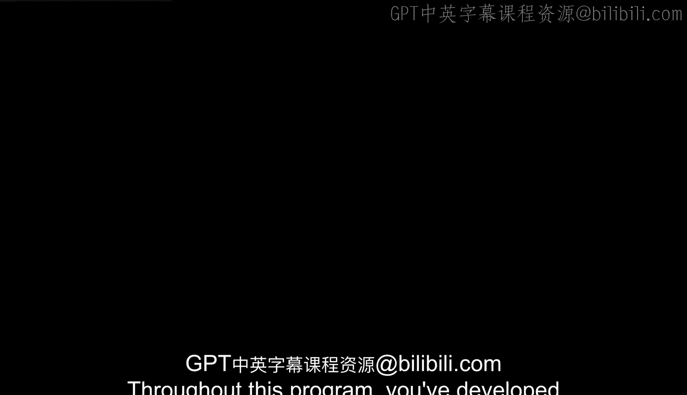
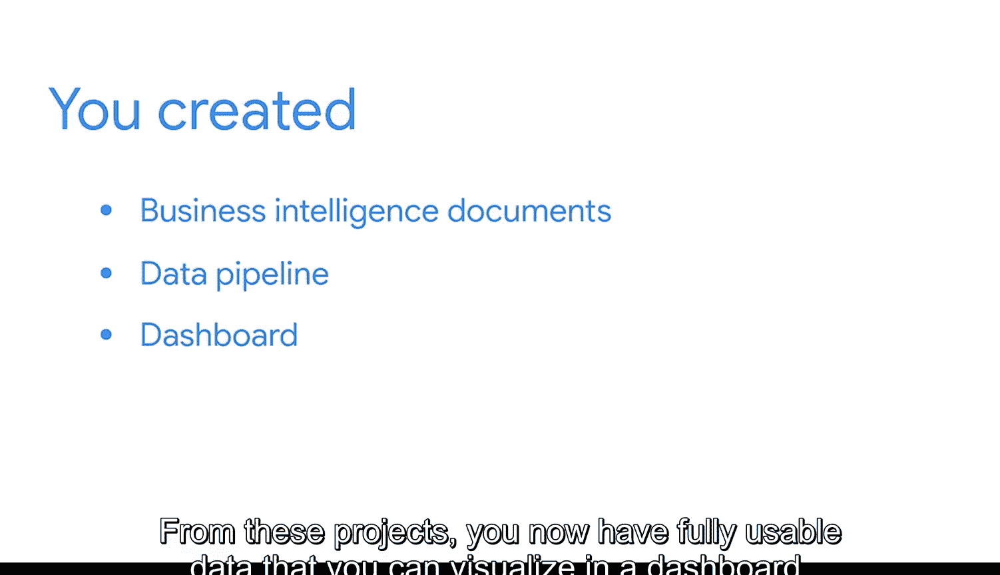

# 谷歌《谷歌商业智能（BI基础、洞察路线：模型和pipelines、决策：数据看板）｜Google Business Intelligence》 p118 39_05_01_欢迎来到模块5.zh_en -BV1yJ4m1V7W9_p118-

Throughout this program， you've developed essential skills in business intelligence。

 You also learned about the importance of building a portfolio that demonstrates your abilities and accomplishments。

 Now， it's time to return to your end of course project。😊，In earlier courses。

 you worked on a B project that you can showcase in your portfolio。

 You created key B documents and a data pipeline to practice producing deliverables for a business scenario From these projects。

 you now have fully usable data that you can visualize in a dashboard In this course。

 you learn how to plan， build and present dashboards equipped with these new skills。

 you can now complete your endof course project。 Now。

 you'll load those reporting tables into a visualization software to highlight important insights with a B dashboard。

 you'll continue to track your approach， methods， accomplishments and transferable skills so that you can add this information to your portfolio。

 When you finish this step of the project， you will have a complete end to end business intelligence case study。

 This will help you demonstrate your B knowledge during interviews and networking opportunities which will be essential to landing your first B job。

😊。

Future employers and business contacts will understand how hard you work to develop your skills as you begin this project。

 know that you can go at your own pace。 You can always refer to the lessons and resources in this program if you face a challenge or need help。

 Get ready for the next and final step of your end， of course project。

