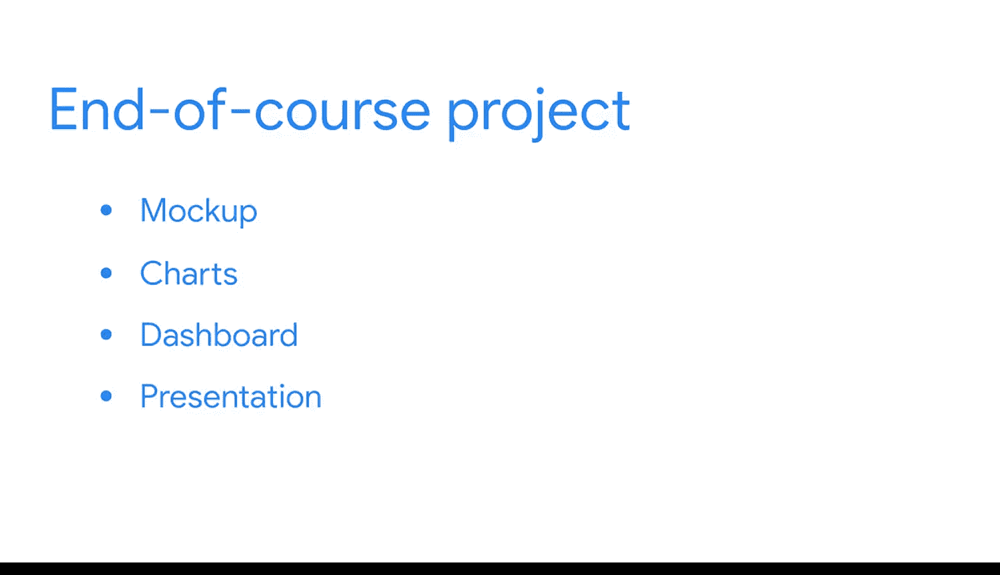

# 谷歌《谷歌商业智能（BI基础、洞察路线：模型和pipelines、决策：数据看板）｜Google Business Intelligence》 p119 40_05_02_完成期末课程项目.zh_en -BV1yJ4m1V7W9_p119-

。Hello now it's time to wrap up your business In End of course project so far you've completed your key BI documents。

 data pipeline and reporting tables from previous courses If you haven't finished these you can take some time to wrap up your work on those deliverables to be ready for this next stage otherwise you can use the exemplars provided for these projects to build your upcoming visualizations。

With your reporting tables ready to load into a visualization tool， such as Tableau。

 you're ready to move forward on your project。 you'll start with creating a mock up。

 Then you'll create your charts and organize them into a dashboard。 Finally。

 you'll develop your unique presentation style you can use when sharing the dashboard in your portfolio。

 The project is structured in this order。 But as always。

 you can go at your own pace and in the way you choose。

 You can read through the materials and then go straight from a mock up to a dashboard and then return to chart design specifics。

 you can even alternate back and forth between each step of the process。

 work in a way that fits your style。 Your dashboard artistry is completely your own。

 If you did the activities in this course， you've already completed each of these steps。

 None of this material will be new to you。 And if you get stuck， you can review previous lessons。

 This project continues the work that you started in previous courses。😊。

You'll use the skills you mastered along the way to guide you through the process。

 This will allow you to make your own B decisions and develop your skills independently so that you'll be ready when you encounter BI projects in the workplace。

 Once again， the readings in this section will contain the scenario for the case study。

 The business questions you need to answer and the instructions for what kind of visualizations you'll need to build。

 Now， it's time to get started。 read through the case study materials。

 Dec how to best design your dashboard and create your project and presentation and the visualization tool you choose。

 When you finish， you'll have your very own completed case study to show off to prospective employers。

 Enjoy working on your portfolio。😊。