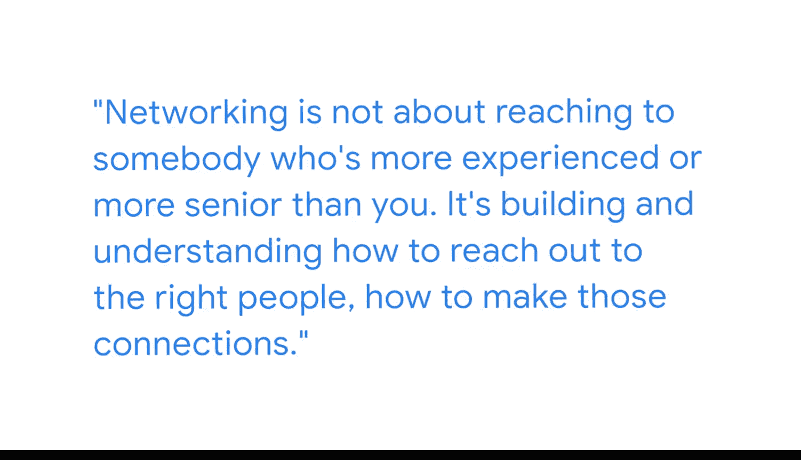

# 谷歌《谷歌商业智能（BI基础、洞察路线：模型和pipelines、决策：数据看板）｜Google Business Intelligence》 p12 12_01_03_加甘：建立专业联系.zh_en -BV1yJ4m1V7W9_p12-

My name is Gagan I am the director of data and analytics team in Fness my teams focus on data BI reporting and visualization solutions for our partners our job it is is to make data more useful。

So people can make good business decisions using that data so when I started my career I started in software development and there were no data teams at the time。

 there were no dedicated data science functions at the time if you asked my prior version from 20 years ago and imagined that where I would be I would have never imagined I'd be here at Google I would have never imagined I'd be doing this as a full- time job there were multiple individuals who were really good at a lot of different aspects of what makes a really good DI person if I'm working on a problem I talked to people I figured out over course of time working with different individuals。

For example I talked to one of my managers， she was really good at coding her SL code and how she wrote it and how well organized it was I learned so much from her I also worked with another individual in my career who was really good at organizing and understanding how to design metrics I met with another person who was really good at telling story through data。

So I had this opportunity of informal networking and working with these individuals who I really admired for what they brought to the table and learning from them over a course of time there are a lot of networking opportunities that have arisen there are lots of linkednkedIn groups。

 there are a lot of professional networks， perhaps where you're working。

 perhaps outside there are local chapters of BI data science analytics that you could be a part of。

 so I have over a course of time you know。The resources have changed and the resources that I've utilized have also changed。

 but I would say the early formative years of my BI experience data analytics experience。

 those individuals that I was able to understand and the specific skills that they brought to the table was very useful networking is not about reaching to somebody who's more experienced were more senior than you is willing and understanding how to reach out to the right people。

 how to make those connections if you。

Actually take the word networking out and say， what am I trying to do。

 it's actually building good professional relationships。And like any relationship。

 it's a two way street， what can you offer in that partnership。

 you might think you don't have anything to contribute and you are only trying to learn from the other individual。

They definitely might have more technical expertise or the experience behind them。

 but they do not have the life experiences， the domain expertise from where you are coming from。

 and they might value understanding where you are coming from and how you are trying to grow as well。

