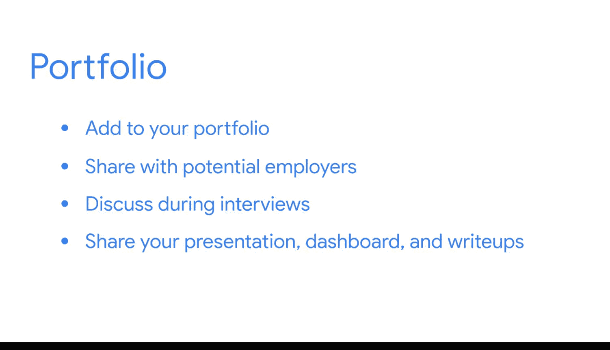

# 谷歌《谷歌商业智能（BI基础、洞察路线：模型和pipelines、决策：数据看板）｜Google Business Intelligence》 p120 41_05_01_课程总结.zh_en -BV1yJ4m1V7W9_p120-

Congratulations， you've completed the last component of your end of course project。

 This is a huge accomplishment that demonstrates all your hard work in this program。

 You finish this project on your own。 You applied your knowledge of business intelligence。

 data pipelines and dashboards to create something that truly demonstrates your growth as a B I professional。

 You can now include this presentation in your portfolio。

 Sha it with potential employers and discuss it during interviews。

 Share the presentation materials you made， the dashboard itself or the write up about the process you used and the choices you made。

 Idely， you'll show all of the above。 Each component illustrates your B I journey。 Now。

 you've completed the first step toward your B I career and reach the end of this program。

 and don't miss the next section。 which has a special message from some familiar faces to help you celebrate。

😊。

