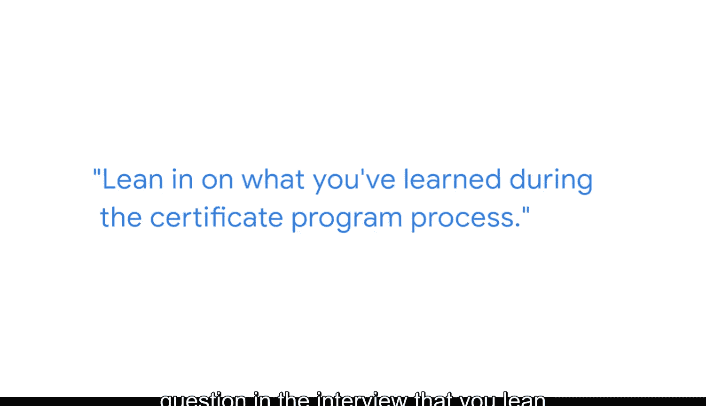

# 谷歌《谷歌商业智能（BI基础、洞察路线：模型和pipelines、决策：数据看板）｜Google Business Intelligence》 p121 42_05_02_托尼-职业发展策略.zh_en -BV1yJ4m1V7W9_p121-

My name is Tony and I'm a finance program manager here at Google for the last five years I interviewed financial analysts and a lot of financial analysts with a specific focus towards business intelligence and the thing that makes someone really stand out for me。

Is someone that has really strong communication skills and has got a really good ability to tell their story when you're in an interview and you don't have the previous work experience that demonstrates that you know how to use the tools that you may have learned in your data certificate or your business intelligence certificate this is where as an interviewee。

 you really have to just take charge of the interview so take advantage of questions that leave you the opportunity to dive in and really explain what you've learned and how you would apply it a lot of times an interviewer like myself。

 I'll open up a very generalized question to see where the interviewee will go whether they want to work with hard numbers from a financial standpoint or whether they want to take their response and start to talk about how they would use SQL or Python or R as a solution tool and maybe even carry me through some parts of that process of how they would go through putting that in place to solve the problem that we're talking about。

That is one really good way to say I'm connecting the dots between what I've learned recently and the job that I'm applying for without having the professional experience right there on your resume One thing that absolutely and strongly recommend someone not do is put themselves in a scenario where they cannot control the environment that is around them in an interview so a lot of our interviews right now are being conducted virtually。

It's very important that you're intentional about where you take your interview， I had one person。

 one time taking an interview out on a street corner outside of a cafe。

Very wrong having the best as much control about your space as you can is not just for me as the interview were。

 but it's also for you as the interview we where you can feel comfortable and confident and know that you're not going to get distracted in that setting one of the things I would really encourage you do is that in advance of the interview you take a look at all of the different projects and your analysis that you did through the certificate process organize a few of them that can be used for generalized questions now from my perspective as someone who's looking at entry levelvel folks and I'm really not concerned about the previous experience I want to see how you can articulate what you've learned。

😊，And so for me， it would be， if we can get into a little bit more technical question in the interview that you lean in on what you've learned during the certificate program process。

 Be confident in what you've learned。

And know that you've done enough to put you in the room， so take advantage of that moment。

